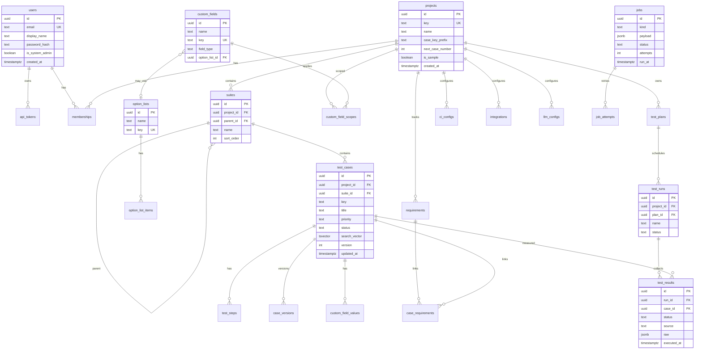

# Vulyk Architecture

Vulyk (Ukrainian for *beehive*) is an open-source test management system: cases and folders, plans/runs, CI ingest, requirements/ALM, reports, LLM assists, MCP, and Docker/Helm deploy.

This document describes the **current** system shape. Operator and user workflows live in [user-guide.md](user-guide.md) and [admin-guide.md](admin-guide.md). Full doc index: [README.md](README.md).

## Goals

| Area | Capability |
|------|------------|
| Repository | Projects (optional key, case prefix + monotonic counter), nested folders, cases with steps, tags, option lists + custom fields, versioning, key tombstones; UI URLs `/cases/{KEY}` |
| Execution | Plans, runs, step results, campaigns/iterations, attachments |
| CI ingest | GitHub / GitLab → JUnit / Playwright / pytest / Vulyk JSON; project CI tokens; multi-repo dispatch + webhooks (secrets required) |
| Traceability | Requirements + case links; OpenProject / Jira adapters |
| Reporting | Dashboards, trends, coverage, flaky, CSV/PDF; case PDF export |
| Admin | Users, RBAC, SSO, LLM, lists/fields, config export/import, content backups, in-app updates/rollback |
| Scale | Bulk ingest, Postgres FTS + `pg_trgm`, background jobs (`SKIP LOCKED`) |
| LLM / MCP | Multi-provider LLM; `vulyk-mcp` over the HTTP API |
| API | OpenAPI 3 (utoipa) + Scalar at `/api/docs` |

**Non-goal:** Do not open PRs or commits against OpenProject upstream. Document the integration contract only in this repo ([integrations/openproject.md](integrations/openproject.md)).

## Monorepo layout

```
backend/          # Rust API (Axum, Tokio, SQLx, utoipa)
frontend/         # React + Vite + TypeScript UI (PWA)
mcp/              # MCP server (rmcp), thin HTTP client of /api/v1
cli/              # vulyk CLI + result reporter
deploy/           # Docker, Kubernetes manifests, Helm chart
docs/             # Guides, architecture, audits
e2e/              # Playwright
scripts/          # install.sh, check.sh, helpers
action/ + ci/     # GitHub Action / GitLab helpers for result upload
```

## Module boundaries

```
┌─────────────┐   ┌─────────────┐   ┌─────────────┐
│  frontend   │   │  mcp server │   │  vulyk-cli  │
└──────┬──────┘   └──────┬──────┘   └──────┬──────┘
       │ HTTP/JSON       │ HTTP/JSON       │ HTTP/JSON
       └─────────────────┼─────────────────┘
                         ▼
              ┌─────────────────────┐
              │   backend (Axum)    │
              │  routes │ services  │
              │  importers │ llm    │
              │  integrations │ jobs│
              │  egress │ backup    │
              └──────────┬──────────┘
                         ▼
              ┌─────────────────────┐
              │  PostgreSQL 16+     │
              │  (+ jobs queue)     │
              └─────────────────────┘
```

| Module | Owns | Must not |
|--------|------|----------|
| `routes` | HTTP, auth extractors, OpenAPI | Business rules, SQL |
| `services` | Domain logic, transactions (cases, jobs, egress, backup, config_bundle, option_lists, custom_fields, case_export, …) | HTTP types |
| migrations | Schema | HTTP |
| `importers` | Pluggable import adapters | Persist without services |
| `integrations` | OpenProject / Jira / CI clients | UI concerns |
| `llm` | Provider trait + adapters | Unreviewed direct DB writes of generated content |
| `jobs` | Queue workers (ingest, import, LLM, backup, reclaim) | Sync long work on request path |
| `egress` | URL allowlist / SSRF guards for outbound HTTP and git | Bypass for “convenience” in prod |
| `mcp` | MCP tool surface | Second persistence path (call API) |
| `frontend` | UX | Bypass API for mutations |

## Data model (ERD)

Core entities (simplified). Additional tables cover SSO, CI configs/tokens, automation repos, option lists, scoped custom fields, content-backup destinations/policies, version-backup metadata, and audit events — see migrations under `backend/migrations/`.



## API conventions

- Base path: `/api/v1`
- Resources: plural nouns; IDs UUID in path; cases also by key
- Errors: `{ "error": { "code": "...", "message": "..." } }`
- Auth: session cookie or `Authorization: Bearer <jwt|session|api_token|ci_token>` — see [auth-and-rbac.md](auth-and-rbac.md)
- When auth is required, `VULYK_JWT_SECRET` must be a non-default value (fail-closed at boot)
- Pagination: `?limit=&offset=`
- OpenAPI: utoipa → `/api/docs` (Scalar)
- Health: `GET /health` (includes `version`), `GET /ready` (DB ping)

Major surfaces (non-exhaustive): projects/suites/cases, plans/runs, executions, ingest + CI reporting + webhooks, reports + case PDF export, requirements/integrations, importers, LLM, admin (sample data, lists, custom fields, config export/import, content backups, updates/rollback). Details: [api.md](api.md).

## Plugin interfaces

Importers, ALM integrations, CI triggers, and LLM providers remain trait-based adapters registered in the backend. See [integrations/](integrations/), [llm.md](llm.md), and [guides/ci-integration.md](guides/ci-integration.md).

## MCP

- Crate: `mcp/` (**rmcp**), stdio + Streamable HTTP
- Tools implemented: search/get/create/update cases, runs, results, ingest, `ask_tests` — see [mcp.md](mcp.md)
- Auth: `VULYK_API_TOKEN` (`vulyk_at_…`) + `VULYK_API_URL`
- Thin client of `/api/v1` only

## Frontend UX

```
┌────────┬──────────────────┬────────────────────┐
│ Brand  │ Project switcher │ Locale / user menu │
├────────┼──────────────────┼────────────────────┤
│ App    │ Cases (folder    │ Detail / Runs /    │
│ nav    │ tree + list)     │ Reports / Admin    │
└────────┴──────────────────┴────────────────────┘
```

PWA + offline queue: [guides/pwa-and-mobile.md](guides/pwa-and-mobile.md). Design tokens: [design-tokens.md](design-tokens.md).

## Background jobs

Postgres-backed queue (`jobs` + `SKIP LOCKED`). Kinds include ingest, import, LLM, CI dispatch, content backup, and stale-running reclaim after worker crash. Multiple API pods may run workers with lease timeout.

## Security (summary)

- Argon2id passwords; HttpOnly sessions; short-lived JWT; hashed API/CI tokens; unbound (null-user) API tokens rejected
- RBAC: system admin + five project roles — [auth-and-rbac.md](auth-and-rbac.md)
- Outbound HTTP/git: HTTPS + block private/link-local/metadata unless `VULYK_EGRESS_ALLOW_PRIVATE=1` (lab/tests only)
- CI webhooks fail closed without a verifying secret; CI config responses redact tokens (`has_webhook_secret` / `has_token`)
- Integration/LLM/SSO secrets encrypted at rest (`VULYK_SECRETS_KEY`)
- October 2026 audit (historical + fix PRs): [security/audit-2026-10.md](security/audit-2026-10.md)

## Workstreams (shipped)

Original parallel workstreams W0–W11 are largely delivered on `main`. Treat the table as historical labels, not an unfinished roadmap:

| ID | Theme | Where to read |
|----|-------|----------------|
| W0–W3 | Foundation, auth, cases, plans/runs | [user-guide.md](user-guide.md), [w2-w3-cases-runs.md](w2-w3-cases-runs.md) (archive) |
| W4–W5 | Ingest, CLI, CI reporting / multi-repo | [guides/ci-integration.md](guides/ci-integration.md) |
| W6–W7 | Requirements, ALM, importers | [integrations/](integrations/) |
| W8 | Reports + PDF | [api.md](api.md), user guide |
| W9–W10 | LLM + MCP | [llm.md](llm.md), [mcp.md](mcp.md) |
| W11 | Deploy, upgrades, backups, updates | [admin-guide.md](admin-guide.md), [guides/upgrade.md](guides/upgrade.md) |

Later features (option lists / config export, content backups, Admin Updates/rollback, security hardenings) are documented in the admin guide and guides above.

## Tech stack

- Backend: Rust, Axum, Tokio, SQLx, utoipa, PostgreSQL 16+
- Frontend: TypeScript, React, Vite PWA
- MCP: Rust (`rmcp`)
- License: AGPL-3.0 ([LICENSE](../LICENSE))

## Local development

See root [README.md](../README.md). Quick path: `./scripts/install.sh compose --yes` then UI `:5173` and API docs `:8080/api/docs`.
