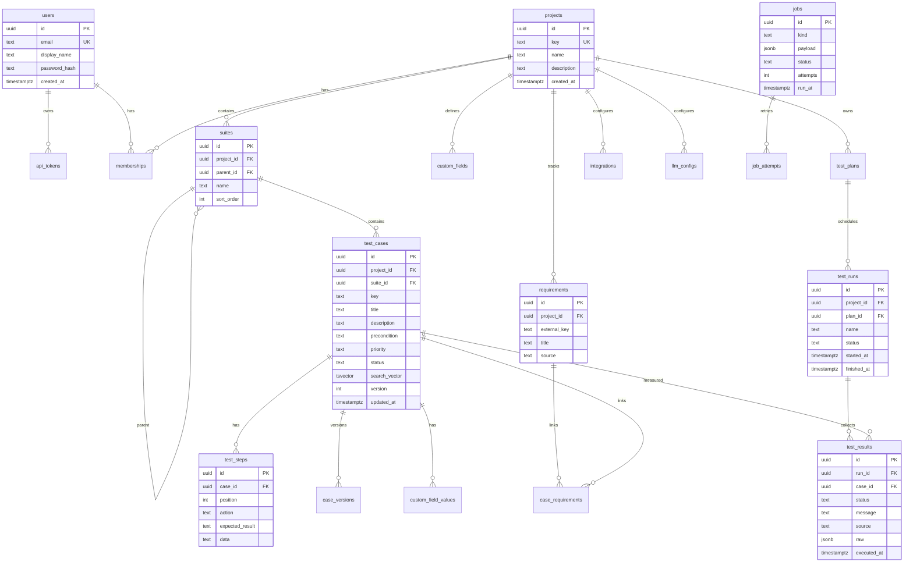

# Vulyk Architecture

Vulyk (Ukrainian for *beehive*) is an open-source test management system. This document is the Phase 1 foundation plan for the whole product so parallel workstreams can build features without colliding.

## Goals

| Area | Capability |
|------|------------|
| Repository | Projects, suites/sections, cases with steps, custom fields, versioning |
| Execution | Test plans, test runs, result ingestion |
| CI ingest | GitHub Actions / GitLab CI → JUnit XML, Vulyk JSON, CLI/reporter |
| Traceability | Requirements import + link cases ↔ requirements |
| Reporting | Dashboards, run summaries, coverage |
| Admin | Users, roles, projects, integrations, LLM providers |
| Scale | Bulk ingest, Postgres FTS + `pg_trgm`, background jobs |
| Integrations | OpenProject, Jira Cloud, Jira Server/DC (requirements + defects) |
| Importers | Xray, Zephyr, Squash TM, TestLink, TestRail, qTest, Qase, Kiwi TCMS, … |
| CI trigger | `workflow_dispatch` (GitHub) and pipeline trigger (GitLab) |
| LLM | Local (Ollama, Unsloth/OpenAI-compatible) + cloud (OpenRouter, Anthropic, Gemini, OpenAI, xAI) |
| MCP | First-class MCP server for AI assistants |
| API | OpenAPI 3 from code; interactive docs (Scalar / Swagger UI) |

**Non-goal:** Do not open PRs or commits against the OpenProject project itself. Vulyk only *integrates with* OpenProject via its REST API; document that contract here and in `docs/integrations/openproject.md` when implemented.

## Monorepo layout

```
backend/          # Rust API (Axum, Tokio, SQLx, utoipa)
frontend/         # React + Vite + TypeScript UI
mcp/              # MCP server (Rust rmcp), calls same API / shared crates
cli/              # vulyk CLI + result reporter
deploy/           # Docker, Kubernetes manifests, Helm chart skeleton
docs/             # Architecture, ADRs, integration notes
scripts/          # install.sh and helper scripts
```

Shared Rust logic (domain types, OpenAPI models) may later move to `crates/` (`vulyk-core`, `vulyk-db`). Phase 1 keeps a single `backend` crate for speed of bootstrap.

## Module boundaries

```
┌─────────────┐   ┌─────────────┐   ┌─────────────┐
│  frontend   │   │  mcp server │   │  vulyk-cli  │
└──────┬──────┘   └──────┬──────┘   └──────┬──────┘
       │ HTTP/JSON       │ HTTP/JSON       │ HTTP/JSON
       └─────────────────┼─────────────────┘
                         ▼
              ┌─────────────────────┐
              │   backend (Axum)    │
              │  routes │ services  │
              │  importers │ llm    │
              │  integrations │ jobs│
              └──────────┬──────────┘
                         ▼
              ┌─────────────────────┐
              │  PostgreSQL 16+     │
              │  (+ job queue table)│
              └─────────────────────┘
```

| Module | Owns | Must not |
|--------|------|----------|
| `routes` | HTTP, auth extractors, OpenAPI annotations | Business rules, SQL |
| `services` | Domain logic, transactions | HTTP types |
| `db` / migrations | Schema, queries | HTTP |
| `importers` | Pluggable import adapters | Persist without going through services |
| `integrations` | OpenProject / Jira / CI clients | UI concerns |
| `llm` | Provider trait + adapters | Direct DB writes of generated content without review hooks |
| `jobs` | Queue workers (ingest, import, LLM) | Sync long work on request path |
| `mcp` | MCP tool surface | Duplicate business logic (call API or shared services) |
| `frontend` | UX | Bypass API for mutations |

## Data model (ERD)



Phase 1 migrations create: `users`, `projects`, `suites`, `test_cases`, `test_steps`, `test_runs`, `test_results`, `requirements`, plus supporting indexes (`pg_trgm`, FTS). Plans, custom fields, memberships, tokens, integrations, jobs land in follow-up migrations on their workstreams.

## API conventions

- Base path: `/api/v1`
- Resources: plural nouns (`/projects`, `/projects/{id}/suites`, `/projects/{id}/cases`)
- IDs: UUID in path; project also addressable by `key` where noted
- Errors: `{ "error": { "code": "...", "message": "..." } }` with appropriate HTTP status
- Auth: session cookie or `Authorization: Bearer <jwt|api_token>` (W1; see [auth-and-rbac.md](./auth-and-rbac.md). Default local/dev keeps auth optional via `VULYK_AUTH_REQUIRED` / `VULYK_REQUIRE_AUTH`.)
- Pagination: `?limit=&offset=` (later: cursor)
- Bulk: `POST /api/v1/runs/{id}/results:bulk` for ingest
- OpenAPI: generated with **utoipa**, served at `/api/docs` (Scalar UI)
- Health: `GET /health` (liveness), `GET /ready` (DB ping)

## Plugin interfaces

### Importers

```rust
#[async_trait]
pub trait Importer: Send + Sync {
    fn id(&self) -> &'static str;           // e.g. "testrail", "xray"
    fn name(&self) -> &str;
    fn supported_formats(&self) -> &[&str]; // "csv", "xml", "api"
    async fn preview(&self, input: ImportInput) -> Result<ImportPreview>;
    async fn run(&self, ctx: ImportContext, input: ImportInput) -> Result<ImportReport>;
}
```

Register via a static registry / DI in `backend`. Heavy imports enqueue a `jobs` row; worker executes `Importer::run`.

### Integrations (ALM / defect trackers)

```rust
#[async_trait]
pub trait AlmIntegration: Send + Sync {
    fn id(&self) -> &'static str; // "openproject", "jira_cloud", "jira_dc"
    async fn list_requirements(&self, cfg: &IntegrationConfig, query: &str) -> Result<Vec<RemoteRequirement>>;
    async fn link_requirement(&self, cfg: &IntegrationConfig, link: RequirementLink) -> Result<()>;
    async fn create_defect(&self, cfg: &IntegrationConfig, defect: DefectDraft) -> Result<RemoteIssue>;
}
```

**OpenProject:** use OpenProject REST API (work packages as requirements/defects). Configuration stores base URL + API token in `integrations`. No contributions are made to the OpenProject upstream project from this repo.

**Jira Cloud / Server-DC:** separate adapters sharing issue DTO mapping; auth differs (OAuth/API token vs PAT).

### CI triggers

```rust
#[async_trait]
pub trait CiTrigger: Send + Sync {
    async fn dispatch(&self, cfg: &CiConfig, inputs: serde_json::Value) -> Result<CiDispatchHandle>;
}
```

GitHub: `workflow_dispatch`. GitLab: pipeline trigger token / API.

### LLM providers

```rust
#[async_trait]
pub trait LlmProvider: Send + Sync {
    fn id(&self) -> &'static str;
    async fn complete(&self, req: LlmRequest) -> Result<LlmResponse>;
}
```

Adapters: Ollama, OpenAI-compatible (Unsloth/local), OpenRouter, Anthropic, Gemini, OpenAI, xAI. Used for: generate cases, generate automation code, Q&A over project tests (RAG later).

## MCP design

- Crate: `mcp/` using **rmcp** (Rust), speaking MCP over stdio (and optionally SSE).
- Tools (planned): `search_cases`, `get_case`, `create_case`, `update_case`, `list_runs`, `create_run`, `ingest_results`, `ask_tests` (LLM).
- Auth: API token from env `VULYK_API_TOKEN` + `VULYK_API_URL`.
- Implementation rule: MCP is a thin client of `/api/v1`; no second persistence path.
- Phase 1: crate skeleton + health/tool stub list so the workstream can land tools without reshaping the repo.

## Frontend UX (spirit of TestRail / Xray)

```
┌────────┬──────────────────┬────────────────────┐
│ Brand  │ Project switcher │ User / settings    │
├────────┼──────────────────┼────────────────────┤
│ Suites │ Case list        │ Case detail / steps│
│ tree   │ (filter/search)  │ Runs | Reports     │
│        │                  │ Admin              │
└────────┴──────────────────┴────────────────────┘
```

Phase 1: shell layout, navigation, project-scoped suite tree stub, case list + case detail wired to API.

## Background jobs

Postgres-backed queue (`jobs` table + `SKIP LOCKED` worker). Kinds: `ingest_junit`, `ingest_json`, `import_*`, `llm_generate`, `ci_dispatch`. Horizontal scale: multiple API pods running workers with lease timeout.

## Scale notes

- Bulk insert for results (`UNNEST` / `COPY`-style batches)
- `tsvector` + GIN on cases; `pg_trgm` for fuzzy title search
- Partition `test_results` by time when volume demands (post Phase 1)
- Read replicas optional; search stays on primary until separate search service is justified

## Security (planned)

- Argon2 password hashes, HttpOnly session cookies, short-lived JWT, scoped API tokens
- RBAC: system admin + per-project roles (`admin`, `project_lead`, `tester`, `viewer`)
- Secrets for integrations encrypted at rest (envelope key from env)

## Roadmap — parallelisable workstreams

Agents can own one stream each; contracts live in this doc + OpenAPI.

| ID | Workstream | Depends on | Deliverables |
|----|------------|------------|--------------|
| **W0** | Foundation (this PR) | — | Monorepo, migrations core, CRUD projects/suites/cases, OpenAPI docs, UI shell, compose, CI |
| **W1** | Auth & admin | W0 | Sessions/JWT, API tokens, users, roles, memberships, admin UI |
| **W2** | Case repository depth | W0 | Steps editor UX, custom fields, case versioning, FTS search API |
| **W3** | Plans, runs, results | W0 | Plans/runs CRUD, result model UI, status workflow |
| **W4** | Ingest & CLI reporter | W3 | JUnit + Vulyk JSON ingest, `cli` reporter, job worker |
| **W5** | CI integrations | W4 | GHA/GitLab webhook + artifact pull; `workflow_dispatch` / pipeline trigger |
| **W6** | Requirements & ALM | W0 | Requirements CRUD, OpenProject + Jira Cloud/DC adapters, defect create |
| **W7** | Importers | W2 | `Importer` trait + Xray, Zephyr, Squash, TestLink, TestRail, qTest, Qase, Kiwi |
| **W8** | Reports & dashboards | W3 | Run summary, pass-rate trends, requirement coverage |
| **W9** | LLM abstraction | W1* | Provider trait, encrypted keys, Admin UI, generate case / code / Q&A — see [llm.md](llm.md). *Minimal API tokens ship with W10 so MCP works before full W1 RBAC.* |
| **W10** | MCP server | W0 + W1* | Full tool set on `mcp/` (stdio + HTTP), docs for Cursor/Claude — see [mcp.md](mcp.md) |
| **W11** | Deploy hardening | W0 | Prod compose, Helm values, backups, install script polish |

Suggested merge order for conflicting areas: **W1 → W2/W3 → W4 → others**. Importers (W7) and ALM (W6) are independent after W0/W2.

## Tech stack (decided)

- Backend: Rust, Axum, Tokio, SQLx, utoipa, PostgreSQL 16+
- Frontend: TypeScript, React, Vite
- MCP: Rust (`rmcp`) preferred; TypeScript acceptable if shared client libs help
- No PHP
- License: repository `LICENSE` (AGPL-3.0) — keep unless maintainers re-license

## Local development

See root [README.md](../README.md). Quick path: `docker compose up --build` then open UI on `:5173` (or served build) and API docs on `:8080/api/docs`.
