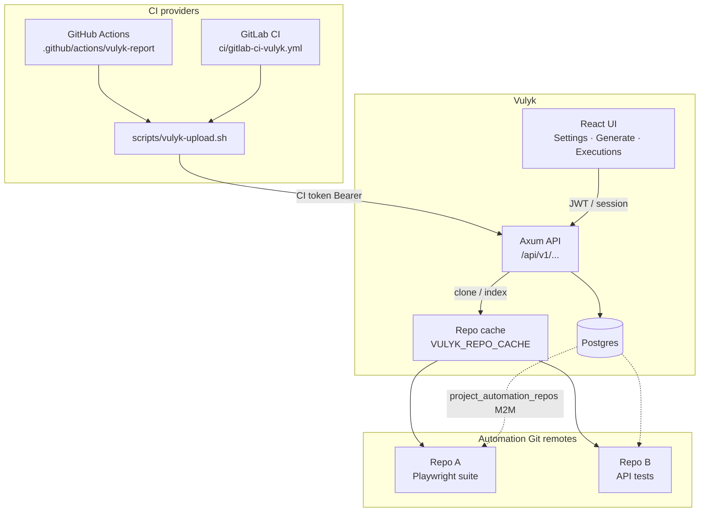
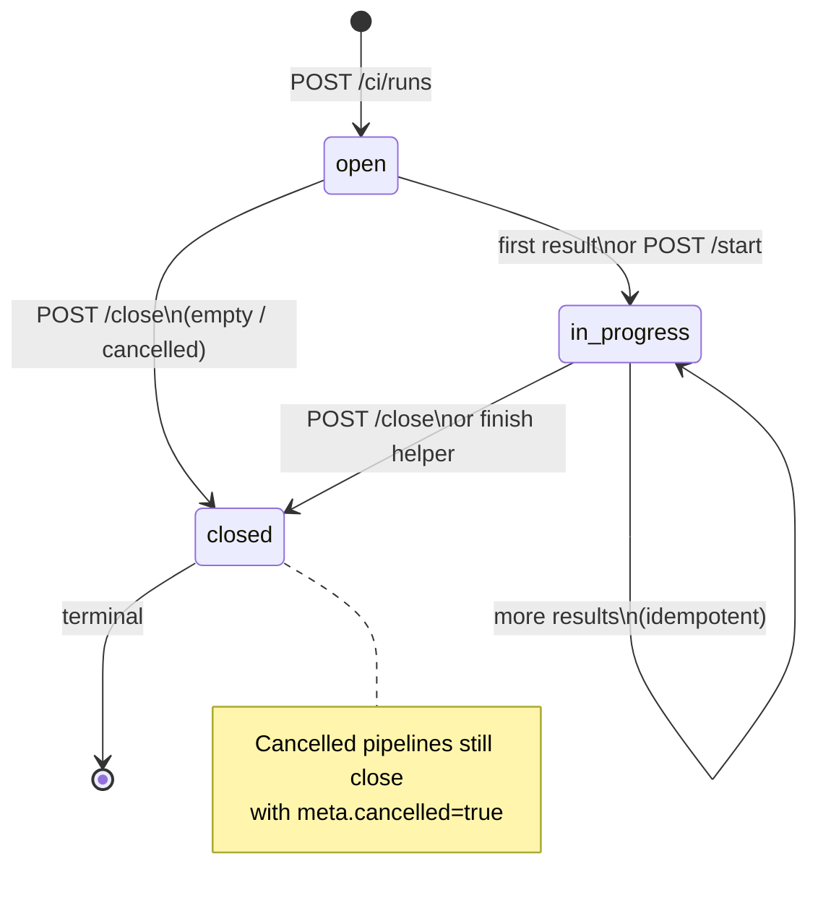

# Automation repositories & CI reporting — design

Technical design for (1) **multi-repo test automation Git connections** with many-to-many project links, and (2) a **CI reporting API** with project-scoped tokens, run lifecycle, batch/JUnit results, and ready-made GitHub/GitLab integrations.

Borrowed conventions: [automation-integration-comparison.md](./automation-integration-comparison.md).  
User setup: [guides/ci-integration.md](./guides/ci-integration.md).

## Goals

1. Admins and **Test Automation Engineers** manage multiple named automation repos (provider, URL, default branch, optional encrypted token) and attach them to any set of projects.
2. Migrate the existing **one-repo-per-project** `automation_repos` rows without data loss.
3. CI pipelines authenticate with **project-scoped API tokens** (hashed at rest) and report runs with metadata + results keyed by case key (`KOC-12`).
4. Run lifecycle: `open` → `in_progress` → `closed`, with explicit endpoints and safe auto-transitions.
5. JUnit / Playwright / pytest / Vulyk JSON mapping; unknown keys reported; idempotent retries.
6. UI: Settings CRUD, Generate repo picker, Executions source badge + pipeline link.
7. Composite GitHub Action, GitLab template, extended `scripts/vulyk-upload.sh`.

Non-goals: OpenProject changes; Squash Orchestrator agents; auto-creating cases from unknown keys (v1).

---

## Architecture



---

## Data model

### Automation repositories (app-level + M2M)

**Today:** `automation_repos` has `UNIQUE (project_id)` — one connection per project.

**Target:**

| Table | Purpose |
|-------|---------|
| `automation_repos` | Named repo: `name`, `provider` (`github`\|`gitlab`\|`generic`), `remote_url`, `branch`, `subpath`, encrypted token, index metadata. **No** required `project_id`. |
| `project_automation_repos` | Junction: `(project_id, repo_id)` PK; optional `is_default`, `sort_order`. |
| `automation_repo_files` / `_chunks` | Unchanged; keyed by `repo_id`. |

```text
projects ──< project_automation_repos >── automation_repos
                                              │
                                    files / chunks / index
```

**Migration (no data loss):**

1. Add `name TEXT NOT NULL DEFAULT ''`, drop `UNIQUE (project_id)`, make `project_id` nullable (or remove after backfill).
2. Create `project_automation_repos`.
3. For each existing row: set `name` from URL basename or `Automation repo`, insert junction row `(project_id, id)` with `is_default = true`.
4. Keep legacy routes `GET/PUT/DELETE /projects/{id}/automation-repo` as thin wrappers over “default linked repo” for one release, then document deprecation.

### Project CI API tokens

Separate from personal `api_tokens` (MCP / user scripts):

| Column | Notes |
|--------|-------|
| `id` | UUID |
| `project_id` | FK projects |
| `name` | Human label (`github-main`, `gitlab-nightly`) |
| `token_prefix` | First 16 chars for UI |
| `token_hash` | SHA-256 of full secret |
| `created_by` | Optional user id |
| `last_used_at`, `revoked_at`, `created_at` | Audit |

Prefix: `vulyk_ci_…` so the auth extractor can distinguish from `vulyk_at_…` / `vulyk_s_…`.

Scopes (implicit for v1): `upload_results`, `execute_runs` (create/open/close CI runs) on **that project only**.

### Test runs — CI metadata & lifecycle

Extend `test_runs` (columns or structured `meta` + dedicated columns for query/UI):

| Field | Source |
|-------|--------|
| `status` | Lifecycle (below) |
| `source` | `ci`, `ci:github`, `ci:gitlab`, `manual`, … |
| `suite_name` | Optional display name |
| `ci_provider` | `github` \| `gitlab` \| `other` |
| `ci_repo` | `owner/repo` or path |
| `ci_branch`, `ci_commit` | Git refs |
| `pipeline_url` / `job_url` | Links for UI badge |
| `external_ref` | Idempotency key (e.g. `github:run_id:attempt`) |
| `environment`, `artifacts` | Existing JSONB |

**Idempotent create:** `UNIQUE (project_id, external_ref)` where `external_ref` is not null — retries of “open run” return the same run.

### Results & case latest automation status

- Existing append-only `test_results` + `result_status_history` remain the history source.
- On each matched result: update `run_items.status`, refresh run counters, sync iteration item if linked, set case **latest automation status** (denormalized column or view from latest CI result — prefer `test_cases.last_automation_status` + `last_automation_run_id` if not already present).
- Unmatched keys: **not** inserted as orphan results that pretend to be cases; listed in the response. Optional v2: store unmatched rows with `case_id NULL` for forensic UI — design allows it; v1 reports only.

---

## Permissions

Role **Test Automation Engineer** already exists (`test_automation_engineer`) with `manage_automation_repo`, `manage_api_tokens`, `upload_results`, `trigger_ci`, `manage_ci_config`.

| Capability | Permission | Who |
|------------|------------|-----|
| CRUD automation repos + project links | `manage_automation_repo` | System admin, project Admin, Test Architect, **Test Automation Engineer** |
| Create/revoke **project CI tokens** | `manage_api_tokens` | Same as above (TAE included) |
| Open/post/close CI runs | `upload_results` (+ token scope) | CI token, TAE, Developer, … |
| View runs / executions | `view_project` | All members |

Settings UI sections are visible when the user has the permission on **any** project or is system admin. Linking a repo to a project requires `manage_automation_repo` on that project.

---

## Run lifecycle state machine

Canonical statuses for CI-driven runs:

| Status | Meaning |
|--------|---------|
| `open` | Created; waiting for first result or explicit start |
| `in_progress` | At least one result posted, or `POST .../start` |
| `closed` | Finished; further result posts rejected (409) unless reopen |

Compatibility aliases (read/write normalize):

- `draft` / `queued` → treat as `open` for CI flows  
- `running` ↔ `in_progress`  
- `completed` / `finished` ↔ `closed`



**Auto-transitions**

1. Create → `open` (unless client sends `start: true` → `in_progress`).
2. First successful persist of ≥1 result while `open` → `in_progress`, set `started_at`.
3. `POST .../close` or upload script `--close` → `closed`, set `finished_at`, refresh counters.
4. **Do not** auto-close on single ingest batch (change from current ingest that sets `completed` immediately) for CI lifecycle runs (`source` starts with `ci` or `lifecycle=ci`); legacy one-shot ingest without open/close may still complete for backward compatibility when `auto_close` is true (default for old `/ingest` paths).

---

## API

### Automation repos (settings)

| Method | Path | Notes |
|--------|------|-------|
| `GET` | `/api/v1/automation-repos` | List repos visible to user (linked projects or admin) |
| `POST` | `/api/v1/automation-repos` | Create |
| `GET` | `/api/v1/automation-repos/{id}` | Detail (token masked) |
| `PATCH` | `/api/v1/automation-repos/{id}` | Update; omit token to keep |
| `DELETE` | `/api/v1/automation-repos/{id}` | Delete repo + links + index |
| `PUT` | `/api/v1/automation-repos/{id}/projects` | Replace project link set (multi-select) |
| `GET` | `/api/v1/projects/{id}/automation-repos` | Repos linked to project (Generate picker) |
| `POST` | `/api/v1/automation-repos/{id}/test` | `git ls-remote` |
| `POST` | `/api/v1/automation-repos/{id}/reindex` | Shallow index |

Legacy singular `/projects/{id}/automation-repo` remains as default-repo shim.

### Project CI tokens

| Method | Path |
|--------|------|
| `GET` | `/api/v1/projects/{id}/ci-tokens` |
| `POST` | `/api/v1/projects/{id}/ci-tokens` → `{ token }` once |
| `DELETE` | `/api/v1/projects/{id}/ci-tokens/{token_id}` |

### CI reporting

Base: `/api/v1/projects/{project_id}/ci` (also accept project **key** via header/`?project_key=` for scripts).

| Method | Path | Body (summary) |
|--------|------|----------------|
| `POST` | `/runs` | Open run: `provider`, `repo`, `branch`, `commit`, `pipeline_url`, `job_url`, `suite_name`, `external_ref`, optional `campaign`/`iteration`, `environment` |
| `POST` | `/runs/{run_id}/start` | Force `in_progress` |
| `POST` | `/runs/{run_id}/results` | Single or batch results by `case_key` / `case_id` |
| `POST` | `/runs/{run_id}/ingest` | JUnit / JSON upload (same parsers as today) |
| `POST` | `/runs/{run_id}/close` | Close; optional `{ "cancelled": true, "message": "…" }` |
| `GET` | `/runs/{run_id}` | Status + counters + unmatched summary |

Auth: Bearer project CI token **or** user token/JWT with `upload_results`.

**Batch results response (SquashTM-inspired):**

```json
{
  "run_id": "…",
  "status": "in_progress",
  "inserted": 12,
  "updated": 0,
  "unmatched_case_keys": ["KOC-999"],
  "idempotent_replays": 1
}
```

---

## Sequence: CI pipeline

```mermaid
sequenceDiagram
  participant P as Pipeline job
  participant U as vulyk-upload.sh / Action
  participant A as Vulyk API
  participant D as Postgres

  P->>U: start (always create run)
  U->>A: POST /projects/{id}/ci/runs<br/>Bearer vulyk_ci_…
  A->>D: INSERT test_runs status=open<br/>(idempotent on external_ref)
  A-->>U: run_id, status=open

  P->>P: run Playwright / pytest
  P->>U: upload results.xml
  U->>A: POST /ci/runs/{id}/ingest (junit)
  A->>D: parse → match keys → append results<br/>open→in_progress
  A-->>U: inserted, unmatched_case_keys

  Note over P,U: on success OR failure OR cancel
  U->>A: POST /ci/runs/{id}/close
  A->>D: status=closed, finished_at
  A-->>U: final counters
  U-->>P: exit 0 if upload OK<br/>(test failures already in Vulyk)
```



Parallel matrix jobs: either (a) one run per job with distinct `external_ref` (`…:job=lint`, `…:job=e2e`), or (b) shared `run_id` from a prior job artifact — document (a) as default to avoid lock contention.

---

## JUnit / Playwright mapping

Priority for resolving a Vulyk case key:

1. Property / annotation: `test_key`, `test_id`, `case_key`, `vulyk_key` (Xray/TestRail-compatible names).
2. Playwright annotation `type=vulyk` / `type=case_key` value.
3. Regex in title / classname / name: `PREFIX-N`, `@vulyk:PREFIX-N`, `[PREFIX-N]`.
4. Match `test_cases.external_key` or automation id field if set.

Status map: failure/error → Failed; skipped → Skipped; else Passed. Blocked/Untestable only via explicit Vulyk JSON.

Example Playwright title: `KOC-12 Login with valid password` or annotation `{ type: 'vulyk', description: 'KOC-12' }`.

---

## Edge cases

| Case | Behavior |
|------|----------|
| **Unknown keys** | Persist matched only; return `unmatched_case_keys`; HTTP 200 (partial). Optional warn log. |
| **Retries / idempotency** | Same `external_id` within a run: skip duplicate insert (`idempotent_replays++`) or append history if status changed — prefer append-only history with dedupe key `(run_id, external_id, status)` for identical retries. |
| **Open twice same `external_ref`** | Return existing run (200), do not create a second. |
| **Post after close** | 409 Conflict. |
| **Cancelled pipeline** | `close` with `cancelled: true`; run `closed`; UI badge “Cancelled”. |
| **Parallel jobs** | Distinct `external_ref` per job (default); document sharing run_id via artifacts. |
| **Token revoked mid-run** | Subsequent posts 401; run stays `in_progress` until manually closed. |
| **Migration single repo** | Junction row + name; Generate uses single linked repo with no picker UI if count=1. |
| **Repo deleted while linked** | CASCADE link rows; Generate falls back to “no repo”. |
| **Large JUnit** | Existing async job path (`async_mode` / threshold). |

---

## UI

1. **Settings** (`/settings`): section **Test automation repositories** — table CRUD, masked token, multi-select projects; section **Project CI tokens** (project picker + create/revoke). Visible to admins & TAE.
2. **Generate**: if multiple repos linked, **repo picker**; pass `repo_id` into generate-code.
3. **Executions**: suite rows from CI show source badge (`GitHub` / `GitLab`), pipeline link, live status (`open` / `in progress` / `closed`).

---

## Integrations layout

| Artifact | Role |
|----------|------|
| `.github/actions/vulyk-report/` | Composite action: open → upload → close (`if: always()`) |
| `action/` | Keep thin wrapper or point at composite |
| `ci/gitlab-ci-vulyk.yml` | Template with `when: always` close |
| `scripts/vulyk-upload.sh` | `--open-run`, `--close-run`, `--pipeline-url`, metadata flags |
| Docs | This file, comparison, [guides/ci-integration.md](./guides/ci-integration.md) |

---

## Tests & seed

- Backend integration: repo M2M + migration; CI token hash/auth; lifecycle open→result→close; permissions (viewer forbidden, TAE allowed); JUnit property mapping; unmatched keys; idempotent `external_ref`.
- Frontend unit: Settings sections, Generate picker, Executions badge.
- Playwright e2e: settings CRUD smoke; optional CI API round-trip against local API.
- Seed: Vulyk QA cases with **detailed single-action steps** covering repo link, token create, CI report happy path, unknown key warning.

## Docs touchpoints

- README documentation table → CI integration guide  
- [docs/api.md](./api.md), [docs/automation-repo.md](./automation-repo.md), [docs/guides/ingest-and-ci.md](./guides/ingest-and-ci.md), [docs/integrations/README.md](./integrations/README.md)  
- [docs/user-guide.md](./user-guide.md) Executions / CI pointers  
- In-app: Settings help text + link to guide (and Admin automation panel copy)
