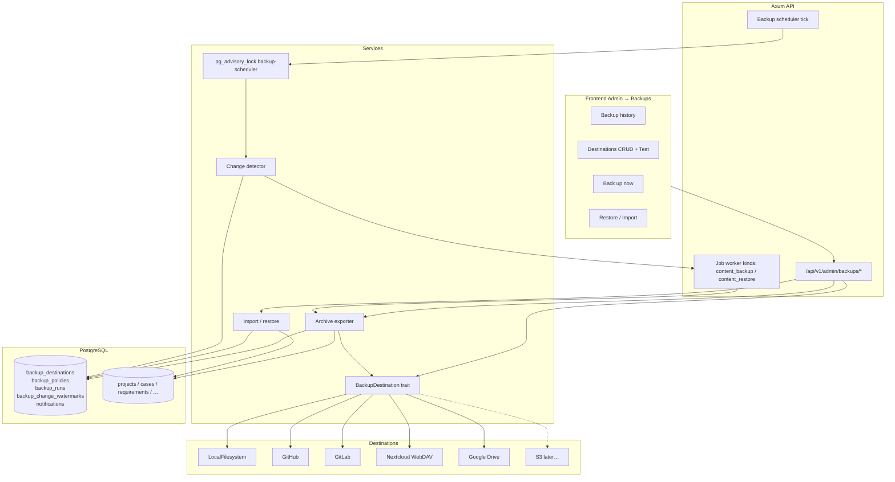
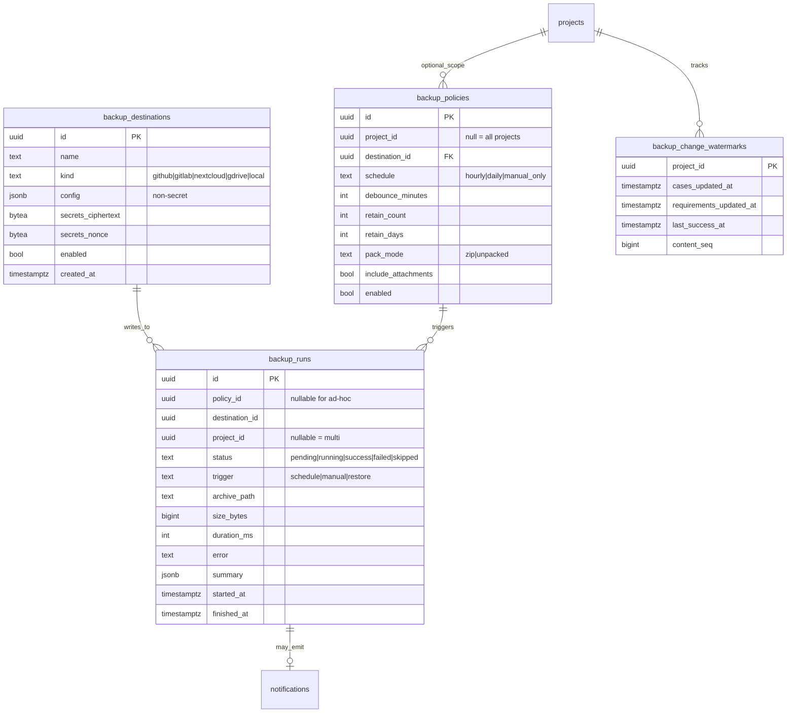

# Application-level content backup — design

This document specifies **portable project content backups** (JSON/ZIP archives shipped to
pluggable destinations). It is distinct from the **database-level** `pg_dump` path in
[`./scripts/install.sh backup`](../scripts/install.sh) / [guides/upgrade.md](guides/upgrade.md).

| Layer | What it captures | When to use |
|-------|------------------|-------------|
| **DB backup** (`install.sh backup`) | Full Postgres dump (users, sessions, jobs, everything) | Disaster recovery, upgrades, infra moves |
| **Content backup** (this feature) | Versioned, portable project archives (cases, requirements, fields, …) | Cross-instance copy, Git-friendly history, selective restore/merge |

See also [guides/backup.md](guides/backup.md) (user-facing guide).

---

## Goals

1. **Portable archives** per project (or all projects): ZIP with JSON + manifest + schema version + checksums.
2. **Change-driven schedule** with debounce + manual “Back up now”; retention (last N / days).
3. **Multiple destinations** (GitHub, GitLab, Nextcloud/WebDAV, Google Drive, local FS), credentials encrypted at rest, Test connection.
4. **Import/restore** with dry-run preview, modes (new project / merge / replace), custom-field mapping, case-key + tombstone rules.
5. **Admin UI** (history, download, restore) + failure notifications; **system administrator only** (all backup/restore routes use `RequireSystemAdmin`).
6. **Align with Admin config export** from PR #24 (`ConfigBundle` version `1.0`).

Non-goals: OpenProject changes; replacing `pg_dump` DR; backing up encrypted LLM/SSO secrets into remote repos by default.

---

## Alignment with config export (PR #24)

PR #24 introduces `ConfigBundle` (`version: "1.0"`) for admin configuration:

- `option_lists`, `custom_fields`, `projects` (+ folders), optional memberships / LLM / integrations / automation repos / SSO
- Optional `data` with raw `cases` / `requirements` / `runs` (JSONB dump — **not** portable enough for content restore)

**Content backup** reuses the same keys and shapes for configuration slices, and **extends** them into a richer archive:

```text
ContentArchive (schema_version "content-1.0")
├── manifest.json          # ids, scope, checksums, created_at, producer
├── config.json            # ConfigBundle-compatible subset (lists, fields, project meta, folders)
├── projects/<key>/
│   ├── project.json
│   ├── folders.json       # case + requirement folder trees
│   ├── tags.json
│   ├── cases.json         # keys, steps, tags, CF values, versions
│   ├── requirements.json  # + case links by key
│   ├── tombstones.json    # retired case numbers (never reuse)
│   └── attachments/       # optional binary files by attachment id
└── checksums.sha256
```

- If ConfigBundle is on `main`: content export **embeds** a `config` section produced by the shared `config_bundle` service (with `include_data: false`).
- Until #24 lands: content backup ships compatible JSON shapes; rebase merges shared types and drops duplicates.
- Schema migration: archives declare `schema_version`; importers run forward migrators (`content-1.0` → future).

---

## Architecture



### Module layout (backend)

| Path | Responsibility |
|------|----------------|
| `services/backup/` | Orchestration: export, import, schedule, retention |
| `services/backup/archive.rs` | ZIP/JSON build + checksums + schema migrate |
| `services/backup/change_detect.rs` | Watermarks / outbox / `updated_at` scans |
| `services/backup/destinations/` | `BackupDestination` trait + adapters |
| `models/backup.rs` | DTOs, manifest, policy, run status |
| `routes/backups.rs` | Admin HTTP surface |
| `jobs/` | Handle `content_backup` / `content_restore` kinds |
| Migration `*_content_backups.sql` | Tables + indexes + advisory lock key constant |

Credentials use existing `SecretsKey` (AES-GCM) — same pattern as LLM/SSO tokens. API responses **mask** secrets (`••••` / omit ciphertext).

---

## Data model



**Change detection:** prefer `MAX(updated_at)` on `test_cases` / `requirements` (and related child touches via case `updated_at`) compared to `backup_change_watermarks`. Optional `backup_outbox` can be added later for finer events; v1 uses watermarks + debounce on the policy.

**Multi-replica safety:** scheduler tick takes `pg_try_advisory_lock(hashtext('vulyk:content-backup-scheduler'))`. Job claim already uses `FOR UPDATE SKIP LOCKED`.

---

## Backup flow

```mermaid
sequenceDiagram
  autonumber
  participant Tick as Scheduler / Manual API
  participant Lock as Advisory lock
  participant Det as Change detector
  participant Q as jobs queue
  participant W as Worker
  participant Exp as Exporter
  participant D as Destination
  participant DB as Postgres

  Tick->>Lock: try_advisory_lock
  alt lock not acquired
    Tick-->>Tick: skip (another replica)
  else locked
    Tick->>Det: projects with policy due + dirty since watermark
    Det->>DB: MAX(updated_at) vs watermark + debounce
    alt no changes
      Tick->>DB: record run status=skipped
    else dirty
      Tick->>Q: enqueue content_backup
      W->>Q: claim_next SKIP LOCKED
      W->>Exp: build archive (config + content)
      Exp->>DB: read projects/cases/… (+ ConfigBundle slice)
      Exp->>Exp: ZIP + checksums + schema_version
      W->>D: put(archive or unpacked tree)
      alt success
        W->>DB: backup_runs success; advance watermark; prune retention
      else failure
        W->>DB: backup_runs failed; notification for admins
      end
    end
    Tick->>Lock: unlock
  end
```

### Schedule & debounce

- Policies: `hourly` | `daily` | `manual_only`.
- Debounce: after content change, wait `debounce_minutes` (default 30) before a scheduled run fires.
- Manual “Back up now” bypasses change detection but still uses the destination and pack mode.
- Retention after success: delete remote/local artifacts older than `retain_days` **or** beyond `retain_count` (whichever is more aggressive; both optional).

### Pack modes

| Mode | Behavior | Why |
|------|----------|-----|
| `zip` | Single `.zip` object | Simple for Drive / Nextcloud / download |
| `unpacked` | Commit/write JSON tree under `path/project_key/timestamp/` | Nice diffs on GitHub/GitLab |

---

## Restore / import flow

```mermaid
sequenceDiagram
  autonumber
  participant U as Admin UI
  participant API as Restore API
  participant Imp as Importer
  participant Mig as Schema migrator
  participant DB as Postgres

  U->>API: upload ZIP / pick destination run / paste path
  API->>Imp: load + verify checksums
  Imp->>Mig: migrate archive → content-1.0
  API-->>U: dry_run preview (counts, conflicts, CF map)
  U->>API: confirm mode + conflict strategy
  API->>Imp: apply transactionally where feasible

  Note over Imp,DB: Modes
  alt new_project
    Imp->>DB: create project (new key if clash); import all
  else merge
    Imp->>DB: match cases/reqs by key; skip or overwrite
  else replace
    Imp->>DB: clear project content (keep memberships); import
  end

  Imp->>DB: map CF by key then name; create missing defs/options
  Imp->>DB: restore tombstones; never reissue retired numbers
  Imp->>DB: bump next_case_number past max(key, tombstone)
  API-->>U: summary (created/updated/skipped/conflicts)
```

### Modes & conflicts

| Mode | Behavior |
|------|----------|
| `new_project` | Always create a project (rename key if needed); full import |
| `merge` | Match by case/requirement **key**; per-entity `skip` \| `overwrite` |
| `replace` | Wipe cases/requirements/folders/tags/CF values in target; re-import; preserve users/memberships |

**Custom fields:** map archive field `key` → existing definition; else match `name`+`entity`; else create. Option lists similarly by `key`. Values remapped to new definition IDs.

**Case keys / tombstones:** import writes `case_key_tombstones` from archive; `next_case_number = max(existing, imported, tombstones)+1`. Never allocate a retired number.

**Idempotency:** re-importing the same archive with `merge`+`skip` is a no-op; with `overwrite` converges to archive content for matched keys.

**Validation:** reject unknown future major versions; migrate known older minors.

---

## Destinations (pluggable)

```rust
#[async_trait]
pub trait BackupDestination: Send + Sync {
    fn kind(&self) -> &'static str;
    async fn test_connection(&self) -> AppResult<()>;
    async fn put_file(&self, remote_path: &str, bytes: &[u8]) -> AppResult<()>;
    async fn put_tree(&self, remote_root: &str, files: &[(String, Vec<u8>)]) -> AppResult<()>;
    async fn list(&self, remote_prefix: &str) -> AppResult<Vec<RemoteObject>>;
    async fn get_file(&self, remote_path: &str) -> AppResult<Vec<u8>>;
    async fn delete(&self, remote_path: &str) -> AppResult<()>;
}
```

| Kind | Auth | Notes |
|------|------|-------|
| `local` | Path on volume under `VULYK_CONTENT_BACKUP_DIR` (default `./data/content-backups`; paths outside that root are rejected) | Default for tests / single-node |
| `github` | PAT / fine-grained token | Contents API or Git Data API; branch + path |
| `gitlab` | Project access token | Repository files API; branch + path |
| `nextcloud` | App password | WebDAV `PUT`/`GET`/`PROPFIND` |
| `gdrive` | OAuth2 refresh token **or** service account JSON | Folder id; multipart upload |

Factory: `destination_from_row(row, secrets_key) -> Box<dyn BackupDestination>`. New kinds (S3) register without touching core export logic.

---

## API surface (admin)

| Method | Path | Purpose |
|--------|------|---------|
| GET/POST | `/api/v1/admin/backups/destinations` | List / create |
| GET/PATCH/DELETE | `/api/v1/admin/backups/destinations/{id}` | CRUD; secrets masked |
| POST | `/api/v1/admin/backups/destinations/{id}/test` | Test connection |
| GET/POST | `/api/v1/admin/backups/policies` | Schedule + retention + scope |
| POST | `/api/v1/admin/backups/run` | Manual backup (`project_id?`, `destination_id`) |
| GET | `/api/v1/admin/backups/runs` | History (status, size, destination, duration, error) |
| GET | `/api/v1/admin/backups/runs/{id}/download` | Download archive |
| POST | `/api/v1/admin/backups/restore` | Restore from a completed run id and/or inline JSON archive (`dry_run: true` for preview only) |
| POST | `/api/v1/admin/backups/restore/upload` | Restore from uploaded ZIP/JSON body (same modes; `dry_run` query param) |

There is **no** separate `/restore/preview` route — dry-run is the `dry_run` flag on `restore` / `restore/upload`.

**Permissions:** **system administrator only** for destinations, policies, manual runs, history, download, and restore. Project admins cannot call these `/api/v1/admin/backups/*` endpoints.

---

## UI

Admin tab **Backups** (`data-testid` prefix `admin-backups-…`):

1. **Destinations** — list, add (kind-specific form), mask secrets, Test connection.
2. **Policies** — project scope (one / all), schedule, debounce, retention, pack mode, attachments toggle.
3. **History** — table: time, project, destination, status, size, duration, error; actions Download / Restore.
4. **Restore wizard** — upload or pick run → dry-run (`dry_run`) for counts/conflicts → choose mode → confirm apply.

Failure → in-app notification (`notifications` table) for system admins with `notify_in_app`.

---

## Testing strategy

| Layer | Coverage |
|-------|----------|
| Unit | Archive build/parse, checksums, schema migrate, CF mapping, tombstone rules |
| Integration | Export → import round-trip (incl. custom fields / option lists when present); change detection; retention |
| Destination mocks | HTTP mock servers for GitHub/GitLab/WebDAV/Drive; local temp dir |
| Frontend | Panel render, masked secrets, restore preview states |
| Playwright | Admin opens Backups, creates local destination, Back up now, history row, restore preview |
| Seed | Vulyk QA cases with **detailed single-action steps** for backup/restore flows |

---

## Implementation order

1. Design doc (this file) + user guide stub.
2. Rebase onto / merge PR #24 when available for shared `ConfigBundle` types.
3. Migration + models + local destination + export/import core.
4. Scheduler + job kinds + advisory lock + watermarks.
5. Remaining destinations + Test connection.
6. Admin API + UI + i18n (EN/UK/FR/ES/DE).
7. Tests, seed cases, README + `docs/guides/backup.md`.
8. CI green; squash-merge.

---

## Security notes

- Destination secrets encrypted with `VULYK_SECRETS_KEY`; never logged; masked in API/UI.
- Archives may contain attachment binaries — treat destination repos as sensitive.
- Do not embed live integration/LLM API keys in content archives (config export passphrase path remains separate).
- Advisory lock + `SKIP LOCKED` prevent duplicate writes under multiple API replicas.
