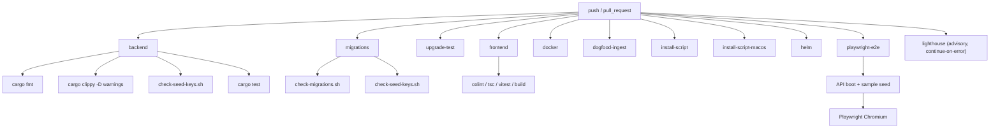

# CI failures from parallel agents — root causes and prevention

This catalog documents the failure modes that repeatedly broke Vulyk PRs when
several Cursor agents landed overlapping changes. Structural fixes live on
`main` (seed allocation, advisory Lighthouse, `./scripts/check.sh`, AGENTS.md).

## Pipeline (required vs advisory)



**Required for merge health:** backend, migrations, upgrade-test, frontend,
docker, dogfood, install scripts, helm, playwright-e2e.

**Advisory:** Lighthouse PWA/a11y — uses `browser-actions/setup-chrome`, retries
once, and sets `continue-on-error: true` so Chrome CDN / launcher flakes do not
block merges. Investigate red advisory checks before a release cut.

## Recommended parallel-PR workflow

```mermaid
sequenceDiagram
  participant A as Agent PR A
  participant B as Agent PR B
  participant M as main
  participant CI as CI

  A->>A: Feature work + fragment seed (no VQA keys)
  B->>B: Feature work + fragment seed (no VQA keys)
  M->>M: Merge unrelated PR
  A->>M: Rebase onto latest main
  B->>M: Rebase onto latest main
  A->>A: ./scripts/check.sh --full
  B->>B: ./scripts/check.sh --full
  A->>CI: Push / update PR
  B->>CI: Push / update PR
  Note over A,B: Prefer getByTestId; unique migration timestamps
  CI-->>M: Green required jobs
  M->>M: Squash-merge one PR, then the other rebases again
```

## Root causes

### 1. Duplicate sample seed keys (`VQA-NNN`)

| | |
| --- | --- |
| **Symptoms** | `all_sample_seeds_parse_and_keys_unique` fails; DB `23505` on `test_cases_project_id_key_key`; API never becomes healthy; Playwright fails waiting for `/health` or sample UI |
| **Why** | Parallel PRs each append the “next” `VQA-16x` range to `vulyk-qa.json` / `generate_vulyk_qa.py`. After rebase both ranges collide. |
| **Fix** | Deduplicate keys; regenerate; or omit keys and let allocation assign the next free number. |
| **Prevent** | Feature fragments in `backend/seed/vulyk-qa.d/` with keys omitted + register in `VULYK_QA_FRAGMENTS`. CI: `./scripts/check-seed-keys.sh` (clear duplicate error). Runtime `prepare_case_keys` before insert. |
| **Seen on** | PRs #27, #28, #29, #30, #31, #33 (primary on several failed runs) |

### 2. Lighthouse Chrome-for-Testing download flake

| | |
| --- | --- |
| **Symptoms** | `Could not parse JSON from …/chrome-for-testing/last-known-good-versions.json`; job red while the rest of CI is green |
| **Why** | `@puppeteer/browsers install chrome@stable` depends on a flaky CDN. Parallel PRs each invented different workarounds (retries, apt, Playwright Chromium, `setup-chrome`). |
| **Fix / prevent** | Single path: `browser-actions/setup-chrome@v1` + explicit `CHROME_PATH` + one retry. Job is **advisory** (`continue-on-error: true`, name ends with `(advisory)`). |
| **Seen on** | #24, #27, #28, #29, #30, #31, #34, **main** after merges — largest failure bucket |

### 3. rustfmt / clippy

| | |
| --- | --- |
| **Symptoms** | `cargo fmt --check` diff (often `openapi.rs` import order after rebase); clippy `-D warnings` (e.g. useless borrows) |
| **Why** | Agents skip local fmt/clippy; rebases reshuffle generated/openapi imports. |
| **Fix** | `cargo fmt --all` and `cargo clippy --workspace --all-targets -- -D warnings` |
| **Prevent** | `./scripts/check.sh` + githooks `pre-commit` / `pre-push` |
| **Seen on** | rustfmt: #26, #30, #34; clippy: #31 (and briefly #24) |

### 4. Playwright strict-mode and locator churn

| | |
| --- | --- |
| **Symptoms** | `strict mode violation: … resolved to N elements`; timeouts on `getByText` / role clicks after sibling UI PRs |
| **Why** | Overlapping PRs change the same header/cases/toasts; text locators match multiple nodes; i18n duplicates labels. |
| **Fix** | Scope locators; prefer `TestIds` / `getByTestId`. |
| **Prevent** | `docs/testing/test-ids.md`, e2e page objects, `npm run check:test-ids`, audit spec. Avoid ambiguous text for shared controls. |
| **Seen on** | Strict: #24, #29; broader churn: #25, #26, #27, #28, main after i18n |

### 5. Rebase conflicts in shared files

| | |
| --- | --- |
| **Symptoms** | GitHub `mergeable=false` / dirty; not always a CI log line |
| **Why** | Parallel edits to seeds, migrations, CI YAML, case list UI, e2e pages |
| **Fix** | Rebase onto latest `main`, resolve, re-run `./scripts/check.sh --full` |
| **Prevent** | AGENTS.md pre-merge checklist; fragment seeds; unique migration timestamps |
| **Seen on** | Open dirty PRs after parallel merges (#24, #25, #29, #31, #34 historically) |

### 6. Migration collisions / bad upgrade paths

| | |
| --- | --- |
| **Symptoms** | `42P07` relation/index already exists during migrate; Backend / Dogfood / Playwright cascade |
| **Why** | Migrations that recreate indexes after `RENAME`, or two PRs shipping the same version prefix |
| **Fix** | Follow-up migration; drop legacy index before recreate; unique timestamps |
| **Prevent** | `./scripts/check-migrations.sh`; never edit applied migrations on `main` |
| **Seen on** | #24 (`custom_field_values_field_id_idx`) |

### 7. Other (less common in the same window)

| Cause | Symptoms | Prevent |
| --- | --- | --- |
| OpenAPI / recursive schema stack overflow | Thread overflow at router/docs build; API tests abort | Avoid recursive utoipa types (break cycles with `Object` / non-recursive children) |
| Feature compile / TS errors | `error[E0xxx]`, `tsc` in frontend or e2e | `./scripts/check.sh --full` |
| Install script non-ASCII | CI grep on `scripts/*.sh` | ASCII-only shell scripts (macOS bash 3.2) |
| Feature-specific test asserts | Backend unit test expectations drift after rebase | Re-run `cargo test` after rebase |

## Classification snapshot (PRs #24–#34 + main, ~2026-10-26)

Counts are **distinct failed CI workflow runs** with a primary root cause (cascades not double-counted). Lighthouse also co-failed in many non-primary runs.

| Cause | Primary failed runs | PRs / refs |
| --- | ---: | --- |
| Lighthouse Chrome download | ~13 (present in ~23) | #24, #27–#31, #34, main |
| Playwright locator churn | ~9 | #24–#28, main |
| Playwright strict-mode | ~3 | #24, #29 |
| Duplicate VQA seed keys | ~6 | #27–#31, #33 |
| rustfmt | ~6 | #26, #30, #34 |
| clippy | ~1 | #31 |
| Migration index collision | ~5 | #24 |
| OpenAPI stack overflow | ~1 | #24 |
| Other (compile / TS / ASCII / feature asserts) | ~5 | #26, #31, #33, #34 |

PR #32 had no CI runs in that window.

## What to run locally

```bash
git fetch origin main && git rebase origin/main
./scripts/check.sh --full
```
