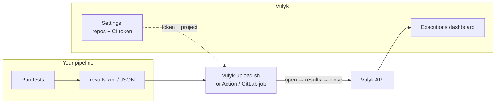
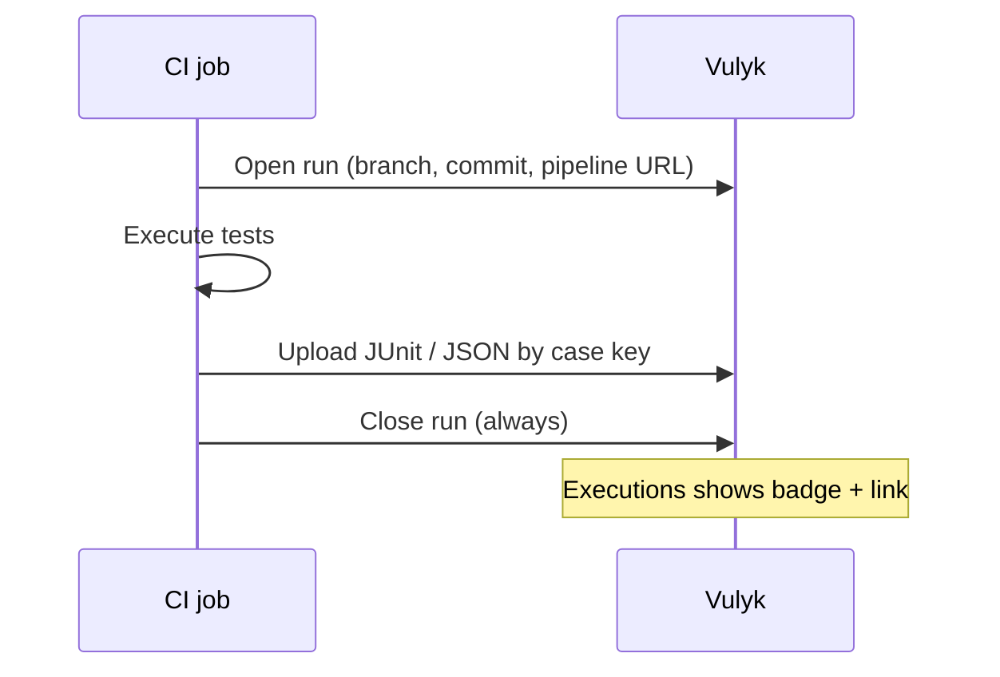
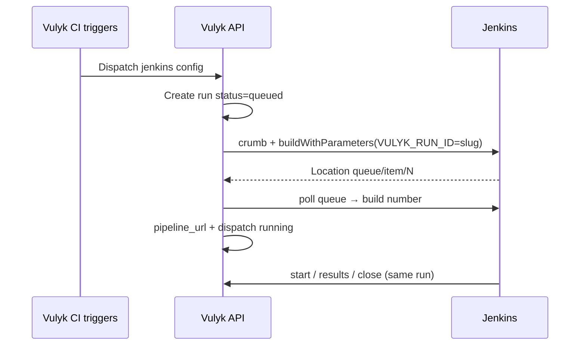
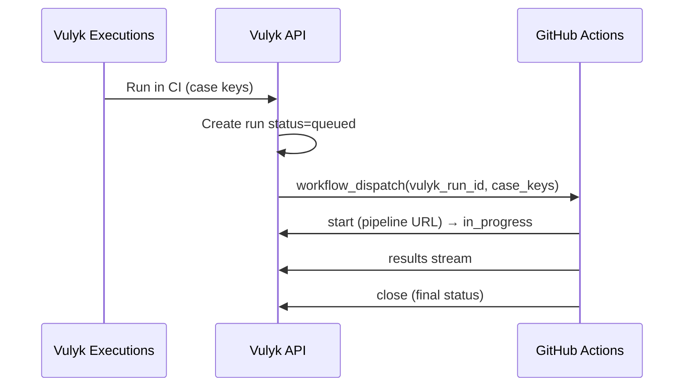
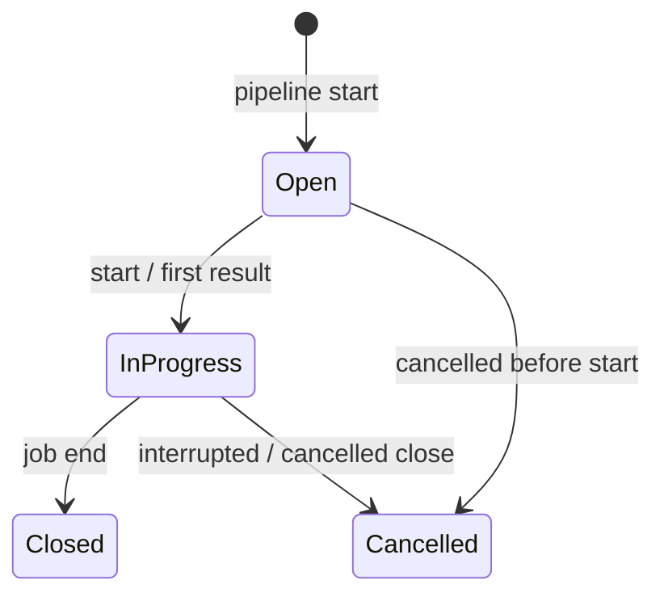

# CI integration guide

Publish automated test results from **GitHub Actions**, **Forgejo / Gitea Actions**, **GitLab CI**, **Jenkins**, or any pipeline that can upload **JUnit** / Playwright / pytest / Vulyk JSON into Vulyk: open a run when the pipeline starts, upload JUnit / Playwright / pytest results (by case key), and close the run when the job finishes — including on failure.

Formats, dispatch, and **webhooks** (secrets required, fail-closed): [ingest-and-ci.md](./ingest-and-ci.md).
Automation Git repos: [automation-repo.md](../automation-repo.md).
In-app examples (GitHub / Forgejo / Gitea / GitLab / Jenkins / JUnit): [../user/cicd.md](../user/cicd.md).

## How it fits together





## Prerequisites

1. A Vulyk project with case keys (e.g. `KOC-12`).
2. Tests that embed the key in the **title**, **annotation**, or JUnit **property** (see [Mapping case keys](#mapping-case-keys)).
3. A **project CI token** from **Settings → Project CI tokens** (Admin or Test Automation Engineer). Copy the secret once; it is stored hashed.
4. Optional: link **Test automation repositories** under Settings so Generate can index the same Git remotes your CI builds.

## Mapping case keys

Preferred (Playwright):

```ts
test('KOC-12 Login with valid password', async ({ page }) => { /* … */ });
// or
test('Login with valid password', {
  annotation: { type: 'vulyk', description: 'KOC-12' },
}, async ({ page }) => { /* … */ });
```

JUnit XML properties (compatible with Xray `test_key` / TestRail `test_id`):

```xml
<testcase classname="tests.Login" name="valid_password" time="1.2">
  <properties>
    <property name="test_key" value="KOC-12"/>
  </properties>
</testcase>
```

Also recognized: `case_key`, `vulyk_key`, `@vulyk:KOC-12` in the name. Unknown keys are listed in the API response and **not** dropped from the matched set — fix the test or create the case, then re-run.

## Create a project CI token

1. Sign in as Admin or Test Automation Engineer.
2. Open **Settings** (gear menu) → **Project CI tokens**.
3. Choose the project → **Create token** → name it (`github-main`) → copy `vulyk_ci_…`.
4. Store it as `VULYK_CI_TOKEN` / `VULYK_API_TOKEN` in GitHub Secrets or GitLab CI variables.

CI tokens are **narrowly scoped** to reporting (open / upload / close) for that project. They cannot perform general admin actions (for example `create_project`). Prefer a dedicated CI token over a personal `vulyk_at_…` token in pipelines.

When configuring GitHub/GitLab **webhooks** for dispatch status sync, set a **webhook secret** on the CI config — authorization fails closed without one; API responses never echo the raw secret.

## Two-way trigger (Run in CI)

Vulyk can **start** a GitHub / Forgejo / Gitea Actions workflow, GitLab pipeline,
or **Jenkins job** and stream results back into an existing run. GitHub also
supports the Executions **Run in CI** button via an automation repo;
Jenkins/GitLab/Forgejo/Gitea use **CI → Dispatch** on a saved CI config (or the
same dispatch API).

### Forgejo / Gitea Actions

Forgejo and Gitea are first-class CI providers (not labelled `github`). Under
**CI triggers**, choose **Forgejo** or **Gitea** and save JSON with:

| Field | Required | Notes |
|-------|----------|-------|
| `base_url` | yes | API-reachable origin (may be `http://vulyk-forgejo:3000` in Docker) |
| `public_base_url` | no | Browser-facing origin for the Actions link after dispatch |
| `token` | yes | PAT with Actions write |
| `owner` / `repo` | yes | Repository path |
| `workflow_id` | yes | Workflow file name or id |
| `ref` | no | Default `main` |

Dispatch POSTs to
`{base_url}/api/v1/repos/{owner}/{repo}/actions/workflows/{workflow_id}/dispatches`
(`Authorization: token …`). Status sync uses GitHub-compatible `workflow_run`
webhooks at `/api/v1/webhooks/forgejo` or `/api/v1/webhooks/gitea`.

When runners report an internal hostname in `pipeline_url`, set on the Vulyk
host:

```bash
VULYK_FORGEJO_PUBLIC_BASE_URL=https://git.example.com
# or
VULYK_GITEA_PUBLIC_BASE_URL=https://gitea.example.com
```

Inbound open/start and webhook URLs rewrite the origin so suite links are
clickable. Example workflow: [`ci/forgejo-actions-vulyk.yml`](../../ci/forgejo-actions-vulyk.yml).
Pass `--provider forgejo` / `gitea` (or `VULYK_CI_PROVIDER`); auto-detect also
checks `FORGEJO_ACTIONS` / `GITEA_ACTIONS` and `GITHUB_SERVER_URL`.

### Jenkins (Dispatch)

1. Under **CI triggers**, choose **Jenkins** and save:
   - **Base URL** — `https://jenkins.example.com` (public HTTPS works by default).
     For `http://localhost:8090` or LAN Jenkins, an admin must enable
     **Allow http and private-network CI hosts** under **Admin → Settings**
     (optionally with a host/CIDR allowlist). See
     [Private / HTTP CI URLs](#private--http-ci-urls-j10).
   - **Job path** — `folder/job-name`, `/job/folder/job/job-name`, or a full job URL
   - **Username** + **API token** (Jenkins user token; redacted in API responses)
   - **Use CSRF crumb** — on by default (`crumbIssuer`; skipped when CSRF is off)
2. Click **Test connection** (whoAmI + job API).
3. **Dispatch** creates a Vulyk run (or attaches one), calls
   `buildWithParameters` with `VULYK_RUN_ID` (preferring the run **slug**),
   `VULYK_PROJECT_ID`, and any extra inputs, then follows the queue item to a
   build number and stores `pipeline_url` / `job_url` on the run.
4. Point the job at [`ci/Jenkinsfile`](../../ci/Jenkinsfile) (Playwright) or
   [`ci/Jenkinsfile.selenide`](../../ci/Jenkinsfile.selenide). The job must
   declare string parameters `VULYK_RUN_ID` / `VULYK_PROJECT_ID` and upload with
   that id (`vulyk-upload.sh` or the Playwright reporter).



### GitHub Actions (Run in CI)

Vulyk can **start** a GitHub Actions workflow and stream results back into an
existing run:



### Setup

1. Link a **GitHub** automation repo under **Settings → Test automation repositories**.
2. Set **Actions write token** (PAT or fine-grained token with `actions:write` on the repo). This is **separate** from the read/index token.
3. Set **CI workflow file** (e.g. `.github/workflows/vulyk-dispatch-example.yml`) and **ref** (`main`).
4. Copy [`.github/workflows/vulyk-dispatch-example.yml`](../../.github/workflows/vulyk-dispatch-example.yml) into the automation repo (or point at your own workflow that declares `workflow_dispatch` inputs `vulyk_run_id` and `case_keys`).
5. Store `VULYK_API_URL`, `VULYK_CI_TOKEN`, `VULYK_PROJECT` / `VULYK_PROJECT_ID` as GitHub secrets.

**Localhost Vulyk:** GitHub-hosted runners cannot reach `http://localhost`. Use a
public tunnel (cloudflared, ngrok, etc.) or a **self-hosted runner** on the same
network as Vulyk, and set `VULYK_API_URL` to that reachable base URL.

### From the UI

On **Executions**, open a suite and click **Run in CI** (`trigger_ci`). Vulyk
creates a **Queued** run, dispatches the workflow with `vulyk_run_id` +
`case_keys`, and shows the GitHub run link once the workflow starts (or via the
`workflow_run` webhook). Stale Queued runs are marked failed after
`VULYK_CI_QUEUED_TIMEOUT_SECS` (default 7200). Hard-killed reporters that leave a
run `in_progress` are auto-cancelled after `VULYK_STALE_RUN_TTL_HOURS` (default
24) of inactivity; project admins can also abandon a stuck run from the UI.

### Reporter / action attach

Set `VULYK_RUN_ID` (or the action `run-id` input) so the pipeline **attaches** to
the existing run instead of opening a new one. The Playwright reporter and
`vulyk-report` / `vulyk-upload.sh` all honor this.

**Human-readable run ids:** every run gets a never-reused `display_id`
(`{PREFIX}-R-{n}`, e.g. `VQA-R-42`) and a URL `slug`
(`{PREFIX}-R-{source}-{n}-{YYYYMMDDTHHMMSSZ}`, e.g.
`VQA-R-jenkins-42-20261116T163512Z`). Print `display_id` / `slug` from the open
response (or UI) for operators; API path params accept **UUID, display_id, or
slug** interchangeably (`GET /api/v1/runs/{id}`, project-scoped
`/runs/{run_id}`, CI `/ci/runs/{run_id}`, ingest). `VULYK_RUN_ID` may be any of
those forms. UUID remains the internal primary key.

The built-in Playwright reporter (`e2e/reporters/vulyk-reporter.ts`) is **live**:

| Hook | API | Run status |
|------|-----|------------|
| **`onBegin`** | Open with `start: true`, or **start** an existing `VULYK_RUN_ID` | `in_progress` before any test ends |
| **`onTestEnd`** | Batched / timed `POST …/results` | stays `in_progress` while streaming |
| **`onEnd`** | Flush + `POST …/close` (`cancelled: true` on interrupt) | `closed` or `cancelled` |

Set `VULYK_REPORTER_DRY_RUN=1` to log the same open/start/results/close steps
without POSTing (useful when wiring a new pipeline). Unmatched case keys warn
once per key with a sample list + count; missing annotations warn once with
sample test titles — annotate with `{ type: 'vulyk', description: 'KEY' }` or
`@KEY` (see [playwright-vulyk.md](../dev/testing/playwright-vulyk.md)).

Optional: configure a GitHub **workflow_run** webhook on the project CI config
(with `webhook_secret`) so cancelled / failed-to-start workflows update the
dispatch and run status.

## GitHub Actions

### Composite action (recommended)

```yaml
# .github/workflows/e2e.yml
jobs:
  playwright:
    runs-on: ubuntu-latest
    steps:
      - uses: actions/checkout@v4
      - uses: actions/setup-node@v4
        with:
          node-version: '20'
      - run: npm ci && npx playwright test
        id: tests
        continue-on-error: true

      - name: Report to Vulyk
        if: always()
        uses: ./.github/actions/vulyk-report
        # or: uses: Ihor-Meat-Proxy/Vulyk/.github/actions/vulyk-report@main
        with:
          api-url: ${{ vars.VULYK_API_URL }}
          api-token: ${{ secrets.VULYK_CI_TOKEN }}
          project-key: KOC
          file: playwright-report/results.xml
          format: junit
          suite-name: Playwright ${{ github.workflow }} #${{ github.run_number }}
          close: 'true'
```

The action opens a run (with `github` provider metadata and the Actions run URL), uploads results, and closes the run even when tests failed.

### Shell only

```bash
export VULYK_API_URL=https://vulyk.example.com
export VULYK_API_TOKEN=vulyk_ci_…
export VULYK_PROJECT_KEY=KOC

# Prefer --print-run-id in the same step. $GITHUB_ENV is only for *later* Actions steps.
VULYK_RUN_ID="$(./scripts/vulyk-upload.sh --open-run --print-run-id \
  --suite-name "Playwright #$GITHUB_RUN_NUMBER" \
  --provider github --repo "$GITHUB_REPOSITORY" \
  --branch "${GITHUB_REF_NAME}" --commit "$GITHUB_SHA" \
  --pipeline-url "${GITHUB_SERVER_URL}/${GITHUB_REPOSITORY}/actions/runs/${GITHUB_RUN_ID}")"

./scripts/vulyk-upload.sh --file results.xml --format junit --run-id "$VULYK_RUN_ID"

./scripts/vulyk-upload.sh --close-run --run-id "$VULYK_RUN_ID" --project-key "$VULYK_PROJECT_KEY"
```

`--open-run` still appends to `$GITHUB_ENV` for multi-step workflows. Elsewhere use
`--print-run-id` / `--run-id-file` / `--dotenv-file` (GitLab defaults to `vulyk.env`).


Thin wrapper at [`action/action.yml`](../../action/action.yml) remains available for simple one-shot uploads. Large result files are streamed (`curl --data-binary @file`) so agents do not hit `Argument list too long`.

## Jenkins (inbound)

Use the same open → upload → close loop from a freestyle or Pipeline job. Sample
Declarative Pipelines live under [`ci/Jenkinsfile`](../../ci/Jenkinsfile) and
[`ci/Jenkinsfile.selenide`](../../ci/Jenkinsfile.selenide). Capture the run id
with `--print-run-id` when Jenkins starts the run itself; when Vulyk dispatched
the build, use the `VULYK_RUN_ID` parameter instead.

```bash
export VULYK_API_URL=https://vulyk.example.com
export VULYK_API_TOKEN=vulyk_ci_…
export VULYK_PROJECT_KEY=KOC

./scripts/vulyk-upload.sh --open-run --print-run-id \
  --suite-name "Jenkins #${BUILD_NUMBER}" \
  --provider jenkins --branch "${GIT_BRANCH}" --commit "${GIT_COMMIT}" \
  --pipeline-url "${BUILD_URL}"
```

## Private / HTTP CI URLs (J10)

By default Vulyk only allows **public `https://`** destinations for CI
(Jenkins base URL, GitHub-compatible API bases including Forgejo, GitLab
`base_url`, and automation-repo remotes used for Run in CI). That blocks
self-hosted controllers on localhost or RFC1918 LANs.

**Admin → Settings** (system admin only):

| Setting | Default | Meaning |
|---------|---------|---------|
| **Allow http and private-network CI hosts** | Off | When on, CI may use `http://` and private / loopback / link-local hosts |
| **CI URL allowlist** | Empty | Empty + opt-in = any private/localhost. Non-empty = only listed hosts/CIDRs for those relaxed destinations. Public `https://` remotes stay allowed either way |

Env overrides (deploy-time; win over DB when set):

```bash
VULYK_CI_ALLOW_PRIVATE_URLS=1
VULYK_CI_URL_ALLOWLIST=localhost,10.0.0.0/8,jenkins.lan
```

This opt-in is **CI-scoped** — backup destinations, SSO JWKS, and other egress
still use the strict public-HTTPS guard. The lab-only
`VULYK_EGRESS_ALLOW_PRIVATE=1` hatch (also allows `file://` git) remains for
tests/mocks and should not be used in production.

Prefer a tight allowlist on any instance that can reach cloud metadata or
sensitive internal HTTP services.

## GitLab CI

Include the template and set variables:

```yaml
include:
  - remote: 'https://raw.githubusercontent.com/Ihor-Meat-Proxy/Vulyk/main/ci/gitlab-ci-vulyk.yml'
  # or vendor: local: 'ci/gitlab-ci-vulyk.yml'

variables:
  VULYK_API_URL: "https://vulyk.example.com"
  VULYK_PROJECT_KEY: "KOC"
  VULYK_RESULTS_FILE: "report.xml"
  # Set VULYK_API_TOKEN in CI/CD variables (masked)

stages: [test, report]

playwright:
  stage: test
  script:
    - npm ci && npx playwright test
  artifacts:
    when: always
    paths: [report.xml]
  allow_failure: true

report-vulyk:
  stage: report
  extends: .vulyk_report
  needs: [playwright]
  when: always
```

The `.vulyk_report` job opens a run with GitLab pipeline/job URLs, uploads `$VULYK_RESULTS_FILE`, and closes the run.

## Run statuses in the UI

| Status | Meaning |
|--------|---------|
| Queued | Created by **Run in CI**; waiting for the workflow to start |
| Open | Pipeline registered; no results yet |
| In progress | Workflow started / results streaming (Playwright reporter opens here in `onBegin`) |
| Closed | Job finished successfully or with failures |
| Cancelled | Job interrupted / cancelled close (`status=cancelled`, not a passed-looking Closed badge) |

On **Executions → Automated suites**, CI runs show a **GitHub** / **GitLab** / **Jenkins** / **Forgejo** / **Gitea** source badge and a link to the pipeline. Per-case history and the case’s latest automation status update as results arrive.



## Automation repositories (Generate)

Under **Settings → Test automation repositories** you can register multiple Git remotes (GitHub, GitLab, or other), optionally with an access token (stored encrypted, shown masked), and **attach each repo to one or more projects**. When a project has several repos, the **Generate** page offers a repo picker so the model indexes the right codebase.

## Troubleshooting

| Symptom | Check |
|---------|--------|
| `401` / `403` | Token revoked? Wrong project? User lacks `upload_results`? |
| Empty suite | Results file path; `format` auto-detect; job `if: always()` / `when: always` |
| `unmatched_case_keys` | Key typo; case not in project; use `test_key` property or Playwright `{ type: 'vulyk', description: 'KEY' }` / `@KEY`. Reporter logs each key once (sample + count). |
| Missing Playwright annotation | Add tag + annotation (see [playwright-vulyk.md](../dev/testing/playwright-vulyk.md)); reporter warns once with sample titles |
| Want lifecycle logs only | Set `VULYK_REPORTER_DRY_RUN=1` (still needs URL/token/project to enable) |
| Duplicate runs | Set stable `--external-ref` (Action sets GitHub run id by default) |
| Posts after close | Open a new run; closed runs reject new results |

## See also

- [executions.md](./executions.md) — campaigns, iterations, dashboards  
- [ingest-and-ci.md](./ingest-and-ci.md) — formats, dispatch, webhooks  
- [automation-repo.md](../automation-repo.md) — indexing details  
- OpenAPI: `/api/docs`
