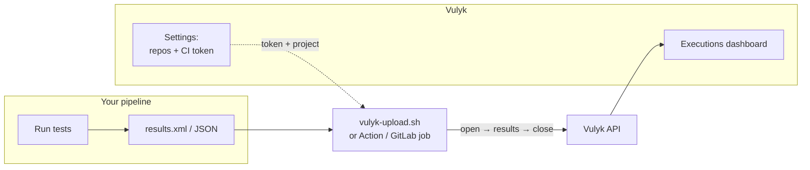
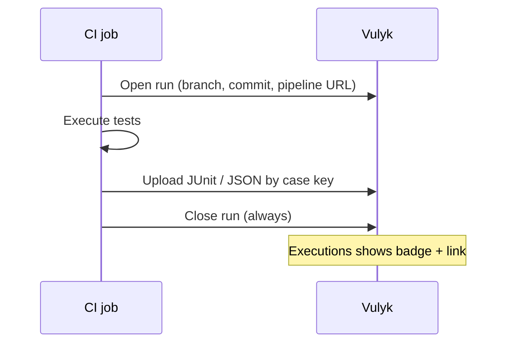
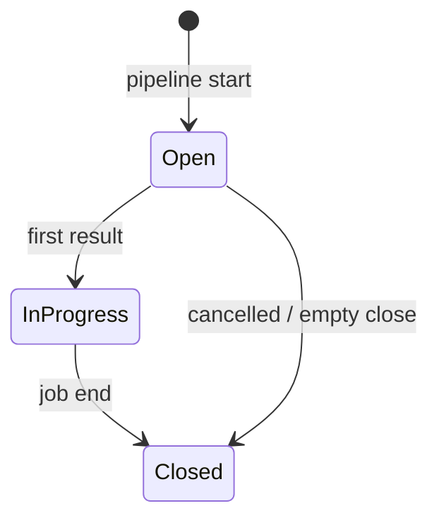

# CI integration guide

Publish automated test results from **GitHub Actions** or **GitLab CI** into Vulyk: open a run when the pipeline starts, upload JUnit / Playwright / pytest results (by case key), and close the run when the job finishes — including on failure.

For design and vendor comparison see [automation-integration-design.md](../automation-integration-design.md) and [automation-integration-comparison.md](../automation-integration-comparison.md). Legacy one-shot upload notes remain in [ingest-and-ci.md](./ingest-and-ci.md).

## How it fits together





## Prerequisites

1. A Vulyk project with case keys (e.g. `KOC-12`).
2. Tests that embed the key in the **title**, **annotation**, or JUnit **property** (see [Mapping case keys](#mapping-case-keys)).
3. A **project CI token** from **Settings → Project CI tokens** (Admin or Test Automation Engineer). Copy the secret once; it is stored hashed.
4. Optional: link **Test automation repositories** under Settings so Generate can index the same Git remotes your CI builds.

## Mapping case keys

Preferred (Playwright):

```ts
test('KOC-12 Login with valid password', async ({ page }) => { /* … */ });
// or
test('Login with valid password', {
  annotation: { type: 'vulyk', description: 'KOC-12' },
}, async ({ page }) => { /* … */ });
```

JUnit XML properties (compatible with Xray `test_key` / TestRail `test_id`):

```xml
<testcase classname="tests.Login" name="valid_password" time="1.2">
  <properties>
    <property name="test_key" value="KOC-12"/>
  </properties>
</testcase>
```

Also recognized: `case_key`, `vulyk_key`, `@vulyk:KOC-12` in the name. Unknown keys are listed in the API response and **not** dropped from the matched set — fix the test or create the case, then re-run.

## Create a project CI token

1. Sign in as Admin or Test Automation Engineer.
2. Open **Settings** (gear menu) → **Project CI tokens**.
3. Choose the project → **Create token** → name it (`github-main`) → copy `vulyk_ci_…`.
4. Store it as `VULYK_CI_TOKEN` / `VULYK_API_TOKEN` in GitHub Secrets or GitLab CI variables.

## GitHub Actions

### Composite action (recommended)

```yaml
# .github/workflows/e2e.yml
jobs:
  playwright:
    runs-on: ubuntu-latest
    steps:
      - uses: actions/checkout@v4
      - uses: actions/setup-node@v4
        with:
          node-version: '20'
      - run: npm ci && npx playwright test
        id: tests
        continue-on-error: true

      - name: Report to Vulyk
        if: always()
        uses: ./.github/actions/vulyk-report
        # or: uses: Ihor-Meat-Proxy/Vulyk/.github/actions/vulyk-report@main
        with:
          api-url: ${{ vars.VULYK_API_URL }}
          api-token: ${{ secrets.VULYK_CI_TOKEN }}
          project-key: KOC
          file: playwright-report/results.xml
          format: junit
          suite-name: Playwright ${{ github.workflow }} #${{ github.run_number }}
          close: 'true'
```

The action opens a run (with `github` provider metadata and the Actions run URL), uploads results, and closes the run even when tests failed.

### Shell only

```bash
export VULYK_API_URL=https://vulyk.example.com
export VULYK_API_TOKEN=vulyk_ci_…
export VULYK_PROJECT_KEY=KOC

./scripts/vulyk-upload.sh --open-run \
  --suite-name "Playwright #$GITHUB_RUN_NUMBER" \
  --provider github --repo "$GITHUB_REPOSITORY" \
  --branch "${GITHUB_REF_NAME}" --commit "$GITHUB_SHA" \
  --pipeline-url "${GITHUB_SERVER_URL}/${GITHUB_REPOSITORY}/actions/runs/${GITHUB_RUN_ID}"

./scripts/vulyk-upload.sh --file results.xml --format junit --run-id "$VULYK_RUN_ID"

./scripts/vulyk-upload.sh --close-run --run-id "$VULYK_RUN_ID"
```

Thin wrapper at [`action/action.yml`](../../action/action.yml) remains available for simple one-shot uploads.

## GitLab CI

Include the template and set variables:

```yaml
include:
  - remote: 'https://raw.githubusercontent.com/Ihor-Meat-Proxy/Vulyk/main/ci/gitlab-ci-vulyk.yml'
  # or vendor: local: 'ci/gitlab-ci-vulyk.yml'

variables:
  VULYK_API_URL: "https://vulyk.example.com"
  VULYK_PROJECT_KEY: "KOC"
  VULYK_RESULTS_FILE: "report.xml"
  # Set VULYK_API_TOKEN in CI/CD variables (masked)

stages: [test, report]

playwright:
  stage: test
  script:
    - npm ci && npx playwright test
  artifacts:
    when: always
    paths: [report.xml]
  allow_failure: true

report-vulyk:
  stage: report
  extends: .vulyk_report
  needs: [playwright]
  when: always
```

The `.vulyk_report` job opens a run with GitLab pipeline/job URLs, uploads `$VULYK_RESULTS_FILE`, and closes the run.

## Run statuses in the UI

| Status | Meaning |
|--------|---------|
| Open | Pipeline registered; no results yet |
| In progress | At least one result received |
| Closed | Job finished (success, failure, or cancelled) |

On **Executions → Automated suites**, CI runs show a **GitHub** / **GitLab** source badge and a link to the pipeline. Per-case history and the case’s latest automation status update as results arrive.



## Automation repositories (Generate)

Under **Settings → Test automation repositories** you can register multiple Git remotes (GitHub, GitLab, or other), optionally with an access token (stored encrypted, shown masked), and **attach each repo to one or more projects**. When a project has several repos, the **Generate** page offers a repo picker so the model indexes the right codebase.

## Troubleshooting

| Symptom | Check |
|---------|--------|
| `401` / `403` | Token revoked? Wrong project? User lacks `upload_results`? |
| Empty suite | Results file path; `format` auto-detect; job `if: always()` / `when: always` |
| `unmatched_case_keys` | Key typo; case not in project; use `test_key` property |
| Duplicate runs | Set stable `--external-ref` (Action sets GitHub run id by default) |
| Posts after close | Open a new run; closed runs reject new results |

## See also

- [executions.md](./executions.md) — campaigns, iterations, dashboards  
- [ingest-and-ci.md](./ingest-and-ci.md) — formats, dispatch, webhooks  
- [automation-repo.md](../automation-repo.md) — indexing details  
- OpenAPI: `/api/docs`
