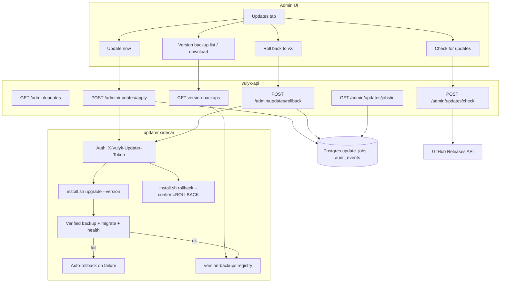

# In-app updates (Admin → Updates)

System administrators can check GitHub Releases and, on Docker Compose
deployments with the **updater sidecar**, apply a published version in one click.
The flow reuses the same data-safety guarantees as
[`./scripts/install.sh upgrade --version`](upgrade.md#data-safety-guarantees).

## Capabilities by environment

| Environment | Check for updates | Update now | Roll back / version backups |
|-------------|-------------------|------------|------------------------------|
| Compose + `updater` service | Yes (GitHub Releases) | Yes (sidecar) | Yes (typed `ROLLBACK`) |
| Kubernetes / Helm | Yes | No — show manual `helm upgrade` / install command | Manual `install.sh rollback` / restore |
| Source-only / no sidecar | Yes | No — show `./scripts/install.sh upgrade --yes --version X` | Show `install.sh rollback --confirm=ROLLBACK` |

The API **never** mounts the Docker socket. Only the updater sidecar does, and it
accepts commands solely over an internal network with a shared bearer token.

## Architecture



## Operator setup (Compose)

1. Set a strong shared token in `.env` / `.env.prod`:

   ```bash
   VULYK_UPDATER_TOKEN=$(openssl rand -hex 32)
   VULYK_UPDATER_URL=http://updater:9091
   VULYK_GITHUB_REPO=Ihor-Meat-Proxy/Vulyk
   ```

2. Include the updater service (see `docker-compose.yml` / `docker-compose.prod.yml`).

3. Open **Admin → Updates**, click **Check for updates**, then **Update now**.

## Security notes

- Only `RequireSystemAdmin` may call apply/check endpoints.
- Sidecar listens on the Compose network only (not published to the host by default).
- Token must match on API and updater; rotate by rewriting both env files (never
  regenerated by upgrade).
- Apply always runs the verified-backup + rollback path from
  [upgrade.md](upgrade.md#data-safety-guarantees).

## Related

- [upgrade.md](upgrade.md) — CLI upgrade guarantees
- [releasing.md](releasing.md) — how releases are published
- [user-guide.md](../user-guide.md) — Admin Updates UI

