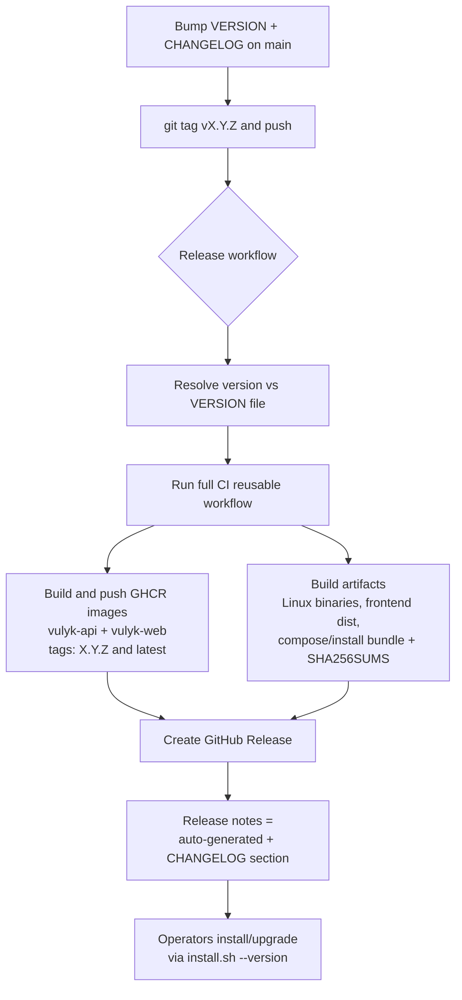

# Releasing Vulyk

How maintainers bump the version, publish a GitHub Release + GHCR images, and how
operators install or upgrade to a published release.

## Version single source of truth

| Location | Role |
|----------|------|
| [`VERSION`](../../VERSION) | Canonical semver (`0.3.0`) |
| [`Cargo.toml`](../../Cargo.toml) `[workspace.package].version` | Rust crates (`backend` / `cli` / `mcp` use `version.workspace = true`) |
| [`frontend/package.json`](../../frontend/package.json) | UI build (`VITE_APP_VERSION` via Vite) |
| [`deploy/helm/vulyk/Chart.yaml`](../../deploy/helm/vulyk/Chart.yaml) `appVersion` | Helm app semver |
| [`CHANGELOG.md`](../../CHANGELOG.md) | `## [X.Y.Z]` section required before tagging |

`/health` and `/ready` return `"version"` from `CARGO_PKG_VERSION`. The UI sidebar
(`data-testid="app-version"`) shows the same value from `/health`.

CI runs `./scripts/check-version.sh` so these stay aligned.

## Bump checklist

1. Update `VERSION` to the new semver.
2. Mirror it in `Cargo.toml` `[workspace.package].version` and `frontend/package.json`.
3. Set Helm `appVersion` (chart `version` may move independently).
4. Move notes from `## [Unreleased]` into `## [X.Y.Z] - YYYY-MM-DD` in `CHANGELOG.md`.
5. Run `./scripts/check-version.sh`.
6. Merge to `main`, then tag (see below).

## Publish flow



### Tag and push

```bash
# on main, after the bump PR is merged
git checkout main && git pull
./scripts/check-version.sh
git tag -a "v$(tr -d '[:space:]' < VERSION)" -m "Release v$(tr -d '[:space:]' < VERSION)"
git push origin "v$(tr -d '[:space:]' < VERSION)"
```

Pushing `v*.*.*` starts [`.github/workflows/release.yml`](../../.github/workflows/release.yml).

### Manual dispatch

Actions → **Release** → **Run workflow**:

- `version`: `0.3.0` (no leading `v` required)
- `create_tag`: set true only if the tag is missing on the selected ref

The workflow refuses to publish if `VERSION` (and related files) do not match the
requested semver.

### What gets published

| Artifact | Where |
|----------|--------|
| `ghcr.io/<owner>/vulyk-api:X.Y.Z` and `:latest` | GHCR |
| `ghcr.io/<owner>/vulyk-web:X.Y.Z` and `:latest` | GHCR |
| `vulyk-api-linux-amd64-*.tar.gz`, `vulyk-cli-linux-amd64-*.tar.gz` | GitHub Release |
| `vulyk-frontend-*.tar.gz` | GitHub Release |
| `vulyk-compose-*.tar.gz` (compose files + `install.sh`) | GitHub Release |
| `SHA256SUMS` | GitHub Release |

`<owner>` is the GitHub owner in lowercase (for this repo: `ihor-meat-proxy`).

## Install / upgrade a release

### First install from GHCR

```bash
# clone (or unpack the compose bundle from the Release)
git clone https://github.com/Ihor-Meat-Proxy/Vulyk.git
cd Vulyk

./scripts/install.sh compose --yes --version 0.3.0
# production:
./scripts/install.sh prod --yes --version 0.3.0 --admin-password='…'
```

`--version` pulls `ghcr.io/<owner>/vulyk-api` and `vulyk-web` and starts Compose
**without** a local Rust/Node build. Image names are written into `.env` /
`.env.prod` as `VULYK_API_IMAGE` / `VULYK_WEB_IMAGE`.

Override owner or full image refs if needed:

```bash
export VULYK_GHCR_OWNER=ihor-meat-proxy
# or:
export VULYK_GHCR_API_IMAGE=ghcr.io/ihor-meat-proxy/vulyk-api:0.3.0
export VULYK_GHCR_WEB_IMAGE=ghcr.io/ihor-meat-proxy/vulyk-web:0.3.0
```

Private packages: `echo $CR_PAT | docker login ghcr.io -u USER --password-stdin`.

### Upgrade to a release

```bash
# Preferred: pull published images (keeps Postgres volume + verified backup/rollback)
./scripts/install.sh upgrade --yes --version 0.3.0

# Alternative: checkout a git tag and rebuild from source
./scripts/install.sh upgrade --yes --to=v0.3.0
```

Do **not** pass both `--version` and `--to`. Upgrades never regenerate secrets or
`.env`; see [upgrade.md — data-safety guarantees](upgrade.md#data-safety-guarantees).

### Still supported: build from source

```bash
./scripts/install.sh compose --yes          # local build
./scripts/install.sh upgrade --yes          # git pull + rebuild
```

## Helm

```bash
helm upgrade --install vulyk deploy/helm/vulyk --namespace vulyk --create-namespace \
  --set image.api=ghcr.io/ihor-meat-proxy/vulyk-api:0.3.0 \
  --set image.web=ghcr.io/ihor-meat-proxy/vulyk-web:0.3.0 \
  --set secrets.create=true \
  --set setup.adminPassword=change-me-admin1
```

## Permissions the repo needs

The Release workflow uses `GITHUB_TOKEN` with `contents: write` and `packages: write`.

If the workflow fails on GHCR push or Release creation, a repo admin should verify:

1. **Actions permissions** — Settings → Actions → General → Workflow permissions:
   **Read and write permissions** (or a fine-grained token with `packages:write` /
   `contents:write` stored as a secret and wired into the workflow).
2. **GHCR package visibility** — after the first push, Package settings →
   Change visibility to **Public** if anonymous pulls should work.
3. **Actions allowed to create releases** — same Workflow permissions as above;
   do not restrict `softprops/action-gh-release` via an allowlist that blocks it.

## Related

- [upgrade.md](upgrade.md) — backups, migrate CLI, Helm hooks
- [admin-guide.md](../admin-guide.md) — production Compose / Helm
- [CONTRIBUTING.md](../../CONTRIBUTING.md) — migration and version bump rules
