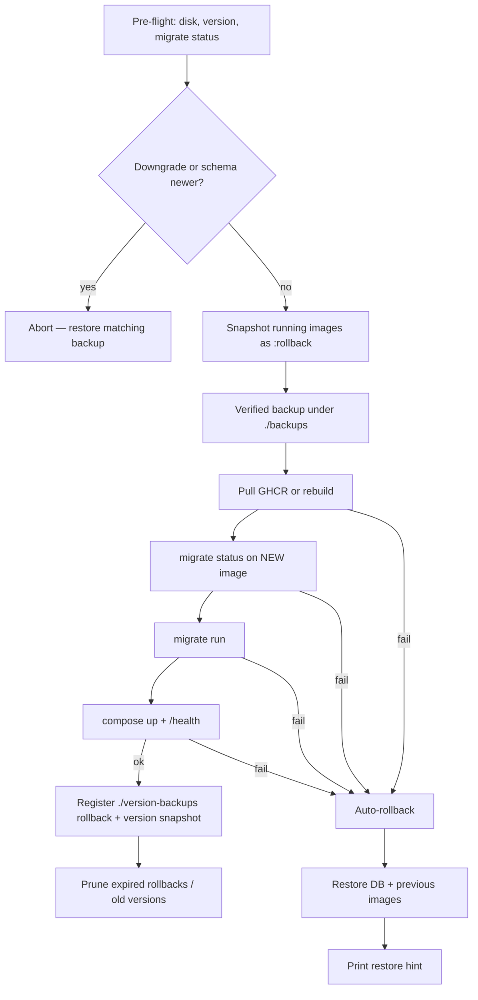

# Upgrading Vulyk

Safe upgrades keep the **Postgres named volume / PVC** and **never regenerate**
secrets, `.env`, admin passwords, or user/instance settings. Schema changes are
forward-only SQLx migrations. Prefer the install script or Helm migrate Job over
hand-editing the database.

## Data-safety guarantees

These apply to `./scripts/install.sh upgrade` / `backup` / `restore` and to any
in-app one-click updater that wraps the same flow.

| Guarantee | Behavior |
|-----------|----------|
| **Verified backup first** | Before touching images or schema, create a timestamped bundle under `./backups/` (never overwritten). Includes gzip SQL dump, `.env` / `.env.prod`, image pins, and optional attachments volume archive. The dump is **integrity-checked** (`gzip -t`) and **restored into a temporary database** before the upgrade continues. |
| **Retention** | Keep the last `VULYK_BACKUP_RETENTION` ad-hoc bundles under `./backups/` (default **10**). Older bundles are pruned; current upgrade’s bundle is never overwritten. |
| **Post-upgrade rollback point** | After a **successful** upgrade, the pre-upgrade verified bundle is also registered under `./version-backups/` as a **rollback point** for `VULYK_ROLLBACK_RETENTION_DAYS` (default **7**), plus a **version snapshot** counted in `VULYK_VERSION_BACKUP_COUNT` (default **3**). Separate from content backups (#30). |
| **Safe operator rollback** | `./scripts/install.sh rollback [--version X] --confirm=ROLLBACK` takes a fresh backup of the current state, restores previous images + DB, health-checks, and writes an audit event. Typed `ROLLBACK` confirmation is required (data created after the upgrade is lost). Never deletes a rollback point while `in_progress`. |
| **Config preservation** | Upgrade **does not** overwrite `.env`, `VULYK_JWT_SECRET`, `VULYK_SECRETS_KEY`, `POSTGRES_PASSWORD`, or admin password. **Missing** keys are appended from [`.env.example`](../../.env.example) (source of truth) via `scripts/env_settings.py`: defaults as written, `@vulyk:secret` keys get a generated value, additions are logged, and `.env` is **backed up** first (`*.bak-<timestamp>`). |
| **Pre-flight** | Free disk (`VULYK_MIN_FREE_MB`, default 2048), **config gap report**, current version from `/health` **or** git/compose when the API is stopped (curl failures must not abort), `migrate status` on current image. **Blocks** when the DB schema is newer than the binary. **Blocks** semver downgrades unless `--allow-downgrade` (prefer restore-from-backup). |
| **Additive migrations** | Production migrations are forward-only, expand/contract safe, and applied in a transaction under a Postgres advisory lock (`vulyk-api migrate run`). |
| **Auto-rollback** | If image pull/build, migrate, compose up, or health check fails: restore the verified DB dump, re-pin previous `vulyk-api:rollback` / `vulyk-web:rollback` images, restart, and print restore instructions. The Postgres volume is never removed (`down -v` is forbidden). |
| **Encrypted secrets** | LLM / SSO / automation tokens stay encrypted at rest under `VULYK_SECRETS_KEY`. That key must survive upgrades (copied in the backup bundle). CI asserts decrypt-after-upgrade. |



### Version-backup lifecycle

```mermaid
flowchart LR
  U[Successful upgrade A to B] --> VB["version-backups/vb-A-…"]
  VB --> RoleR[role: rollback expires in N days]
  VB --> RoleV[role: version keep last M]
  RoleR -->|expired and not in_progress| DropR[Drop rollback role]
  RoleV -->|beyond M and not current and not unexpired rollback| DropV[Delete bundle]
  Admin[Admin Updates / install.sh rollback] -->|typed ROLLBACK| Fresh[Fresh backup of B]
  Fresh --> Restore[Restore images + DB from vb-A]
  Restore --> Health[/health OK]
  Health --> Audit[audit_events + version-backups/audit.log]
```

## Critical warning

**Never run `docker compose down -v` (or `docker compose down --volumes`) on an
instance whose data you care about.** The `-v` flag deletes named volumes,
including Postgres data. Use `docker compose down` without `-v`, or stop
individual services (`docker compose stop api web`).

## Compose (local / production)

### Recommended: `./scripts/install.sh upgrade`

```bash
# Verified backup → pull/rebuild → migrate run → up → health check
./scripts/install.sh upgrade --yes

# Preferred: upgrade to a published release (GHCR images, no local build)
./scripts/install.sh upgrade --yes --version 0.1.0

# Or pin a git tag/branch and rebuild from source
./scripts/install.sh upgrade --yes --to=v0.1.0

# Skip backup only when you already have an off-box dump (NOT recommended)
./scripts/install.sh upgrade --yes --no-backup

# Within N days of a successful upgrade: restore the pre-upgrade point
./scripts/install.sh rollback --confirm=ROLLBACK
./scripts/install.sh rollback --version 0.1.0 --confirm=ROLLBACK
```

What it does:

1. **Preflight (report only)** — Docker, free disk, current version (`/health` if
   up, else git / compose image pin), **config gaps** vs `.env.example`,
   downgrade guard, `migrate status` (exit 2 = schema newer). A stopped API must
   not abort preflight.
2. **Confirm** — then backup `.env` / `.env.prod` and **sync missing keys** from
   `.env.example` (log additions; never overwrite existing values; generate
   `@vulyk:secret` values when the default is empty)
3. **Snapshot images** — tag running api/web as `:rollback` for automatic recovery
4. **Verified backup bundle** — `./backups/vulyk-<version>-<timestamp>/` with
   `db.sql.gz` (temp-DB verified), `config/` (env + secrets), optional
   `attachments.tar.gz`, `SHA256SUMS` (retention via `VULYK_BACKUP_RETENTION`)
5. **Target** — `--version` pulls GHCR images; `--to` checks out git; else
   `git pull --ff-only` + local rebuild (do not combine `--version` and `--to`)
6. **Stop API/web only** (DB volume untouched)
7. **One-shot migrate** — `vulyk-api migrate run` **before** starting the new API
8. **Start** stack and **health-check** `/health` (includes `version`)
9. **On failure** — automatic DB restore + previous images, then clear restore hints
10. **On success** — copy the pre-upgrade bundle into `./version-backups/` as a
    rollback point (`VULYK_ROLLBACK_RETENTION_DAYS`) and a version snapshot
    (`VULYK_VERSION_BACKUP_COUNT`); prune expired / excess points (never while
    a rollback is in progress; never the current version’s snapshot)

### `.env.example` sync markers

| Marker | Meaning |
|--------|---------|
| *(uncommented `KEY=`)* | Synced on install/upgrade if missing |
| `@vulyk:sync` | Sync even when the example line is commented |
| `@vulyk:secret` | Generate a random value when adding a missing empty default |
| `@vulyk:required` | Preflight reports a gap if missing/empty |
| `@vulyk:nosync` | Never auto-append |

CI: `./scripts/ci-env-upgrade-test.sh` seeds an operator `.env` from the previous
release tag (default `v0.2.0`) and asserts HEAD sync + `docker compose config`.

Operator rollback (`install.sh rollback`) always:

1. Requires typed confirmation `ROLLBACK` (warns that post-upgrade data is lost)
2. Takes a **fresh** verified backup of the current state first
3. Restores previous image pins + DB from the version-backup bundle
4. Health-checks `/health` and appends an audit record

Publishing releases and first-time `--version` installs:
[releasing.md](releasing.md).

### Manual backup / restore

```bash
./scripts/install.sh backup
# Bundle dir, e.g. ./backups/vulyk-0.1.0-20261026T120000Z/
./scripts/install.sh restore ./backups/vulyk-0.1.0-20261026T120000Z/ --yes
# Legacy flat dumps still work:
./scripts/install.sh restore ./backups/vulyk-0.1.0-20260101T120000Z.sql.gz --yes
```

Restore **does not** overwrite an existing `.env` / `.env.prod` if present (avoids
clobbering a newer secret you intentionally rotated). If those files are missing,
they are copied from the bundle. Always keep an off-box copy of `VULYK_SECRETS_KEY`.

### Environment

| Variable | Compose dev | Compose prod | Meaning |
|----------|-------------|--------------|---------|
| `VULYK_AUTO_MIGRATE` | `true` (default) | `false` | Apply migrations on API startup |
| `VULYK_BACKUP_RETENTION` | `10` | `10` | Ad-hoc backup bundles to keep under `./backups/` |
| `VULYK_VERSION_BACKUP_DIR` | `./version-backups` | same | Version / rollback points (**not** content backups) |
| `VULYK_ROLLBACK_RETENTION_DAYS` | `7` | `7` | How long a post-upgrade rollback point stays usable |
| `VULYK_VERSION_BACKUP_COUNT` | `3` | `3` | Keep one verified snapshot per last N installed versions |
| `VULYK_MIN_FREE_MB` | `2048` | `2048` | Minimum free disk before upgrade |

Prod Compose expects migrations from `install.sh upgrade` (or
`docker compose run --rm api vulyk-api migrate run`) before the API serves
traffic. If auto-migrate is off and migrations are pending, the API **refuses
to start**.

### CLI reference

```bash
vulyk-api version              # semver from Cargo.toml
vulyk-api migrate status       # applied + pending (exit 1 if pending, 2 if schema newer)
vulyk-api migrate run          # apply pending (Postgres advisory lock)
```

Downgrade protection: if the database has migrations the binary does not know,
the API and `migrate run` refuse to proceed. Restore a matching backup or deploy
a newer binary. App-level semver downgrades via `--version` are refused unless
`--allow-downgrade` is set — restoring a backup is the supported path.

## Production checklist

1. Schedule / take a backup (`install.sh backup` or off-box `pg_dump` + env copy).
2. Read the release notes / changelog for the target tag.
3. Confirm free disk and that `VULYK_SECRETS_KEY` / JWT / Postgres password are set.
4. Run `./scripts/install.sh upgrade --yes --version X.Y.Z` (or `--to=vX.Y.Z`).
5. Confirm `/health` returns `"status":"ok"` and the expected `"version"`.
6. Spot-check sample projects, encrypted LLM/SSO configs, and critical cases.
7. Keep the backup bundle until the next successful upgrade.

## Helm / Kubernetes

Chart path: [`deploy/helm/vulyk`](../../deploy/helm/vulyk).

In-app one-click update is **Compose-oriented**. On Kubernetes, use Helm + your
own PVC/VolumeSnapshot backups; the Admin UI will show the manual upgrade command
instead of **Update now**.

### Migrate Job (pre-upgrade hook)

On `helm upgrade`, a Job runs `vulyk-api migrate run` **before** API pods roll
(`helm.sh/hook: pre-upgrade`). Fresh installs migrate via an API **initContainer**
(same command; advisory-locked so replicas do not race).

API pods set `VULYK_AUTO_MIGRATE=false` (see `values.yaml` → `migrate.autoMigrate`).

### Backup before upgrade

```bash
kubectl exec -n vulyk deploy/vulyk-postgresql -- \
  pg_dump -U vulyk -d vulyk -Fc > "vulyk-$(date -u +%Y%m%dT%H%M%SZ).dump"
# Also back up Secrets (VULYK_SECRETS_KEY, JWT) and attachment PVCs.
```

Prefer VolumeSnapshots for large PVCs in addition to logical dumps.

### PVC retention

`postgresql.persistence.keepOnUninstall: true` (default) annotates the PVC with
`helm.sh/resource-policy: keep` so `helm uninstall` does **not** delete Postgres
data. Set to `false` only for disposable demos.

### Example upgrade

```bash
# 1) Backup (above)
# 2) Upgrade chart / images
helm upgrade vulyk deploy/helm/vulyk --namespace vulyk \
  --set image.api=ghcr.io/ihor-meat-proxy/vulyk-api:0.1.0 \
  --set image.web=ghcr.io/ihor-meat-proxy/vulyk-web:0.1.0

# 3) Watch migrate hook + rollout
kubectl get jobs -n vulyk
kubectl rollout status deploy/vulyk-vulyk-api -n vulyk
curl -fsS https://vulyk.example/health
```

Setup Job is **post-install only** (not re-run on every upgrade).

### API image packages

The `vulyk-api` runtime image installs **`git`** so the **generic** automation-repo
provider can shallow-clone. GitHub/GitLab providers index via REST and do not need
it. No schema migration is required for that change — redeploy the API image only.
Details: [automation-repo.md](../automation-repo.md#upgrade-notes).

### Automation repo Actions CI columns

Forward migration `20261027140000_automation_repo_actions_ci.sql` adds encrypted
Actions write-token columns and `ci_workflow_file` / `ci_workflow_ref` for
**Run in CI**. Applied automatically by `install.sh upgrade` / Helm migrate Job.
No rollback SQL — restore from the verified pre-upgrade backup if needed.

## Versioning

- Canonical semver is the root [`VERSION`](../../VERSION) file; Rust crates inherit
  `[workspace.package].version`, and `frontend/package.json` + Helm `appVersion`
  must match (`./scripts/check-version.sh`).
- Tag releases as `vMAJOR.MINOR.PATCH` to run the Release workflow (GHCR + GitHub
  Release artifacts). See [releasing.md](releasing.md).
- `/health` and `/ready` include `"version"`. The UI sidebar footer shows the same
  value from `/health`.

## CI coverage

The **Upgrade (base → PR)** job (`scripts/ci-upgrade-test.sh`) installs the PR base
with sample data, upgrades to HEAD, asserts projects/cases, requirements, runs,
settings, custom fields, and an encrypted LLM API key still decrypt with the same
`VULYK_SECRETS_KEY`, then restores the pre-upgrade dump (rollback) and asserts the
post-upgrade marker is gone while pre-upgrade data/config match. Prune/expiry of
`./version-backups/` is covered by `scripts/test-version-backups.py`.

## Related

- [Releasing (tags, GHCR, install --version)](releasing.md)
- [Migration authoring rules](../../CONTRIBUTING.md#database-migrations)
- [Admin guide — backups](../admin-guide.md#backups)
- [First-run setup](first-run-setup.md)
