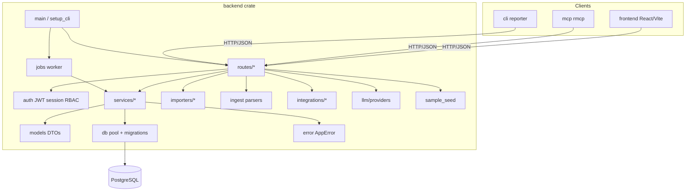
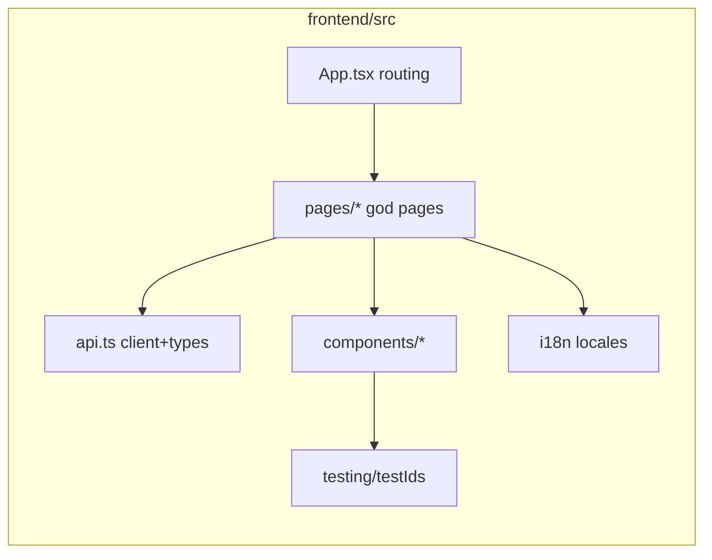

# Vulyk code quality audit — 2026-10

Snapshot audit of backend (Rust / Axum / SQLx), frontend (React / TypeScript),
and scripts. Findings cite `file:line` on the tree as of this document’s landing
commit. Parallel agents land frequently — re-verify line numbers after rebase.

**Scope:** production request paths, shared UI, CI helpers. Unit-test-only
`unwrap`/`expect` are noted only when they hide production risk.

## Module overview

### Largest modules (churn / god-file risk)

| Area | File | ~LOC | Concern |
|------|------|------|---------|
| Backend | `sample_seed.rs` | 1380 | Seed composition + admin DB writes |
| Backend | `services/case_export.rs` | 1319 | PDF layout + SQL + ZIP |
| Backend | `routes/cases.rs` | 1177 | List/CRUD/bulk/export/custom fields |
| Backend | `services/campaigns.rs` | 1149 | CRUD + dashboard + counters |
| Backend | `sso.rs` | 1142 | Providers + OAuth + JIT user |
| Frontend | `api.ts` | 2604 | Types + ~154 methods + 4 blob downloads |
| Frontend | `pages/Admin.tsx` | 1982 | 11 admin panels in one file |
| Frontend | `pages/CaseDetail.tsx` | 1327 | Editor + history + executions + PDF |
| Frontend | `pages/CaseList.tsx` | 1020 | Filter/sort/bulk/folders/columns |
| Frontend | `pages/Settings.tsx` | 1027 | Profile + tokens + repos (overlaps Admin) |

---

## Prioritised findings

### P0 — Correctness / availability

| ID | Finding | Location | Recommendation |
|----|---------|----------|----------------|
| P0-1 | Blocking `git` + `std::fs` on async request path (`sync_and_index`, delete cleanup) | `routes/automation_repos.rs:815+`, `services/automation_repo.rs:69+`, `:246`, `routes/automation_repos.rs:417` | `tokio::task::spawn_blocking` for sync/index/test/remove; timeout |
| P0-2 | Argon2 hash/verify runs on Tokio worker threads | `auth/password.rs:132–168`, callers in `routes/auth.rs:252+` | Async wrappers via `spawn_blocking`; keep sync API for seed/CLI |
| P0-3 | Ingest N+1 case lookup + per-row `last_automation_*` UPDATE; counter refresh swallowed | `services/ingest.rs:45–97`, `:128` | Batch `WHERE key = ANY($1)`; single `UPDATE … FROM UNNEST`; `tracing::warn!` on counter failure |
| P0-4 | `genpdf` `.expect` can panic PDF export worker | `services/case_export.rs:737–789` | Propagate `AppError::Internal` from table builders |
| P0-5 | `HeaderValue::unwrap` on download responses | `routes/reports.rs:532–538` | Sanitize filename; `map_err` → `AppError` (content-types are consts today; still harden) |
| P0-6 | Index-as-key on editable step list (focus/content bleed on reorder) | `pages/CaseDetail.tsx:867–876` | Stable `clientKey` / server step `id`; strip before API |
| P0-7 | Index-as-key on chat turns/drafts despite stable `turn.id` | `pages/Chat.tsx:345–353`, `:437`, `:555` | `key={turn.id}` (and draft ids) |
| P0-8 | History/executions effect omits loader/filter deps (stale closures) | `pages/CaseDetail.tsx:413–420` | `useEffectEvent` for loaders (already used for save) |
| P0-9 | Silent `limit: 500` truncation in generate/picker | `Generate.tsx:92`, `CasePicker.tsx:46` | Page until covered or warn “first N” |

### P1 — Integrity / scale / consistency

| ID | Finding | Location | Recommendation |
|----|---------|----------|----------------|
| P1-1 | Importer suite create outside per-case tx | `importers/persist.rs:29–118` | One import (or chunk) transaction |
| P1-2 | LLM bulk / results / run_reports enrichment N+1 | `routes/llm.rs:457+`, `services/results.rs:155+`, `run_reports.rs:362–390`, `:583` | `ANY($1)` + join once |
| P1-3 | Custom field bulk upsert existence check per item | `routes/cases.rs:1081–1100` | Single ownership query |
| P1-4 | Swallowed integration / backup / import errors | `routes/integrations.rs:319`, `integrations/jira_*.rs:67`, `backup/mod.rs:530+`, `imports.rs:141` | Warn + partial-failure fields; never `unwrap_or_default` on serde preview |
| P1-5 | Error-type drift (`String` / `Box<dyn Error>` vs `AppError`); remote HTTP → BadRequest | `ingest/*`, `jobs/mod.rs`, `db/mod.rs`, integration clients | Parsers → typed errors; transport → 502/Internal |
| P1-6 | `last_automation_*` columns lack indexes | `migrations/20261026190000_*.sql:98–100` | `(project_id, last_automation_at DESC)` if filtered |
| P1-7 | Project-wide `ORDER BY sort_order` vs index `(suite_id, sort_order, key)` | `20261026150000_*` | Consider `(project_id, sort_order, key)` |
| P1-8 | In-memory sort of up to 20k run results | `services/run_reports.rs:572–579` | SQL `ORDER BY` + `LIMIT` for common sorts |
| P1-9 | Admin updates poll resets interval every tick (`activeJob` object dep) | `pages/Admin.tsx:1244–1261` | Depend on `id` + status; ref for latest |
| P1-10 | Whole pages skip `t()` (locale key parity OK, call-site coverage not) | `ImportPage.tsx`, `Runs.tsx`/`RunsPage.tsx`, `RequirementsPage.tsx`, `PwaToasts.tsx`, parts of `Admin`/`CaseDetail`/`Layout` | Add keys to all of `en/uk/fr/es/de` |
| P1-11 | Four copy-pasted blob download flows in `api.ts` | `api.ts:~1700`, `~1848`, `~1878`, `~2584` | Shared `downloadBlob(path)` helper |
| P1-12 | `std::sync::Mutex` login throttle on async hot path | `auth/login_throttle.rs:44–47` | `parking_lot` / `DashMap` / Redis for multi-instance |

### P2 — Maintainability / hygiene

| ID | Finding | Location | Recommendation |
|----|---------|----------|----------------|
| P2-1 | Duplicated importer / Jira-family HTTP skeletons | `importers/*`, `integrations/jira_cloud.rs`, `jira_dc.rs`, `openproject.rs` | Shared `json_request` + pointer helpers |
| P2-2 | Effects for derived/reset state | `Admin.tsx:118`, `CaseList.tsx:343`, `Settings.tsx:104`, `ImportPage.tsx:58` | Reset in event handlers; derive active tab |
| P2-3 | Prop drilling `projectId`/`suites` through ~15 routes | `App.tsx:210–286`, `CaseFolderTree` 8 callbacks | `ProjectContext`; folder mutation hook |
| P2-4 | Dead `Placeholder` page | `pages/Placeholder.tsx` | Delete or wire |
| P2-5 | Magic numbers (page sizes, poll 2000ms, toast 2200ms, attach 5MiB) | Various | Named consts / settings (some already named — keep pattern) |
| P2-6 | Weak frontend unit tests (`typeof api.foo === 'function'`) | `api.test.ts` | Assert URL/method/body like PDF tests |
| P2-7 | E2E `waitForTimeout(500)` | `e2e/tests/status-sample.spec.ts:64` | Prefer `getByTestId` + expect visible |
| P2-8 | No `any` in app TS (good); rare test/platform casts only | `CaseExport.test.ts`, `platform.ts:38` | Keep; restore globals in tests |
| P2-9 | `auth/extractor.rs:245` `header.unwrap()` after None check | Prefer `let Some(h) = … else` | Clarity, no behaviour change |
| P2-10 | Scripts are solid (`check.sh` mirrors CI); install/upgrade are long but linear | `scripts/check.sh`, `install.sh`, `ci-upgrade-test.sh` | Keep; avoid embedding business logic |

---

## Recommended refactor sequence (behaviour-preserving)

1. **Panic hygiene** — PDF `expect` → `AppError`; attachment `HeaderValue` helper.
2. **Ingest batching** — batch `last_automation_*` updates + warn on counter failures (no API shape change).
3. **React list keys + stale loaders** — CaseDetail `clientKey`, Chat `turn.id`, `useEffectEvent`.
4. **Argon2 `spawn_blocking`** — async helpers at auth route boundary.
5. **`downloadBlob` extract** — shrink `api.ts` duplication without splitting types yet.
6. **Index migration** — `last_automation_*` (unique timestamp after rebase).
7. **Split god files** — Admin panels / CaseDetail tabs / `api` types vs client (file moves only).
8. **i18n call-site coverage** — Import / Runs / Requirements / PwaToasts.
9. **Importer + LLM N+1** — after metrics confirm hot paths.

## Follow-up PRs from this audit

Track landing of mechanical P0/P1 fixes in focused PRs (rebase on latest `main` before merge; never hardcode `VQA-*` seed keys; use `TestIds`).

| Theme | Status |
|-------|--------|
| This report (`docs/quality/code-quality-2026-10.md`) | This PR |
| Report download headers + PDF expect removal | Planned sibling PR |
| Ingest batch denorm updates + warn | Planned sibling PR |
| CaseDetail/Chat stable keys + effect fix | Planned sibling PR |
| Argon2 spawn_blocking | Planned sibling PR |

## References

- Agent / parallel-PR rules: [`AGENTS.md`](../../AGENTS.md)
- CI failure catalog: [`ci-failures.md`](../ci-failures.md)
- Architecture boundaries: [`architecture.md`](../architecture.md)
- Test id pattern: [`testing/test-ids.md`](../testing/test-ids.md)
