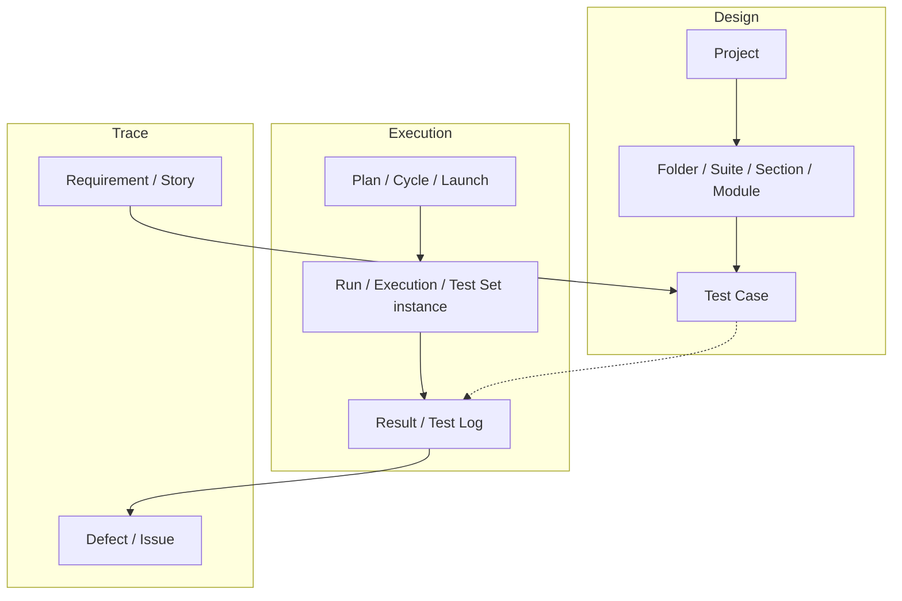
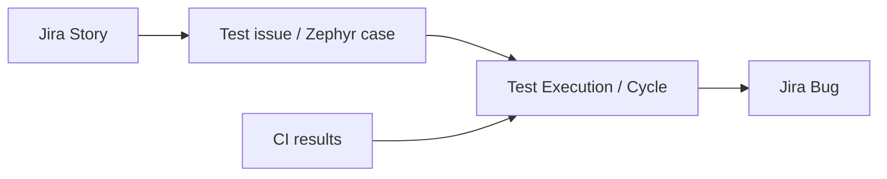
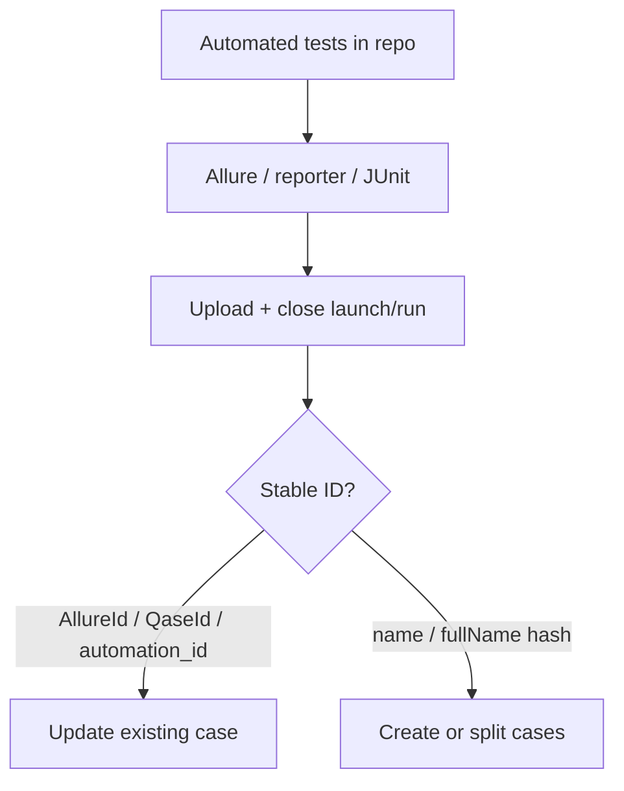
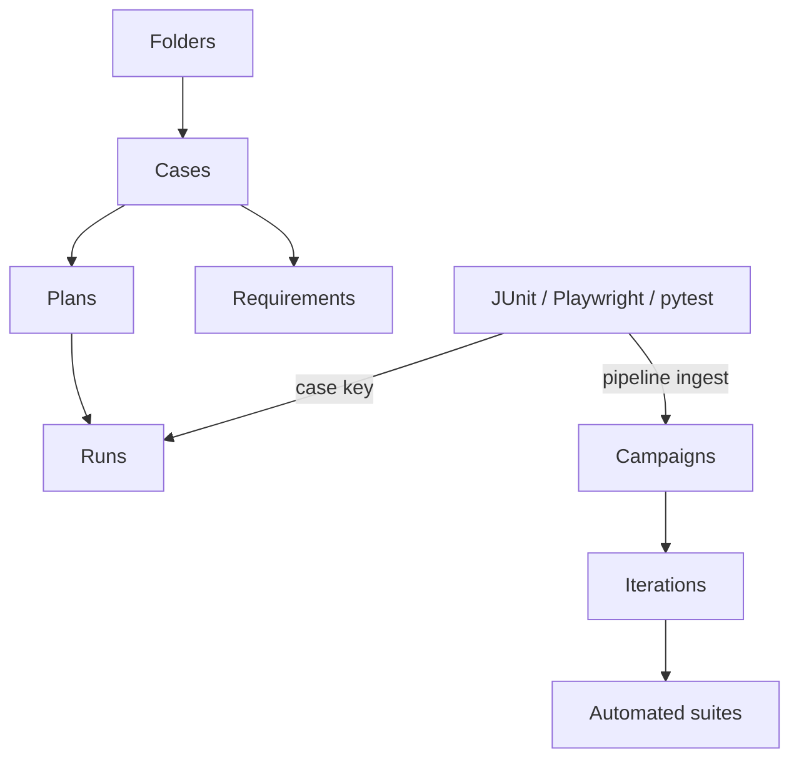

# Competitive review: top paid test management systems

**Audience:** Vulyk feature planning  
**Research date:** 2026-11-14  
**Scope:** 20 paid / popular TMS products (per-tool briefs in this folder)  
**Method:** Official docs, pricing pages, API references, changelogs, and reviews (G2, Capterra, TrustRadius, Reddit, Atlassian Marketplace). Claims not confirmed are marked *not found in docs* in the per-tool files.  
**Vulyk baseline:** Self-hosted AGPL TMS (Rust/Axum, Postgres, React) — see repo `docs/architecture.md`, `docs/user-guide.md`, `docs/guides/ci-integration.md`.

Per-tool files:

| Slug | Tool |
| --- | --- |
| [testrail.md](./testrail.md) | TestRail |
| [zephyr-scale.md](./zephyr-scale.md) | Zephyr Scale / Zephyr Standard |
| [zephyr-squad.md](./zephyr-squad.md) | Zephyr Squad / Zephyr Essential |
| [xray.md](./xray.md) | Xray |
| [qtest.md](./qtest.md) | Tricentis qTest |
| [practitest.md](./practitest.md) | PractiTest |
| [testmo.md](./testmo.md) | Testmo |
| [qase.md](./qase.md) | Qase |
| [allure-testops.md](./allure-testops.md) | Allure TestOps |
| [azure-test-plans.md](./azure-test-plans.md) | Azure Test Plans |
| [browserstack-test-management.md](./browserstack-test-management.md) | BrowserStack Test Management |
| [testlodge.md](./testlodge.md) | TestLodge |
| [testiny.md](./testiny.md) | Testiny |
| [qa-touch.md](./qa-touch.md) | QA Touch |
| [spiratest.md](./spiratest.md) | SpiraTest |
| [aqua-cloud.md](./aqua-cloud.md) | aqua cloud |
| [testcollab.md](./testcollab.md) | TestCollab |
| [kualitee.md](./kualitee.md) | Kualitee |
| [testflo.md](./testflo.md) | TestFLO |
| [testmonitor.md](./testmonitor.md) | TestMonitor |

---

## 1. Executive summary

The paid TMS market splits into three product shapes: **standalone SaaS** (TestRail, Qase, Testmo, PractiTest, Testiny, …), **Jira-native apps** (Xray, Zephyr Scale/Essential, TestFLO), and **ALM-suite modules** (Azure Test Plans, SpiraTest, qTest, aqua). Almost every vendor now markets AI case generation, CI reporters, and SSO on upper tiers. Differentiation is less “has runs/plans” and more **automation identity** (how CI results become cases), **deployment** (cloud-only vs self-host), and **where requirements/defects live**.

**License models (all 20):** Every TMS product in this review is **closed source / proprietary commercial**. None of the twenty is open source or classic open-core for the TMS application itself. Notable **open-source companions** (not the TMS): **Allure Report** (Apache-2.0, `allure-framework/allure2`) beside proprietary Allure TestOps; **TestRail CLI `trcli`** (MPL-2.0, `gurock/trcli`); **Qase reporters/SDKs** (typically Apache-2.0 under `qase-tms`). Vulyk’s **AGPL self-hosted** positioning is therefore rare among this peer set (Kiwi/TestLink/Squash are OSS peers outside this paid list).

**Auto-create from CI (headline):** A clear majority of modern tools can create repository or automation cases when CI uploads unknown tests — usually behind a flag or by default. TestRail (TRCLI `-y`), Zephyr Scale (`autoCreateTestCases`), Xray (JUnit/Xray JSON paths), qTest (bulk automation logs), Qase (default), Allure TestOps (on launch close), Testmo (automation entities), PractiTest (Auto Create Run / FireCracker), BrowserStack TM, Testiny, TestCollab (`--auto-create`), TestFLO, TestMonitor, and parts of Kualitee all document some form of auto-create. **Azure Test Plans**, **TestLodge**, **SpiraTest** (official xUnit path), **QA Touch** (typical reporters), and **aqua cloud** (documented ingest) do **not** auto-create cases from unmatched CI results (or require pre-existing IDs). Vulyk today matches by case key and **does not** auto-create cases — only campaigns/iterations/suites.

**Pricing pattern:** Standalone tools are mostly **$/user/month** ($12–$78 list) or **flat blocks** (Testmo, TestLodge). Jira apps bill by **Jira user tier**. Enterprise (qTest, aqua bundles, Spira concurrent seats) is often quote/concurrent. Free forever tiers: Qase, Testiny, Kualitee, QA Touch (limited).

**Implication for Vulyk:** Keep the AGPL self-host wedge; close the **optional CI auto-create + stable automation ID** gap that Qase/Allure/TestRail/Zephyr already sell; deepen shared steps/parameters/configs; avoid Jira-only lock-in and seat-tax UX that reviewers hate.

---

## 2. Feature comparison matrix

Legend: ✅ strong / first-class · ◐ partial / tier-gated / limited · ✕ absent or not found · ? unclear in docs

| Tool | License model | Entities | Authoring | Execution | Traceability | Reporting | AI | Permissions / SSO | Import / export |
| --- | --- | --- | --- | --- | --- | --- | --- | --- | --- |
| TestRail | Closed (+ OSS CLI MPL-2.0) | ✅ suites/sections/cases/runs/plans/milestones/configs | ✅ shared steps, BDD, params (Ent) | ✅ manual + automation | ✅ refs/defects | ✅ rich reports | ✅ gen cases/BDD | ◐ SSO Ent | ✅ CSV/XML |
| Zephyr Scale | Closed | ✅ cases/cycles/plans in Zephyr DB | ✅ BDD, params, call-to-test | ✅ | ✅ via Jira | ✅ | ◐ Halo/Rovo | via Jira | ✅ |
| Zephyr Squad/Essential | Closed | ✅ Jira issues / cycles | ◐ | ✅ | ✅ Jira | ◐ | ◐ | via Jira | ✅ |
| Xray | Closed | ✅ Tests/Precond/Plans/Exec as issues | ✅ BDD-native | ✅ | ✅ Jira links | ✅ | ◐ | via Jira | ✅ |
| qTest | Closed | ✅ modules/cases/cycles/suites/releases | ✅ | ✅ + Launch | ✅ Jira | ✅ Insights | ◐ | ✅ enterprise | ✅ |
| PractiTest | Closed | ✅ reqs/tests/sets/runs/issues | ✅ scripted/BDD/exploratory | ✅ | ✅ | ✅ dashboards | ✅ Value Score (Corp) | ◐ SSO Corp | ✅ |
| Testmo | Closed | ✅ repo + automation sources | ✅ | ✅ unified | ◐ milestones | ✅ automation analytics | ◐ | ◐ | ✅ |
| Qase | Closed (+ OSS reporters Apache-2.0) | ✅ suites/cases/runs/plans/milestones | ✅ shared steps, Gherkin | ✅ | ✅ RTM | ✅ | ✅ credits | ✅ Teams+ | ✅ |
| Allure TestOps | Closed (+ Allure Report Apache-2.0) | ✅ cases/launches/plans/trees | ✅ shared steps | ✅ manual+auto | ✅ issues | ✅ analytics/flaky | ◐ | ✅ | ✅ CSV/PDF |
| Azure Test Plans | Closed (Microsoft) | ✅ plans/suites/cases/points/configs | ◐ work-item steps | ✅ web runner | ✅ Boards | ◐ | ✕ TMS AI | ✅ Entra | ◐ |
| BrowserStack TM | Closed | ✅ folders/cases/runs/plans | ✅ + AI agents | ✅ | ✅ trackers | ✅ | ✅ | ◐ | ✅ |
| TestLodge | Closed | ✅ plans/suites/cases/runs/configs | ◐ simple | ✅ manual-first | ✅ RTM | ◐ | ✕ | ◐ | ✅ CSV |
| Testiny | Closed | ✅ folders/cases/plans/runs/milestones | ✅ | ✅ + automation | ◐ | ✅ | ◐ MCP | ✅ Business+ | ✅ |
| QA Touch | Closed | ✅ modules/cases/runs | ◐ | ✅ | ◐ | ◐ | ✅ gen | ◐ SSO Unlimited | ✅ |
| SpiraTest | Closed | ✅ reqs/cases/sets/runs/incidents/releases | ✅ | ✅ | ✅ full ALM | ✅ | ◐ | ✅ | ✅ |
| aqua cloud | Closed | ✅ reqs/cases/plans/bugs | ✅ params | ✅ | ✅ | ✅ | ✅ Intelligence | ✅ | ✅ |
| TestCollab | Closed | ✅ suites/cases/plans/runs | ✅ | ✅ | ✅ | ✅ | ✅ Copilot Elite | ◐ | ✅ |
| Kualitee | Closed | ✅ cases/cycles/defects | ✅ | ✅ | ◐ | ◐ | ✅ Hootie | ◐ | ✅ |
| TestFLO | Closed | ✅ Jira TC/TP/Plan | ✅ | ✅ | ✅ Jira | ◐ | ✕ / not found | via Jira | ✅ |
| TestMonitor | Closed | ✅ risks/reqs/cases/runs/issues | ✅ | ✅ | ✅ | ✅ | ✕ / not found | ✅ OIDC | ✅ |
| **Vulyk (today)** | **AGPL open source** | ✅ folders/cases/plans/runs/campaigns/reqs | ◐ no shared steps/params | ✅ + offline PWA | ✅ Jira/OP | ✅ flaky/coverage | ✅ LLM+MCP | ✅ OIDC | ✅ many importers |

---

## 3. Entity models and flows

### 3.1 Common patterns



| Concept | Typical names | Notes |
| --- | --- | --- |
| Case container | Suite, section, folder, module, tree | Nested almost everywhere |
| Case | Test case / Test issue | Keys: `C123`, `PROJ-T1`, `DEMO-42`, Allure ID |
| Execution container | Run, cycle, execution, launch, test set | Some tools split manual vs automation runs |
| Plan | Test plan, cycle group, launch from plan | Optional milestone/release link |
| Milestone | Milestone, release, sprint, version | First-class in TestRail/Qase/Spira/ADO |
| Configuration | Config, environment, test environment | Matrix execution (ADO, TestRail, Zephyr, Xray) |
| Defect | Native bug vs Jira/ADO link | Spira/Kualitee/aqua stronger native bugs |

### 3.2 Standalone flow (TestRail / Qase / Testmo-like)

```mermaid
sequenceDiagram
  participant Author
  participant TMS
  participant CI
  Author->>TMS: Create cases in suites
  Author->>TMS: Create plan / run
  Author->>TMS: Execute manually
  CI->>TMS: Upload JUnit / reporter results
  TMS->>TMS: Match ID or name; optional auto-create
  Author->>TMS: Report / RTM / defects
```

### 3.3 Jira-native flow (Xray / Zephyr / TestFLO)



### 3.4 Automation-first flow (Allure TestOps / Qase code-first)



### 3.5 Vulyk today



Vulyk combines SquashTM-style **Campaign → Iteration → Automated suite** with TestRail/Xray-style **case keys**. Missing vs peers: shared steps, call-to-test, first-class parameters/datasets, first-class configurations matrix, optional CI auto-create.

---

## 4. Auto-creation of test cases from CI results

Dedicated comparison. “Yes” means the product can create TMS cases (or automation-case entities) when results arrive for tests that do not already exist.

| Tool | Auto-create? | Matching | Options / limits | Source notes |
| --- | --- | --- | --- | --- |
| **TestRail** | **Yes** (TRCLI) | `automation_id` = `classname.name`; or case ID in name/`test_id` property | `-y` create / `-n` refuse; rename → duplicates | [Code-first workflow](https://support.testrail.com/hc/en-us/articles/12609674354068-Code-first-workflow), [trcli](https://github.com/gurock/trcli) |
| **Zephyr Scale** | **Yes** (opt-in) | Case key in method name → FQN → create if `autoCreateTestCases=true` (default **false**) | JUnit/Cucumber/custom automation APIs | [JUnit integration](https://support.smartbear.com/zephyr/docs/en/test-automation/junit-integration--and-similar-.html), [API](https://support.smartbear.com/zephyr-scale-cloud/api-docs/) |
| **Zephyr Squad/Essential** | **Yes** (path-dependent) | Legacy: summary JQL match, creates if missing; Essential Cloud: `autoCreateTestCases` like Scale | Framework ZIP/XML jobs | Zephyr automation API docs |
| **Xray** | **Yes** (format-dependent) | `test_key`/`test_id`; Generic = classname+name; Cucumber needs `@TEST_KEY` (**no** create); Xray JSON `testInfo` creates | Unmapped Cucumber → no map | [JUnit docs](https://docs.getxray.app/space/XRAYCLOUD/44564745/Taking+advantage+of+JUnit+XML+reports), Import Execution Results |
| **qTest** | **Yes** | `automation_content` unique id; bulk auto-test-logs | Creates modules/cases/runs hierarchy | Dolby case study + Testlog API |
| **PractiTest** | **Yes** | By test id or **name** | Auto Create Run API; FireCracker XML | [Auto Create a Run](https://www.practitest.com/help/integrating-test-automation/auto-create-run-api/) |
| **Testmo** | **Yes** (automation entities) | Source + test identity from JUnit; optional link to **manual** cases via linking CLI | Does **not** auto-create repo manual cases | [JUnit](https://support.testmo.com/hc/en-us/articles/37893689383309-JUnit), linking extension |
| **Qase** | **Yes** (default on) | QaseId → else title+suite path | Default create from **passed** only; field checkboxes; auto-update off by default | [auto create & update](https://developers.qase.io/docs/auto-create-update) |
| **Allure TestOps** | **Yes** | Allure ID label; else `testCaseId`≈hash(`fullName`+params); orphan if invalid Allure ID | Creates/updates on **launch close** | [Test results](https://docs.qameta.io/use-testops/results-and-analytics/test-results/), [Test cases](https://docs.qameta.io/use-testops/test-cases/) |
| **Azure Test Plans** | **No** | Associate automation to existing test case work item; PublishTestResults ≠ create cases | Third-party tasks may map by name/property | [Associate automated tests](https://learn.microsoft.com/en-us/azure/devops/test/associate-automated-test-with-test-case?view=azure-devops) |
| **BrowserStack TM** | **Yes** | ID property / title / folder; unmatched → **new case** | Warns orphans without tags | [Upload reports](https://www.browserstack.com/docs/test-management/upload-reports-cli), [Tagging](https://www.browserstack.com/docs/test-management/test-runs/test-case-tagging) |
| **TestLodge** | **No** | API results against existing cases/runs | Manual/API case create only | Per-tool research |
| **Testiny** | **Yes** | `testid`/`testkey` else title+folder; automation cases separate from manual | CLI `--testcases create|ignore|fail` | [Automation guide](https://www.testiny.io/docs/automation/importing-results/) |
| **QA Touch** | **Mostly no** | `TR###` / title mapping into **existing** run | Playwright/Selenium reporters need pre-created run | Per-tool research |
| **SpiraTest** | **No** (official xUnit) | `classname.name` → TC ID in `spira.cfg` | Dynamic create only via custom API scripting | Inflectra docs / forum |
| **aqua cloud** | **No** (documented ingest) | Map results to existing cases via API | Auto-create feature **not found in docs** | Per-tool research |
| **TestCollab** | **Yes** (opt-in) | JUnit/Mochawesome via CLI | `tc report --auto-create` | Per-tool research |
| **Kualitee** | **Mixed** | Path-dependent (API/reporter/automation) | Some paths create; others require IDs | Per-tool research |
| **TestFLO** | **Yes** | Jenkins/Bamboo creation strategy | CREATE_AND_UPDATE / UPDATE_EXISTING / etc. | Per-tool research |
| **TestMonitor** | **Yes** (default) | JUnit XML integration | Auto-create documented as default | Per-tool research |
| **Vulyk** | **No** (cases) | Case key in title/annotation/`test_key` property | Unmatched keys returned; campaigns/iterations **are** auto-created | [ci-integration.md](../../guides/ci-integration.md) |

**Design lesson:** Best UX combines (1) **stable ID** annotation, (2) **name+path** fallback, (3) **explicit create policy** (off / passed-only / all / fail), (4) **duplicate warnings** on rename, (5) optional **link automation ↔ manual** without forcing one model.

---

## 5. Automation / CI and result formats

| Tool | Formats (high level) | CLI / reporters | CI notes |
| --- | --- | --- | --- |
| TestRail | JUnit, Robot, Cucumber (TRCLI), framework reporters | `trcli` | GitHub Actions, Jenkins, ADO, etc. |
| Zephyr Scale | JUnit, Cucumber, custom ZIP | Scale CLI / REST | `autoCreateTestCases` query param |
| Zephyr Squad | JUnit, TestNG, Selenium XML, Cucumber JSON, … | Automation jobs / ZBot | Jenkins, Bamboo native |
| Xray | Cucumber, JUnit, NUnit, Robot, Xray JSON, … | REST + CI plugins | Strong BDD export/import |
| qTest | JUnit/xUnit via Pulse/Launch/API | Automation agents | Launch orchestration |
| PractiTest | XML via FireCracker; API JSON | FireCracker JAR, xBot | Zero-code XML path |
| Testmo | JUnit XML (universal) | `@testmo/testmo-cli` | Source-based automation runs |
| Qase | Native reporters (many frameworks) | qase-* reporters | Auto-create/update settings |
| Allure TestOps | Allure results (+ adapters) | `allurectl` | Launch open/upload/close |
| Azure Test Plans | VSTest, PublishTestResults formats | Azure Pipelines tasks | Association required for plan points |
| BrowserStack TM | JUnit XML, BDD JSON | Upload CLI / SDK | Creates automation runs |
| TestLodge | Limited automation; REST | Custom | Manual-first |
| Testiny | JUnit, xUnit, NUnit, Playwright, Cypress, … | `@testiny/cli` | Source + automation cases |
| QA Touch | Playwright/Selenium/Pytest reporters | npm reporters | Needs existing TR codes often |
| SpiraTest | xUnit + RemoteLaunch engines | Readers / API | Pre-map TC IDs |
| aqua | API results; automation launching | API | Details in per-tool file |
| TestCollab | JUnit, Mochawesome | `tc` CLI | `--auto-create` |
| Kualitee | Multiple reporters | API | Mixed |
| TestFLO | Jenkins/Bamboo result publishers | CI plugins | Creation strategies |
| TestMonitor | 30+ tools / JUnit | Integrations | Result quotas by plan |
| **Vulyk** | JUnit, Playwright JSON, pytest JSON, Vulyk JSON | `vulyk` CLI, GH Action, upload.sh | Open→upload→close; Run in CI |

Flaky detection: strong in Testmo, Allure TestOps, Qase, Vulyk reports; others vary.

---

## 6. API comparison

| Tool | Type | Auth | Rate limits | Webhooks | Main groups |
| --- | --- | --- | --- | --- | --- |
| TestRail | REST | email+API key / password | Cloud 100/180/300 req/min by plan; Server unlimited | ✅ | cases, sections, suites, runs, plans, milestones, results, attachments |
| Zephyr Scale | REST | Bearer access token | not fully published | ◐ | testcases, cycles, executions, automations |
| Zephyr Squad | REST (+ Vortex automation) | accessKey + JWT | not found precisely | ◐ | cycles, executions, automation jobs |
| Xray Cloud | REST | Client credentials → JWT | documented soft limits | ◐ | import/export, GraphQL (Cloud) for many queries |
| qTest | REST | Bearer / OAuth | queue processing for bulk | Pulse rules | projects, cases, runs, auto-test-logs |
| PractiTest | REST v2 | email:token | not found precisely | ◐ | tests, sets, instances, runs, requirements |
| Testmo | REST | API token | not found precisely | ◐ | automation runs, cases, milestones |
| Qase | REST | API token | Free: 5k results/mo | ✅ | cases, suites, runs, results, defects |
| Allure TestOps | REST | API token | cloud quotas (storage/upload) | ✅ | launches, testcases, results, jobs |
| Azure Test Plans | REST | PAT / OAuth / Entra | Azure DevOps limits | Service hooks | plans, suites, points, results, WIT |
| BrowserStack TM | REST | Basic user:access_key | not found precisely | ◐ | projects, folders, cases, runs |
| TestLodge | REST | token | 300 / 5 min (docs) | ✕ / limited | projects, suites, cases, runs |
| Testiny | REST | API key | customizable on Ent | ✅ | cases, runs, automation import |
| QA Touch | REST | token | not found | ◐ | projects, cases, runs |
| SpiraTest | REST (+ SOAP legacy) | API key + user | unlimited API calls marketed | ◐ | artifacts CRUD, test-runs/record |
| aqua | REST | token | not found | ◐ | items, executions |
| TestCollab | REST | token | not found | ◐ | cases, plans, report |
| Kualitee | REST | token | not found | ◐ | cases, cycles, defects |
| TestFLO | REST + Jira | Jira auth | Jira limits | Jira automation | TC/TP via Jira + TestFLO APIs |
| TestMonitor | REST | token | result/day quotas | ✅ | cases, runs, issues |
| **Vulyk** | REST OpenAPI | JWT / session / `vulyk_at_` / CI tokens | app-level | GH/GL CI webhooks | projects, cases, runs, ingest, LLM, admin |

---

## 7. Integrations matrix

| Tool | Jira | Azure Boards | GitHub/GitLab issues | CI (GH/GL/Jenkins/ADO) | Slack/Teams | SSO |
| --- | --- | --- | --- | --- | --- | --- |
| TestRail | ✅ | ✅ | ✅ | ✅ | ◐ | Ent |
| Zephyr * | native | ◐ | ◐ | ✅ | via Jira | Jira |
| Xray | native | ◐ | ◐ | ✅ | via Jira | Jira |
| qTest | ✅ | ◐ | ◐ | ✅ Launch/Pulse | ✅ | ✅ |
| PractiTest | ✅ | ◐ | ◐ | ✅ | ◐ | Corp |
| Testmo | ✅ | ◐ | ✅ | ✅ | ◐ | ◐ |
| Qase | ✅ | ◐ | ✅ + Linear | ✅ | ◐ | Teams+ |
| Allure TestOps | ✅ | ◐ | ✅ | ✅ | ◐ | ✅ |
| Azure Test Plans | Marketplace | native | ◐ | native | ✅ | Entra |
| BrowserStack TM | ✅ | ✅ | ◐ | ✅ | ◐ | ◐ |
| TestLodge | ✅ many trackers | ✅ | ✅ | limited | ✕ | ◐ |
| Testiny | ✅ | ◐ | ✅ | ✅ | ◐ | Business+ |
| QA Touch | ✅ | ◐ | ◐ | ◐ | ◐ | Unlimited |
| SpiraTest | ✅ | ✅ | ◐ | ✅ | ◐ | ✅ |
| aqua | ✅ | ◐ | ◐ | ✅ | ◐ | ✅ |
| TestCollab | ✅ | ◐ | ◐ | ✅ | ◐ | ◐ |
| Kualitee | ✅ plugin | ◐ | ◐ | ◐ | ◐ | Ent/? |
| TestFLO | native | ✕ | ✕ | ✅ | via Jira | Jira |
| TestMonitor | ✅ | ✅ | ◐ | ✅ | ◐ | OIDC |
| **Vulyk** | ✅ | ✕ | OpenProject ✅ | ✅ GH/GL | ✕ | OIDC |

---

## 8. Pricing (list prices checked ~2026-11-14)

| Tool | Entry published price | Model | Free / trial |
| --- | --- | --- | --- |
| TestRail | $22 / user / mo Essentials (≤5); Pro $38; Ent $78 | Per user | 30-day trial |
| Zephyr Scale | Marketplace tier (~$10/mo ≤10 Jira users historically) | Jira tier | Trial |
| Zephyr Squad/Essential | Marketplace tier | Jira tier | Trial |
| Xray | Marketplace tier (vendor estimates vary) | Jira tier | Trial |
| qTest | Quote only | Enterprise | Trial via sales |
| PractiTest | $47 / user / mo Team; 10-pack $5,640/yr example | Per tester + comment seats | 14-day |
| Testmo | $59 / mo Team (5 users); $249; $599 | Flat blocks | Trial |
| Qase | Free ≤4; Teams $35/$42; Ent quote | Per user | Free + 14-day Teams |
| Allure TestOps | $39 / user / mo Cloud or on-prem | Per named user | Trial |
| Azure Test Plans | Basic+$52 / user / mo (or VS Ent) | ADO access level | 30-day |
| BrowserStack TM | Bundled in BrowserStack pricing (product-specific SKU varies) | Platform | Trial / plan |
| TestLodge | $34–$279 / mo unlimited users | Flat by volume caps | 30-day |
| Testiny | Free ≤3; Starter ~$15.42; Business ~$17.08; Ent $25 | Per seat | Free + 21-day |
| QA Touch | $7 / $15 / user / mo | Per user | Free tier |
| SpiraTest | From ~$134.26 / mo for 3 concurrent | Concurrent users | Trial |
| aqua cloud | From ~€89–€119 / mo license lines | Module licenses | Trial |
| TestCollab | $29 / $39 / user / mo yearly | Per user | 14-day |
| Kualitee | Free; $12 / user / mo; on-prem $292 / user / yr | Per user | Free + 14-day |
| TestFLO | Atlassian Marketplace DC/Cloud pricing | Jira tier | 30-day |
| TestMonitor | $11 / $16 / user / mo | Per user | Trial |
| **Vulyk** | $0 (self-host AGPL) | Infra cost only | n/a |

Exact Marketplace figures change with Atlassian; always re-check before quoting customers.

---

## 9. Marketing positioning

| Tool | Headline posture |
| --- | --- |
| TestRail | Structured enterprise TMS + AI + reporters; “trusted by QA teams” |
| Zephyr | Test management **inside Jira**; Scale/Essential/Advanced ladder + Halo AI |
| Xray | Quality living in Jira; BDD + CI native |
| qTest | Enterprise Agile/DevOps test management + Tosca/Launch/Pulse |
| PractiTest | QA intelligence / end-to-end traceability SaaS |
| Testmo | Unified manual + exploratory + automation reporting |
| Qase | Modern TMS for manual+auto; free tier; MCP |
| Allure TestOps | Automation-first TestOps; Allure ecosystem |
| Azure Test Plans | Testing inside Azure DevOps |
| BrowserStack TM | TM + AI agents + BrowserStack cloud testing synergy |
| TestLodge | Simple, unlimited users, flat price |
| Testiny | Fast modern TM; TestRail migration; free for OSS projects |
| QA Touch | Affordable AI-assisted TM |
| SpiraTest | Requirements–test–defect ALM in one |
| aqua | AI-powered ALM/TM |
| TestCollab | TM + QA Copilot automation |
| Kualitee | AI Hootie + defects + affordable seats |
| TestFLO | Flexible TM as Jira issue types |
| TestMonitor | Risk-based testing platform |
| **Vulyk** | Open-source self-hosted beehive TMS (AGPL) |

---

## 10. What users love and hate (cross-tool themes)

### Love

- **Jira-native familiarity** (Xray/Zephyr) when the org already lives in Jira.
- **Clean modern UI + quick onboarding** (Qase, Testmo, Testiny).
- **Automation result hubs** that don’t require pre-creating every case (Allure TestOps, Testmo, Qase).
- **Traceability / RTM** (PractiTest, Spira, TestRail reports).
- **Unlimited / flat pricing** when headcount is large (TestLodge, Testmo blocks vs per-seat).
- **Self-host / concurrent licensing** for regulated buyers (Spira, TestRail Server, Allure on-prem).

### Hate

- **Jira seat tax** — paying for every Jira user when only a few need TM (dominant Zephyr/Xray Marketplace theme).
- **Cloud-only / no self-host** (PractiTest, Testmo, Qase) for regulated teams.
- **Duplicate cases from rename** when matching is name-based (TestRail automation_id, Qase title+suite, Allure fullName hash).
- **Price** (qTest, TestRail Enterprise, ADO Basic+Test Plans at $52).
- **Complexity / legacy UI** (older TestRail, qTest, Spira comments appear in reviews).
- **Shallow automation** on “cheap” tools (TestLodge, some QA Touch paths).
- **Mandatory association friction** (Azure Test Plans).

Representative quote sources are cited inside each per-tool §9–§10 (G2/Capterra/Marketplace/Reddit); do not treat paraphrases here as verbatim quotes.

---

## 11. Prioritised recommendations for Vulyk

Checked against current Vulyk capabilities (`docs/architecture.md`, `user-guide.md`, `guides/ci-integration.md`, `llm.md`, `auth-and-rbac.md`).

### Must-have (close table-stakes gaps)

1. **Optional CI auto-create policy** — Off by default (current safe behaviour); modes: `off` | `create_passed` | `create_all` | `fail_unmatched`. Match order: case key → automation_id/external_id → title+folder. Surface unmatched in ingest response (already started). *Peers: Qase, TestRail TRCLI, Zephyr, Allure.*
2. **Stable automation identity field** — First-class `automation_id` / external_id on cases + docs for Playwright/pytest annotations (beyond embedding key in title). *Peers: TestRail automation_id, AllureId, QaseId.*
3. **Shared steps + call-to-test** — Highest-frequency authoring ask vs TestRail/Xray/Qase/PractiTest.
4. **Parameters / datasets** — Data-driven cases and result iterations. *Peers: TestRail Ent, Zephyr, Xray, aqua, Allure.*
5. **Configurations / environments as first-class** — Matrix runs (browser×OS) without exploding folders. *Peers: TestRail, ADO, Xray environments, TestLodge configs.*

### Differentiators (lean into what peers can’t easily copy)

6. **Stay AGPL self-hosted** — Unique vs this closed-source set; pair with Docker/Helm + in-app upgrade (already a strength).
7. **Keep OpenProject + Jira** — Few peers integrate OpenProject; don’t drop it for Jira-only.
8. **LLM + MCP already ahead of many** — Package “generate → review → create → automate → Run in CI” as one guided loop; credit/cost transparency like Qase.
9. **Campaign → Iteration → Automated suite tree** — Keep SquashTM-style executions; add optional linking of automation entities ↔ manual cases (Testmo linking pattern) without forcing merge.
10. **Offline PWA runner** — Rare in SaaS peers; market it for field/UAT.
11. **Importer breadth** — Continue TestRail/Xray/Zephyr/qTest/Qase/… migration story (Testiny-style “leave TestRail” wedge).

### Pitfalls to avoid

12. **Don’t default-on auto-create** — Reviewers hate orphan/duplicate floods (BrowserStack docs warn; Qase/Allure document rename fragility).
13. **Don’t bill like Jira apps** — Seat-tax is the #1 Marketplace complaint; Vulyk should stay instance/self-host oriented.
14. **Don’t become cloud-only** — PractiTest/Testmo hate-themes for regulated buyers.
15. **Don’t require Jira** — Preserve standalone model; integrations optional.
16. **Don’t overwrite curated manual cases from CI by default** — Follow Qase: auto-update off until opted in.
17. **Don’t invent Marketplace pricing in marketing** — Cite dated sources; Atlassian tiers move.
18. **Avoid enterprise-only SSO** — Ship OIDC early (Vulyk already has); document SCIM as future if needed (PractiTest/Qase Ent pattern).

---

## 12. Suggested next research / product spikes

1. Prototype ingest flag `auto_create_cases` with dry-run preview.
2. UX spike: shared steps editor + reference counting.
3. Config matrix spike on runs (2–3 dimensions).
4. Competitive demo scripts: same Playwright suite → Vulyk / Qase / Allure TestOps / Zephyr Scale upload paths.

---

## Sources (global)

See §12 **Sources** in each per-tool file for URLs. High-signal globals used in this merge:

- [testrail.com/pricing](https://www.testrail.com/pricing/), [TRCLI code-first](https://support.testrail.com/hc/en-us/articles/12609674354068-Code-first-workflow), [gurock/trcli](https://github.com/gurock/trcli)
- [Zephyr Scale API](https://support.smartbear.com/zephyr-scale-cloud/api-docs/), [JUnit integration](https://support.smartbear.com/zephyr/docs/en/test-automation/junit-integration--and-similar-.html)
- [Xray JUnit docs](https://docs.getxray.app/space/XRAYCLOUD/44564745/Taking+advantage+of+JUnit+XML+reports)
- [Qase auto create & update](https://developers.qase.io/docs/auto-create-update), [qase-tms org](https://github.com/qase-tms)
- [Allure TestOps test cases](https://docs.qameta.io/use-testops/test-cases/), [license terms](https://qameta.io/license-terms), [allure2 Apache-2.0](https://github.com/allure-framework/allure2)
- [Testmo JUnit](https://support.testmo.com/hc/en-us/articles/37893689383309-JUnit)
- [PractiTest Auto Create Run](https://www.practitest.com/help/integrating-test-automation/auto-create-run-api/)
- [BrowserStack upload reports](https://www.browserstack.com/docs/test-management/upload-reports-cli)
- [Testiny automation guide](https://www.testiny.io/docs/automation/importing-results/)
- [Azure associate automated tests](https://learn.microsoft.com/en-us/azure/devops/test/associate-automated-test-with-test-case?view=azure-devops)
- Vulyk: [docs/guides/ci-integration.md](../../guides/ci-integration.md), [docs/architecture.md](../../architecture.md)
