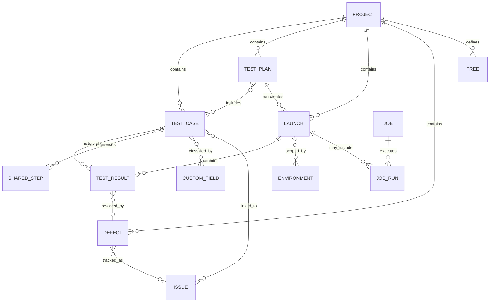

# Allure TestOps (Qameta Software) — competitive TMS research

Research date: 2026-11-14. Primary sources: docs.qameta.io, qameta.io, Capterra reviews. Claims not confirmed in those sources are marked **not found in docs**.

---

## 1. Overview

**Vendor:** Qameta Software (Allure / Allure Report ecosystem). Product site: [qameta.io](https://qameta.io/).

**Deployment:** Cloud (hosted by Qameta) or self-hosted / on-premise (Kubernetes, Docker Compose, Linux packages). Product workflows are the same for both; the difference is who operates the platform ([deployment choice](https://docs.qameta.io/getting-started/choose-default-or-self-hosted-deployment/)). Self-hosted needs PostgreSQL 15+, RabbitMQ, S3-compatible object storage, and Redis ([architecture](https://docs.qameta.io/server/architecture-and-planning/)).

**Not a Jira app:** Allure TestOps is a standalone TMS with Jira Cloud / Data Center integrations, not an Atlassian Marketplace plugin installed inside Jira.

**Target users:** Automation-heavy QA/SDET/engineering teams that want manual and automated tests in one hub, CI result ingestion, flaky/defect triage, and analytics. Marketing positions it as “full-stack test management focused on automation, aligned with DevOps” ([homepage](https://qameta.io/)). Independent comparisons repeatedly frame it as a TestRail alternative for code-first teams ([qam-hub alternatives](https://www.qam-hub.com/blog/testrail-alternatives)).

**License model.** **Closed source / proprietary commercial** subscription product (**Allure TestOps**), per [Allure TestOps Software License Terms](https://qameta.io/license-terms) (Qameta Software, Inc.). Separately, **Allure Report** (HTML reporting tool) and most adapters are **open source under Apache License 2.0**, repo [allure-framework/allure2](https://github.com/allure-framework/allure2); docs state most ecosystem tools except TestOps are Apache-2.0 ([Allure Report docs](https://allurereport.org/docs/v2/), [allurereport.org](https://allurereport.org/)). This is **not** open-core of one codebase: Report is OSS; TestOps is a separate paid product.

**Pricing (checked 2026-11-14 from [qameta.io/pricing](https://qameta.io/pricing)):**

| Option | Price |
| --- | --- |
| Cloud | **$39 per user / month**; volume pricing via sales@qameta.io |
| On-premise | **$39 per user / month**; volume pricing via sales |
| Free plan | **None** published on the pricing page |
| Trial | **Start Cloud trial** / **Request On-premise trial** (no credit card called out on homepage; third-party summaries cite ~14-day Cloud trial — treat trial length as sales-confirmed if critical) |

Cloud quotas (fixed, not UI-editable): 60 GB total storage (DB + artifacts), 100 MB upload body, 2,000,000 bytes per single result file ([limits](https://docs.qameta.io/cloud/limits-and-quotas/)).

---

## 2. Data model and entities

| Entity | What it is | Key fields / notes |
| --- | --- | --- |
| **Project** | Top-level workspace | Collaborators, custom fields, workflows, integrations, trees, upload/metadata policies |
| **Test case** | First-class manual or automated asset (shared model) | Name, auto-assigned **Allure ID**, workflow status, description, scenario/steps, parameters, tags, layer, custom fields, members/roles, issues/links, mute, history, versions (up to 10 saved) ([test cases](https://docs.qameta.io/use-testops/test-cases/)) |
| **Trees** | Dynamic folders/views | Nested grouping by **custom field** values (e.g. Suite → Feature); Trash tree for deleted cases ([trees](https://docs.qameta.io/use-testops/test-management/project-trees/)) |
| **Shared steps** | Reusable manual scenario blocks | Name, steps/sub-steps, expected results, attachments; updates propagate to all referencing scenarios ([shared steps](https://docs.qameta.io/use-testops/test-cases/shared-steps/)) |
| **Parameters / datasets** | Manual parameter sets; automated params on results | Named values; one result per parameter set on run; automated: one case for many param sets ([parameters](https://docs.qameta.io/use-testops/test-cases/parameters/), [test cases](https://docs.qameta.io/use-testops/test-cases/)) |
| **Test plan** | Reusable execution scope | Name, optional tree, optional AQL, explicit included cases, Executors (users for manual / jobs for automated) ([plans](https://docs.qameta.io/use-testops/test-plans-and-launches/test-plans/)) |
| **Launch** | One testing activity / run container | Open vs Closed; name, tags, issues, links, environments; Overview / Tree / Categories / Errors / Graphs / Timeline ([launches](https://docs.qameta.io/use-testops/test-plans-and-launches/launches-overview/)) |
| **Test result** | One attempt inside a launch | Status, steps, attachments, parameters, environment, defects, mute, retries, history ([results](https://docs.qameta.io/use-testops/results-and-analytics/test-results/)) |
| **Job / job-run** | CI pipeline binding | Used when TestOps starts CI or uploads from CI; selective execution via `testplan.json` ([allurectl](https://docs.qameta.io/reference/ecosystem/allurectl/)) |
| **Environment** | Runtime context | Global env names → project mappings of CI vars → job defaults → launch overrides ([environments](https://docs.qameta.io/use-testops/test-plans-and-launches/launch-environments/)) |
| **Defect** | Known-failure asset | Open/Closed, description, linked results/cases/launches, regex automation rules, issue links ([defects](https://docs.qameta.io/use-testops/results-and-analytics/defects/)) |
| **Mute** | Suppress noise for a specific case | Name, reason, optional issue ([test cases](https://docs.qameta.io/use-testops/test-cases/)) |
| **Tags / layers / custom fields / labels** | Classification | Tags (multi), layer (single), CF (governed; Epic/Feature/Story/etc.), labels as automation transport ([metadata](https://docs.qameta.io/use-testops/test-management/tags-labels-layers-and-custom-fields/)) |
| **Members / roles** | Ownership | Default Lead, Owner; admin-defined roles; from UI or upload labels ([members](https://docs.qameta.io/use-testops/test-cases/members-and-ownership/)) |
| **Attachments** | Evidence | Screenshots, videos, text, tables; result + fixture attachments ([results](https://docs.qameta.io/use-testops/results-and-analytics/test-results/)) |
| **Test key** | External TMS ID on a case | Links TestOps case to another TMS ([Allure IDs](https://docs.qameta.io/use-testops/test-cases/test-keys-and-allure-ids/)) |
| **Workflow / status** | Case lifecycle | Separate from execution statuses ([workflows](https://docs.qameta.io/use-testops/test-cases/workflows-and-statuses/)) |
| **Versions / baselines** | Case version history | Up to 10 named versions; restore/compare ([test cases](https://docs.qameta.io/use-testops/test-cases/)) |
| **Requirements / stories** | Not a first-class “requirement” entity | Coverage via **custom fields** (epic/feature/story) and **issue tracker** links ([labels](https://docs.qameta.io/use-testops/test-cases/labels/)) |
| **Milestones / releases / sprints** | No dedicated milestone entity found | Release tracking via launch tags/environments/AQL (e.g. `ev["Release"] = "1.2.3"`) ([dashboards](https://docs.qameta.io/use-testops/results-and-analytics/dashboards/)) |
| **Configurations** | Via environments + jobs | Multi-env runs create multiple results/job runs ([environments](https://docs.qameta.io/use-testops/test-plans-and-launches/launch-environments/)) |

---

## 3. Relationships and flows

**Typical end-to-end (automation-first):** adapters write Allure results in CI → `allurectl watch` / CI plugin uploads into a **launch** → team triages failures (defect/mute/rerun) while launch is **open** → **close launch** → TestOps **creates/updates automated test cases**, analytics, and trees → optional defect matchers auto-resolve future failures → dashboards / compare launches for trends.

**Manual path:** author case (scenario, shared steps, parameters) → assign workflow status → put in plan → run plan → execute in launch → close launch.

**Case versioning / review:** manual default workflow `Draft → Review → Active → Outdated`; automated default `Active → Outdated`; custom workflows/statuses are admin-defined ([workflows](https://docs.qameta.io/use-testops/test-cases/workflows-and-statuses/)). Separate **version history** (save/restore/compare up to 10). Changing workflow does not change manual vs automated type.

**Execution statuses (fixed, not customisable):** Passed, Failed, Skipped, Broken, Unknown (+ temporary In progress). Extra detail via categories, defects, mute — not new status enums ([results](https://docs.qameta.io/use-testops/results-and-analytics/test-results/)).

**Coverage / requirements:** issue links + epic/feature/story-style custom fields + AQL filters; dedicated requirements module **not found in docs**.

---

## 4. Full feature list

**Authoring:** manual cases with rich scenarios (steps/sub-steps, attachments); shared steps; parameters/datasets; generate automation code templates from a case; convert automated → manual (detach automation, optionally copy steps from result); metadata update policies (code vs UI ownership for name, layer, description, expected_result, link, tag, issue, member, custom_field) ([upload policy](https://docs.qameta.io/use-testops/test-plans-and-launches/upload-policy/)). BDD/Gherkin as a first-class editor: **not found in docs** (Cucumber JSON results are supported for import). Call-to-test: shared steps cover reuse; broader call-to-test **not found in docs**.

**Organisation:** trees from custom fields; tags; layers; filters and saved filters; bulk actions (limits: 10k Cloud / 50k self-hosted); move cases between projects; trash/restore.

**Execution:** manual runner with per-step statuses; assignment; bulk status/assign/rerun/defect/mute/tag/export; plans with mixed manual+automated executors; multi-environment runs; selective CI execution from plans/reruns.

**Traceability:** issue links on cases/results/launches/defects; defect ↔ issue sync for Jira (webhook close sync); test keys for external TMS; AQL slices.

**Reporting / dashboards:** launch Overview widgets; Categories; Errors; Graphs; Timeline; Compare launches (All / Intersect / Diff, only status changes); dashboards with widgets including Launch Analytics, Launch Trend (by date / by launches), Launches list, Last Launch Pie Chart, Low Performing Tests; AQL-driven KPIs; widget cache TTL ~15–30 minutes on Cloud ([dashboards](https://docs.qameta.io/use-testops/results-and-analytics/dashboards/), [limits](https://docs.qameta.io/cloud/limits-and-quotas/)).

**Search / AQL:** UI filters plus **Allure Query Language** for cases/results/launches (e.g. `tag`, `cf["Epic"]`, `flaky`, `automation`, `muted`, `ev[...]`) ([AQL](https://docs.qameta.io/reference/aql/)).

**Import / export:** CSV/PDF export of cases; CSV import historically existed but UI import was removed from 25.3.4 pending rework — migration via tools/API/support ([import](https://docs.qameta.io/use-testops/test-cases/import-test-cases/), [migration](https://docs.qameta.io/reference/migration-from-other-solutions/)); result formats listed in §5; TMS sync with TestRail/Zephyr/Xray/etc.

**Audit logs:** self-hosted from 4.23.0+ (accesslog for entity CRUD / optional GET) ([audit](https://docs.qameta.io/server/configure/audit-log/)). Cloud UI audit product: **not found in docs** (marketing mentions audit logs).

**Permissions / SSO:** global roles Admin / User / Guest; project Read / Write / Owner ([access](https://docs.qameta.io/administer/users-and-access/project-access-model/)); SAML 2.0 SSO (Cloud docs; Entra ID, Okta, Keycloak guides); optional 2FA after IdP; API tokens. SCIM: **not found in docs**.

**AI / MCP:** built-in MCP server from 26.1.1 (public beta; may incur future fees) with 13 tools for cases, shared steps, results, mutes, project, issue details ([MCP](https://docs.qameta.io/reference/ecosystem/mcp-server/)). Built-in LLM authoring product beyond MCP: **not found in docs**.

**Localisation / mobile / offline:** dedicated i18n, native mobile app, and PWA offline: **not found in docs** (web UI; self-host is infra offline, not client offline).

---

## 5. Automation and CI (critical: tree sync / auto-create)

### Supported result formats

Upload via UI or `allurectl` ([results](https://docs.qameta.io/use-testops/results-and-analytics/test-results/)):

- Allure Report 2.x (`*-result.json`, containers, attachments)
- Allure Report 1.x XML (legacy)
- Cucumber JSON
- JGiven JSON
- JUnit XML
- Visual Studio TRX (obsolete)
- XCTest `.xcresult` (Xcode 11+)
- xUnit.net XML

### CLI / SDKs / CI

- **`allurectl`:** `watch` (CI real-time) and `upload` (batch); selective run via generated `testplan.json` + `ALLURE_TESTPLAN_PATH` ([allurectl](https://docs.qameta.io/reference/ecosystem/allurectl/)).
- Official Allure adapters across many frameworks; marketing cites **37 frameworks**, **10 CI systems**.
- CI integrations: Azure DevOps, AWS CodePipeline, Bamboo, Bitbucket, CircleCI, GitHub Actions, GitLab, Jenkins, Tekton, TeamCity ([integrations](https://docs.qameta.io/reference/integrations/)).
- Do **not** build custom clients against internal upload endpoints — use plugins/`allurectl` ([API](https://docs.qameta.io/reference/api/)).

### Does it auto-create / update test cases from CI / Allure results?

**Yes.** Automated test cases are **created or updated when results are uploaded and the launch is closed**. Closing the launch is the processing boundary: missing automated cases are created; existing ones are updated; analytics refresh ([test cases](https://docs.qameta.io/use-testops/test-cases/), [generate docs howto](https://docs.qameta.io/howto/generate-test-documentation/), [results](https://docs.qameta.io/use-testops/results-and-analytics/test-results/)). Marketing “Smart Test Cases” is this sync: documentation auto-updates from run results ([homepage](https://qameta.io/)).

Parameterized automation: **one test case** for the logical test; **multiple results** per parameter set in the launch.

### Matching identity layers (precise)

Three layers ([results matching](https://docs.qameta.io/use-testops/results-and-analytics/test-results/), [troubleshooting](https://docs.qameta.io/troubleshooting/automated-test-results-upload/), [Allure IDs](https://docs.qameta.io/use-testops/test-cases/test-keys-and-allure-ids/)):

1. **Allure ID (`as_id` / `ALLURE_ID` label)** — stable TestOps DB id of an **existing** case. When present and valid in the **same project**, it overrides adapter hashes and binds the result to that case (including converting/updating a former manual case). **Invalid / non-existent / foreign-project Allure ID does not create a case** — result becomes **orphaned**. Sentinel `-1` / `unknown` intentionally orphans (no create).
2. **`testCaseId` / fullName path** — adapter-generated logical case id, typically  
   `testCaseId = md5(fullName + sort(params))`  
   where `fullName` is like `my_package#my_function`. If no case with that id exists, **TestOps creates a new automated case** on launch close. Without Allure ID, renames / package moves / parameter-set changes change the hash → **duplicate cases** ([help article](https://help.qameta.io/support/solutions/articles/101000533490-why-duplicates-of-test-cases-may-appear-when-uploading-results-)). Non-official adapters missing full-path → orphan risk. If results lack `testCaseId`, TestOps may generate one on upload (may differ from adapter).
3. **`historyId`** — execution-context id for **retries/reruns**, not primary case creation:  
   `historyId = md5(hash, sort(values(parameters)), sort(environment))`.  
   Changing params or mapped environments between attempts breaks retry matching; expected result can stick In progress → Unknown on close, while the new result appears separately.

**Manual ↔ auto handoff:** put the **existing** manual case’s Allure ID into code so uploads update that case instead of creating a duplicate automated one ([automate manual](https://docs.qameta.io/use-testops/test-cases/automate-manual-tests/)).

### Flaky detection / run merging

- Flaky (from 26.2.1.2): ≥ **3 status transitions** in last **10** executions (env-aware); retries count; AQL `flaky = true` from 26.3.1.0 ([flaky](https://docs.qameta.io/use-testops/execution-and-reporting/unstable-tests-detection/)).
- Reruns stay in the **same open launch**; older attempts under Retries. Multiple pipelines can contribute to one launch (`watch`/`upload` patterns). Compare launches for cross-run merge analysis — not silent merging of incompatible environments.

---

## 6. API

| Topic | Detail |
| --- | --- |
| Type | REST (Swagger/OpenAPI per instance) |
| Entry | `{ENDPOINT}/swagger-ui.html` — Report Service, UAA Service, or All Services ([API](https://docs.qameta.io/reference/api/)) |
| Auth | Personal API token → `POST /api/uaa/oauth/token` (`grant_type=apitoken`) → short-lived Bearer JWT; MCP uses `Authorization: api-token …` |
| Rate limits | Published numeric API rate limit: **not found in docs**. Cloud has storage/upload size quotas ([limits](https://docs.qameta.io/cloud/limits-and-quotas/)) |
| Pagination | Pageable list/search endpoints (e.g. widget data until `last` is false; MCP AQL tools paginate) ([FAQ](https://docs.qameta.io/faq/)) |
| Webhooks | Outgoing project webhooks: Launch created/closed; Test plan created/deleted; Defect created/deleted/closed; auto-disable after 10 failed deliveries ([notifications](https://docs.qameta.io/use-testops/notifications/notifications-overview/)) |
| Upload | Public API for entity CRUD; **upload reserved** for `allurectl` / CI plugins |

**Main endpoint groups (from docs + Swagger sections):**

| Group | Operations (examples) |
| --- | --- |
| UAA | `/api/uaa/oauth/token`, `/api/uaa/me`, users, licenses, roles |
| Test cases | CRUD, search/AQL, bulk, trash/restore, move project |
| Launches / results | Create/open/close, import via supported tools, bulk triage |
| Test plans | CRUD, sync AQL scope, run |
| Integrations | Global + `POST /api/integration/project` |
| Defects / mutes | Link, matchers, mute |
| Widgets / dashboards | `GET /api/widget/{id}/data` |
| MCP | `/api/mcp` |

Reference: [docs.qameta.io/reference/api](https://docs.qameta.io/reference/api/).

---

## 7. Integrations

**Issue trackers:** Asana, Azure DevOps Work Items, Bitbucket, ClickUp, GitHub Issues, GitLab Issues, Jira DC, Jira Cloud, Linear, Redmine, Wrike, YouTrack (capabilities vary; Jira uniquely supports test-case export among listed trackers) ([integrations](https://docs.qameta.io/reference/integrations/)).

**CI/CD:** see §5 table. **TMS sync:** TestRail, Zephyr Scale (Server/Cloud), Xray (Server/Cloud), TestOps↔TestOps.

**Chat / notifications:** Slack, Mattermost, Telegram, Discord, Zapier, n8n via outgoing webhooks. Native Microsoft Teams app: **not found in docs** (generic webhook may work).

**SSO:** SAML 2.0 (Cloud documented; IdP guides for Entra ID, Okta, Keycloak).

**Ecosystem:** Allure adapters, IDE plugins, `allurectl`, MCP, REST API. OpenProject: **not found in docs**.

---

## 8. Marketing positioning

Headline: **“Full-stack Test Management focused on automation, aligned with DevOps.”** Differentiators claimed on [qameta.io](https://qameta.io/): CI investigation from the failing test + evidence; central hub for manual + automated; **Smart Test Cases** (docs auto-update from results); Analytics + AQL KPIs; scale to large suites; RBAC/SSO/API tokens/audit; aggregate multi-component runs; 37 frameworks / 10 CI / 10 trackers; MCP + REST + allurectl. Customer quotes from Miro, Wrike, Mayflower on the homepage.

---

## 9. What users love

Themes from [Capterra](https://www.capterra.com/p/227555/Allure-TestOps/reviews/) (~4.7/5, 18 reviews as of page snapshot) and marketing testimonials:

1. **Unified manual + automation UI** — “Handling both manual and automated tests with a consistent UI is fantastic” (Capterra, Aug 2022).
2. **Always-up-to-date cases from launches** — “updating test cases from launches -> test cases are always up to date… easy to work with flaky tests and issues (defects)” (Capterra, Aug 2021).
3. **Engineer-centric / IDE-friendly** — “almost everything can be done from your IDE… keep track of any flakiness” (Capterra, Jul 2022).
4. **CI + rich evidence** — Jenkins ease; screenshots/videos; “complete integration with most… frameworks” (Capterra, Jun 2021).
5. **Scale** — reviewers describe very high daily result volumes and self-hosted scaling (Capterra, Aug 2021; Wrike leadership review).

---

## 10. What users dislike

1. **Global custom fields / environments** — “Custom field and environment definitions are globally scoped… confusing when I want to manage projects differently” (Capterra, Aug 2022).
2. **Manual/plan friction** — cannot edit manual result messages; cannot predefine plan environments (same review).
3. **Docs / roadmap / iOS** — slow feature requests, thin docs/YouTube for some flows, weak iOS guidance (Capterra, May 2021).
4. **Dashboard complexity / Allure Framework dependency** — “Configuring dashboards quite challenging”; framework issues outside TestOps support (Capterra, Aug 2022).
5. **Parameterized title pitfalls** — param in title can collapse variations in the case list (Capterra, Jun 2021); aligns with docs on name/identity sensitivity.
6. **CSV import UI removed** — migration friction for manual-first imports ([import docs](https://docs.qameta.io/use-testops/test-cases/import-test-cases/)).
7. **Review scarcity** — limited Capterra volume; no strong G2 footprint noted by third parties ([qam-hub](https://www.qam-hub.com/blog/testrail-alternatives)).

---

## 11. Ideas for Vulyk

Vulyk context: open-source self-hosted TMS (folders/cases/plans/runs, CI ingest, campaigns/iterations, requirements, Jira/OpenProject, reports/flaky, RBAC/SSO, LLM, MCP, importers, PWA offline).

1. **Ship “close run → sync tree” as a first-class CI contract** — Allure’s killer feature is auto-create/update of cases from results on launch close. Vulyk should document and implement an explicit ingest→match→create/update pipeline with the same clarity.
2. **Three-layer identity (stable id / structural fullName / historyId)** — copy the Allure ID vs `md5(fullName+params)` vs retry `historyId` model so refactor-safe linking and retry matching are separable; never invent TMS ids from CI without a create path.
3. **Orphan vs create policy** — support intentional “do not create” markers (Allure’s `-1`/`unknown`) and clear orphan diagnostics; invalid foreign ids must not silently spawn junk cases.
4. **Metadata ownership policies** — per-field “from automation” vs “from TMS” so CI sync does not wipe curated descriptions/owners (Allure upload policy).
5. **Defect matchers + mute** — regex (or similar) auto-link of recurring failures, distinct from muting a single case; huge triage leverage for CI-heavy teams.
6. **AQL-like query language** — reusable slices for plans, dashboards, MCP/API; Vulyk campaigns/iterations and requirements filters would benefit.
7. **Mixed plan executors** — one plan assigning humans and CI jobs (selective run) matches Vulyk plans/runs + CI ingest goals.
8. **Avoid Allure pain:** project-scoped custom fields/environments by default; keep CSV/importers in product (don’t remove UI mid-flight); first-class requirements (Vulyk advantage vs Allure’s CF+issues approach); PWA offline (Allure gap); OpenProject alongside Jira.
9. **MCP early** — Allure already ships MCP beta; Vulyk’s MCP+LLM story should stay competitive with clear tool coverage for cases/runs/defects.
10. **Flaky algorithm transparency** — publish a simple, env-aware rule (Allure’s 3 transitions / 10 runs) users can trust and tune.

---

## 12. Sources

- https://qameta.io/
- https://qameta.io/pricing
- https://docs.qameta.io/
- https://docs.qameta.io/getting-started/choose-default-or-self-hosted-deployment/
- https://docs.qameta.io/server/
- https://docs.qameta.io/server/architecture-and-planning/
- https://docs.qameta.io/server/configure/audit-log/
- https://docs.qameta.io/cloud/sso/
- https://docs.qameta.io/cloud/limits-and-quotas/
- https://docs.qameta.io/use-testops/test-cases/
- https://docs.qameta.io/use-testops/test-cases/shared-steps/
- https://docs.qameta.io/use-testops/test-cases/parameters/
- https://docs.qameta.io/use-testops/test-cases/workflows-and-statuses/
- https://docs.qameta.io/use-testops/test-cases/test-keys-and-allure-ids/
- https://docs.qameta.io/use-testops/test-cases/automate-manual-tests/
- https://docs.qameta.io/use-testops/test-cases/import-test-cases/
- https://docs.qameta.io/use-testops/test-cases/members-and-ownership/
- https://docs.qameta.io/use-testops/test-cases/labels/
- https://docs.qameta.io/use-testops/test-management/project-trees/
- https://docs.qameta.io/use-testops/test-management/tags-labels-layers-and-custom-fields/
- https://docs.qameta.io/use-testops/test-plans-and-launches/test-plans/
- https://docs.qameta.io/use-testops/test-plans-and-launches/launches-overview/
- https://docs.qameta.io/use-testops/test-plans-and-launches/launch-environments/
- https://docs.qameta.io/use-testops/test-plans-and-launches/compare-launches/
- https://docs.qameta.io/use-testops/test-plans-and-launches/run-automated-tests/
- https://docs.qameta.io/use-testops/test-plans-and-launches/upload-policy/
- https://docs.qameta.io/use-testops/results-and-analytics/test-results/
- https://docs.qameta.io/use-testops/results-and-analytics/defects/
- https://docs.qameta.io/use-testops/results-and-analytics/dashboards/
- https://docs.qameta.io/use-testops/execution-and-reporting/unstable-tests-detection/
- https://docs.qameta.io/howto/generate-test-documentation/
- https://docs.qameta.io/howto/triage-failed-tests/
- https://docs.qameta.io/troubleshooting/automated-test-results-upload/
- https://docs.qameta.io/reference/api/
- https://docs.qameta.io/reference/aql/
- https://docs.qameta.io/reference/integrations/
- https://docs.qameta.io/reference/ecosystem/allurectl/
- https://docs.qameta.io/reference/ecosystem/mcp-server/
- https://docs.qameta.io/reference/migration-from-other-solutions/
- https://docs.qameta.io/administer/users-and-access/project-access-model/
- https://docs.qameta.io/use-testops/notifications/notifications-overview/
- https://docs.qameta.io/use-testops/notifications/slack-notifications/
- https://docs.qameta.io/faq/
- https://help.qameta.io/support/solutions/articles/101000533490-why-duplicates-of-test-cases-may-appear-when-uploading-results-
- https://allurereport.org/docs/how-it-works-test-identifiers/
- https://www.capterra.com/p/227555/Allure-TestOps/reviews/
- https://www.qam-hub.com/blog/testrail-alternatives
