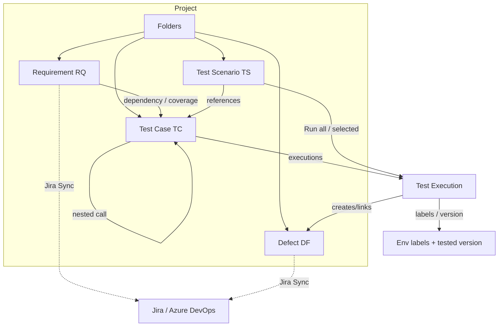

# Competitive TMS research: aqua cloud

Research date: 2026-11-14. Prefer primary sources (aqua-cloud.io, docs.aqua-cloud.io, app.aqua-cloud.io swagger). Review quotes from G2/Capterra.

---

## 1. Overview

**Vendor:** aqua cloud GmbH (Cologne, Germany), a subsidiary of the **andagon** group. Product brand: **aqua** / **aqua cloud**. andagon launched in 2001; aqua shipped as an on-prem desktop ALM/TMS in 2009 for regulated buyers (banks, government), with web client and cloud options from 2018. Marketing stats on the About page cite 20+ years IT expertise and 22,500+ users worldwide; homepage/pricing also cite 200+ companies / 35,000+ users. ([About Us](https://aqua-cloud.io/about-us/), [Impressum](https://aqua-cloud.io/de/legal-notice/), [Pricing](https://aqua-cloud.io/pricing/))

**License model:** **Closed source / proprietary commercial.** aqua itself states on aqua-cloud.io: *“While aqua cloud, an AI-powered test management system, is not open source, it goes far beyond what open-source products can offer.”* ([13 Best Open Source Test Management Tools](https://aqua-cloud.io/13-best-open-source-test-management-tools/)). Related marketing positions aqua as a **commercial (paid) testing tool** versus open-source stacks, with subscription/perpetual/rental licensing and professional support. ([Open Source vs Commercial](https://aqua-cloud.io/open-source-vs-commercial/), [Product FAQ](https://aqua-cloud.io/aqua-cloud-faq/)).

**OSS companion components:** No open-source edition of the aqua TMS/ALM core was found. Companion pieces are **not OSS products**: **aqua Capture** ships as a Chrome Web Store extension with a **releases-only** GitHub repo (`aqua-cloud-gmbh/capture-releases` — binaries/docs, not product source); the **Jenkins plugin** is a vendor-distributed `.hpi` (not in the Jenkins Plugin Store; source not published in docs). aqua **integrates with** open-source automation/CI tools (Selenium, Jenkins, JMeter, SoapUI, Playwright/Cypress via REST) but those remain third-party OSS, not aqua-licensed companions. ([Capture docs](https://docs.aqua-cloud.io/documentation/items/test-cases-management/capture-test-recorder-bug-reporter), [Capture releases](https://github.com/aqua-cloud-gmbh/capture-releases), [Jenkins plugin](https://docs.aqua-cloud.io/documentation/automation/web-client/jenkins-plugin), [Integrations](https://aqua-cloud.io/aqua-integrations/)).

**Deployment:** Public SaaS (`app.aqua-cloud.io`), **private cloud**, and **on-premises**. Desktop client still exists alongside the web client; Capture is a Chrome/Edge extension. Not a Jira-only app—standalone TMS/ALM with optional **aqua4Jira** plugin and bidirectional Jira Sync. ([docs getting started](https://docs.aqua-cloud.io/documentation), [SSO](https://docs.aqua-cloud.io/documentation/integrations/sso), [Integrations](https://aqua-cloud.io/aqua-integrations/))

**Target users:** QA/test managers, testers, requirements engineers, developers (Test Runner/DEV seats), PMs, and stakeholders via free Guest seats. Strong positioning toward **regulated industries** (banking, insurance, government, medical) needing auditability, on-prem/private cloud, and ALM-style requirements↔tests↔defects. Also marketed to SaaS/agency teams. ([About](https://aqua-cloud.io/about-us/), [G2](https://www.g2.com/products/aqua-cloud/reviews), [Capterra](https://www.capterra.com/p/172833/aqua-ALM/))

**Pricing (published on pricing page; checked 2026-11-14):** Per-user modular licenses, monthly or annual.

| License | Annual | Monthly | Notes |
| --- | --- | --- | --- |
| Requirement Management (RM) | €89/user/mo | €119/user/mo | RM + Agile/dashboard/reporting/AI/bugs |
| Test Management (TM) — “Most popular” | €89/user/mo | €119/user/mo | TM + AI test-case/data gen, Capture, parametrisation, API results, automation launching |
| Test Runner / DEV (TR) | €19/user/mo | €29/user/mo | Execute tests, bugs, Capture; Agile/dashboard read-only |
| Guest | Free, unlimited | — | Read-only stakeholder access, included with every plan |
| Concurrent / Floating | Contact sales | Contact sales | Shared concurrent pool; All-in-One feature set |
| aqua Suite (Private Cloud / On-Prem) | €99/mo (marketing banner) / talk to sales | — | Full ALM package, SSO (SAML/LDAP), dedicated backups/support |

FAQ also describes All-in-One (RM+TM), named vs floating seats, and notes perpetual/rental options in older FAQ wording (treat public pricing table as authoritative for SaaS list prices). ([Pricing](https://aqua-cloud.io/pricing/), [Product FAQ](https://aqua-cloud.io/aqua-cloud-faq/))

**Free trial / free plan:** **30-day free trial** (andagon AI course FAQ; FinancesOnline/Capterra “free trial available”). **No full free product plan**—only unlimited free **Guest** seats with paid plans. ([andagon AI course](https://andagon.com/en/trainings/aqua-ai-copilot-course), [Capterra](https://www.capterra.com/p/172833/aqua-ALM/))

---

## 2. Data model and entities

aqua organizes work as **projects → folders → items**. Item types are first-class, each with a global unique ID prefix after create: **RQ** (requirement), **TC** (test case), **TS** (test scenario), **DF** (defect). Fields are project-template-configurable. ([Creating and editing items](https://docs.aqua-cloud.io/documentation/items/general-item-capabilities/creating-and-editing-items), [Project tree](https://docs.aqua-cloud.io/documentation/navigation-page/project-tree))

| Entity | What it is | Key fields / notes |
| --- | --- | --- |
| **Project** | Top-level workspace; can have independent or **shared template** configuration from a master project | Name; template (fields, workflows, field rules); optional copy of items from source; archive |
| **Folder** | Nested tree under a project; holds mixed item types | Name; favourites; cut/copy/paste; import/export |
| **Requirement (RQ)** | Spec / story / use-case item; supports **subrequirements** hierarchy | Name, status, priority, custom fields, description (rich text), files, history, dependencies, discussions; AI generation |
| **Test case (TC)** | Executable test definition | Steps/conditions (index, type, name, instruction, expected result); nested TCs; Data/value sets; automation per step; Defaults (actual-result template); executions tab |
| **Test step / condition** | Step designer units; conditions have instruction only; steps have instruction + expected | Rich text; can embed nested TC; automation tab (e.g. Jenkins job id) |
| **Nested / shared steps** | Reuse via embedding another TC as a nested test case (call-to-test style) | Condition for when nested TC runs; variables resolved at execution; shown as dependency |
| **Parameters / value sets** | Excel-like Variable Manager on TC Data tab | Set name + variable columns; `$Var` placeholders in steps; reuse/sync data across TCs; Excel import/export of data |
| **Test scenario (TS)** | Group of **referenced** TCs for a purpose (= plan/set); not a copy | Scheduling; order; soft/hard run dependencies; per-row tester, value set, agent; context = release/env/phase |
| **Execution / test run** | Instance of running a TC (alone or from a scenario) | Status: Failed, Blocked, Passed, Not Complete; tester; date; tested version; labels; finalize; irrelevant flag; attachments; defects |
| **Milestone / release / sprint** | No separate “milestone” entity found; **Agile backlog + Sprint board** hold work items; scenarios can target a release/version via fields | Sprint API (`/api/Agile/Sprint`); tested version on run |
| **Defect (DF)** | Built-in bug item; creatable from execution/Capture | Standard item fields + relations to executions/requirements |
| **Configuration / environment** | **Test Execution Labels** (tags) for SUT/environment; optional custom fields on run configurator; API tag `Environment` | Labels with optional sub-labels; edits do not rewrite historical runs |
| **Custom fields** | Per item type in project template | Selection, multi-select, user, date, number, text; shared value sets; field rules / adaptive logic |
| **Attachments / files** | On items and executions | Unlimited storage on TM pricing; screenshots in rich text |
| **Tags / labels** | Execution labels as above; item-level tags: not found as a separate global tag system beyond custom fields/labels | — |
| **Versions / baselines** | Explicit **Item version** field + **Create New Version**; DiffReport compare; History on every item | New version must be “higher” in configured ranking; scenarios use **current** TC version when executing |
| **Scripts** | Item-grid tab type “scripts” for automation assets | Listed alongside RQ/TC/TS/DF in items grid |
| **Agents** | Automation agents / pools (Jenkins, Ranorex, etc.) | Created in project Automation config; API `/api/Agent` |

Sources: [Items](https://docs.aqua-cloud.io/documentation/items/general-item-capabilities/creating-and-editing-items), [Test scenarios](https://docs.aqua-cloud.io/documentation/items/test-scenarios-management/test-scenarios), [Test data](https://docs.aqua-cloud.io/documentation/items/test-cases-management/test-data-or-variables-manager), [Nested TCs](https://docs.aqua-cloud.io/documentation/items/test-cases-management/nested-test-cases-shared-test-cases-steps), [Labels](https://docs.aqua-cloud.io/documentation/items/test-cases-management/test-environment-tracking-with-labels-tags), [Versioning](https://docs.aqua-cloud.io/documentation/desktop-client/versioning), [Project wizard](https://docs.aqua-cloud.io/documentation/projects-and-folders/project-wizard).

---

## 3. Relationships and flows

**How entities link**

- Folder membership places all item types in one tree.
- **Dependencies / relations** link RQ ↔ TC ↔ TS ↔ DF (and nested TCs). “Create Dependent Item” and “Test it!” from RQ/DF jump to linked TC execution.
- **TS → TC** is a **reference list** (same TC in many scenarios; per-scenario status; all executions still appear on the TC).
- **Execution → Defect** create/link from failed steps; closing defects when linked TC passes is supported in manual flow.
- **Execution → Labels / tested version / value set / agent** capture run context.
- **Jira/Azure** sync maps external issues to aqua items (bidirectional optional).

**Typical end-to-end workflow**

1. Configure project template (fields, workflows, shared value sets) or inherit from a master project.
2. Author requirements (optionally AI); link or AI-generate test cases.
3. Author TC steps, nested TCs, and value sets; attach automation agents/jobs where needed.
4. Assemble a **test scenario** (regression/release/env), assign testers, value sets, soft/hard dependencies, agents.
5. Execute manually (step runner / Quick Run / Capture) or via automation agent / CI posting executions.
6. Failures → create/link defects; dashboards/reports for status; finalize executions for audit-proof results.

**Case versioning / review / approval**

- **Versioning:** Create New Version on items; linear hierarchy via Item version dictionary; Compare → DiffReport (including TC steps). History section on items. Scenarios always execute the **current** TC version—pinning a frozen suite to an old TC version is not the default model (use versioned item copies / Item version discipline). ([Versioning](https://docs.aqua-cloud.io/documentation/desktop-client/versioning), [Test scenarios](https://docs.aqua-cloud.io/documentation/items/test-scenarios-management/test-scenarios))
- **Workflows:** Per item-type workflows with statuses, transitions, role-based rules, global field rules (required/read-only/default). Mandatory fields tied to workflow. Item lock while editing. Dedicated “test script reviews” appear on Capterra feature lists; a separate formal peer-review product module was **not found** as a distinct documented workflow beyond configurable statuses. ([Workflow configuration](https://docs.aqua-cloud.io/documentation/project-configuration/workflow-configuration), [Creating items](https://docs.aqua-cloud.io/documentation/items/general-item-capabilities/creating-and-editing-items))

**Execution statuses (built-in):** step/run outcomes Pass, Fail, Blocked, Not Applicable; overall execution Failed / Blocked / Passed / Not Complete; Finalize locks edits; mark Irrelevant (with reason) to exclude from reports. ([Manual testing](https://docs.aqua-cloud.io/documentation/items/test-cases-management/manual-testing), [Execution results](https://docs.aqua-cloud.io/documentation/items/test-cases-management/test-execution-results))

---

## 4. Full feature list

**Test authoring:** Step designer (steps + conditions); rich text (tables, images, paste from Word); nested test cases (shared steps); parametrisation with value sets; actual-result templates; AI description↔steps and AI TC from requirements/files; **BDD-format generation** via aqua Intelligence (Gherkin-style authoring assist—not a separate Cucumber-first case type documented as native storage). ([Test cases](https://docs.aqua-cloud.io/documentation/items/test-cases-management/test-cases), [AI docs index](https://docs.aqua-cloud.io/llms.txt))

**Organisation:** Multi-project; nested folders; filters/views/grouping; favourites; archive; bulk edit; shared vs independent project templates. ([Items grid](https://docs.aqua-cloud.io/documentation/navigation-page/items-grid))

**Execution:** Manual step runner; Suspend/Continue; Finalize; Quick Run (multi-TC); Capture Chrome recorder; assignment in scenarios; screenshots/attachments; timers as a first-class feature: **not found in docs**.

**Traceability / coverage:** Dependencies between RQ/TC/TS/DF; Test it!; Jira coverage via aqua4Jira; subrequirements. Dedicated coverage matrix report: use custom Report Designer / dashboards (no single named “coverage %” product page found).

**Reporting / dashboards:** Dashboard module with chart widgets (project/folder, group-by, filters/views, legend/totals/%). Report module: templates from RQ/TC/TS/DF data sources; Layout Designer; parameters; export PDF/Word/Excel/HTML (marketing/Software Advice). DiffReports for version compare. Users note report designer power and learning curve. Built-in list is **template/designer-based** rather than a fixed catalog of named stock reports in docs. ([Dashboards](https://docs.aqua-cloud.io/documentation/dashboards/creating-a-dashbord), [Report templates](https://docs.aqua-cloud.io/documentation/reporting/creating-a-new-report-template))

**Search / filters:** Navigation filters, saved views, GlobalSearch API. Dedicated JQL-like query language: **not found in docs**.

**Import / export:** Excel/ZIP project & folder import-export; TestRail importer; TestLink importer; test data Excel; API Import/Export. JUnit XML via custom CI importer (not a one-click UI format picker). Limitations: value sets and embedded TCs not in Excel project import. ([Import project](https://docs.aqua-cloud.io/documentation/projects-and-folders/projects/import-project), llms.txt migration pages)

**Audit:** Item History; finalized executions described as audit-proof; login Statistics in user admin. Full enterprise audit-log product page: partial (history + login stats documented).

**Permissions / SSO:** Granular roles & permissions; license types gate features; SAML SSO (private cloud/on-prem); LDAP (on-prem); Active Directory module. **SCIM:** not found in docs. ([SSO](https://docs.aqua-cloud.io/documentation/integrations/sso), [LDAP](https://docs.aqua-cloud.io/documentation/integrations/sso/ldap), [Pricing](https://aqua-cloud.io/pricing/))

**AI (aqua Intelligence):** Requirements/stories/BDD/PRD from text/files; TC generation from RQ/context/files/design techniques; test data generation; defect assist; grounding on uploaded knowledge; claim “42% of AI test cases require no extra human input.” ([G2 product copy](https://www.g2.com/products/aqua-cloud/reviews), docs AI section)

**Localisation:** UI languages **English and German** (G2). Auto-translation for collaboration mentioned in FAQ.

**Mobile / offline:** Browser access on any device; **no dedicated mobile app**; FAQ recommends desktop for full UI. **PWA / offline:** not found in docs. Capture is browser-extension based (online). ([FAQ mobile](https://aqua-cloud.io/aqua-cloud-faq/))

---

## 5. Automation and CI

**Supported result formats / paths**

- **JUnit XML** → custom importer script → REST executions grouped by **Test Scenario** (documented for GitLab + CodeceptJS/Playwright). ([JUnit XML to Aqua](https://docs.aqua-cloud.io/documentation/automation/rest-api/junit-xml-to-aqua-integration))
- **Jenkins aqua Notifier** posts unit results into a **pre-created template TC** (rewrites description/steps each run). ([Jenkins plugin](https://docs.aqua-cloud.io/documentation/automation/web-client/jenkins-plugin))
- Framework guides: Playwright (TS/Java), Cypress, etc. calling **TestExecution** REST after hooks. ([GitLab Playwright](https://docs.aqua-cloud.io/documentation/automation/automation-ci-cd-tools-and-aqua-rest-api/gitlab-ci-cd-typescript-playwright))
- Native agents/integrations: Jenkins, Ranorex, Selenium, UFT, JMeter, SoapUI, PowerShell/UnixShell, DB MSSQL/Oracle. ([Integrations](https://aqua-cloud.io/aqua-integrations/))
- TestNG / Cucumber JSON / Robot / NUnit / Allure as **first-class native importers:** not found in docs (JUnit XML + REST + agents are the documented paths).

**CLI / SDKs:** No official npm/pip “aqua reporter” package highlighted; teams use REST + generated clients from swagger JSON. Contact support for JS/Python/PowerShell samples. ([REST API](https://docs.aqua-cloud.io/documentation/automation/rest-api))

**CI integrations:** First-class **Jenkins plugin** (trigger jobs from aqua, trigger scenarios from Jenkins, notifier). Documented **GitLab CI** pipelines. Azure DevOps as issue/ALM sync + automation marketing. GitHub Actions / CircleCI: achievable via REST/JUnit importer patterns; dedicated marketplace actions: **not found in docs**.

### Matching and auto-create (critical)

**Does aqua auto-create test cases when CI sends results for tests that do not exist in the TMS?**

**Documented answer: No.** Official CI/result-ingest docs describe mapping to **pre-existing** aqua IDs only. An automatic “create missing cases from CI results” option (as a product toggle or importer default) is **not found in docs**. What docs do say:

1. **JUnit XML importer (documented convention):** Tests must embed existing aqua IDs in names:
   - Scenario: `TS\d+` (e.g. `TS1132748 - GitHub`)
   - Case: `TC\d+` (e.g. `TC1132533 - Load the GitHub homepage`)
   - Missing IDs → treat as invalid; policy **fail import or skip** (configurable; **fail recommended**). Importer authenticates, groups by TS, POSTs executions per scenario. It does **not** create new TCs/TSs from anonymous JUnit names. ([JUnit XML to Aqua](https://docs.aqua-cloud.io/documentation/automation/rest-api/junit-xml-to-aqua-integration))

2. **Playwright/Cypress/Java guides:** Map by **aqua numeric Test Case Id** in title/tag (`@Tag("270")` / title = id), then `POST` `/api/TestExecution` with `TestCaseId`. Assumes the TC already exists. ([GitLab Playwright](https://docs.aqua-cloud.io/documentation/automation/automation-ci-cd-tools-and-aqua-rest-api/gitlab-ci-cd-typescript-playwright), [GitLab Cypress](https://docs.aqua-cloud.io/documentation/automation/automation-ci-cd-tools-and-aqua-rest-api/gitlab-ci-cd-typescript-cypress), [GitLab Java/Playwright](https://docs.aqua-cloud.io/documentation/automation/automation-ci-cd-tools-and-aqua-rest-api/gitlab-ci-cd-java-playwright))

3. **Jenkins Notifier:** Target **template TC Id must exist**; parameterized jobs require “all test cases from the variable values **must exist** in aqua.” Each run **replaces** that TC’s description and steps with Jenkins content (side effect, not suite expansion). ([Jenkins plugin](https://docs.aqua-cloud.io/documentation/automation/web-client/jenkins-plugin))

4. **API can create TCs** (`POST /api/TestCase`) if the user/license has create permission—but that is a **separate authoring call**, not an automatic side effect of result upload. ([REST API notes](https://docs.aqua-cloud.io/documentation/automation/rest-api), swagger 26.30)

**Name-only matching without IDs:** not found in docs. **Annotation libraries** beyond embedding IDs/tags: not found as an official SDK. **Auto-create-from-CI product feature:** not found in docs.

**Automation linking:** Per-step Automation tab (Jenkins job id, agents); scenario-level agent; Automation Hub marketing for mixed manual/automated. Bidirectional Jenkins orchestration.

**Flaky detection:** Marketing/blog advice (history, quarantine, retries) but **no documented built-in flaky-score / auto-quarantine feature** in product docs. Centralized execution history supports manual analysis. ([Flaky blog](https://aqua-cloud.io/flaky-tests/))

**Run merging:** Scenario groups many case executions in one scenario run context; JUnit importer posts **one API call per scenario**. Merging arbitrary CI shards into one run: not found beyond scenario grouping. Jenkins item IDs limited to **at most 6 digits** in plugin notes.

---

## 6. API

| Aspect | Detail |
| --- | --- |
| **Type** | REST, OpenAPI 3 (`aqua REST API`) |
| **Base URL** | Public cloud: `https://app.aqua-cloud.io/aquaWebNG` (+ `/api/...`). On-prem: `http(s)://<server>/aquaWebNG` (or `/aquaWeb`) |
| **Docs** | Interactive Help: [https://app.aqua-cloud.io/aquaWebNG/Help](https://app.aqua-cloud.io/aquaWebNG/Help); swagger JSON: `/aquaWebNG/swagger/v1/swagger.json` (observed version **26.30.0.0**, ~289 paths). New **public API** preview for Q1 2026 (Bearer-focused; swagger download in docs). |
| **Auth** | OAuth2 **password** grant → `POST api/token` (`grant_type=password`, username, password) → `Authorization: Bearer …`; refresh_token; `DELETE api/Session` to invalidate. Permissions/licenses of the API user apply. Item IDs **without** leading zeros / `TC` prefix in requests. |
| **Rate limits** | Agents 20 req/s; API 20 req/s; attachment/image uploads 20/min. ([REST API](https://docs.aqua-cloud.io/documentation/automation/rest-api)) |
| **Pagination** | `firstResults` / `maxResults` (and similar skip/take) on list endpoints |
| **Webhooks** | **not found in docs** / swagger tags |

**Main endpoint groups (from swagger tags):**

| Group | Operations (representative) |
| --- | --- |
| TestCase | CRUD, steps, test data, executions list, automated execution start, relations, history, attachments, watchers |
| TestExecution | Create/update/patch executions, bulk executions, continue, step update, locks, relations, logs |
| TestScenario | Scenario CRUD and execution orchestration (tag present) |
| Requirement / Defect | Full item CRUD, relations, history, posts |
| Project / Navigation / Folder | Project meta, item lists, batch ops |
| Agent | Create/update agents, currently executing |
| Agile | Item list, sprint CRUD, reorder |
| Import / Export | Excel import/export, TestRail import |
| Report / DashboardNG | Report definitions, printout, widgets |
| User / ServerAdministrator / Session | Users, licenses, auth session |
| Integrations / Label / File / Workflow / Config | Sync/integration hooks, labels, files, workflow, templates |

---

## 7. Integrations

**Issue trackers:** **Jira** (link, create, execute from Jira, aqua4Jira, bidirectional Sync Configurator for Cloud/Server/DC); **Azure DevOps** sync; Confluence live doc links. Linear: **not found**. ([Integrations](https://aqua-cloud.io/aqua-integrations/), [Jira Sync](https://docs.aqua-cloud.io/documentation/integrations/jira-sync-synchronize-items-between-aqua-and-jira-projects/sync-of-the-projects-between-aqua-and-jira))

**CI/CD & automation:** Jenkins plugin; GitLab examples; Ranorex, Selenium, UFT, JMeter, SoapUI, PowerShell/UnixShell, MSSQL/Oracle DB agents; REST for anything else.

**Chat (Slack/Teams):** not found as first-class connectors on the integrations page.

**SSO:** SAML 2.0 (private/on-prem); LDAP; AD module. ([SSO](https://docs.aqua-cloud.io/documentation/integrations/sso))

**Marketplace:** Jenkins plugin distributed as `.hpi` from aqua (not Jenkins store); aqua4Jira for Jira DC/Cloud. Capture Chrome extension.

**Migration:** TestRail, TestLink importers; Excel/ZIP.

---

## 8. Marketing positioning

Headline themes from aqua-cloud.io and G2 listing:

- **“AI-powered test management”** — generate requirements, test cases, and test data; “42% of AI test cases require no extra human input.”
- **ALM in one place** — requirements + tests + defects + automation + Agile board, not “just a test case DB.”
- **Regulated / European quality** — banks, government, medical; private cloud/on-prem; audit-friendly finalization and versioning.
- **Manual → automated smoothly** — Capture recorder, agents, Jenkins, unified results.
- **Modular licensing** — cheap Test Runner seats + free Guests vs buying full seats for everyone.
- Differentiators claimed in FAQ: deeper AI than peers, deployment flexibility, DIY workflows/reports, granular permissions, full lifecycle. ([FAQ](https://aqua-cloud.io/aqua-cloud-faq/), [About](https://aqua-cloud.io/about-us/), [Pricing](https://aqua-cloud.io/pricing/))

---

## 9. What users love

Themes from G2 (~4.7/15) and Capterra (~4.7/28):

1. **AI test-case generation from requirements** — “The performance of Aqua AI in generating test cases from requirements, exceeded my expectations.” (Dilkushi J., G2); “I love the AI feature to generate test cases from the requirements…” (Daniel K., G2).
2. **Usability / fast setup** — “Aqua test management has a super easy to use web interface. One can start in minutes…” (Daniel K., G2); Capterra: intuitive administration.
3. **Dashboards & reporting power** — “Overview of Testcases is very good. Dashboards helps a lot…” (Andreas L., G2); “My personal favorite is the reporting functionality… almost PowerBi-deep” (G2 anonymous).
4. **Integrations (Jira, automation)** — “Aqua is able to connect to Jira seamlessly and many other tools like Testautomation (Ranorex, Powershell).” (G2, Apr 2024).
5. **Support** — “We have a very good contact to the Customer Support.” (Andreas L.); Capterra customer service often 5.0.
6. **Parametrisation / modular cases** — customer quote on pricing page: modular parameterizable cases → slim structure and reuse (Slavcho Mavrodiev / CREM SOLUTIONS).
7. **Collaboration** — comments, shared dashboards/views, externals on tickets (Edgars T., G2).

Sources: [G2 reviews](https://www.g2.com/products/aqua-cloud/reviews), [Capterra](https://www.capterra.com/p/172833/aqua-ALM/), [Pricing testimonials](https://aqua-cloud.io/pricing/).

---

## 10. What users dislike

1. **Report designer learning curve** — “The Report designer needs a good amount of training.” (Andreas L., G2); “The Report-Editor is… not so easy to use. But after you climbed the learning curve…” (G2, 2024).
2. **Occasional bugs / polish** — “Sometimes it can have minor bugs.” (Andreas L.); UI “could be updated and look more stylish” (Edgars T.).
3. **Documentation uneven / onboarding volume** — “Some aqua wiki entries were less detailed…” (Anna R.); “I wish there were more video materials in onboarding.” (G2).
4. **Complex manual / feature discovery** — Capterra: “I find the manual very complex… filtering them out takes a lot of time.” (Jan 2024).
5. **Integration gaps for some stacks** — “It couldn't integrate with some of the tools I'd need.” (Capterra, Apr 2024).
6. **Performance / scale perception** — Capterra: “The Performance can be faster…”; demo workspace felt too small until sales showed a larger instance (G2).
7. **Enterprise weight vs lightweight TMS** — ALM breadth and designer complexity are the flip side of power (inferred from learning-curve comments; avoid inventing quotes).

Sources: [G2](https://www.g2.com/products/aqua-cloud/reviews), [Capterra](https://www.capterra.com/p/172833/aqua-ALM/).

---

## 11. Ideas for Vulyk

Vulyk already covers folders/cases/plans/runs, CI ingest, campaigns/iterations, requirements, Jira/OpenProject, reports/flaky, RBAC/SSO, LLM, MCP, importers, PWA offline. Concrete takeaways from aqua:

1. **Keep (and advertise) ID-optional CI ingest + optional auto-create** — aqua’s documented path **requires** `TC`/`TS` IDs and **does not** auto-create from CI. Vulyk’s ability to match by name/annotation and optionally create cases from unknown automated tests is a clear competitive wedge; document policies (create / skip / fail) as explicitly as aqua documents fail-on-missing-ID.
2. **Nested “call-to-test” with conditional execution** — aqua nested TCs with run conditions are polished reuse. Ensure Vulyk shared steps/call-to-test supports conditions and dependency visibility.
3. **Scenario-level soft vs hard run dependencies** — copy the soft (order only) vs hard (must pass) model for plans/campaigns; high value for gated regression.
4. **Execution labels for environment/SUT** — hierarchical labels that do not mutate history when renamed; complements Vulyk configs without forcing rigid env entities.
5. **Finalize + Irrelevant executions** — audit lock vs “don’t count this run” with reason is excellent for regulated users and flaky/false-start cleanup; Vulyk can pair this with existing flaky reports.
6. **Guest / execution-only seat model (product lesson)** — unlimited read-only guests + cheap runner seats explain aqua’s packaging; for open-source Vulyk, mirror the *UX* (stakeholder share links, executor-focused roles) without the license gate.
7. **Avoid Power-BI-grade report designers as the only path** — users love power but hate the learning curve. Prefer Vulyk’s opinionated reports/flaky/coverage plus light customization, not a blank canvas as default.
8. **AI grounded on project docs** — aqua’s “grounding” uploads are popular; Vulyk LLM assists should similarly ground on requirements/cases and support BDD output without becoming the only authoring path.
9. **Bidirectional issue sync expectations** — aqua’s Jira Sync interval (default 30s) sets enterprise bar; keep OpenProject/Jira sync reliable and field-map transparent so Vulyk stays competitive for ALM-adjacent buyers.
10. **Pain to avoid:** Jenkins-style “dump entire unit suite into one template case rewriting steps” — prefer structured suite/run mapping (Vulyk campaigns/iterations) over clobbering a single case.

---

## 12. Sources

- https://aqua-cloud.io/
- https://aqua-cloud.io/pricing/
- https://aqua-cloud.io/about-us/
- https://aqua-cloud.io/aqua-cloud-faq/
- https://aqua-cloud.io/aqua-integrations/
- https://aqua-cloud.io/13-best-open-source-test-management-tools/
- https://aqua-cloud.io/open-source-vs-commercial/
- https://aqua-cloud.io/aqua-vs-testlink-comparison/
- https://aqua-cloud.io/de/legal-notice/
- https://aqua-cloud.io/flaky-tests/
- https://aqua-cloud.io/integration-aqua-with-deployment-pipelines/
- https://andagon.com/en/
- https://andagon.com/en/trainings/aqua-ai-copilot-course
- https://docs.aqua-cloud.io/documentation
- https://docs.aqua-cloud.io/llms.txt
- https://docs.aqua-cloud.io/documentation/automation/rest-api
- https://docs.aqua-cloud.io/documentation/automation/rest-api/junit-xml-to-aqua-integration
- https://docs.aqua-cloud.io/documentation/automation/web-client/jenkins-plugin
- https://docs.aqua-cloud.io/documentation/automation/automation-ci-cd-tools-and-aqua-rest-api/gitlab-ci-cd-typescript-playwright
- https://docs.aqua-cloud.io/documentation/automation/automation-ci-cd-tools-and-aqua-rest-api/gitlab-ci-cd-typescript-cypress
- https://docs.aqua-cloud.io/documentation/automation/automation-ci-cd-tools-and-aqua-rest-api/gitlab-ci-cd-java-playwright
- https://docs.aqua-cloud.io/documentation/items/general-item-capabilities/creating-and-editing-items
- https://docs.aqua-cloud.io/documentation/items/test-scenarios-management/test-scenarios
- https://docs.aqua-cloud.io/documentation/items/test-scenarios-management/adding-test-cases-to-a-test-scenario
- https://docs.aqua-cloud.io/documentation/items/test-cases-management/manual-testing
- https://docs.aqua-cloud.io/documentation/items/test-cases-management/test-execution-results
- https://docs.aqua-cloud.io/documentation/items/test-cases-management/test-data-or-variables-manager
- https://docs.aqua-cloud.io/documentation/items/test-cases-management/nested-test-cases-shared-test-cases-steps
- https://docs.aqua-cloud.io/documentation/items/test-cases-management/test-environment-tracking-with-labels-tags
- https://docs.aqua-cloud.io/documentation/items/test-cases-management/capture-test-recorder-bug-reporter
- https://docs.aqua-cloud.io/documentation/desktop-client/versioning
- https://docs.aqua-cloud.io/documentation/project-configuration/workflow-configuration
- https://docs.aqua-cloud.io/documentation/projects-and-folders/project-wizard
- https://docs.aqua-cloud.io/documentation/navigation-page/project-tree
- https://docs.aqua-cloud.io/documentation/navigation-page/items-grid
- https://docs.aqua-cloud.io/documentation/integrations/sso
- https://docs.aqua-cloud.io/documentation/integrations/sso/ldap
- https://docs.aqua-cloud.io/documentation/integrations/jira-sync-synchronize-items-between-aqua-and-jira-projects/sync-of-the-projects-between-aqua-and-jira
- https://docs.aqua-cloud.io/documentation/dashboards/creating-a-dashbord
- https://docs.aqua-cloud.io/documentation/reporting/creating-a-new-report-template
- https://docs.aqua-cloud.io/documentation/product-updates-for-public-and-private-clouds-customers/aqua-news/preview-of-aquas-public-api
- https://github.com/aqua-cloud-gmbh/capture-releases
- https://app.aqua-cloud.io/aquaWebNG/Help
- https://app.aqua-cloud.io/aquaWebNG/swagger/v1/swagger.json
- https://www.g2.com/products/aqua-cloud/reviews
- https://www.capterra.com/p/172833/aqua-ALM/
- https://specifiction.org/tools/aqua/pricing/
