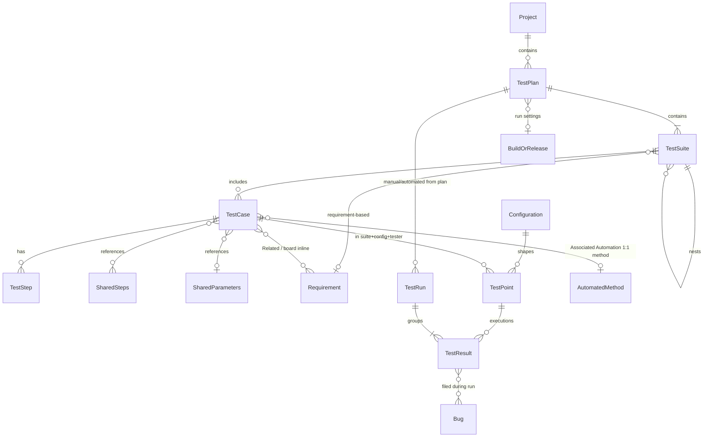

# Azure Test Plans — Competitive TMS Research

Research date: 2026-11-14. Prefer Microsoft Learn, Azure pricing, REST API, Marketplace, and user reviews. Prices and access rules checked against Microsoft’s public pricing page on this date.

---

## 1. Overview

**Vendor:** Microsoft (Azure DevOps product family).

**Product:** Azure Test Plans — a browser-based test management solution for planned manual testing, user acceptance testing (UAT), exploratory testing, stakeholder feedback, and association of automated tests with test case work items. It is not a standalone SaaS TMS; it is one service inside Azure DevOps alongside Boards, Repos, Pipelines, and Artifacts.

**Deployment:**
- **Azure DevOps Services (cloud):** `https://dev.azure.com/{organization}`
- **Azure DevOps Server (on-premises / self-hosted):** Windows Server + SQL Server; Test Plans ships with the server product. Express edition supports ≤5 active users for evaluation/personal use.
- Not a Jira app; it is native to Azure DevOps (with Marketplace extensions for adjacent tooling).

**Target users:** Teams already on Azure DevOps / Visual Studio who need manual/UAT plans, configuration matrices, requirement-linked coverage, and CI test reporting in the same org as Boards/Pipelines. Strong fit for Microsoft-stack QA and enterprises standardizing on Entra ID.

**License model.** **Closed source** (proprietary Microsoft product). Azure Test Plans is licensed as part of Azure DevOps / Visual Studio subscriptions under Microsoft Product Terms; it is not an open-source project. Some Azure DevOps documentation lives in public MicrosoftDocs repos for docs only, not product source. Sources: [Microsoft Product Terms / Visual Studio](https://www.microsoft.com/licensing/terms/productoffering/VisualStudioSubscriptions/EAEAS), [Azure DevOps billing FAQ](https://learn.microsoft.com/en-us/azure/devops/organizations/billing/billing-faq?view=azure-devops), [Test Plans overview](https://learn.microsoft.com/en-us/azure/devops/test/overview?view=azure-devops).

**Pricing (Azure DevOps Services, USD, checked 2026-11-14):**

| Access level | Price | Test Plans capability |
| --- | --- | --- |
| Stakeholders | Free (unlimited) | Exploratory/feedback via Test & Feedback; **no** Test Plans portal |
| Basic | **Free for first 5 users**, then **$6/user/month** | Execute tests, mark outcomes, view charts; add/run tests from Kanban; **cannot** create/manage plans/suites/configs/parameters |
| Basic + Test Plans | **$52/user/month** | Full create/manage plans, suites, cases, configurations, parameters, UAT prep, rich reporting |

- Visual Studio Enterprise, Test Professional, and MSDN Platforms subscriptions include Basic + Test Plans–equivalent access at no extra Azure DevOps charge.
- GitHub Enterprise can include Azure DevOps Basic access for Entra-managed users (not Test Plans authoring).
- Charges are **daily prorated** when access is assigned/removed mid-cycle.
- **Free trial:** 30-day Trial of Basic + Test Plans from Organization settings → Billing; each user must still be assigned the access level.

**Sources:** [What is Azure Test Plans?](https://learn.microsoft.com/en-us/azure/devops/test/overview?view=azure-devops), [Azure DevOps Services pricing](https://azure.microsoft.com/en-us/pricing/details/devops/azure-devops-services/), [Try additional features](https://learn.microsoft.com/en-us/azure/devops/organizations/billing/try-additional-features-vs?view=azure-devops), [Buy access (Server)](https://learn.microsoft.com/en-us/azure/devops/organizations/billing/buy-access-tfs-test-hub?view=azure-devops-2022).

---

## 2. Data model and entities

Azure Test Plans stores core artifacts as **work item types** in the work-tracking store, plus runtime execution objects.

| Entity | What it is | Key fields / notes |
| --- | --- | --- |
| **Project** | Azure DevOps project boundary | Contains plans, boards, pipelines, area/iteration paths |
| **Test Plan** | Container for suites/cases for a sprint/milestone | Name, Area, Iteration, Owner, State, Start/End dates, Build/Release settings, Root suite, Test outcome settings |
| **Test Suite** | Groups cases under a plan | Types: **Static**, **Requirement-based**, **Query-based**; name; parent suite; default configs/testers; requirement ID or WIQL query |
| **Test Case** | Scenario under test (manual or automated) | Title, State (e.g. Design → Ready), Assigned To, Area, Iteration, Priority, Automation Status, steps, parameters, tags, attachments, Associated Automation |
| **Test Step** | Action + Expected Result inside a case | Step number, Action, Expected Result; validation steps must be marked pass/fail |
| **Shared Steps** | Reusable step sequences across cases | Linked via Test Cases ↔ Shared Steps link types |
| **Shared Parameters** | Reusable parameter datasets | Parameter names/values; max **one** shared parameter set per test case |
| **Parameters (local)** | `@param` values on a case | Value grid under steps; importable from Excel paste |
| **Test Point** | Executable unit | Unique combo of **test case + suite + configuration + tester** |
| **Test Run** | Logical grouping of results from one execution | Name, plan, state (In progress / Needs investigation / Completed), metadata, attachments |
| **Test Result** | Outcome of one case (or point) in a run | Outcome (Passed, Failed, Blocked, Not Applicable, etc.), duration, diagnostics, links |
| **Configuration / variables** | Environment matrix (OS, browser, …) | Config = combination of variable values; assignable to suite or case |
| **Requirement / story** | User Story / PBI / Requirement / Issue | Linked via requirement-based suites or Related links; coverage tracked when linked through RBS |
| **Defect (Bug)** | Work item filed from Test Runner / exploratory | Auto-linked to requirement/build under test when created during testing |
| **Build / Release** | Pipeline artifacts associated to plan | Plan run settings point to build definition / release environment |
| **Iteration / Area path** | Sprint/milestone and product area | Assigned on plan and work items (not a separate “milestone” entity) |
| **Custom fields** | Inherited or XML process customization | On Test Plan / Suite / Case (and related WITs) |
| **Attachments / tags** | Files on WIs or run/result; tags on WIs | Screenshots, recordings, logs; Create tag definition permission |
| **Versions / baselines** | Work item revisions + clone/copy | Case updates reflect in all plans referencing them; **clone** for independent baseline. No separate named “baseline” product feature found beyond copy/clone and WI history |

**Sources:** [Test objects and terms](https://learn.microsoft.com/en-us/azure/devops/test/test-objects-overview?view=azure-devops), [Create test plans](https://learn.microsoft.com/en-us/azure/devops/test/create-a-test-plan?view=azure-devops), [Create test suites](https://learn.microsoft.com/en-us/azure/devops/test/create-test-suites?view=azure-devops), [Configurations](https://learn.microsoft.com/en-us/azure/devops/test/test-different-configurations?tabs=browser&view=azure-devops), [Shared steps](https://learn.microsoft.com/en-us/azure/devops/test/share-steps-between-test-cases?view=azure-devops), [Parameters](https://learn.microsoft.com/en-us/azure/devops/test/repeat-test-with-different-data?view=azure-devops).

---

## 3. Relationships and flows

### Entity relationships

### Typical end-to-end workflow

1. Create a **Test Plan** for the sprint/iteration; set area, iteration, default configurations, build/release.
2. Add **suites** (static folders, requirement-based for stories, query-based for dynamic sets).
3. Author or import **test cases** (steps, shared steps, parameters); assign testers/configs → **test points**.
4. Execute via web/desktop Test Runner (or on-demand automated run from plan); file bugs; save → **test run/results**.
5. Track Progress Report / charts / Analytics; next cycle: new plan importing same cases (or clone for baseline).

### Case versioning / review / approval

- Cases are work items with **revision history** (History tab). Reimporting CSV/XLSX with matching ID **replaces all steps**.
- Updating a shared case updates every plan/suite that references it; use **copy/clone** for an independent baseline.
- Formal multi-step “review/approval workflow” for test cases is **not found in docs** as a dedicated Test Plans feature beyond normal work item State/Reason and process customization.

### Statuses

- **Test case State:** process-dependent (default new state **Design**; Ready for execution). Customizable via Inherited/XML process.
- **Automation Status:** Not Automated / Planned / Automated (when a method is associated).
- **Point/result outcomes:** Passed, Failed, Blocked, Not Applicable, Active (not run), paused; Progress Report treats Blocked/N/A specially vs Passed%/Failed%.
- **Test run states:** In progress, Needs investigation, Completed.

**Sources:** Overview, objects overview, [Run manual tests](https://learn.microsoft.com/en-us/azure/devops/test/run-manual-tests?view=azure-devops), [Test runs](https://learn.microsoft.com/en-us/azure/devops/test/test-runs?view=azure-devops), [Progress report](https://learn.microsoft.com/en-us/azure/devops/test/progress-report?view=azure-devops).

---

## 4. Full feature list

**Authoring:** Grid and form editors; Action/Expected Result steps; rich text in work item Description (step formatting frequently criticized by users); **Shared Steps**; parameters (`@name`) and Shared Parameters; **no first-class Gherkin/BDD author editor** in Test Plans itself (Gherkin import appears via third-party Marketplace importers); call-to-test ≈ Shared Steps, not a separate “call test case” tree like some TMS tools.

**Organisation:** Plans → nested static suites; requirement- and query-based suites; Area/Iteration; tags; copy/clone plans/suites/cases.

**Execution:** Web Test Runner and desktop Test Runner; assign testers; bulk select points; per-step pass/fail; comments; screenshots, image action logs, screen recordings; create/update bugs with diagnostics; UAT invite-by-email; exploratory via **Test & Feedback** (Chrome/Edge; Connected vs Standalone).

**Traceability / coverage:** Requirement-based suites; board inline tests; Related Work; Requirements widget; pipeline requirements traceability when cases are associated to automation and requirements.

**Reporting / dashboards:**
- Progress Report (summary, outcome trend 14/30/custom days, suite drill-down; ~15 min lag; no built-in export)
- Test Run Hub (manual + automated runs)
- Configurable charts / dashboard widgets
- Pipeline Tests tab + Test Analytics
- Analytics OData + Power BI sample reports (progress, flaky, etc.)

**Search / filters:** Plan suite filter; WIQL/query-based suites; work item queries; Run Hub filters. No dedicated TMS-only query language beyond Azure DevOps WIQL/OData.

**Import / export:** CSV and XLSX bulk import/export of cases (auto-mapping, templates on Services); export plans/suites for review. JUnit/etc. are pipeline result formats, not native case-library import formats.

**Audit:** Work item History revisions; organization/project audit logs for Azure DevOps generally (not Test Plans–specific beyond WI history).

**Permissions / SSO:** Access levels Stakeholder / Basic / Basic+Test Plans; Area Path permissions (Manage test plans/suites, Edit work items); project permissions for runs/configs. **Microsoft Entra ID** SSO and centralized identity; user lifecycle via Entra groups/assignment — **SCIM for Azure DevOps itself is not the model** (contrast with GitHub EMU SCIM docs).

**AI:** Docs mention **Azure DevOps MCP Server** for AI assistants to manage test cases via natural-language prompts (list/update/audit). Not a dedicated “generate tests from requirements” TMS AI product page beyond that MCP assistance note.

**Localisation / mobile / offline:** Web UI follows Azure DevOps localization. Manual testing via major browsers on any platform. Test & Feedback browser extension. **No PWA offline TMS client found in docs.** Standalone exploratory mode can export HTML without connection.

**Sources:** Overview, FAQ, import/export, progress report, permissions, Entra connect, MCP note on import page.

---

## 5. Automation and CI

### Pipeline result formats (Publish Test Results @2)

Supported formats: **CTest, JUnit (incl. PHPUnit), NUnit 2/3, VSTest/TRX, xUnit 2**. VSTest value also covers TRX from Microsoft.Testing.Platform. Other runners publish if they emit these formats. **Allure / Robot / Cucumber JSON** are not listed as native PublishTestResults formats (Allure/Robot/Cucumber typically need conversion or Marketplace tools).

### Tasks / CI

- **Visual Studio Test** task, **Azure Test Plan** task, **Publish Test Results**, DotNetCore CLI, Ant/Maven/Gulp/Grunt/Xcode options.
- Primary CI is **Azure Pipelines**; GitHub-hosted repos can run in Azure Pipelines and then associate. Jenkins/etc. can be triggered via service hooks for builds, but Test Plans’ deepest automation UX assumes Azure Pipelines.

### How automated results map to Test Plans cases

Official workflow:

1. Publish/run tests in a pipeline (results appear on the **pipeline Tests tab** even with **no** Test Plans entities).
2. **Manually associate** each automated test method with an **existing** test case (Visual Studio Test Explorer → Associate to Test Case, or portal: pipeline Tests tab / Associated Automation on the work item).
3. Association stores automated test identity on the case; **one method per test case** (a method may link to multiple cases).
4. After association, results can flow into Test Plans / requirement quality when run from plan or pipelines with association in place.

Matching is **explicit association by test method identity**, not automatic name-matching on ingest. The test must have **run at least once** before it is available to associate. Parameters on the case apply to **manual iterations only**, not automated methods.

### Critical: auto-create test cases from CI / VSTest / PublishTestResults?

**No — native Azure Test Plans does not auto-create test case work items when CI publishes results.**

- `PublishTestResults@2` and VSTest publish **pipeline test results** (and optional merge via `mergeTestResults`). They do **not** create Test Case work items or suites in Test Plans.
- Microsoft docs explicitly separate pipeline test tasks from Test Plans: with Azure DevOps Server 2020+, automated tests via pipeline tasks **do not require** defining plans/cases/suites.
- Linking into the TMS requires **pre-existing cases** + **manual association**.
- **Third-party:** Marketplace extension **Solidify Test Result Importer** can import JUnit/xUnit/TestNG/Gherkin into a plan and optionally **Create Test Cases** / reset / preserve hierarchy — that is extension behavior, not built-in Microsoft auto-create.

### Flaky tests and run merging

- **Flaky management** (Azure DevOps Services): system detection (VSTest rerun or rerun failed jobs → pass ⇒ flaky), custom detection via Result Meta Data API, mark/unmark flaky, optionally exclude flaky failures from Test Summary. Lives under **Pipelines → Test management**, not a separate Test Plans suite feature.
- **mergeTestResults** on PublishTestResults merges multiple result files into one run when enabled.

**Sources:** [Associate automated tests](https://learn.microsoft.com/en-us/azure/devops/test/associate-automated-test-with-test-case?view=azure-devops), [Automated testing overview](https://learn.microsoft.com/en-us/azure/devops/test/automated-testing-overview?view=azure-devops), [PublishTestResults@2](https://learn.microsoft.com/en-us/azure/devops/pipelines/tasks/reference/publish-test-results-v2?view=azure-pipelines), [Flaky tests](https://learn.microsoft.com/en-us/azure/devops/pipelines/test/flaky-test-management?view=azure-devops), [Solidify importer](https://marketplace.visualstudio.com/items?itemName=solidify.import-test-results), Overview note on pipeline tests without plans.

---

## 6. API

**Type:** REST (plus Analytics **OData** for reporting). No GraphQL Test Plans API found in docs.

**Base URL patterns:**
- Classic Test: `https://dev.azure.com/{org}/{project}/_apis/test/...`
- Newer Test Plan: `https://dev.azure.com/{org}/{project}/_apis/testplan/...`
- Analytics: `https://analytics.dev.azure.com/{org}/{project}/_odata/v4.0-preview/...`
- On-prem: `https://{instance}/{collection}/{project}/_apis/test/...`

**Auth:** OAuth 2.0 (`vso.test`, `vso.test_write`); Personal Access Token (Basic auth with empty username + PAT); Entra-backed identity.

**Rate limits:** Global consumption in **TSTUs**; delay/block above ~**200 TSTUs / 5 minutes** per user; HTTP **429**; headers `Retry-After`, `X-RateLimit-*`. Assigning Basic + Test Plans to a service identity can raise limits.

**Pagination:** `$skip`/`$top` on older Test APIs; **continuationToken** / `x-ms-continuationtoken` on Test Plan list; results list documents `$top` caps (e.g. max 1000/200 depending on details).

**Webhooks:** Service Hooks for builds, pipelines, work items, code, PRs, etc. **No dedicated “test run completed” publisher event** found in the service-hooks event catalog; approximate via work item updates or pipeline run state.

| Endpoint group | Operations (representative) |
| --- | --- |
| Test Plans (`/testplan/plans` or `/test/plans`) | List, Get, Create, Update, Delete |
| Test Suites | Create, Get, List, Update; Get/Add test cases |
| Test Cases / Suite test cases | Via suites + Work Item Tracking APIs |
| Configurations | Manage test configurations |
| Runs (`/test/runs`) | List, Create, Get, Update |
| Results (`/test/Runs/{id}/results`) | List, Get, Update; flaky metadata APIs |
| Points | Query/update test points |
| Attachments | Run/result attachments |
| Work Items | Full WIT CRUD for Test Case/Shared Steps/etc. |

**API references:** [Test Plan REST](https://learn.microsoft.com/en-us/rest/api/azure/devops/testplan/test-plans?view=azure-devops-rest-7.1), [Test Runs](https://learn.microsoft.com/en-us/rest/api/azure/devops/test/runs/list?view=azure-devops-rest-7.1), [Rate limits](https://learn.microsoft.com/en-us/azure/devops/integrate/concepts/rate-limits?view=azure-devops), [Service hooks](https://learn.microsoft.com/en-us/azure/devops/service-hooks/overview?view=azure-devops).

---

## 7. Integrations

| Area | What exists |
| --- | --- |
| Issue tracking | **Native Azure Boards** (bugs, stories, PBIs). Jira/Linear/etc. via Marketplace/webhooks — not a first-class Test Plans↔Jira suite like Zephyr/Xray |
| CI/CD | **Azure Pipelines** (deepest); GitHub repos + Pipelines; Jenkins/Bamboo/etc. via service hooks for builds |
| Automation frameworks | MSTest, NUnit, xUnit, Selenium, Coded UI; Python/Java association from portal; any JUnit/NUnit/xUnit/TRX publisher |
| Chat | Microsoft Teams and Slack apps/service hooks (Boards/Pipelines/Repos events) |
| SSO | Microsoft Entra ID |
| Marketplace | Extensions (e.g. Test Result Importer); contribution model for Test platform |

**Sources:** Overview extensibility, associate-automation frameworks table, service hooks overview, Marketplace.

---

## 8. Marketing positioning

Headline themes from Microsoft Learn marketing/docs:

- “Plan, execute, and track manual, exploratory, and automated tests” inside Azure DevOps.
- **Browser-based** testing on any platform; **rich diagnostics** into bugs.
- **End-to-end traceability** across requirements, builds, tests, and bugs.
- **Integrated analytics** (Progress Report, widgets, Analytics/Power BI).
- **Extensible** REST + contribution model.
- Differentiator vs pure TMS: **same platform as Boards/Repos/Pipelines**, one identity, one work item model — not a best-of-breed standalone QA tool.

---

## 9. What users love

Themes with sources:

1. **Everything in one Azure DevOps place** — “keeps everything inside azure devops, no jumping between tools for traceability” (r/QualityAssurance, [thread](https://www.reddit.com/r/QualityAssurance/comments/1v4mnc3/whats_good_and_bad_about_azure_devops_test_plans/)).
2. **Traceability links** story ↔ test ↔ bug ↔ commit when the org already lives in ADO (same thread; TrustRadius pros cite seamless Azure feature integration).
3. **Short-cycle manual/UAT plans** — TrustRadius: works well for “express test case implementation with a short duration” ([compare page](https://www.trustradius.com/compare-products/azure-test-plans-vs-testcomplete)).
4. **Dashboards / ecosystem** — easy to put QA widgets on existing ADO dashboards; Power BI when paired ([Reddit](https://www.reddit.com/r/QualityAssurance/comments/1v4mnc3/whats_good_and_bad_about_azure_devops_test_plans/)).
5. **Capterra** rates Azure DevOps ~**4.4/5** (148 reviews) with praise for Boards/Repos/Pipelines/Test Plans integration ([Capterra](https://www.capterra.in/software/170547/vsts-devops)). TrustRadius lists Azure Test Plans ~**9.1/10** on a small review set.

---

## 10. What users dislike

1. **UI / UX** — “UI feels like it was designed in 2010”; “UI is auful… mapping automation… restructuring suites” ([Reddit](https://www.reddit.com/r/QualityAssurance/comments/1m1qr6i/anyone_using_azure_devops_for_test_management/), [Reddit](https://www.reddit.com/r/QualityAssurance/comments/1v4mnc3/whats_good_and_bad_about_azure_devops_test_plans/)).
2. **Pricing of Basic + Test Plans ($52)** — “very expensive”; large jump from Basic $6 ([Reddit](https://www.reddit.com/r/QualityAssurance/comments/1m1qr6i/anyone_using_azure_devops_for_test_management/)).
3. **Weak reporting out-of-box** — “built-in charts are so limited… exporting everything to excel” ([Reddit](https://www.reddit.com/r/QualityAssurance/comments/1v4mnc3/whats_good_and_bad_about_azure_devops_test_plans/)); Progress Report has no direct print/export.
4. **Automation association friction** — manual mapping; non-.NET feels second-class; “only fully integrate… with Dotnet Visual Studio” ([Reddit](https://www.reddit.com/r/QualityAssurance/comments/1m1qr6i/anyone_using_azure_devops_for_test_management/)).
5. **Perceived abandonware / slow improvement** — teams ask if Test Plans is abandonware; others say improvements are on the roadmap but maturity of automation often displaces manual plans ([r/azuredevops](https://www.reddit.com/r/azuredevops/comments/1bx35gj/is_test_plans_abandonware/)).
6. **Reuse / suite flexibility** — clients who moved from other TMS called it a “downgrade” on suite management and automation sync ([Reddit](https://www.reddit.com/r/QualityAssurance/comments/1m1qr6i/anyone_using_azure_devops_for_test_management/)).

---

## 11. Ideas for Vulyk

Context: Vulyk is an open-source (AGPL), self-hosted TMS (folders/cases/plans/runs, CI ingest, campaigns/iterations, requirements, Jira/OpenProject, reports/flaky, RBAC/SSO, LLM, MCP, importers, PWA offline).

1. **CI auto-create as a first-class option** — Azure’s gap (publish ≠ create cases; association is manual) is a differentiation win. Offer ingest modes: match-by-ID, match-by-name/annotation, **auto-create missing cases**, and dry-run.
2. **Keep pipeline results and TMS cases intentionally linked but separable** — ADO correctly allows pipeline analytics without plans; Vulyk should support “results-only” campaigns plus optional promotion into the case library.
3. **Test point = case × configuration × assignee** — strong model for matrix testing; Vulyk configurations/environments should generate executable points cleanly.
4. **Requirement-based and query-based suites** — dynamic coverage suites reduce stale folder trees; map to OpenProject/Jira requirement sync.
5. **Shared steps + shared datasets** — users still want reuse; make them first-class and easy (ADO users complain reuse is tedious).
6. **Flaky as product feature with clear UX** — ADO’s flaky tooling is Pipelines-centric; Vulyk can unify flaky across manual + CI runs in reports.
7. **Avoid $52-class seat tax for authors** — open-source self-host + sensible RBAC undercuts ADO’s Basic vs Basic+Test Plans split (executors vs authors).
8. **Progress/report export by default** — CSV/XLSX/PDF for campaign progress; don’t force Power BI/OData for basic needs.
9. **MCP + LLM with guardrails** — ADO is adding MCP-assisted bulk case ops; Vulyk can go further (draft cases from requirements, suggest flaky quarantine) while keeping AGPL self-host control.
10. **PWA offline + importers** — ADO has little offline TMS story; Vulyk’s offline runner and multi-format importers address migration pain from Excel/ADO CSV/XLSX and JUnit-family CI.

Pain to avoid: clunky association UX, suite restructure pain, .NET-only bias, and “traceability theater” that nobody uses — make links actionable in reports and MCP tools.

---

## 12. Sources

- https://learn.microsoft.com/en-us/azure/devops/test/overview?view=azure-devops
- https://learn.microsoft.com/en-us/azure/devops/test/?view=azure-devops
- https://learn.microsoft.com/en-us/azure/devops/test/test-objects-overview?view=azure-devops
- https://learn.microsoft.com/en-us/azure/devops/test/create-a-test-plan?view=azure-devops
- https://learn.microsoft.com/en-us/azure/devops/test/create-test-suites?view=azure-devops
- https://learn.microsoft.com/en-us/azure/devops/test/test-different-configurations?tabs=browser&view=azure-devops
- https://learn.microsoft.com/en-us/azure/devops/test/share-steps-between-test-cases?view=azure-devops
- https://learn.microsoft.com/en-us/azure/devops/test/repeat-test-with-different-data?view=azure-devops
- https://learn.microsoft.com/en-us/azure/devops/test/run-manual-tests?view=azure-devops
- https://learn.microsoft.com/en-us/azure/devops/test/test-runs?view=azure-devops
- https://learn.microsoft.com/en-us/azure/devops/test/progress-report?view=azure-devops
- https://learn.microsoft.com/en-us/azure/devops/test/bulk-import-export-test-cases?view=azure-devops
- https://learn.microsoft.com/en-us/azure/devops/test/reference-qa?view=azure-devops
- https://learn.microsoft.com/en-us/azure/devops/test/manual-test-permissions?view=azure-devops
- https://learn.microsoft.com/en-us/azure/devops/test/associate-automated-test-with-test-case?view=azure-devops
- https://learn.microsoft.com/en-us/azure/devops/test/automated-testing-overview?view=azure-devops
- https://learn.microsoft.com/en-us/azure/devops/pipelines/tasks/reference/publish-test-results-v2?view=azure-pipelines
- https://learn.microsoft.com/en-us/azure/devops/pipelines/test/flaky-test-management?view=azure-devops
- https://learn.microsoft.com/en-us/azure/devops/pipelines/test/requirements-traceability?view=azure-devops
- https://azure.microsoft.com/en-us/pricing/details/devops/azure-devops-services/
- https://learn.microsoft.com/en-us/azure/devops/organizations/billing/try-additional-features-vs?view=azure-devops
- https://learn.microsoft.com/en-us/azure/devops/organizations/billing/billing-faq?view=azure-devops
- https://learn.microsoft.com/en-us/azure/devops/organizations/accounts/connect-organization-to-azure-ad?view=azure-devops
- https://learn.microsoft.com/en-us/azure/devops/server/download/azuredevopsserver?view=azure-devops
- https://learn.microsoft.com/en-us/rest/api/azure/devops/testplan/test-plans?view=azure-devops-rest-7.1
- https://learn.microsoft.com/en-us/rest/api/azure/devops/test/runs/list?view=azure-devops-rest-7.1
- https://learn.microsoft.com/en-us/azure/devops/integrate/concepts/rate-limits?view=azure-devops
- https://learn.microsoft.com/en-us/azure/devops/service-hooks/overview?view=azure-devops
- https://learn.microsoft.com/en-us/azure/devops/service-hooks/events?view=azure-devops
- https://marketplace.visualstudio.com/items?itemName=solidify.import-test-results
- https://www.reddit.com/r/QualityAssurance/comments/1m1qr6i/anyone_using_azure_devops_for_test_management/
- https://www.reddit.com/r/QualityAssurance/comments/1v4mnc3/whats_good_and_bad_about_azure_devops_test_plans/
- https://www.reddit.com/r/azuredevops/comments/1bx35gj/is_test_plans_abandonware/
- https://www.trustradius.com/products/azure-test-plans/reviews
- https://www.trustradius.com/compare-products/azure-test-plans-vs-testcomplete
- https://www.capterra.in/software/170547/vsts-devops
