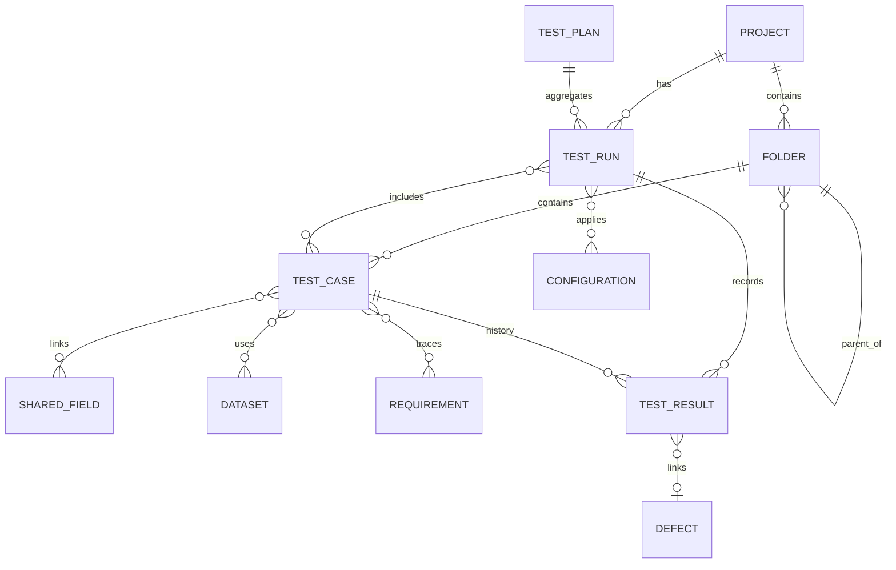

# BrowserStack Test Management — competitive TMS research

Research date: 14 November 2026. Prefer primary sources (BrowserStack docs, pricing, API). Review quotes from G2, Capterra, and Reddit.

---

## 1. Overview

**Vendor:** BrowserStack (cloud testing platform; Test Management is one product under “Management & Optimization,” alongside Test Reporting & Analytics).

**License model:** Closed source / **proprietary commercial SaaS**. BrowserStack’s Terms of Service define “Services” as “BrowserStack’s **proprietary software-as-a-service** solution(s)” and state that this is a **subscription** for access only: customers obtain “only a limited right,” “no ownership rights are being conveyed,” and “Customer has **no right to obtain a copy** of any of the Services” ([Terms of Service](https://www.browserstack.com/terms), Ownership §7). Use of Test Management is additionally subject to [Service-Specific Terms](https://www.browserstack.com/terms/service-specific-terms) and [Additional Terms — Test Management](https://www.browserstack.com/terms/service-specific-terms/additional-terms-test-management) (also mirrored in [docs terms](https://www.browserstack.com/docs/test-management/references/terms-and-conditions)). The product UI/API at `test-management.browserstack.com` is not offered as open-source software. **Adjacent open-source tooling found:** BrowserStack’s official MCP server (`browserstack/mcp-server`, npm `@browserstack/mcp-server`) is published under **AGPL-3.0** and can manage TM projects/cases/runs via natural language — it is an integration layer, not the TMS itself. Official “upload reports CLI” in TM docs is **HTTP `curl` against the proprietary import API**, not a separately licensed open-source CLI package. Test Companion’s `tc` CLI is a **proprietary** (beta) installer from BrowserStack, not open source. Third-party/community API wrappers (e.g. MIT-licensed unofficial clients on GitHub) exist but are not first-party BrowserStack TM products. No first-party open-source SDK that *is* the Test Management product was found.

**Deployment:** SaaS / cloud only (`test-management.browserstack.com`). No self-hosted, Data Center, or on-prem edition for Test Management was found in docs. There is a **Jira app** for creating/tracking test cases and runs inside Jira with two-way binding. Not a native Jira Forge/DC-only plugin as the sole product.

**Target users:** QA and engineering teams that want a unified manual + automated test repository, especially teams already on BrowserStack Live/Automate or migrating from TestRail / Zephyr / Xray. Marketing emphasises AI agents, CI/CD quality gates, and executive dashboards.

**Pricing (checked 14 Nov 2026 from [browserstack.com/pricing?product=test-management](https://www.browserstack.com/pricing?product=test-management); annual billing):**

| Plan | Published price | Seats / notes |
| --- | --- | --- |
| **Free** | $0 | Up to **5 users**; unlimited projects, cases, manual runs; **10 GB** attachments; lifetime case retention; **30-day** automated run retention; **1k automated executions / user**; **50 req/min** for test-run import API |
| **Team** | **$99 / month** (billed annually) for **5 users** | Bundles of 5 / 10 / 25 (+ contact sales); ~$19.80/user/mo at 5 seats. Marketing also says paid plan “starts at $19/user/month” ([vs TestRail](https://www.browserstack.com/test-management/vs-testrail)). **50 GB** storage; **1-year** automated run retention; **300 req/min** import API |
| **Team Pro** | **$199 / month** (billed annually) for **5 users** | Same seat bundles; **100 GB** storage; adds versioning, archive, review/approve, dynamic run selection, automation reporting |
| **Team Ultimate** | Inquire / Contact Sales | **150 GB**; AI agents; flaky detection; failure categorisation; quality gates; custom dashboards; **2k** automated executions / user |
| **Enterprise** | Inquire | Custom storage/retention/rate limits; SSO, advanced access, etc. |

Monthly billing is offered (“save up to 25%” annuallyially). Exact month-to-month Team/Team Pro list prices for TM were not clearly isolated from other products on the scraped pricing page — treat annual figures above as the confirmed published numbers.

**Free trial / free plan:** Permanent **Free** plan (not only a time-boxed trial). Team/Team Pro advertise **complimentary AI Agents for 3 months**. Sign-up via BrowserStack account; demo project with sample cases/runs.

Sources: [Terms](https://www.browserstack.com/terms), [TM additional terms](https://www.browserstack.com/terms/service-specific-terms/additional-terms-test-management), [MCP server](https://github.com/browserstack/mcp-server), [Pricing](https://www.browserstack.com/pricing?product=test-management), [Free tool](https://www.browserstack.com/test-management/free-tool), [Product](https://www.browserstack.com/test-management), [Getting started](https://www.browserstack.com/docs/test-management/overview/getting-started).

---

## 2. Data model and entities

| Entity | What it is | Key fields / notes |
| --- | --- | --- |
| **Project** | Top-level container (`PR-N`) | `name`, `identifier`; owns folders, cases, runs, plans, configs |
| **Folder** | Nested case organisation | `id`, `name`, `description`, `parent_id`, `cases_count`, `sub_folders_count`, attachments; delete removes folder **and** cases |
| **Test case** | Spec under test (`TC-N`) | Templates: **steps**, **text**, **BDD**; `name`, priority, status/state, case_type, automation_status, owner, tags, custom_fields, reviewers, review_status, issue links, configs, archived; name truncated at **500** chars on import |
| **Steps** | Ordered Action / Additional Data / Expected Result | Inline or via shared steps |
| **Shared fields** | Reusable content | **Shared steps**, **shared backgrounds** (Gherkin), **shared preconditions** (rich text); reference not copy; copyable across projects |
| **Datasets / parameters** | Data-driven variables | Dataset title, columns (variables), rows; linked to cases; cartesian product across multiple datasets |
| **Test run** | Execution container (`TR-N`) | Manual **or** automated (distinct); name, description, state (`new`, `under_review`, `in_progress`, `rejected`, `done`, `closed`), assignee, tags, configs, requirements, dynamic selection |
| **Test result** | Outcome on a case (× config × dataset row) | Status (customisable on paid), response/error, logs, defects, custom fields, attachments |
| **Test plan** | Parent aggregating multiple runs | Name, owner, custom fields, status (incl. Completed); unifies manual + automation runs |
| **Milestones / releases / sprints** | **not found in docs** as first-class TM entities | Release context typically via linked tracker issues / plans |
| **Requirements / stories** | External issues linked for coverage | Jira, Azure Boards, Asana, Linear (reports), ClickUp (API filters), custom tracker (Issue Link + Issue ID) |
| **Defects** | Linked tracker issues on results | Not a native defect store; filed to Jira/Azure/custom with context |
| **Configurations / environments** | OS / browser / device (and custom) | Applied on runs; each config duplicates case instances; system + custom |
| **Custom fields** | Definitions per entity type | `TestCase`, `TestResult`, `TestPlan`; types: string, text, int, boolean, date, url, user, dropdown, multi_dropdown; nested_dropdown for cases only |
| **Attachments** | Files on folders, cases, results | Quota by plan (10–150 GB / custom) |
| **Tags / labels** | Classification | On cases, shared fields, runs; filterable |
| **Versions / baselines** | Case history & versioning | **Team Pro+**; archive/retrieve on Pro+ |
| **Review** | Peer review workflow | Statuses: pending, in_review, approved, rejected, changes_requested (**Pro/Ultimate**) |

Sources: [Folders API](https://www.browserstack.com/docs/test-management/api-reference/folders), [Test cases API](https://www.browserstack.com/docs/test-management/api-reference/test-cases), [Shared fields](https://www.browserstack.com/docs/test-management/test-cases/shared-fields), [Datasets](https://www.browserstack.com/docs/test-management/test-cases/test-datasets), [Manual runs](https://www.browserstack.com/docs/test-management/test-runs/create-manual-test-runs), [Configurations](https://www.browserstack.com/docs/test-management/test-runs/configurations-in-a-test-run), [Custom fields API](https://www.browserstack.com/docs/test-management/api-reference/custom-fields), [Review workflow](https://www.browserstack.com/docs/test-management/test-cases/review-and-approve-test-cases), [Pricing feature matrix](https://www.browserstack.com/pricing?product=test-management).

---

## 3. Relationships and flows

**Typical links**

- Project → Folders (tree) → Test cases  
- Case ↔ Requirements (Jira/Azure/Asana/custom)  
- Case → Shared steps / preconditions / backgrounds; Case → Datasets  
- Test run ← selected cases (+ dynamic filters); Run × Configurations × Dataset rows → Result instances  
- Result → Defects (tracker); Run → Requirements  
- Test plan → many Test runs (manual + automated)  
- Automated upload creates a **new Automation Test Run** (cannot append into an existing manual run)

**End-to-end workflow**

1. Create/import project → organise folders → author cases (steps/text/BDD).  
2. Optionally send cases for review (Pro+).  
3. Create manual run (filter/select cases, configs, datasets, assign) and/or push JUnit/BDD results from CI (new automation run).  
4. Group runs under a **test plan** for release readiness.  
5. Link defects from failures; use dashboards/reports (traceability, defects, flaky on Ultimate).

**Case versioning / review:** History & versioning on Team Pro+. Review: submit → reviewers approve / request changes / reject; project-level enablement and optional restricted reviewer list; CSV/API default review state configurable; manual create defaults to Pending.

**Statuses:** Case state/priority/type and result statuses are customisable (Team+ for run/result customisation per pricing). Run states via API: `new`, `under_review`, `in_progress`, `rejected`, `done`, `closed`.

Sources: [Link CI/CD with manual](https://www.browserstack.com/docs/test-management/test-runs/link-ci-cd-results-with-manual-testing), [Manual runs](https://www.browserstack.com/docs/test-management/test-runs/create-manual-test-runs), [Review](https://www.browserstack.com/docs/test-management/test-cases/review-and-approve-test-cases), [Test runs API](https://www.browserstack.com/docs/test-management/api-reference/test-runs).

---

## 4. Full feature list

**Authoring:** Steps, rich-text, and BDD templates; shared steps/backgrounds/preconditions; datasets (cartesian multi-dataset); AI Test Case Generator / Deduplication / Maintenance / Data Generator (Ultimate; 3‑mo trial on Team/Pro); Low-Code Authoring Agent (needs Low-Code Automation Pro). **Call-to-test** as a distinct entity: **not found in docs** (shared steps cover reuse).

**Organisation:** Unlimited projects/folders/tags; advanced filters (Team+); archive (Pro+); copy shared fields across projects; share cases across projects (`is_shared` / `source_project_id`).

**Execution:** Manual runner with assignment, bulk select, dynamic filter-based inclusion (Pro+); configs multiply instances; Live integration for browser sessions; App Live integration listed as **Upcoming** on pricing. Timers: **not found in docs** as a first-class feature.

**Traceability:** Requirements on cases/runs; defects on results; Requirement Traceability Report (Jira/Azure/Asana/Linear; JQL; schedule email); automation coverage metrics.

**Reporting / dashboards (built-in / marketed):** Test run summary & detailed reports; defects & traceability reports; critical-metrics dashboard with drill-down; reports across all projects (**Upcoming** / Contact Sales on Pro); TRA features on Ultimate: stability/performance/test-count trends, custom dashboards with widgets, test health & error dashboards, last-10-run history, timeline debugging, unique-error analysis. Hard limit **20,000 rows** per report.

**Search / filters:** UI filters mirrored in API (`status`, `priority`, `case_type`, `automation_status`, `tags`, `issue_ids`, custom fields, review fields, date ranges, `match[any|all|none]`). No separate named query language (e.g. JQL-for-cases) beyond Jira JQL for requirement picking.

**Import / export:** Quick Import from **TestRail, Zephyr Scale, Zephyr Essential (Squad) Cloud/Server, Xray Cloud/Server-DC, CSV**; marketing also cites **qTest**. API/CSV field auto-map; retain case IDs. Export of full repository: **not found in docs** as a first-class product export (API can read entities).

**Audit logs:** Enterprise product docs describe org audit logs (180 days, Owner/Admin); pricing matrix still marks Audit logs as **Upcoming** for TM tiers — treat as platform/enterprise capability with unclear TM-tier availability.

**Permissions / SSO / SCIM:** Platform RBAC (Admin / User / Viewer; unlimited Viewers on paid matrix). SSO (SAML, GAuth, Okta, Azure AD, etc.) and Open SCIM (incl. `Test-Management` product attribute) documented for **Enterprise**. IP whitelisting on enterprise matrix.

**AI:** Agents listed in §1/pricing (generator, low-code authoring, data, failure analysis, dedup, selection upcoming, maintenance); flaky + failure categorisation on Ultimate.

**Localisation:** Product UI localisation for TM: **not found in docs**. (Separate Live/App products support geo/localisation testing of *apps under test*.)

**Mobile / offline:** No dedicated TM native mobile app or PWA offline mode found. Offline mode docs refer to **Live** network simulation for PWAs on devices, not TM client offline.

Sources: [Product](https://www.browserstack.com/test-management), [Pricing matrix](https://www.browserstack.com/pricing?product=test-management), [Quick Import](https://www.browserstack.com/docs/test-management/quick-import), [Traceability report](https://www.browserstack.com/docs/test-management/reports-and-analytics/reports/requirement-traceability-report), [SSO](https://www.browserstack.com/docs/enterprise/single-sign-on), [SCIM](https://www.browserstack.com/docs/enterprise/auto-user-provisioning/open-scim), [Audit logs](https://www.browserstack.com/docs/enterprise/audit-logs), [RBAC](https://www.browserstack.com/docs/iaam/user-and-team-management/role-based-access-control/roles-and-permissions).

---

## 5. Automation and CI

**Result formats:** **JUnit XML** and **BDD JSON** (Cucumber). Framework guides: TestNG, WebdriverIO, Nightwatch, Appium, Cypress, Mocha, PyTest, Playwright, Espresso, XCUITest, Cucumber. Native Allure / NUnit / Robot as first-class upload formats: **not found in docs** (teams typically emit JUnit XML from those runners).

**Upload mechanism:** HTTP upload (docs brand this as “CLI” / terminal upload), e.g.:

- `POST https://test-management.browserstack.com/api/v1/import/results/xml/junit`  
- `POST https://test-management.browserstack.com/api/v1/import/results/json/bdd`  

Form fields: `project_name`, `file_path`, `test_run_name` (+ optional `user_email`). Auth via API token. BrowserStack SDK / Test Reporting & Analytics paths also map results; WDIO reporters exist in the ecosystem.

**CI integrations (docs / pricing):** Jenkins, Azure Pipelines, CircleCI, Bamboo, GitHub Actions, Bitbucket Pipelines, and “more.” Jenkins note: if `project_name` is new, **Test Management will create the project**. Quality Gates / GitHub PR checks on Ultimate. Trigger automation runs from TM on CI: **Upcoming**.

### Auto-create test cases from CI/automation results? Matching?

**Yes — unmatched automated tests auto-create new test cases.** This is first-class, documented behaviour on the JUnit XML / BDD-JSON upload path (the docs brand it “upload reports CLI”).

Official wording from [JUnit XML or BDD-JSON based report upload](https://www.browserstack.com/docs/test-management/upload-reports-cli) under **Data import mechanism → Creation or association**:

> “A Test Case is either mapped to an existing Test Case (**by ID or Title**) or a **new Test Case is created**.”

Combined with [Link CI/CD results with manual testing](https://www.browserstack.com/docs/test-management/test-runs/link-ci-cd-results-with-manual-testing) and [Test Case ID Tagging](https://www.browserstack.com/docs/test-management/test-runs/test-case-tagging):

1. **New Automation Test Run per upload.** Manual and automated runs are distinct. Uploading JUnit XML / SDK results **always creates a new Automation Test Run**; you **cannot append** automated results into an existing manual run. Unify both under a **Test Plan**.
2. **Match order / keys.** Prefer a stable **Test Case ID** (`TC-…`); fall back to **Title**. If neither matches an existing case, TM **creates** one (and places it using suite/folder mapping).
3. **JUnit → entity mapping:** `<testsuite name>` → folder; `<testcase name>` → case name; `time` → duration; child `failure` / `error` / `system-err` → Failed; `skipped` → Skipped; else Passed. Error messages map into the result Response field.
4. **ID tagging (recommended to stop orphans):**
   - **Property-based:** include a property named `id` with the TM case ID — e.g. TestNG `Reporter.log("[[PROPERTY|id=TC-1]]\n", true);`, PyTest `record_property("id", "TC-52628")`, Playwright `console.log(\`[[PROPERTY|id=${id}]]\`)`, or JUnit `<property name="id" value="TC-…"/>`. SDK path: `BrowserStack.setCustomTag("ID", "TC-972810")`.
   - **Title-based:** embed `TC-…` in the test title (before or after the text; docs recommend **after**). Works across frameworks for JUnit/SDK/TRA uploads and avoids duplicate cases when folder layout differs from the repo.
   - **BDD / Cucumber:** `@TCID_TC-1234` scenario tags (also documented for Test Companion).
5. **Orphan warning (docs):** if you do not tag, “the system cannot identify them. It will **create new, unmapped orphan test cases for every execution, cluttering your project**.”
6. **Field import side effects:** State, Priority, Tags, Owner, Configurations, Type, and custom fields can ride in via `<property>` or `[[PROPERTY|Field=Value]]` in `system-out`. For **system** fields (except Owner), unknown values are **auto-created**; **custom** fields must already exist on the project and type-match. Same case name + different Configurations → **separate result instances**.
7. **Name limit:** case names truncated to **500** characters silently (`success:true` still returned). For long parameterized names, tag by ID so matching does not depend on the truncated title.
8. **Limits / options:** one XML file per build on that upload path; external log files unsupported (use `system-out`). Plan quotas: Free **1k** automated executions/user & **50** import req/min; Team/Team Pro **300** req/min; Ultimate marketing cites higher automated execution caps. No documented toggle to disable auto-create (map-only mode): **not found in docs**.

**Flaky detection:** Automatic flaky detection (customisable definitions) on **Team Ultimate** (+ TRA marketing).  

**Run merging:** Cannot merge automation results into a manual run; **unify via Test Plans** that contain both run types. Archive build runs to exclude from metrics (paid matrix).

Sources: [Upload reports CLI](https://www.browserstack.com/docs/test-management/upload-reports-cli), [TestNG upload](https://www.browserstack.com/docs/test-management/upload-reports-cli/frameworks/testng), [Tagging](https://www.browserstack.com/docs/test-management/test-runs/test-case-tagging), [Link CI/CD](https://www.browserstack.com/docs/test-management/test-runs/link-ci-cd-results-with-manual-testing), [Jenkins](https://www.browserstack.com/docs/test-management/integrations/jenkins), [Pricing](https://www.browserstack.com/pricing?product=test-management).

---

## 6. API

| Aspect | Detail |
| --- | --- |
| **Type** | REST, JSON responses, standard HTTP codes |
| **Base URL** | `https://test-management.browserstack.com` — management APIs under `/api/v2/…`; result import under `/api/v1/import/results/…` |
| **Auth** | HTTP Basic: BrowserStack `username:access-key`, or Test Management API token (`-u $TEST_MANAGEMENT_API_TOKEN` / `API-TOKEN` header in Jenkins samples) |
| **Rate limits** | Docs: **300 requests/minute per group**; HTTP **429**, wait **60s**. Pricing: Free import path **50**/min; Team+ **300**/min; Enterprise custom |
| **Pagination** | `p`, `page_size` (default 30, max **300**); `info.{page,page_size,count,prev,next}` |
| **Webhooks** | Platform webhooks: test case created/updated/deleted/archived; test plan created/updated/completed/deleted; test result added. Pricing matrix still shows Webhooks as **Upcoming** on some TM rows — docs describe them as available platform feature |

**Main endpoint groups** ([API introduction](https://www.browserstack.com/docs/test-management/api-reference/introduction)):

| Group | Operations (representative) |
| --- | --- |
| Projects | List, get, create, update, delete |
| Folders | List root/sub, get, create, update, delete, move |
| Test cases | List/filter, minify, create, bulk create (≤10k; async >30), update, etc. |
| Reviewers | Assign reviewers, review status, project allowed reviewers |
| Test runs | List/filter, create, list cases in run, close/update |
| Test plans | List, create, link runs |
| Test results | List by run/case, add single/bulk results |
| Attachments | List/add for cases & results |
| Configurations | List project configs |
| Custom fields | CRUD definitions (`TestCase` / `TestResult` / `TestPlan`) |
| Import | JUnit XML / BDD JSON result upload (`/api/v1/import/…`) |

Sources: [Introduction](https://www.browserstack.com/docs/test-management/api-reference/introduction), [Authentication](https://www.browserstack.com/docs/test-management/api-reference/authentication), [Pagination](https://www.browserstack.com/docs/test-management/api-reference/pagination), [Rate limits](https://www.browserstack.com/docs/test-management/api-reference/rate-limit-for-api-calls), [Webhooks](https://www.browserstack.com/docs/test-management/webhooks).

---

## 7. Integrations

| Category | Integrations |
| --- | --- |
| **Issue trackers** | Jira (app + two-way binding, create cases/runs in Jira on Team+), Azure Boards, Asana, ClickUp, Linear (traceability report), custom issue tracker |
| **CI/CD** | Jenkins, Azure Pipelines, CircleCI, Bamboo, GitHub Actions, Bitbucket Pipelines |
| **Automation** | Frameworks via JUnit/BDD upload; BrowserStack Automate / SDK / TRA; Live (and App Live upcoming) |
| **Chat / alerts** | Slack & email threshold alerts (Ultimate/Contact Sales on matrix); webhook templates mention Slack / PagerDuty |
| **SSO** | GAuth, Okta, Azure AD, OpenSAML, etc. (Enterprise docs) |
| **Marketplace** | Atlassian/Jira app for Test Management; broader BrowserStack marketplace for other products |

OpenProject: **not found**. Native Linear as full two-way ALM like Jira: limited evidence (report selection).

Sources: [Pricing integrations](https://www.browserstack.com/pricing?product=test-management), [Jira support hub](https://www.browserstack.com/support/test-management), [Custom tracker](https://www.browserstack.com/docs/test-management/integrate-issue-trackers/custom-issue-tracker/link-with-test-runs), [Webhooks](https://www.browserstack.com/docs/test-management/webhooks).

---

## 8. Marketing positioning

Headline: **“Next-gen Test Management with AI”** — AI agents across planning, authoring, execution, validation, maintenance; advanced reporting/analytics; quality-engineering insights (Net Quality Score, 50+ metrics).

Differentiators claimed:

- AI-native (not “GPT wrapper”): 90% faster creation, 50% more coverage, 10× faster authoring (marketing claims).  
- Automation-first reports: flaky, new failures, unique errors; failure analysis “95% faster.”  
- Quality Gates blocking merges/deploys.  
- Unified manual + automated + BrowserStack device cloud.  
- Generous **free** tier vs classic TMS (unlimited cases, Jira binding, AI teasers).  
- Migration from TestRail/Zephyr/Xray with “hassle-free” quick import.  
- Price wedge vs TestRail ($19 vs $37/user in their comparison page).

Sources: [test-management](https://www.browserstack.com/test-management), [vs TestRail](https://www.browserstack.com/test-management/vs-testrail), [free-tool](https://www.browserstack.com/test-management/free-tool).

---

## 9. What users love

Themes (mix of TM-specific and BrowserStack-platform reviews; TM is often bundled in overall BrowserStack ratings — G2 ~**4.4**/5, Capterra ~**4.6**/5):

1. **Usable free tier for small teams** — “The thing I like the most is the limited free version… user management is great, test case creation is nice” (Capterra, Test Management–only disclaimer).  
2. **Support quality** — “Their support team is top tier” (Capterra TM review).  
3. **One roof with BrowserStack execution** — Reddit: switching from TestRail “made sense… Cuts down on the ‘justify another tool to finance’ headache” when already on BStack.  
4. **CI/automation fit** — Capterra: integrates with automation frameworks, parallel execution, quality confidence.  
5. **AI direction** — G2: AI “flags flaky tests, and assists with more autonomous test case generation.”

Sources: [Capterra reviews](https://www.capterra.com/p/162900/BrowserStack/reviews/), [G2](https://www.g2.com/products/browserstack/reviews), [Reddit r/Everything_QA](https://www.reddit.com/r/Everything_QA/comments/1qr5lhd/anyone_else_finding_testrail_or_other_qa_tools/).

---

## 10. What users dislike

1. **TM still “basic” vs dedicated TMS** — “Test management features are basic compared to dedicated tools, so we still rely on other platforms” (Capterra). Another: “Okay, but not the best for Test Management… ended up switching to Qase”; drag-and-drop copy “will work for a bit, then stop.”  
2. **AI gated / incomplete on free** — “deducting one point because of the lack of AI in the free version.”  
3. **Ecosystem lock-in & price** — Reddit: “expensive for what we really needed and a bit too locked into their ecosystem”; prefer loosely coupled management vs execution vendor.  
4. **Platform latency/timeouts** (often Live/Automate, colours overall perception) — lag, session disconnects, pricing for small teams (G2/Capterra).  
5. **Jira depth** — Reddit new QA lead: Jira integration “limited to my taste”; fear of content lock-in vs CSV/sheets.

Sources: [Capterra](https://www.capterra.com/p/162900/BrowserStack/reviews/), [G2 / learn.g2](https://learn.g2.com/best-test-management-tools), [Reddit r/QualityAssurance](https://www.reddit.com/r/QualityAssurance/comments/1pft2zd/should_we_use_browserstack_for_test_management/).

---

## 11. Ideas for Vulyk

Vulyk context: open-source self-hosted TMS (folders/cases/plans/runs, CI ingest, campaigns/iterations, requirements, Jira/OpenProject, reports/flaky, RBAC/SSO, LLM, MCP, importers, PWA offline).

1. **Ship explicit CI matching policy (copy the useful part, fix the pain):** Support match-by-stable-ID and match-by-title, plus an operator-visible mode: `auto-create` | `map-only` | `quarantine-orphans`. BrowserStack’s default auto-create is powerful for greenfield automation but creates orphan clutter — Vulyk should make the behaviour a first-class setting with dry-run/preflight (like community reporters already warn about missing TC IDs).  
2. **Separate manual vs automation runs, unify in plans/campaigns:** Their Test Plan aggregation model maps cleanly to Vulyk campaigns/iterations — keep runs single-source, roll up coverage in the parent.  
3. **JUnit + Cucumber JSON first, with rich property mapping:** Import folder from suite name, status from failure tags, configs multiplying instances, and optional field auto-create — strong DX for CI ingest.  
4. **Shared steps + BDD backgrounds + datasets (cartesian):** High leverage for authoring parity; avoid inventing “call-to-test” until shared steps exist.  
5. **Review/approve + version history as progressive features:** Match Team Pro expectations without blocking FOSS core.  
6. **Importers as a migration moat:** TestRail/Zephyr/Xray/CSV with ID retention — BrowserStack wins migrations here; Vulyk should keep fragment-based seeds and solid importers.  
7. **Avoid SaaS lock-in narrative:** Users dislike being tied to an execution vendor; lean into AGPL self-host, OpenProject + Jira, exportable data, MCP/LLM that work on local data — opposite of “content locked in BrowserStack.”  
8. **Flaky + quality gates carefully:** Ultimate’s flaky detection and PR gates are competitive; implement with transparent definitions and no opaque quota on “automated executions.”  
9. **PWA offline as a differentiator:** BrowserStack TM has no offline client; Vulyk’s PWA offline is a clear wedge for field/manual QA.  
10. **Don’t under-deliver on core TMS UX:** Reviews that call BS TM “basic” or buggy (drag-drop) show that AI marketing cannot replace solid case/run editing — prioritise reliability of folder moves, bulk edit, and RBAC/SSO.

---

## 12. Sources

- https://www.browserstack.com/terms  
- https://www.browserstack.com/terms/service-specific-terms  
- https://www.browserstack.com/terms/service-specific-terms/additional-terms-test-management  
- https://www.browserstack.com/docs/test-management/references/terms-and-conditions  
- https://github.com/browserstack/mcp-server  
- https://www.browserstack.com/test-management  
- https://www.browserstack.com/test-management/free-tool  
- https://www.browserstack.com/test-management/vs-testrail  
- https://www.browserstack.com/test-management/features/quick-import  
- https://www.browserstack.com/pricing?product=test-management  
- https://www.browserstack.com/docs/test-management/overview/getting-started  
- https://www.browserstack.com/docs/test-management/quick-import  
- https://www.browserstack.com/docs/test-management/upload-reports-cli  
- https://www.browserstack.com/docs/test-management/upload-reports-cli/frameworks/testng  
- https://www.browserstack.com/docs/test-management/upload-reports-cli/frameworks/cucumber  
- https://www.browserstack.com/docs/test-management/test-runs/link-ci-cd-results-with-manual-testing  
- https://www.browserstack.com/docs/test-management/test-runs/test-case-tagging  
- https://www.browserstack.com/docs/test-management/test-runs/create-manual-test-runs  
- https://www.browserstack.com/docs/test-management/test-runs/configurations-in-a-test-run  
- https://www.browserstack.com/docs/test-management/test-cases/shared-fields  
- https://www.browserstack.com/docs/test-management/test-cases/test-datasets  
- https://www.browserstack.com/docs/test-management/test-cases/review-and-approve-test-cases  
- https://www.browserstack.com/docs/test-management/reports-and-analytics/reports/requirement-traceability-report  
- https://www.browserstack.com/docs/test-management/integrations/jenkins  
- https://www.browserstack.com/docs/test-management/webhooks  
- https://www.browserstack.com/docs/test-management/api-reference/introduction  
- https://www.browserstack.com/docs/test-management/api-reference/authentication  
- https://www.browserstack.com/docs/test-management/api-reference/pagination  
- https://www.browserstack.com/docs/test-management/api-reference/rate-limit-for-api-calls  
- https://www.browserstack.com/docs/test-management/api-reference/projects  
- https://www.browserstack.com/docs/test-management/api-reference/folders  
- https://www.browserstack.com/docs/test-management/api-reference/test-cases  
- https://www.browserstack.com/docs/test-management/api-reference/test-runs  
- https://www.browserstack.com/docs/test-management/api-reference/test-results  
- https://www.browserstack.com/docs/test-management/api-reference/test-plans  
- https://www.browserstack.com/docs/test-management/api-reference/custom-fields  
- https://www.browserstack.com/docs/enterprise/single-sign-on  
- https://www.browserstack.com/docs/enterprise/auto-user-provisioning/open-scim  
- https://www.browserstack.com/docs/enterprise/audit-logs  
- https://www.browserstack.com/docs/iaam/user-and-team-management/role-based-access-control/roles-and-permissions  
- https://www.browserstack.com/support/test-management  
- https://www.g2.com/products/browserstack/reviews  
- https://learn.g2.com/best-test-management-tools  
- https://www.capterra.com/p/162900/BrowserStack/reviews/  
- https://www.capterra.com/test-management-tools-software/  
- https://www.reddit.com/r/QualityAssurance/comments/1pft2zd/should_we_use_browserstack_for_test_management/  
- https://www.reddit.com/r/Everything_QA/comments/1qr5lhd/anyone_else_finding_testrail_or_other_qa_tools/  
