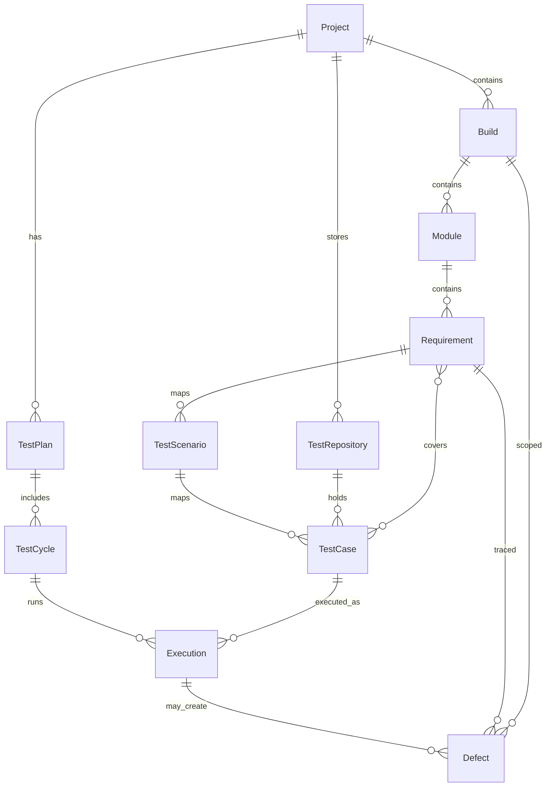

# Kualitee — Competitive TMS Research

Research date: **2026-11-14**. Prefer primary sources (kualitee.com, API docs, pricing, G2/Capterra). Unconfirmed items marked **not found in docs**.

---

## 1. Overview

**Vendor:** Kualitatem (product: **Kualitee**). Marketed as an AI-powered QA test case management / “release confidence” platform since about **2016**, with claims of **500+** organizations globally ([homepage FAQ](https://www.kualitee.com/)).

**Deployment:**
- **Cloud** SaaS (data hosting marketed for **US & EU**)
- **On-premise / self-hosted** (“Light Speed”): Windows or Linux install; annual licenses; **minimum 10 users**
- **Jira app**: free Kualitee–Jira plugin on Atlassian Marketplace for reviewing test cases & reports; bi-directional Jira sync for Cloud / Server / Data Center ([Jira integration](https://www.kualitee.com/integrations/jira/), [pricing](https://www.kualitee.com/pricing/))

**Target users:** Mid-market and growing QA teams (banking, healthcare, telecom, government, e-commerce, SaaS per marketing); also positioned for small teams (3–5 engineers) and regulated / on-prem buyers ([homepage](https://www.kualitee.com/), [pricing FAQ](https://www.kualitee.com/pricing/)).

**License model.** **Closed source** (proprietary commercial; Cloud and on-prem “Light Speed”). Free forever tier and paid plans; no public product source repository found. Not open source or open core. Source: [kualitee.com/pricing](https://www.kualitee.com/pricing/).

**Pricing (as published 2026-11-14 on [kualitee.com/pricing](https://www.kualitee.com/pricing/)):**

| Plan | Price | Limits / notes |
| --- | --- | --- |
| Free Forever (Growth) | $0 | 1 project, 500 test cases, 200 defects, 3 users, 20 AI credits/month/domain |
| Hypergrowth (monthly) | **$12/user/month** (shown as $15 → $12) | Marketing claims “all features”; paid unlimited projects/tests/defects on yearly SKU |
| Hypergrowth (yearly) | **$108/user/year** | Unlimited projects, tests & defects; 100 AI credits (bundle wording varies on page) |
| Viewer license (cloud) | **$7/month** or **$84/year** | Read/report-oriented |
| On-premise Light Speed | **$292/user/year** | Min 10 users; viewer **$146/user/year** |
| Enterprise | Quote | SAML SSO / custom SLA called out as sales-quoted in FAQ (SSO also listed on standard plans—treat FAQ vs feature list carefully) |

**AI credits:** Credit-based model for Hootie agents (generation / execution); add-on credit bundles listed on pricing (e.g. up to 250/500/1000 generation tiers).

**Trial / free:** Free forever tier above; **14-day free trial** full features, no credit card; extended 30-day pilot via sales ([pricing FAQ](https://www.kualitee.com/pricing/)).

Sources: [pricing](https://www.kualitee.com/pricing/), [homepage](https://www.kualitee.com/), [Capterra pricing mirror](https://www.capterra.com/p/164813/Kualitee/pricing/).

---

## 2. Data model and entities

Hierarchy from the official [Test Strategy / user-guide PDF](https://www.kualitee.com/wp-content/uploads/2025/11/Test-Strategy-Template.pdf) and feature pages:

| Entity | What it is | Key fields / notes |
| --- | --- | --- |
| **Project** | Top-level workspace | Users & roles; unlimited on paid |
| **Build** | Release / sprint container | Name, association for tests & defects; “can also act as a sprint” |
| **Module** | Functional area under a build | e.g. Login, Dashboard; groups requirements/tests |
| **Requirement** | User story / requirement under a module | Acceptance criteria; status; risk assessment; Jira mapping |
| **Test scenario** | High-level scenario mapped to a requirement | Structured testing hierarchy between req and cases |
| **Test case** | Detailed case under a scenario | Steps (incl. per-step attachments & results); priority; risk; links to defects; templates; AI-generated drafts |
| **Test repository** | Cross-cycle reusable library | Organized by project/module/build; shareable across projects; “version control” marketing ([repositories](https://www.kualitee.com/features/reusable-test-repositories/)) |
| **Test cycle** | Execution batch (smoke, regression, sprint) | Cases added from repository; status per case |
| **Test plan** | Groups multiple cycles | Overall testing effort for larger releases |
| **Execution / Test Lab** | Run results | Pass/fail/blocked etc.; direct execution without cycle also marketed |
| **Defect** | Built-in bug tracker | Severity, priority, status, assignee; duplicate detection; batch edit; links to case/req/build/cycle |
| **Task** | Kanban / board work items | Task Management module |
| **Custom fields** | Settings → Custom Fields | On test cases, defects, projects ([customizability](https://www.kualitee.com/features/customizability/)) |
| **Dropdown values / custom labels** | Settings | Configurable lists/labels ([user guide](https://www.kualitee.com/user-guide/)) |
| **Attachments** | On steps / defects | Screenshots, evidence; AI from screenshots |
| **Tags / labels** | Custom labels | Via settings |
| **Risk matrix / strategy** | Org-level RBT | Probability × damage → levels **A–E**; coverage targets ([RBT](https://www.kualitee.com/software-testing/risk-based-testing/)) |
| **Configurations / environments** | Browser/OS for Hootie runs | Chosen for AI execution; first-class multi-config matrix **not found in docs** as a rich entity like TestRail configs |
| **Parameters / datasets** | Data-driven cases | **not found in docs** as first-class dataset entity |
| **Shared steps / call-to-test** | Reusable steps | **not found in docs** under those names (reusable *cases* / repositories yes) |
| **Milestones** | Separate milestone entity | Covered via **Builds** / plans; dedicated “milestone” **not found** |
| **Baselines** | Snapshot baselines | **not found in docs** (repositories claim “version control”) |
| **Case versions** | Version history | Marketing: “Native versioning” vs spreadsheets ([vs spreadsheets](https://www.kualitee.com/comparison/spreadsheet/)); detailed version API **not found** |

Sources: [Test Strategy PDF](https://www.kualitee.com/wp-content/uploads/2025/11/Test-Strategy-Template.pdf), [user guide](https://www.kualitee.com/user-guide/), [why-kualitee](https://www.kualitee.com/why-kualitee/), [repositories](https://www.kualitee.com/features/reusable-test-repositories/).

---

## 3. Relationships and flows

**Canonical hierarchy (vendor PDF):**

`Project → Users → Build → Module → Requirement → Scenario → Test Case → Test Cycle → Execution → Defects → Test Plan → Reports`

**Links:**
- Requirement ↔ scenario ↔ case (coverage)
- Case ↔ defects (from failed execution); defects also link requirement, build, cycle
- Cycle ∈ plan; cases pulled from repository into cycles
- Jira: bi-directional sync of issues/defects/requirements ([Jira](https://www.kualitee.com/integrations/jira/))
- Risk: assessed on module / requirement / case; can inherit from parent ([RBT](https://www.kualitee.com/software-testing/risk-based-testing/))

**Typical E2E workflow:** Create project → invite users/roles → add build & modules → requirements → scenarios → cases → cycle(s) → execute in Test Lab → log defects → optionally group cycles in a test plan → reports/insights ([PDF](https://www.kualitee.com/wp-content/uploads/2025/11/Test-Strategy-Template.pdf)).

**Review / approval:** Homepage markets “sharing with team members for their review and approvals” for plans/cases; roles include privileges such as **approve** ([roles](https://www.kualitee.com/features/roles-and-privileges/)). Detailed multi-stage approval workflow docs **not found**.

**Statuses:** Execution statuses include at least **Passed, Failed, Blocked** (and “Not Run” / “NOW Run” in API guide). Custom status labels for runs and defects ([customizability](https://www.kualitee.com/features/customizability/)). Defect statuses appear in dashboards (reported, fixed, open, reopened, etc.) ([user guide](https://www.kualitee.com/user-guide/)). Full enum list **not found in docs**.

Sources: [Test Strategy PDF](https://www.kualitee.com/wp-content/uploads/2025/11/Test-Strategy-Template.pdf), [direct execution](https://www.kualitee.com/features/direct-test-execution/), [roles](https://www.kualitee.com/features/roles-and-privileges/).

---

## 4. Full feature list

**Authoring**
- Manual cases with individual steps, per-step attachments/results ([why-kualitee](https://www.kualitee.com/why-kualitee/))
- **Hootie AI**: generate from text, BRD, screenshots/UI, URL + plain-language workflow; categorize positive/negative/edge; optional automation script generation ([features](https://www.kualitee.com/features/))
- **Gherkin**: upload feature files; Cypress Cucumber tags ([Cypress](https://www.kualitee.com/automation-testing/kualitee-cypress/))
- Templates / reusable cases; clone between projects
- Shared steps / call-to-test / parameters: **not found in docs**
- Rich text: **not found** beyond standard case/defect fields

**Organisation**
- Projects, builds, modules, repositories, scenarios, cycles, plans, tasks/Kanban
- Risk-based testing matrix A–E ([RBT](https://www.kualitee.com/software-testing/risk-based-testing/))

**Execution**
- Test Lab / cycle execution; **direct run** without cycle ([direct execution](https://www.kualitee.com/features/direct-test-execution/))
- Step pass/fail/blocked + inline notes; log defect from run
- Assignment of cases/defects to users (dashboard “assigned vs open”)
- Timers: **not found in docs**
- Bulk: batch defect editing; bulk CSV import

**Traceability / coverage**
- Req ↔ scenario ↔ case ↔ defect ↔ build/cycle
- Requirements coverage & with/without defects widgets
- Build / test-case / requirement **traceability reports**

**Reporting / dashboards** (built-ins from [user guide](https://www.kualitee.com/user-guide/) + PDF)
- Defects: by severity/status, closure efficiency, active defects, reopened %, fix duration, bug statistics, assigned vs open
- Cases: status, executed, progress, fail %, assigned vs executed by tester, execution by module, with/without defects, planned vs execution
- Requirements: coverage, with/without defects, by status
- Named reports: Build Traceability, Defect, Test Case, Test Execution, Scheduled, Cycle Comparison, Test Case Traceability, Requirement Traceability, Insights (incl. risk distribution / coverage vs target / execution by risk)
- Customizable / personalized dashboards; AI “executive summary” claimed in [vs PractiTest](https://www.kualitee.com/comparison/kualitee-vs-practitest/)

**Search / filters**
- Persistent filters praised in reviews; risk-level filter for execution. Dedicated query language (JQL-like): **not found in docs**

**Import / export**
- Import: CSV / spreadsheet mapping; Gherkin upload; free assisted migration; docx/CSV import-export mentioned in Capterra reviews; REST API
- Export: CSV/XLSX on cancel (pricing FAQ); test case export claimed vs PractiTest. JUnit export as first-class: **not found**

**Audit / security**
- “Full audit trail” claimed vs spreadsheets; military-grade encryption marketing; ISO 27001 / SOC called out in comparisons. Detailed audit-log UI docs: **thin / not found**
- RBAC: custom roles (view/edit/execute/approve/admin); defaults Admin Tenant, Test Manager, Developer, Tester, Viewer ([PDF](https://www.kualitee.com/wp-content/uploads/2025/11/Test-Strategy-Template.pdf), [roles](https://www.kualitee.com/features/roles-and-privileges/))
- **SSO**: SAML 2.0 — Okta, Azure AD, Google Workspace ([SSO](https://www.kualitee.com/features/single-sign-on/), [integrations auth](https://www.kualitee.com/integrations/))
- **SCIM**: **not found in docs**

**AI**
- Hootie Copilot end-to-end generate → validate → execute against URL; credit system

**Localisation**
- **not found in docs** (product UI language pack list)

**Mobile / offline**
- iOS & Android app + SDK ([pricing](https://www.kualitee.com/pricing/)); execute / log defects / cycle status
- Offline / PWA: third-party reviews say limited offline; official offline docs **not found**

Sources: [features](https://www.kualitee.com/features/), [user guide](https://www.kualitee.com/user-guide/), [customizability](https://www.kualitee.com/features/customizability/).

---

## 5. Automation and CI

### Result formats
- **Upload Report (JSON):** Allure, Puppeteer, Mochawesome, Protractor ([upload report](https://www.kualitee.com/automation-testing/upload-report/))
- Marketing / integrations also: Cucumber, Allure, Mochawesome via API or upload ([automation reports](https://www.kualitee.com/integrations/integration-with-automation-tool-reports/))
- CircleCI path consumes pipeline results that CircleCI itself parses from **JUnit XML** (Jest, pytest, Cypress, Playwright, etc.) then imports cases/statuses into Kualitee ([CircleCI](https://www.kualitee.com/integrations/integrates-with-circle-ci/))
- Direct framework ties: Selenium, Playwright (`kualitee_bridge`), Cypress (`kualitee_cypress` / Gherkin tags), Appium, Tosca, modular Python/Selenium scripts
- Native **TestNG / NUnit / Robot** first-class importers: **not found in docs** (may arrive only if wrapped as supported report JSON or JUnit via CI)

### CLI / SDKs / reporters
- REST token API for per-case status updates
- npm packages: `kualitee_bridge` (Playwright/Cypress), Cypress postResult after run
- Mobile SDK

### CI integrations
Documented or listed: **Jenkins, CircleCI, GitLab CI/CD, GitHub, Bitbucket, Azure DevOps / Pipelines, GitHub Actions** (homepage FAQ), plus framework bridges ([homepage](https://www.kualitee.com/), [Jenkins](https://www.kualitee.com/integrations/jenkins/), [CircleCI](https://www.kualitee.com/integrations/integrates-with-circle-ci/)).

### Matching and **auto-create** (critical)

Kualitee uses **three different models**; auto-create is **yes for some paths, no for others**.

| Path | Matching | Auto-create cases? | Notes |
| --- | --- | --- | --- |
| **Upload Report** (Test Lab → Upload Report) | Parses report JSON by selected type | **Yes** | Docs: “This will **create all the test cases** for you and even define some bugs if … failed.” Creates cases + statuses; BDD steps imported when applicable. Requires only a project (not pre-authored cases). Formats: Allure, Puppeteer, Mochawesome, Protractor. ([upload report](https://www.kualitee.com/automation-testing/upload-report/)) |
| **Report API** (UserFile, Token, Project_ID, Type of Report) | Same report-driven ingest via API | Implied create/populate results | Configure JSON format or upload; details in API doc ([automation reports](https://www.kualitee.com/integrations/integration-with-automation-tool-reports/)) |
| **CircleCI** | Map CircleCI project ↔ Kualitee project | **Yes — import automated test cases** | “Import automated test cases and their execution statuses from mapped CircleCI projects.” ([CircleCI](https://www.kualitee.com/integrations/integrates-with-circle-ci/)) |
| **Per-case execution API** | **Test Case ID** (+ name, project, token, status) | **No** | Prerequisites: Build, Module, Requirements, Scenario, Cases **already created** and added to execution cycle. Update status only (e.g. Passed). ([API integration](https://www.kualitee.com/automation-testing/api-integration/)) |
| **Cypress Gherkin** | Tags `@kts_*` (feature) / `@ktc_*` (scenario) **must match Kualitee** | Cases from Gherkin **upload**; runtime maps by tags | Not free-form name match ([Cypress](https://www.kualitee.com/automation-testing/kualitee-cypress/)) |
| **Jenkins** | Map Jenkins build → Kualitee project; executions sync | Auto-create **not explicitly documented** | Marketing: results map to “managed test case”; sync after build ([Jenkins](https://www.kualitee.com/integrations/jenkins/)) |
| **Playwright Bridge** | Token + project ID + report path; sync into cycles | Update status / reports; create behavior **not spelled out** beyond report sync | ([Playwright](https://www.kualitee.com/integrations/playwright/), [GitHub SDK](https://github.com/kualitee-sdk/kualitee-cyprus)) |

**Options / limits:** Upload-report create is the clearest “CI results → invent TMS cases” path; CircleCI explicitly imports cases. ID-keyed API assumes cases already exist. Dedup / match-on-name-when-exists options: **not found in docs**. Run merging rules: **not found**. Failed upload-report cases may auto-define bugs.

**Flaky detection:** Product blogs discuss flaky *metrics* and using execution history; CircleCI’s own Test Insights flag flakes. A dedicated Kualitee “flaky quarantine” feature: **not found in docs**.

**Automation linking:** Attach scripts to cases (modular scripting); execute Selenium from Kualitee; trigger Cypress/Playwright via integration server URL.

Sources: [upload report](https://www.kualitee.com/automation-testing/upload-report/), [API integration](https://www.kualitee.com/automation-testing/api-integration/), [CircleCI](https://www.kualitee.com/integrations/integrates-with-circle-ci/), [Jenkins](https://www.kualitee.com/integrations/jenkins/), [Cypress](https://www.kualitee.com/automation-testing/kualitee-cypress/).

---

## 6. API

- **Type:** REST (marketing + Pipedream). GraphQL: **not found**.
- **Base URL pattern:** `https://apiss.kualitee.com/api/v2/...` (example: `.../users/list` via [Pipedream](https://pipedream.com/apps/kualitee)). Interactive docs: [https://apiss.kualitee.com/Apidoc/](https://apiss.kualitee.com/Apidoc/) (SPA; full endpoint catalogue hard to scrape).
- **Auth:** Per-user **API token** (profile → Token → API Token). Pipedream lists auth as **API key**.
- **Rate limits:** **not found in docs**.
- **Pagination:** **not found in docs**.
- **Webhooks:** Claimed supported in [Kualitee vs PractiTest](https://www.kualitee.com/comparison/kualitee-vs-practitest/); event catalogue **not found**.

**Known operation groups (from public guides / proxies, not a complete OpenAPI dump):**

| Group | Operations (documented publicly) |
| --- | --- |
| Users | List users (`GET /api/v2/users/list`) |
| Test execution | Update case status in a cycle (Project ID, Token, Test Case ID, Name, Status) |
| Report ingest | Upload/post automation report (UserFile, Token, Project_ID, Type of Report) |
| Integrations | Jenkins/CircleCI/etc. configured in UI; bridge HTTP endpoints for Playwright/Cypress |

Sources: [API integration](https://www.kualitee.com/automation-testing/api-integration/), [Apidoc](https://apiss.kualitee.com/Apidoc/), [Pipedream Kualitee](https://pipedream.com/apps/kualitee), [automation reports](https://www.kualitee.com/integrations/integration-with-automation-tool-reports/).

---

## 7. Integrations

**Issue trackers / PM:** Jira (bi-di + Marketplace plugin), Azure DevOps, GitHub Issues, Linear, YouTrack, Redmine, Trello, Asana, ClickUp, Monday.com, Teamwork, Bitbucket.

**CI/CD:** Jenkins, CircleCI, GitLab CI/CD, GitHub / Actions, Azure Pipelines, Bitbucket.

**Automation:** Selenium, Playwright, Cypress, Appium, Tricentis Tosca, Automation Reports (Cucumber/Allure/Mochawesome), API Automation.

**Chat:** Slack (listed); Microsoft Teams claimed on homepage FAQ.

**SSO:** Azure AD, Google, Okta (SAML).

**Marketplace:** Atlassian Marketplace Kualitee–Jira plugin; free data migration assistance.

Sources: [integrations index](https://www.kualitee.com/integrations/), [homepage](https://www.kualitee.com/), [Jira](https://www.kualitee.com/integrations/jira/).

---

## 8. Marketing positioning

- Headline: **“The Release Confidence Platform”** — Confident Releases • Clear Visibility • At Any Scale ([homepage](https://www.kualitee.com/)).
- Differentiators pushed hard: **Hootie AI** (generate + execute), **all-in-one** cases + native defects + requirements, **$12/user** with “no feature gating,” cloud **and** on-prem, mobile app, broad integrations, G2 leadership badges (Spring/Summer 2026 claims).
- Competitive framing vs TestRail: lower price + included AI ([homepage FAQ](https://www.kualitee.com/)).
- “Up to 80% coverage” AI generation claim (marketing, not independently verified here).

Sources: [homepage](https://www.kualitee.com/), [why-kualitee](https://www.kualitee.com/why-kualitee/), [features](https://www.kualitee.com/features/).

---

## 9. What users love

Themes from G2 (~4.6/230 reviews) and Capterra (~4.3/20):

1. **Ease of use / setup** — “initial setup of Kualitee was very easy” (G2, Ammad T. via [learn.g2](https://learn.g2.com/best-test-management-tools)); “Simple UI / UX” (Malek B., quoted on [pricing](https://www.kualitee.com/pricing/)).
2. **Value / free tier** — “Best value while still meeting business needs”; free plan for small teams ([Capterra](https://www.capterra.com/p/164813/Kualitee/reviews/)).
3. **Organisation & reuse** — “create test scenarios, test cases and reuse them for different projects” (Capterra Co-Founder review).
4. **Traceability & coverage / AI** — “test coverage feature… missing test cases”; AI from BRD/screenshots (G2 themes on [learn.g2](https://learn.g2.com/best-test-management-tools)); “AI test case generation is a bang” (Wajeeha N. on [homepage](https://www.kualitee.com/)).
5. **Built-in defects + Jira** — “defect management module is at par with bug tracking tools” (verified user quote on [pricing](https://www.kualitee.com/pricing/)); Jira integration useful (Capterra).
6. **Support** — repeatedly praised as responsive (Capterra).

Sources: [G2 summary / learn.g2](https://learn.g2.com/best-test-management-tools), [Capterra reviews](https://www.capterra.com/p/164813/Kualitee/reviews/), [g2.com/products/kualitee](https://www.g2.com/products/kualitee/reviews).

---

## 10. What users dislike

1. **Performance at scale** — “slow… large repositories” (G2 themes); “Tool is very slow… test cases and scenarios doesn't load” (Capterra QA Team Lead).
2. **Limited customization / advanced depth** — “advanced features feel a bit limited… workflows could be more customizable” (Muqaddas L., [learn.g2](https://learn.g2.com/best-test-management-tools)); G2 cons cluster on limited customization & inflexible reporting filters.
3. **Learning curve / hierarchy terminology** — Modules/Components/Scenarios mapping pain (Capterra Web Designer); steep curve for custom reports (G2).
4. **UI bugs / polish** — dropdown reload lag; mobile app “crashes often” (G2); “Facing Some Bugs” (Capterra).
5. **Mobile quality** — G2 AI summary: mobile experience needs improvement.
6. **Historical integration gaps** — older Capterra reviews wanted more integrations / Azure (product has since expanded; treat as dated).

Sources: [Capterra](https://www.capterra.com/p/164813/Kualitee/reviews/), [learn.g2](https://learn.g2.com/best-test-management-tools), [G2 pros-cons](https://www.g2.com/products/kualitee/reviews).

---

## 11. Ideas for Vulyk

Context: Vulyk is AGPL self-hosted TMS (folders/cases/plans/runs, CI ingest, campaigns/iterations, requirements, Jira/OpenProject, reports/flaky, RBAC/SSO, LLM, MCP, importers, PWA offline). Vulyk today **does not** auto-create cases from unknown CI tests.

1. **Dual-mode CI ingest (copy the useful fork):** Offer (a) **strict key matching** (Vulyk’s current safe default) and (b) optional **report-driven auto-create** like Kualitee Upload Report / CircleCI import—for greenfield automation dumps—with clear toggles, dedup rules, and audit of created keys.
2. **Tag/ID dual matching:** Support both stable case keys *and* optional `@vulyk_*`-style tags (Cypress `@ktc_` pattern) so BDD suites map without stuffing IDs into titles.
3. **Don’t bury hierarchy:** Kualitee’s Build→Module→Scenario chain is powerful but confuses users—keep Vulyk’s flatter folders/cases but document migration mappings; avoid forcing “scenario” as mandatory.
4. **Native defects vs tracker-only:** Users love Kualitee’s built-in defect module; Vulyk’s Jira/OpenProject links are fine—add lightweight local defect stubs or “failure notes” so self-hosted teams without Jira aren’t blocked.
5. **Risk-based testing:** A–E matrix + filter-by-risk execution is a differentiator worth a lean version (priority × impact on cases/requirements) feeding reports.
6. **AI credits transparency:** Hootie’s credit metering is a pain point to avoid; Vulyk LLM should stay self-hosted/BYO-key without opaque SaaS credits.
7. **Mobile vs offline PWA:** Reviews slam Kualitee mobile crashes; double down on Vulyk’s **offline PWA** as the mobile story rather than a fragile native app.
8. **Performance on large repos:** Explicit pagination, folder virtualization, and flaky dashboards—users cite Kualitee slowness; make “large suite” a non-functional requirement.
9. **On-prem without 10-user tax:** Kualitee on-prem min 10 users / $292/user/year; Vulyk’s open self-host is a positioning win—keep upgrade path simple.
10. **Importers + report ingest:** Keep multi-TMS importers; add Allure/Mochawesome-style report upload that can *update* existing keys and optionally create—matching Kualitee’s sweet spot without silent duplicates.

---

## 12. Sources

- https://www.kualitee.com/
- https://www.kualitee.com/pricing/
- https://www.kualitee.com/features/
- https://www.kualitee.com/why-kualitee/
- https://www.kualitee.com/user-guide/
- https://www.kualitee.com/wp-content/uploads/2025/11/Test-Strategy-Template.pdf
- https://www.kualitee.com/automation-testing/upload-report/
- https://www.kualitee.com/automation-testing/api-integration/
- https://www.kualitee.com/integrations/integration-with-automation-tool-reports/
- https://www.kualitee.com/automation-testing/kualitee-cypress/
- https://www.kualitee.com/integrations/jenkins/
- https://www.kualitee.com/integrations/integrates-with-circle-ci/
- https://www.kualitee.com/integrations/playwright/
- https://www.kualitee.com/integrations/jira/
- https://www.kualitee.com/integrations/
- https://www.kualitee.com/features/reusable-test-repositories/
- https://www.kualitee.com/features/roles-and-privileges/
- https://www.kualitee.com/features/single-sign-on/
- https://www.kualitee.com/features/customizability/
- https://www.kualitee.com/features/direct-test-execution/
- https://www.kualitee.com/software-testing/risk-based-testing/
- https://www.kualitee.com/comparison/spreadsheet/
- https://www.kualitee.com/comparison/kualitee-vs-practitest/
- https://apiss.kualitee.com/Apidoc/
- https://pipedream.com/apps/kualitee
- https://github.com/kualitee-sdk/kualitee-cyprus
- https://www.capterra.com/p/164813/Kualitee/reviews/
- https://www.capterra.com/p/164813/Kualitee/pricing/
- https://learn.g2.com/best-test-management-tools
- https://www.g2.com/products/kualitee/reviews
