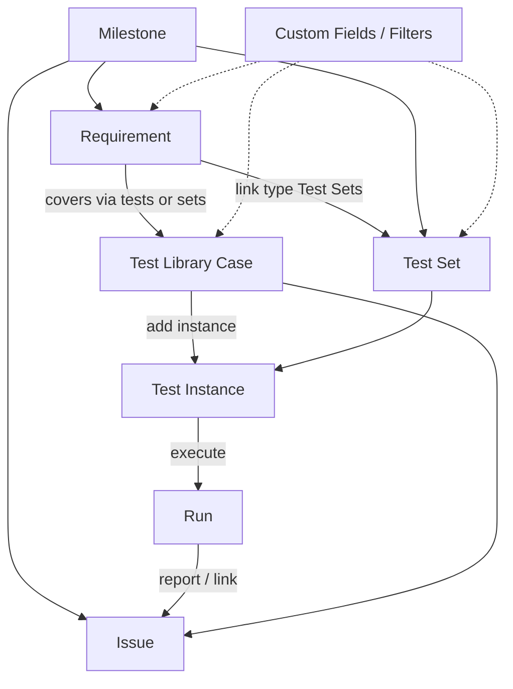

# PractiTest — Competitive TMS Research

Research date: 2026-11-14. Sources are primary PractiTest docs/marketing unless noted. Prices and plan matrices checked on that date.

---

## 1. Overview

**Vendor:** PractiTest (Israel-based; founded ~2008). Product is an AI-positioned SaaS test management / “QA intelligence” platform.

**Deployment:** Cloud-only (multi-region: US `prod.practitest.com`, EU `eu1-prod.practitest.app`, AU `au1.practitest.app`). No self-hosted / on-premises / Data Center product. Users and marketing PDFs explicitly describe “Cloud only.” It is **not** a Jira app that stores cases inside Jira; it sits alongside Jira with two-way sync and an embedded Jira panel. Jira Cloud and Jira Data Center integrations are offered (Data Center listed as Corporate).

**Target users:** QA / test managers, mid-market and enterprise QA orgs that need requirements→tests→runs→defects traceability, release readiness reporting, and mixed manual + automation visibility. Strong presence in IT/software on G2. Pricing is **per tester**, with extra “comment” (read-only with comments) seats included per license— pitched against Jira plugins that bill every Jira user.

**License model.** **Closed source** (proprietary SaaS). Cloud-only product; PractiTest marketing and reviewers describe no on-premises/open-source edition. No public product source repository found. Not open source or open core. Sources: [practitest.com/pricing](https://www.practitest.com/pricing/), Capterra reviews noting “Cloud only / no open source version.”

**Pricing (published, checked 2026-11-14):**

| Plan | Published price | Minimum | Notes |
| --- | --- | --- | --- |
| **Team** | **$47 / user / month** on [practitest.com/pricing](https://www.practitest.com/pricing/); example pack **$5,640 for 12 months / 10 testers**. G2 lists Team at **$49 / user / month**. | 5 tester licenses (help docs) | +5 comment users per license; unlimited projects; monthly or annual |
| **Corporate** | Contact / yearly only | 10 tester licenses | +10 comment users per license; SSO/SCIM, MCP, AI Test Value Score, advanced API, multiple issue integrations, Global Test Repository, enforce run order, concurrent licensing option |

Help center: Team min 5 testers / Corporate min 10; unused yearly seats not refunded; payments under $10,000 may incur a $50 processing fee. Legacy Professional/Enterprise/Ultimate plans still exist for older customers.

**Free trial / free plan:** Marketing pages advertise a **14-day free trial, no credit card**. No free forever plan found.

Sources: [Pricing](https://www.practitest.com/pricing/), [Payment and Plans](https://www.practitest.com/help/getting-started/pricing/), [Processes / trial](https://www.practitest.com/solutions/processes/), [G2](https://www.g2.com/products/practitest/reviews).

---

## 2. Data model and entities

PractiTest organizes work primarily with **fields + hierarchical filters** (and optional folders), not a rigid suite tree only.

| Entity | What it is | Key fields / notes |
| --- | --- | --- |
| **Account / Project** | Multi-project SaaS account | Projects, users/groups, API tokens, SSO (Corporate) |
| **Requirement** | What needs to be built/validated; stories/tasks | Name, description, custom fields, coverage status, linkage type (by Tests **or** by Test Sets, max 10 sets), links to issues/milestones |
| **Test (Test Library)** | Canonical case | Types: **Scripted**, **Exploratory**, **BDD**, **Automated** (API / Firecracker / xBot). Name, description, status, author, version, custom fields, steps / scenario / charter, Traceability, History, Value Score (Corporate) |
| **Steps** | Scripted steps | Name, description, expected results; can embed `{{parameter}}`; Call a Test embeds another test’s steps |
| **Step parameters** | Data-driven placeholders | Text or list (predefined values / URLs); values set **per instance** |
| **Call to Test** | Reuse | Step that links to another library test; appears on Traceability |
| **Folder** | Optional physical grouping | Enable Folder field in project settings; drag tests/sets into folders/subfolders |
| **Filter / Hierarchical filter tree** | Primary organization | Public/private, parent/child, auto-filters, cross-module filters; same entity can appear in multiple trees |
| **Test Set** | Group of tests to run together (cycle/task/regression) | Name, assignment, custom fields; max **2,000 instances** per set; can mix manual/BDD/automated/exploratory |
| **Test Instance** | Dynamic copy of a library test inside a set | Assigned to, parameters, version label, last run status; same test reusable across sets |
| **Run** | One execution of an instance | Statuses: PASSED, FAILED, BLOCKED, NOT COMPLETED / NO RUN (docs vary by context); duration; steps; attachments; automated-execution-output; version label used |
| **Milestone** | Release / sprint / version scope | Status: Upcoming / Active / Completed; Type (Sprint, Version, or custom); start/end dates; links Requirements, Test Sets, Issues |
| **Issue** | Built-in defect/task tracker | Title, type, status (+ customizable lifecycle), priority, assignee, attachments; sync with Jira etc. |
| **Custom fields** | Unlimited (plan matrix) | List, multi-list, text, etc. on issues, tests, sets, instances, requirements |
| **Attachments** | Files on entities/runs/steps | API: Base64; max **50 MB** for auto-create run attachments |
| **Tags / labels** | Via custom fields and filters; version **labels** for snapshots | Test Versioning labels (e.g. `Release-2025.11`) create immutable snapshots |
| **Versions / baselines** | **Test Versioning** | Snapshot of name, description, preconditions, steps; instance can pin a label; runs record which version ran |
| **Permutations** | Generated Test Sets from list/multi-list field combos | Max **500** combinations |
| **Global Test Repository** | Cross-project shared library | Corporate / Control & Compliance pack |

Sources: [Tests](https://www.practitest.com/help/test-planning-and-execution/tests/), [Test Sets & Runs](https://www.practitest.com/help/test-planning-and-execution/test-sets-and-runs/), [Requirements](https://www.practitest.com/help/test-planning-and-execution/requirements/), [Milestones](https://www.practitest.com/help/test-planning-and-execution/milestones/), [Folders](https://www.practitest.com/help/data-management-and-analysis/folders/), [Filters](https://www.practitest.com/help/data-management-and-analysis/hierarchical-filter-trees/), [Test Versioning](https://www.practitest.com/help/test-planning-and-execution/test-versioning/), [Pricing matrix](https://www.practitest.com/pricing/).

---

## 3. Relationships and flows

**Core chain:** Requirement ↔ Test(s) or Test Set(s) → Test Instance (in Test Set) → Run → Issue (optional). Milestone groups Requirements + Test Sets + Issues for release readiness. Instances always pull latest library content unless pinned to a version label.

**Typical end-to-end workflow:** Define requirements (native or import from Jira/Azure DevOps) → author/library tests (or AI/MCP generate) → link for coverage → create Test Set from requirements or selected tests → assign instances → manual run and/or automation/Firecracker/xBot → file issues (local or synced) → dashboards/reports/milestones answer “are we ready?”

**Case versioning / review:** Explicit **Test Versioning** snapshots at sprint/release end; no separate formal “approval workflow” product surface found beyond statuses, history, and permissions. Project History + entity History tabs support audit-style review.

**Statuses:** Run/step statuses include PASSED, FAILED, BLOCKED, NO RUN, N/A (steps); issue statuses are customizable via project field/lifecycle settings. Requirement coverage status is computed from linked test/set results (Not Covered until linked).

Sources: [Requirements](https://www.practitest.com/help/test-planning-and-execution/requirements/), [Test Sets & Runs](https://www.practitest.com/help/test-planning-and-execution/test-sets-and-runs/), [Admins guide](https://www.practitest.com/help/getting-started/admins/), [History](https://www.practitest.com/help/managing-projects-and-users/history-tracking/), [Test Versioning](https://www.practitest.com/help/test-planning-and-execution/test-versioning/).

---

## 4. Full feature list

**Test authoring:** Scripted (rich description + steps), Exploratory (charters/guide points), BDD Gherkin Scenario / Scenario Outline (examples → multiple instances), Automated types. Call to Test, step parameters, permutations, cloning, Excel/CSV/Google Sheets import including BDD scenarios and linked requirement IDs.

**Organisation:** Hierarchical filters (primary), optional folders, favorites (up to 15), multi-project, Global Test Repository (Corporate), Task Board (optional), Time Management (optional).

**Execution:** Manual runner with step statuses, attachments, comments, Pass All Steps, report/link issue from step, assign Test Sets and (optionally) instances, Instance View across sets, Enforce Run Order + notify next user (Corporate), xBot remote agents to trigger/schedule executables, timers via Time Management (enabled in settings).

**Traceability / coverage:** Requirement↔test/set links; coverage by latest runs; create Test Set from requirements; Traceability report template; issue links from runs.

**Reporting / dashboards:** Unlimited dashboards (Team/Corporate matrix); tabs (public/private, up to 8 items each); item types: latest updates, distribution table, pie, bar, progress, execution progress, defect age, planned vs executed, gauge; **external dashboard URLs** for non-users. Reports: scheduled daily/weekly/monthly, email recipients, Excel/PDF. Templates: Tabular, Detailed, Tabular with Steps, Tabular Aggregated, Tabular Traceability, Detailed with Attachments.

**Search / filters / query:** Grid fast-filters, saved hierarchical filters, cross-filters; API **PTQL** (beta) human-readable queries.

**Import / export:** Import tests/requirements XLSX, CSV UTF-8, Google Sheets; export Issues, Tests, Test Runs, Test Sets, Requirements; filter-based tabular export via reports.

**Audit:** Project History module + per-entity History tabs (who/what/when); history includable in Detailed reports. Dedicated immutable “compliance audit pack” naming beyond history/SSO/MFA not found as a separate product doc.

**Permissions / SSO / SCIM:** Users & groups with granular roles (Requirements/Tests/Runs/Issues View→Admin, Project Admin, etc. in API docs). MFA on Team; MFA enforcement, SAML 2.0 SSO (Okta, Azure AD, Ping, ADFS), SCIM on Corporate. Commenter seats for stakeholders.

**AI:** SmartFox assistant (generate tests/steps, duplication/gap alerts, execution prioritization—marketing); AI Test Value Score 0–100 (Corporate); MCP server (Corporate).

**Localisation:** G2 lists German, English, Japanese; Corporate “Multilingual Support.”

**Mobile / offline:** Browser-based SaaS. Dedicated native mobile app and offline/PWA mode: **not found in docs**.

Sources: product/help pages cited above; [Reports](https://www.practitest.com/help/data-management-and-analysis/reports/), [Dashboards](https://www.practitest.com/help/data-management-and-analysis/dashboards/), [AI page](https://www.practitest.com/ai-powered-test-management/), [Login methods](https://www.practitest.com/help/settings-and-customization/login-management-methods/), [API V2 groups](https://www.practitest.com/api-v2/).

---

## 5. Automation and CI

### Result formats and tools

- **FireCracker:** Parses **XML** unit/CI reports (Surefire/JUnit-style and similar). Dedicated guide for **Cucumber / SpecFlow / Behave** BDD XML. Config JSON maps XML attributes → PractiTest system/custom fields; can treat XML testcases as PractiTest tests **or** as steps (`test-case-as-pt-test-step`). CircleCI Orbs documented; Jenkins pipeline examples; works with any CI that emits XML.
- **REST Auto Create a Run / create_a_run:** Framework-agnostic (Playwright, Cypress, Selenium, Robot, Postman/Newman, Ghost Inspector, GitHub Actions, GitLab CI, Azure DevOps, Bamboo, etc.) via custom reporters/hooks.
- **xBot:** Trigger/schedule remote executables from PractiTest; can kick CI and return results (often with FireCracker).
- **BDD cucumber integration** listed on pricing for both plans.

Allure-specific native importer: **not found in docs** (teams can map via XML/API if they produce compatible output).

### Matching and **auto-create** (critical)

**Yes — PractiTest can auto-create test cases (and instances/sets) from CI/automation results.** Two first-class paths:

#### A) Auto Create a Run API

Documented flow per request:

1. Look for the relevant test  
2. **Create the test if needed**  
3. Look for an instance in the selected Test Set  
4. **Create the instance if needed**  
5. Create the run  

**Matching options:**

| Mode | Behavior |
| --- | --- |
| **`test-id`** | Use existing PractiTest test only (no auto-create of that case). Prefer when library is source of truth. |
| **`test-attributes.name`** (no test-id) | Find by **name**; **if missing, create** using provided attributes (`name`, `test-type`, `description`, …). Duplicate names → **most recently updated** test wins. |

Requires a pre-existing **Test Set** (system ID), project ID, API token. Extra permissions needed when creating tests/instances. Pass/fail via `exit-code` (0 = Passed, else Failed) unless steps are sent (then step statuses drive result). Steps: PASSED/FAILED/BLOCKED/NO RUN/N/A. Attachments Base64 ≤50 MB; `automated-execution-output` ≤255 chars.

#### B) FireCracker `create-and-populate-testset`

From GitHub README and help docs: analyzes Surefire/XML reports and **creates/populates TestSets, Tests, Instances, and Runs**. Searches for Test Set by name (creates if missing); adds missing tests to the set; **reuses existing tests** when names match. Re-run the action when new tests appear in reports. Matching for updates: **test names in PractiTest must match XML**. Optional multitestset by suite name; custom field injection for mandatory fields on create.

**Limits / caveats:** Rate limit **30 API calls/minute/account** (FireCracker `--max-api-rate` must stay aligned). Unstable names create duplicate cases. Classic `create_a_run` path still requires pre-created cases + instance-id lookup if not using Auto Create. No documented automatic merge of parallel CI shards into one run beyond choosing the same Test Set / naming strategy.

### Flaky detection

No dedicated “flaky test” entity or quarantine workflow found. **Test Value Score** explicitly **lowers** score for tests that **consistently pass or consistently fail**, and raises score when run history **fluctuates**—adjacent signal, not flaky management.

### Automation linking / run merging

Automated runs attach to instances in a chosen Test Set; clone Test Sets per build/version is a recommended pattern in older API guides. Instance run history retains prior executions. Run merging of multiple uploads into one logical run: **not found in docs**.

Sources: [Auto Create a Run API](https://www.practitest.com/help/integrating-test-automation/auto-create-run-api/), [FireCracker help](https://www.practitest.com/help/automation-integration/firecracker/), [Firecracker GitHub](https://github.com/PractiTest/practitest-firecracker), [API automation](https://www.practitest.com/help/automation-integration/api/), [Test Value Score](https://www.practitest.com/help/data-management-and-analysis/test-value-score/), [xBot](https://www.practitest.com/integrations/xbot/).

---

## 6. API

- **Type:** REST API **V2** (JSON:API-ish `data` / `type` / `attributes`). Not GraphQL.
- **Base URL:** US `https://api.practitest.com`; EU `https://eu1-prod-api.practitest.app/`; AU `https://au1-api.practitest.app/`. Paths like `/api/v2/projects/{id}/tests.json`.
- **Auth:** API token via (1) Basic `email:token`, (2) query `api_token=`, (3) header `PTToken`. Personal API Tokens (respect user perms or impersonation) vs Account tokens (all projects). Email not strictly authenticated.
- **Rate limit:** **30 calls per minute per account**; excess blocked for the remainder of that minute; higher limits via support.
- **Pagination:** `page[number]` (default 1), `page[size]` (default 100, **max 100**).
- **Query:** Filter params + **PTQL** beta.
- **Webhooks:** Project Activity WebHooks — JSON POSTs for run start/complete/fail; issue/test/requirement create/update.
- **Reference:** [https://www.practitest.com/api-v2/](https://www.practitest.com/api-v2/)

| Endpoint group | Typical operations |
| --- | --- |
| Projects | List projects |
| Users / Groups / Users-Projects | CRUD membership, permissions |
| Custom Fields / Project Fields | List/manage fields |
| Requirements | List, create, update, link entities |
| Tests | CRUD, steps |
| TestSets | CRUD, clone, add instances |
| Instances | List/create/update, parameters |
| Runs | Create automated/manual runs (incl. auto-create path) |
| Issues | CRUD, workflow |
| Milestones | CRUD, linkages |
| Attachments | Upload/list |

Sources: [API V2](https://www.practitest.com/api-v2/), [API tokens help](https://www.practitest.com/help/automation-integration/api/), [WebHooks](https://www.practitest.com/help/integrations/activity-web-hooks/).

---

## 7. Integrations

| Category | Examples |
| --- | --- |
| **Issue trackers** | Jira Cloud / Server / Data Center (two-way, embedded panel); Azure DevOps; Bugzilla; ClickUp (G2); Pivotal Tracker mentioned in older reviews; built-in Issues module |
| **CI/CD** | Jenkins, CircleCI (FireCracker Orbs), GitHub Actions, GitLab CI, Azure DevOps/Pipelines, Bamboo |
| **Automation** | Selenium, Playwright, Cypress, Robot, Postman/Newman, Cucumber/SpecFlow/Behave via FireCracker/API; xBot agents |
| **Chat** | Slack (project activity notifications); Teams: **not found in docs** as first-class |
| **SSO** | SAML2 IdPs (Okta, Azure AD, Ping Federate, ADFS); SCIM provisioning (Corporate) |
| **AI / MCP** | Remote MCP for Claude (officially supported), ChatGPT, GitHub Copilot VS Code |
| **Marketplace** | Atlassian Marketplace for Jira connection; Firecracker UI config generator |

Sources: [Jira](https://www.practitest.com/integrations/test-management-for-jira/), [Slack](https://www.practitest.com/help/integrations/slack/), [MCP](https://www.practitest.com/help/integrations/mcp/), [G2 integrations list](https://www.g2.com/products/practitest/reviews).

---

## 8. Marketing positioning

Headline themes from the homepage and product pages:

- “Are You Ready to Release?” — go beyond execution to **business answers**.
- **Test Management + QA Intelligence** — live signals → coverage, risk, readiness.
- **SmartFox AI** — generate tests, prioritize by risk/history/change, duplication/blind-spot alerts, dig into results.
- Flexible data structure (“Any View. One Click.”) — filters over rigid trees.
- Tool-agnostic stack: ticketing, automation, BDD, CI/CD, AI/MCP.
- Differentiator vs Jira-only / spreadsheet QA: dedicated TMS with pay-per-tester, two-way Jira sync, FireCracker zero-code CI ingest, xBot, dashboards shareable without seats.
- Forrester TEI claims appear on the homepage (ROI/benefits figures rendered dynamically).

Sources: [Homepage](https://www.practitest.com/), [Product](https://www.practitest.com/product/), [AI](https://www.practitest.com/ai-powered-test-management/).

---

## 9. What users love

Themes from G2 (~4.3/5, 237 reviews) and Capterra (~4.9/5, 15 reviews):

1. **Centralization & traceability** — requirements, cases, runs, bugs in one place.  
   *“PractiTest solves the problem of fragmented and unstructured test management… full traceability between requirements, tests, and bugs.”* — Sanmati V., G2.
2. **Filters / customization** — *“the flexibility of the tagging and filtering options is very convenient.”* — G2 Mid-Market review (2026).
3. **Jira integration & dashboards** — frequent praise for sync and executive-ready reporting.
4. **Support quality** — Capterra: recovery of an accidentally deleted Test Set; “Support is like nothing you’ve ever seen before.”
5. **AI authoring assist** — *“AI-enabled features help me write summaries and generate test steps… huge time-saver for UAT testers.”* — Anuradha P., G2 (2026).

Sources: [G2 reviews](https://www.g2.com/products/practitest/reviews), [Capterra reviews](https://www.capterra.com/p/108312/PractiTest/reviews/).

---

## 10. What users dislike

1. **Learning curve / filter complexity** — advanced filters, dashboards, custom fields need onboarding; desire for bulk filter maintenance.
2. **Extra clicks / navigation** — especially traceability and Jira-linked sets/assignments hard to find quickly (G2).
3. **Performance** — *“At times, performance can lag, especially when generating reports.”* — Sanmati V., G2.
4. **Cloud-only / no open source** — *“it is a SaaS tool only, would be great to have it on-premises as well.”* — David B., Capterra; similar “running on Cloud only / no open source version” — Inga R., Capterra.
5. **Price for small teams** — min seats + mid/high pricing; requests for a lightweight edition.
6. **Milestones manual upkeep** — *“takes a lot of manual effort to keep it up to date with deliveries and sprints.”* — G2 enterprise reviewer (2026).
7. **Bulk import friction** — bulk file import called difficult by some G2 users.

Sources: same G2/Capterra URLs as §9.

---

## 11. Ideas for Vulyk

Vulyk context: open-source AGPL self-hosted TMS (folders/cases/plans/runs, CI ingest, campaigns/iterations, requirements, Jira/OpenProject, reports/flaky, RBAC/SSO, LLM, MCP, importers, PWA offline).

1. **Ship first-class CI auto-create with explicit matching modes** — Mirror PractiTest’s clarity: match by **stable ID** vs **name**, auto-create case + plan membership, document duplicate-name behavior. Vulyk should default to opt-in auto-create (avoid silent library pollution) and support deterministic keys (annotations) stronger than bare names.
2. **Zero-code JUnit XML path + API path** — FireCracker’s “no code change” JAR/Orb is a competitive must-have for CI teams; keep Vulyk’s ingest CLI/action and REST ingest both first-class.
3. **Don’t rely on filters alone** — Users love PractiTest filters but hate the learning curve and bulk maintenance. Vulyk’s **folders** should stay simple primary navigation; offer saved views/filters as power layer, with bulk edit of views.
4. **Instance / plan-run model** — PractiTest’s Test→Instance→Run reuse story is strong. Ensure Vulyk plans/runs support multi-assignment, parameter values per placement, and clear “library vs execution copy” semantics (Vulyk already leans this way).
5. **Flaky as a product feature, not a score side-effect** — PractiTest only hints at flakiness via Value Score. Vulyk can differentiate with explicit flaky detection, quarantine, and history charts.
6. **Self-host + offline PWA as wedge** — Repeated Capterra complaint is SaaS-only. Vulyk’s self-hosted + PWA offline is a direct counter-positioning message.
7. **MCP + LLM without Corporate gatekeeping** — PractiTest locks MCP and Test Value Score behind Corporate. Open MCP tools (list/create/link cases, coverage, runs) in Vulyk OSS is a sharp differentiator—match their tool set (requirements coverage → create tests → add to plan).
8. **Version/baseline snapshots for patch releases** — Test Versioning is a concrete enterprise need Vulyk should cover with labeled immutable case revisions and run-against-label.
9. **Shareable stakeholder dashboards without seats** — External dashboard URLs reduce license friction; useful for Vulyk’s open deployments (tokenized public report links).
10. **Avoid milestone busywork** — If Vulyk campaigns/iterations sync from Jira/OpenProject sprints automatically, avoid the “milestones need constant manual update” pain reviewers cite.

---

## 12. Sources

- https://www.practitest.com/
- https://www.practitest.com/pricing/
- https://www.practitest.com/product/
- https://www.practitest.com/ai-powered-test-management/
- https://www.practitest.com/solutions/processes/
- https://www.practitest.com/help/getting-started/pricing/
- https://www.practitest.com/help/getting-started/admins/
- https://www.practitest.com/help/test-planning-and-execution/tests/
- https://www.practitest.com/help/test-planning-and-execution/tests/scripted-manual-tests/
- https://www.practitest.com/help/test-planning-and-execution/tests/bdd-tests/
- https://www.practitest.com/help/test-planning-and-execution/test-sets-and-runs/
- https://www.practitest.com/help/test-planning-and-execution/requirements/
- https://www.practitest.com/help/test-planning-and-execution/milestones/
- https://www.practitest.com/help/test-planning-and-execution/test-versioning/
- https://www.practitest.com/help/data-management-and-analysis/hierarchical-filter-trees/
- https://www.practitest.com/help/data-management-and-analysis/folders/
- https://www.practitest.com/help/data-management-and-analysis/dashboards/
- https://www.practitest.com/help/data-management-and-analysis/reports/
- https://www.practitest.com/help/data-management-and-analysis/test-value-score/
- https://www.practitest.com/help/managing-projects-and-users/history-tracking/
- https://www.practitest.com/help/settings-and-customization/login-management-methods/
- https://www.practitest.com/help/settings-and-customization/account-settings/
- https://www.practitest.com/help/settings-and-customization/project-settings/
- https://www.practitest.com/help/automation-integration/api/
- https://www.practitest.com/help/automation-integration/firecracker/
- https://www.practitest.com/help/integrating-test-automation/auto-create-run-api/
- https://www.practitest.com/help/integrations/activity-web-hooks/
- https://www.practitest.com/help/integrations/slack/
- https://www.practitest.com/help/integrations/mcp/
- https://www.practitest.com/integrations/test-management-for-jira/
- https://www.practitest.com/integrations/xbot/
- https://www.practitest.com/integrations/firecracker/
- https://www.practitest.com/api-v2/
- https://github.com/PractiTest/practitest-firecracker
- https://www.g2.com/products/practitest/reviews
- https://www.capterra.com/p/108312/PractiTest/reviews/
