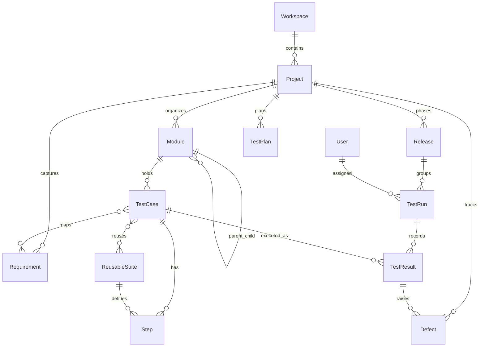

# QA Touch — Competitive TMS Research

Research date: 2026-11-14. Prefer primary sources (qatouch.com, help.qatouch.com, doc.qatouch.com). Prices and plan limits as published on that date.

---

## 1. Overview

**Vendor:** DCKAP Inc., doing business as QA Touch (Austin, TX). Product marketed as an AI test management platform for agile QA teams (testers, developers, managers).

**Deployment:** Primarily **cloud SaaS** on AWS (architecture/security docs describe SaaS delivery, TLS, encrypted backups, 99.9% availability target in the SaaS agreement). A vendor comparison page lists “Cloud & On-Prem,” and the separate **QA Touch Automate** product advertises cloud nodes plus a **local agent** for private-network execution. A full self-hosted TMS install path comparable to open-source/on-prem competitors was **not found in docs** as a standard plan option; independent roundups commonly describe QA Touch as cloud-only for the TMS app. Not a Jira-native Data Center app—Jira is an integration, not the host.

**Target users:** Small and mid-size QA/agile teams, freelancers/agencies, and product orgs that want all-in-one cases + runs + built-in defects/requirements without buying TestRail-class pricing. Industries cited by the vendor include software, retail, fintech, and agencies.

**License model.** **Closed source** (proprietary commercial SaaS by DCKAP / QA Touch). Free and paid plans; no public product source repository found. Not open source or open core. Source: [qatouch.com/pricing](https://www.qatouch.com/pricing/).

**Pricing (checked 2026-11-14 on [qatouch.com/pricing](https://www.qatouch.com/pricing/)):**

| Plan | Published price | Notable caps / inclusions |
| --- | --- | --- |
| **Free** | $0 | 3 projects; 100 test cases; 10 test runs; 100 inbuilt issues; 100 requirements; ~10 MB attachment storage; basic features |
| **Professional** | **$7 / user / month** | 100 projects; 25,000 cases; 2,000 runs; 10,000 issues/requirements; AI generators with **fixed 20 usage** limit; version history & productivity report; review management; 18+ integrations; API (**50 requests/min**). Storage advertised as **50 GB** on the plan card and **100 GB** in the compare table—use vendor clarification for contracts |
| **Unlimited** | **$15 / user / month** | Unlimited projects/cases/runs/issues/requirements; unlimited AI; SSO (Google, Okta, Azure); MFA; automation reporters (Playwright/Selenium/Pytest etc.); Jenkins; API **100 requests/min**; storage **150 GB** on card / “Unlimited” in table |

**Free trial / free plan:** Free forever plan exists (not only a trial). Registration via register.qatouch.com. API, automation reporters, SSO/MFA, and Jenkins sit on paid / Unlimited tiers per the pricing matrix.

Sources: [pricing](https://www.qatouch.com/pricing/), [home](https://www.qatouch.com/), [architecture](https://help.qatouch.com/docs/v2/architectural-basics), [security](https://help.qatouch.com/docs/v2/qatouch-security), [SaaS agreement](https://www.qatouch.com/qa-touch-saas-services-agreement/).

---

## 2. Data model and entities

Entities below are those documented in product/help/API surfaces. Where a common TMS concept is missing, that is stated.

| Entity | What it is | Key fields / notes |
| --- | --- | --- |
| **Workspace / Group / Team** | Org-level containers for multi-project collaboration | Listed in API (`Workspace/Group/Team`); admin features for workspaces, groups, teams |
| **Project** | Top-level QA workspace | `project_key`, name; counts of cases, runs, defects, milestones |
| **Module (section)** | Hierarchical folder for cases (parent/child modules via `parentKey`) | `moduleKey`, `moduleName`, optional parent |
| **Test case** | Manual or BDD scenario | Title, steps (description + expected), preconditions, references, type/priority/mode (bulk API), tags, custom fields, attachments, version history, review status |
| **Steps** | Ordered step + expected result | Statuses during execution; drive parent case status in stepwise mode |
| **Reusable steps / reusable BDD scripts** | Shared step suites reused across cases; Auto Sync on update | Suite name; step description + expected; export XLS/XLSX/CSV |
| **Parameters / datasets** | Data-driven parameter rows on a case (AI-assisted generation) | Parameter template; rows of inputs/expected; AI prompt + row limit |
| **Test plan** | Pre-execution planning artifact (Default template components or Blank) | Scope/approach/resources/activities style content |
| **Release (milestone)** | Phase/sprint container for runs | Open / Upcoming / Completed; API “Release” / milestone key |
| **Test run** | Execution set of cases assigned to a user, tied to a release | Name, assignee, release, tags, browser/version metadata on export; queue for >500 cases |
| **Test run result** | Per-case (and per-step) outcome in a run | Status, comments, attachments, time spent, history; result keys used by automation |
| **Requirement** | In-project requirement with RTM coverage | Requirement code (e.g. R0001), name, linked cases, Covered/Not Covered |
| **Requirement document** | Document grouping for requirements | Create/list via API |
| **Defect / issue** | Built-in bug tracker (also push to external trackers) | Priority, severity, status, type, environment; attachments; screen/audio recording |
| **Board / card** | Agile board over issues | Inbuilt boards & cards (plan matrix) |
| **Mind map** | Lightweight planning for use cases before writing cases | Nodes under a named map |
| **Custom fields** | Extend cases, runs, results, issues | Global or project-scoped; typed fields with options; custom *result* fields (browsers, devices, languages) |
| **Attachments / tags** | Files on cases/runs/issues; tags on runs/cases | Project attachment guide: ≤2 MB/file, max 10 project files (requirements attachments); plan storage quotas for general file attachment |
| **Version history** | Per-case history with diffs | Who/when; compare additions/deletions/modifications |
| **Configurations / environments** | Not a first-class “config matrix” product like some TMS peers | Defect environments list via API; multi-result custom fields for browsers/devices; Playwright Integration 2.0 tracks per-browser results |
| **Baselines** | Formal baseline entity like TestRail | **not found in docs** (test plans described as setting a “baseline” before testing, not a versioned baseline object) |
| **Call-to-test** | Named call-to-test linking | **not found in docs** (reusable steps fill a similar niche) |

Sources: [test management features](https://www.qatouch.com/features/test-management-software/), [requirements mapping](https://www.qatouch.com/features/requirements-mapping/), [custom fields](https://help.qatouch.com/docs/v2/custom-fields), [AI parameters](https://help.qatouch.com/docs/v2/ai-testparameter), [API](https://doc.qatouch.com/).

---

## 3. Relationships and flows

**Typical graph:** Workspace → Project → Modules → Test Cases (↔ Requirements, reusable steps) → Test Runs (under Release/Milestone, assigned to User) → Results/Steps → Defects (inbuilt and/or Jira etc.). Test Plans sit alongside as planning documents. Boards track issue workflow.

**End-to-end workflow:** Create project (optionally from domain templates) → capture requirements / mind map → author cases in modules (steps or BDD) → review/approve → create release → create test run (all / filtered / by module) → execute stepwise or bulk → log defects → report / RTM / dashboards → optionally sync automation into the same run.

**Case review/approval:** Review statuses **Pending, Approved, Rejected, Re-Verify** with timelines; version history for diffs. Release notes (Oct 2026) add API approve/reject for multiple cases.

**Execution statuses (documented):** Untested, Blocked, Failed, In Progress, Not Applicable, Passed, Retest. API status values: `passed`, `untested`, `blocked`, `retest`, `failed`, `not-applicable`, `in-progress`. Customisation of the *status vocabulary itself* beyond these built-ins was **not found in docs**; custom fields and custom *result* fields extend metadata instead.

Sources: [test runs help](https://help.qatouch.com/docs/v2/testRun), [features](https://www.qatouch.com/features/), [API statuses](https://doc.qatouch.com/), [release notes](https://release.qatouch.com/).

---

## 4. Full feature list

**Authoring:** Step editor; BDD/Gherkin cases + BDD XML import; reusable steps and reusable BDD scripts; AI generation from prompts, Jira stories/epics, BRDs, Figma/images, Postman/Swagger; AI issue writing; AI BDD script generate; AI parameters; Playwright Assistant to generate scripts from case fields; sample project templates; copy cases/modules across projects.

**Organisation:** Modules (nested); filters on run creation; tags; workspaces/groups/teams; custom fields; mind maps; move/copy.

**Execution:** Manual runner with stepwise status; bulk status update (whole run or module); assignment; Auto Timer / manual elapsed time (HH:MM:SS); queue for large runs; mark run completed; screen/audio recording on issues.

**Traceability:** Two-way requirement↔case links; automatic RTM (Covered / Not Covered); bulk CSV/XLS/XLSX mapping; public read-only RTM link; XLSX export.

**Reporting / dashboards (built-in):** Project reports (add report types including Result summary); schedule/email; export CSV/PDF; sharable public report links; Custom Dashboard (multi-project release summary, status over time); Team/Managerial reports—Activity Summary, Test Runs Summary (result + assigned), Issue Summary, Project Summary, Module Summary; Productivity report; sprint burndown/velocity; public dashboard without login; audit log + activity log.

**Search / filters:** Filters when picking cases for runs; full-text search engine mentioned in compliance system specs as Elasticsearch/OpenSearch for cases/defects—**query language (JQL-like) not found in product docs**.

**Import / export:** CSV/XLS/XLSX for cases, runs, requirement mapping; TestRail and TestLink migration guides; BDD Script Import (XML); exports for cases/runs/RTM/reports; API JSON.

**Audit / admin:** Activity log; audit log; custom roles; site settings (queues, pagination, email); timesheets (admin feature set).

**Permissions / SSO:** Custom roles; MFA and SSO (Google, Okta, Azure) on Unlimited. **SCIM provisioning: not found in docs.**

**AI / MCP:** In-app AI generators; open-source **QA Touch MCP** (`npx -y qatouch-mcp-server`) for Claude Desktop, Cursor, Kiro; capture skills with Playwright MCP / Claude for Chrome / Android-MCP producing importable cases.

**Localisation:** Multi-languages listed on pricing matrix (specific locale list **not expanded** on pricing page).

**Mobile / offline:** Capterra lists **Web** platforms; Android/iPhone app checkboxes not selected. **PWA offline TMS: not found in docs.** Automate local agent is for script execution privacy, not offline case editing.

Sources: [features hub](https://www.qatouch.com/features/), [reporting](https://www.qatouch.com/features/reporting-productivity-report/), [reports help](https://help.qatouch.com/docs/v2/reports), [team reports](https://help.qatouch.com/docs/v2/managerial-report), [integrations/MCP](https://www.qatouch.com/integrations/), [Capterra](https://www.capterra.com/p/175760/QATouch/).

---

## 5. Automation and CI

### Supported paths

Official automation hub lists: **Jenkins, GitLab Pipelines, GitHub Actions**, plus reporters/plugins for **Cypress, Playwright, Selenium (via API), Pytest, WebdriverIO, TestCafe, Go, Ruby**. Pricing Unlimited card highlights Automation Reporter (Playwright/Selenium/Pytest) and Jenkins.

**Result formats:** Primary path is **live reporter/API status updates** into an existing test run—not a documented first-class “upload JUnit XML / Allure / Cucumber JSON file” ingest like some TMS tools. Jenkins mapping uses Jenkins **TestNG or JUnit** result plugins to drive pass/fail on mapped cases. Broader “drop a JUnit/Allure XML” workflow: **not found in docs**.

### How matching works (official)

| Integration | Matching mechanism | Auto-create cases? |
| --- | --- | --- |
| **Playwright** (`playwright-qatouch-reporter`) | Prefix test title with **TR code** (e.g. `TR0035 hastitle`); env: domain, API token, project key, **existing** `QATOUCH_TESTRUN_ID` | **No** — docs require mapping to existing TR codes in a pre-created run |
| **Cypress** (`cypress-qatouch-reporter`) | Title contains QA Touch identifiers (`TR0001…` or `[QATouch-KEY]` / `[QATouch-CASE…]`) | **No** — “test cases in QA Touch that correspond to the Cypress tests” |
| **Jenkins** | Method name `TR002__VerifyTheLogoIsClickable` (case code + `__` + name); map Jenkins project → QA Touch test run | **No** — updates statuses on mapped run cases |
| **API** | PATCH/POST result status by `project`, `test_run`, `run_result` (or TR numeric id) | Creating cases is a **separate** `POST /testCase` (and `POST /module`); not triggered automatically by result upload |

**Critical answer — Auto-create from CI?**

**Official QA Touch CI/reporter documentation does not auto-create test cases when automation sends results for tests that do not exist.** Matching is **ID/code-based** against cases already present in a configured Test Run. Unmatched automation methods simply do not update TMS cases. Operators must either (1) create cases/runs first and embed TR/case/result keys in tests, or (2) call the create-case/module APIs themselves before posting results.

Community/third-party packages (e.g. `ujjwala91/playwright-qatouch`, `ujjwala91/testng-qatouch`) advertise optional **title-based sync** with `createCases` / `sync` flags that create modules and missing cases via the API. Those behaviours are **not** described in official help.qatouch.com Playwright/Cypress/Jenkins guides and should not be assumed as product guarantees.

**Flaky test detection (TMS analytics):** Dedicated flaky-rate / quarantine reporting across historical runs: **not found in docs**. Automate marketing describes **self-healing locators** to reduce UI flakiness—that is execution healing, not TMS flaky analytics.

**Run merging:** Creating/updating a mapped run and bulk status APIs are documented; automatic merge of multiple CI builds into one logical run with conflict rules: **not found in docs**. Playwright Integration 2.0 stores **per-browser** results for the same case.

Sources: [automation integration](https://help.qatouch.com/docs/v2/automation-integration), [Playwright](https://help.qatouch.com/docs/v2/playwright), [Cypress](https://help.qatouch.com/docs/v2/cypress-qatouch-reporter), [Jenkins blog](https://www.qatouch.com/blog/how-to-integrate-jenkins-devops-with-qa-touch/), [automation API sync](https://help.qatouch.com/docs/v2/automation), [API](https://doc.qatouch.com/).

---

## 6. API

| Aspect | Detail |
| --- | --- |
| **Type** | REST/JSON (OpenAPI mentioned in compliance specs; GraphQL **not found**) |
| **Base URL** | `https://api.qatouch.com/api/v1/...` |
| **Auth** | Headers: `api-token` + `domain` (token from User → Edit profile → Generate API Key). Professional+ feature |
| **Rate limits** | Pricing table: **50 req/min** Professional; **100 req/min** Unlimited |
| **Pagination** | Default when >50 rows; `?page=N` (e.g. `getAllProjects?page=2`) |
| **Webhooks** | Documented in trust/compliance output policies: HTTPS POST JSON, **HMAC-SHA256** signature, unique event ID, retry up to 5 with backoff. Product webhook event catalogue in help UI: sparse in public help index—treat delivery mechanics as confirmed, full event list as partially documented |

**Main endpoint groups (from [doc.qatouch.com](https://doc.qatouch.com/)):**

| Group | Operations (examples) |
| --- | --- |
| Projects | List, count, detail with case/run/defect/milestone counts, create |
| Modules | Create (optional parent), list |
| Test cases | Create, list (+ pagination), detail (steps, custom fields, mapped runs), count, steps template, custom fields, bulk type/priority/mode (newer), review approve/reject (newer) |
| Releases | Create, list, count |
| Test plans | List, count |
| Test runs / results | Create (specific cases / specific modules + automation mode), list/filter/count/detail, statuses, history, release results, patch/post status (by TR code, multi id, steps), bulk update, comments/attachments, assignable users |
| Defects | Create (+ multi attachment), list, count, priority/severity/status/type/environment lists, bulk update (newer) |
| Requirements | Create requirement/document, list, count |
| Workspace | Workspace/group/team listing |

Postman collection and demo repos linked from the API docs.

---

## 7. Integrations

**Issue / PM:** Jira Cloud (basic + two-way), Jira Software/Server, Azure Boards, Linear, Monday.com, ClickUp, Asana, Trello, YouTrack, Redmine, Bugzilla, Zoho Sprint (pricing matrix).

**Code hosting:** GitHub, GitLab (incl. two-way on matrix), Bitbucket, Assembla.

**Chat:** Slack (Teams **not listed** on the public integrations directory).

**CI / automation:** Jenkins, GitHub Actions, GitLab Pipelines; framework reporters above; REST API.

**SSO:** Google, Okta, Azure AD (Unlimited).

**Marketplace:** Not an Atlassian Marketplace–primary product; integrations live on qatouch.com/integrations and Help Center. MCP package on npm (`qatouch-mcp-server`).

Sources: [integrations](https://www.qatouch.com/integrations/), [pricing](https://www.qatouch.com/pricing/).

---

## 8. Marketing positioning

Headline themes from marketing:

- “AI Test Case Management” / “Smarter QA” — generate cases from prompts, Jira, BRDs, Figma; claim to **reduce manual QA work by up to 80%**.
- **One workspace** for testers, developers, and managers (cases → runs → defects → reports).
- Affordable alternative to heavyweight TMS (free plan + $7/$15 seats).
- Broad integrations + automation reporters + MCP for AI assistants.
- Newer **Automate** narrative: low-code record → Playwright/Selenium/Robot, self-healing, cloud or local agent.

Differentiators emphasised vs peers: aggressive AI generation breadth, built-in defects/requirements (less “Jira-only”), price, and responsive product updates.

Sources: [home](https://www.qatouch.com/), [features](https://www.qatouch.com/features/), [Automate](https://www.qatouch.com/test-automation-platform/).

---

## 9. What users love

Themes (G2 ~4.2/5 from ~79 reviews per secondary roundups; Capterra 4.0 from 1 review; vendor testimonials):

1. **Ease of use / fast onboarding** — “QA Touch is easy to use and navigate…” (Muhammad Abubakar Q., Team Manager, testimonials). G2 themes summarised by Kualitee: intuitive from day one.
2. **All-in-one cases + bugs + reports** — “excellent test case tracking and bug reporting” (Pradhabh P.). “manage releases, build test cases, generating test runs, log defects, and reporting all in one place” (Julie Doan, Pushint).
3. **Affordability** — Capterra: “Most affordable test case management tool with tons of features” (QA Lead, May 2020). Free tier called out positively by Leonel C.
4. **Support responsiveness** — Repeated across testimonials (“support team is responsive,” “Issues and enhancements are taken seriously” — Brandon Rich, EDF).
5. **Integrations (esp. Jira)** — Capterra: “seamless integration with your existing tools like JIRA.”

Sources: [testimonials](https://www.qatouch.com/testimonials/), [Capterra](https://www.capterra.com/p/175760/QATouch/), [Kualitee review](https://www.kualitee.com/review/qa-touch-review/).

---

## 10. What users dislike

1. **Limited customisation / reporting flexibility** — G2 themes (via Kualitee): layout and reporting options feel constrained; “Reporting could be more flexible.” Vendor’s own Jira-tools blog concedes highly customized dashboards may outstrip built-in reports.
2. **Scale / performance on large suites** — Alternatives roundup citing G2: slows down with large test suites; feels limited on large projects.
3. **Free plan too small** — Caps at 100 cases / 10 runs; reviewers note teams outgrow it quickly.
4. **Key enterprise features gated to Unlimited ($15)** — SSO, MFA, automation reporters, Jenkins called out as top-tier; Professional AI capped at 20 uses.
5. **Usability pockets** — Capterra: “In a few areas of the application, usability can be improved.” Some G2 reviews reportedly incentivized—treat star ratings with caution.
6. **Cloud-only TMS / no mobile app** — Called out when teams compare to on-prem alternatives.

Sources: [Kualitee review](https://www.kualitee.com/review/qa-touch-review/), [alternatives](https://www.kualitee.com/alternative/best-qa-touch-alternatives/), [Capterra](https://www.capterra.com/p/175760/QATouch/), [vendor Jira comparison blog](https://www.qatouch.com/blog/best-test-case-management-tools-for-jira/).

---

## 11. Ideas for Vulyk

Vulyk context: open-source self-hosted TMS (folders/cases/plans/runs, CI ingest, campaigns/iterations, requirements, Jira/OpenProject, reports/flaky, RBAC/SSO, LLM, MCP, importers, PWA offline).

1. **Win on CI ingest semantics.** Official QA Touch forces TR-code matching into a pre-created run and does **not** auto-create cases. Vulyk should document and ship clear modes: match-by-id, match-by-name, **optional auto-create**, and refuse-unknown—plus JUnit/Allure XML drop ingest, which QA Touch docs under-emphasise.
2. **Publish flaky analytics as a first-class report.** QA Touch’s gap (no clear historical flaky detection in the TMS) is a direct Vulyk differentiator next to CI ingest.
3. **Keep self-host + PWA offline as wedge.** Competitors’ cloud-only + no offline story is a recurring complaint; Vulyk already aims here—make upgrade/backup and offline sync as polished as QA Touch’s “register and go” SaaS.
4. **Copy the MCP + LLM surface carefully.** QA Touch’s MCP + AI-from-Jira/BRD/Figma is marketing-hot. Mirror MCP for Cursor/Claude, but keep generation review-before-save and AGPL-friendly model/provider choices.
5. **Reusable steps + Auto Sync** are table stakes users expect; ensure Vulyk shared steps update consumers predictably (QA Touch markets Auto Sync explicitly).
6. **RTM with public read-only link** is popular with managers—consider shareable coverage links without forcing SSO accounts for auditors (with self-host auth caveats).
7. **Avoid gating automation behind the top SKU.** Users resent Jenkins/reporters only on Unlimited; open-source Vulyk should keep CI reporters in the core.
8. **Don’t underbuild reporting customisation.** Even fans want more flexible dashboards—invest early in composable reports so Vulyk doesn’t inherit QA Touch’s #1 dislike.
9. **Importers:** TestRail/TestLink/CSV mapping queues are a migration moat; keep fragment-based seeds and robust import UX.
10. **OpenProject/Jira parity:** QA Touch is Jira-strong and OpenProject-absent—lean into OpenProject two-way as a unique enterprise FOSS angle while matching Jira link/defect push quality.

---

## 12. Sources

- https://www.qatouch.com/
- https://www.qatouch.com/pricing/
- https://www.qatouch.com/features/
- https://www.qatouch.com/features/test-management-software/
- https://www.qatouch.com/features/requirements-mapping/
- https://www.qatouch.com/features/reporting-productivity-report/
- https://www.qatouch.com/integrations/
- https://www.qatouch.com/testimonials/
- https://www.qatouch.com/test-automation-platform/
- https://www.qatouch.com/mcp/
- https://www.qatouch.com/blog/how-to-integrate-jenkins-devops-with-qa-touch/
- https://www.qatouch.com/blog/best-test-case-management-tools-for-jira/
- https://www.qatouch.com/qa-touch-saas-services-agreement/
- https://help.qatouch.com/
- https://help.qatouch.com/docs/v2/automation-integration
- https://help.qatouch.com/docs/v2/automation
- https://help.qatouch.com/docs/v2/automation-configuration
- https://help.qatouch.com/docs/v2/playwright
- https://help.qatouch.com/docs/v2/cypress-qatouch-reporter
- https://help.qatouch.com/docs/v2/testRun
- https://help.qatouch.com/docs/v2/reports
- https://help.qatouch.com/docs/v2/managerial-report
- https://help.qatouch.com/docs/v2/custom-fields
- https://help.qatouch.com/docs/v2/ai-testparameter
- https://help.qatouch.com/docs/v2/architectural-basics
- https://help.qatouch.com/docs/v2/qatouch-security
- https://doc.qatouch.com/
- https://release.qatouch.com/
- https://trust.qatouch.com/docs/compliance/Output_Delivery_Policies
- https://www.capterra.com/p/175760/QATouch/
- https://www.kualitee.com/review/qa-touch-review/
- https://www.kualitee.com/alternative/best-qa-touch-alternatives/
