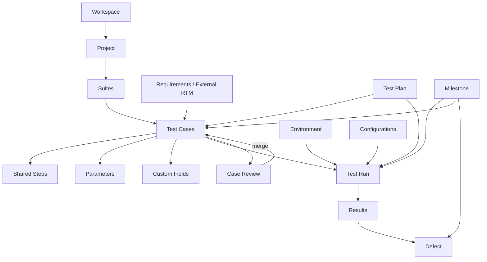

# Qase.io — Competitive TMS Research

Research date: 2026-11-14. Prices and packaging last published as updated 2026-07-21.

## 1. Overview

**Vendor:** Qase Inc. (cloud product at [app.qase.io](https://app.qase.io/); company site [qase.io](https://www.qase.io/)).  
**Deployment:** SaaS only. There is no self-hosted / data-center / on-prem edition. Enterprise can add a dedicated AWS VPC cluster and custom domain; the product remains Qase-hosted. It is not a Jira app as primary product (there is a Jira Cloud integration and a Jira Server/Data Center plugin for linking).  
**Target users:** Engineering and QA teams that want one system of record for manual cases, automated runs, and CI results—positioned against TestRail, Zephyr, Xray, Testmo, PractiTest, and qTest. Marketing cites 2,000+ companies (e.g. Asana, Bitly, Bumble, SUSE, Wolt) and ~4.8 on G2.

**License model.** **Closed source SaaS** with **open-source client libraries** (not classic open-core: the hosted Qase application source is not published). Framework reporters and API clients under the [qase-tms](https://github.com/qase-tms) GitHub org are typically **Apache License 2.0** (e.g. [qase-java](https://github.com/qase-tms/qase-java), [qase-csharp](https://github.com/qase-tms/qase-csharp), [qase-api-client](https://github.com/qase-tms/qase-api-client)). Independent directory entry: “Code Closed source” ([faun.dev toolbox](https://faun.dev/toolbox/qase/)). Sources: GitHub org licenses; [qase.io](https://qase.io/).

**Pricing (published; excl. regional tax):**

| Plan | Price | Seats / notes |
| --- | --- | --- |
| **Free** | $0 / user / mo | Up to 4 users; 2 projects; 500 MB storage; 30-day history; 2 active runs; 5k API-submitted results/mo; MCP server included |
| **Teams** | $35 / user / mo annual ($42 monthly) | Min 5 full seats; unlimited projects/runs/storage; 2-year history; SAML SSO; RBAC; audit logs; QQL; requirements/RTM; review; webhooks; 35+ integrations; 2,000 AI credits/mo |
| **Enterprise** | Custom (annual) | Unlimited users & retention; multi-workspace SSO + SCIM; 4,000 AI credits/mo; dedicated CSM/onboarding; 24/5 SLA; hosted MCP |
| **Collaborator seats** | $10 / user / mo | View/comment on runs, reports, dashboards (Teams/Enterprise add-on) |
| **Extra AI credits** | $0.40 each | Monthly grant; no rollover |

**Plan changes (June/July 2026):** Former Free / Startup / Business / Enterprise collapsed to Free / Teams / Enterprise. Startup closed to new signups (grandfathered). Business renamed Teams and raised from $30/$36 to $35/$42. SSO moved into Teams (no longer a paid add-on). Free gained a 4th seat, MCP for all plans, and a 5k/mo API results cap. Data retention on Teams extended from 1 year to 2.

**Trial:** Teams — 14 days, no credit card. Enterprise — paid POC (fee credited on signup).

Sources: [Pricing](https://www.qase.io/pricing/), [llms.txt](https://www.qase.io/llms.txt), [pricing packaging blog](https://www.qase.io/blog/pricing-packaging-updates-june-2026/).

## 2. Data model and entities

Everything lives inside a **Project** (code + settings, access, integrations). Projects do not share repository data.

| Entity | What it is | Key fields / notes |
| --- | --- | --- |
| **Project** | Top-level container | Code, name, access, automation settings |
| **Suite** | Nested folder for cases | Title, parent suite, description; no hard depth limit (docs recommend ≤3) |
| **Test case** | Atomic scenario; ID like `DEMO-42` | Title, status (Active/Draft/Deprecated), description, suite, severity, priority, type, layer, behavior, automation status, to-be-automated, is flaky, muted, milestone, tags, pre/postconditions, steps, parameters, custom fields, attachments |
| **Steps** | Classic (action/data/expected) or Gherkin; nestable; can reference shared steps | — |
| **Shared steps** | Reusable step sequences | Project-level or global (workspace); edits propagate to linked cases |
| **Parameters / shared parameters** | Data-driven expansion | Named params with value sets; combinatorial run instances; API for shared parameters |
| **Test plan** | Reusable selection of cases/suites + optional assignees | Title, cases/suites, assignments; holds no results |
| **Test run** | Execution event with case snapshots | Title, description, environment, milestone, configurations, tags, assignees, custom fields, public share, estimation/duration |
| **Result** | Outcome of one case in one run | Status, time, comment, attachments, step detail; treated as immutable audit trail |
| **Environment** | Named target (staging, prod, …) | Title, slug, description, host |
| **Configuration / config groups** | Matrix axes (Browser × OS, …) | Groups + values; run selects cross-product combinations |
| **Milestone** | Release/sprint/version thread | Title, description, status (Active/Completed), due date; one milestone per case/run/defect |
| **Requirement** | Internal backlog of business rules | Title, description, parent, status, type (Epic/User Story/Feature), attachments, linked cases |
| **External requirements / RTM** | Traceability from Jira, GitHub, GitLab, Notion, Confluence | Coverage + latest results + defects |
| **Defect** | Bug in Qase (optionally synced out) | Linked from failed results; statuses open / in progress / resolved / invalidated |
| **Custom fields** | Workspace-defined metadata | Scoped to cases, runs, or defects; types: text, textarea, number, checkbox, URL, select, multiselect |
| **Tags** | Labels on cases (and related artifacts) | Workspace-managed |
| **Attachments** | Files on cases, results, defects, requirements | Storage capped on Free |
| **Review** | PR-like change proposal for a case | New vs update; reviewers; approve / request changes / merge / decline |
| **Baselines / case versions** | not found in docs as a named “baseline” product | Cases snapshot into runs; review + change history provide versioning-like control |

Sources: [Qase Concepts](https://docs.qase.io/en/articles/14442829-qase-concepts), [Test Cases](https://docs.qase.io/en/articles/5563704-test-cases), [Shared Steps](https://docs.qase.io/en/articles/5563709-shared-steps), [Plans](https://docs.qase.io/en/articles/5563703-test-plans), [Runs](https://docs.qase.io/en/articles/5563702-test-runs), [Milestones](https://docs.qase.io/en/articles/5563715-milestones), [Requirements](https://docs.qase.io/en/articles/5563700-requirements), [Custom Fields](https://docs.qase.io/en/articles/5563701-custom-fields).

## 3. Relationships and flows

**Typical loop:** author cases in suites → optionally group into a plan → create a run (from plan or ad hoc) with environment / milestone / configurations → record results → file or link defects → fix → re-run. Requirements link to cases; RTM shows external requirement coverage and latest results.

**Case review / approval (Teams+):** Per-project settings: optional vs mandatory review, approvals required, default reviewers, self-merge, auto-merge. Author sends New/Update; reviewers approve, request changes, comment, merge, or decline. Existing case stays runnable until merge. Approving/merging via API is not available (create/list/update/delete only).

**Result statuses:** Defaults — Passed, Failed, Blocked, Skipped, Invalid. Paid plans can add custom statuses (positive vs negative; negative triggers defect workflow). Custom statuses can be hidden, not fully deleted. Run completion: Passed if all positive; Failed if any negative; muted cases excluded. Case statuses: Active / Draft / Deprecated.

Sources: [Concepts](https://docs.qase.io/en/articles/14442829-qase-concepts), [Test Case Review](https://docs.qase.io/en/articles/5563713-test-case-review), [Test Runs](https://docs.qase.io/en/articles/5563702-test-runs), [Workspace Fields](https://docs.qase.io/en/articles/6705423-workspace-management-fields).

## 4. Full feature list

**Authoring:** Rich case editor; classic + Gherkin steps; nested steps; shared/global shared steps; parameters; system fields (priority, severity, type, layer, behavior, flaky, muted, automation); custom fields; tags; attachments; hotkeys. Call-to-test as a named distinct feature: not found in docs (shared steps cover reuse).

**Organisation:** Nested suites; plans; milestones; requirements hierarchy; trash bin; bulk edit; mute.

**Execution:** Manual runner / test wizard; express runs; assignees from plans; configurations matrix; environments; scheduled runs; estimation vs duration; timers via work-time / duration tracking on runs; bulk operations on runs; public shared run reports; re-test failures.

**Traceability:** Requirements + RTM (Jira/GitHub/GitLab/Notion/Confluence); defect linking; external issues on cases/runs.

**Reporting / dashboards (built-in widgets):** Get Started dashboard; Single Value (cases, open defects, active runs, requirements, suites, open reviews, automation ratio, flaky count); Timed Value (case/defect/result/run events); Distribution (case properties, custom fields); Time Series (case counts/events, automation ratio/velocity, flaky, results); QQL table widgets; custom widget builder; password-protected public dashboard links. Run dashboard: donut by status, defects tab, team stats, automated timeline view. Export run results CSV/PDF.

**Search:** Filters + **QQL** (Teams+); saved queries.

**Import / export:** Import sources include Qase XML/JSON/CSV, TestRail, TestLink, Zephyr (Squad/Scale/Standalone/Jira Cloud), SquashTM, CucumberStudio, TestLodge, TestCollab, Xray, TestCaseLab, TestPad, Allure TestOps/Reporter, qTest, PractiTest, Azure DevOps. Export cases: CSV, XLS, XML, JSON, PDF, HTML. Dedicated migration guides for TestRail, Xray, Zephyr, PractiTest, Azure Test Plans (history/attachments where supported).

**Audit / permissions:** Audit logs (Teams+); RBAC + groups; collaborator licenses; token management.

**SSO / SCIM:** SAML 2.0 on Teams (single workspace); multi-workspace SSO + SCIM on Enterprise. Guides for Azure AD, Okta, Google Workspace, OneLogin, JumpCloud.

**AI:** Credit-based (AIDEN / Qase AI): generate cases from requirements/issues; convert manual → Playwright/Cypress/Selenium; AI Test Advisor; AI Test Cloud execution; Quality Supervisor skills; MCP server (`@qase/mcp-server`, hosted on paid). Workspace can disable AI.

**Localisation:** UI English-only per public roadmap request for German; not found in docs as multi-locale product UI.

**Mobile / offline:** Responsive web app; dedicated native mobile app and offline/PWA mode: not found in docs. Third-party reviews describe Qase as cloud-only with no offline mode.

Sources: docs index [docs.qase.io/llms.txt](https://docs.qase.io/llms.txt), [Dashboards](https://docs.qase.io/en/articles/5563698-dashboards), [Import](https://docs.qase.io/en/articles/5563719-import-test-cases), [Export](https://docs.qase.io/en/articles/5563717-export-test-cases), [AI](https://docs.qase.io/en/articles/14442830-ai-in-qase), [roadmap language](https://roadmap.qase.io/posts/add-german-language-support-for-the-web-interface).

## 5. Automation and CI

**Reporters / SDKs (framework-native):** Broad set including Playwright, Cypress, Jest, Mocha, CucumberJS, WebdriverIO, TestCafe, Vitest, Newman, Pytest, Robot Framework, Behave, TestNG, JUnit 4/5, Cucumber (Java), PHPUnit, Codeception, Pest, xUnit, NUnit, MSTest, Reqnroll, Kaspresso, Go reporter, plus demos per language ([Quick Start](https://developers.qase.io/docs/quick-start-1)).

**CLI (`qasectl`):** Create/complete runs; create env/milestone; upload results in formats: **`junit`, `qase`, `allure`, `xctest`, `maestro`**. Install via Homebrew, `go install`, or Docker `ghcr.io/qase-tms/qase-cli`.

**CI:** GitHub Actions / GitHub CI, GitLab CI, Jenkins, Bitbucket Pipelines; any CI via reporters or CLI + API. Qase can also trigger CI pipelines from the product ([CI/CD Integrations](https://docs.qase.io/en/articles/14442858-ci-cd-integrations)).

### Matching and auto-create (critical)

**Yes — Qase can auto-create test cases from CI/reporter results for unknown tests.** Documented in depth:

1. **Match by Qase ID** (`@QaseId(42)` / framework equivalent): exact, stable across rename/move/refactor.
2. Else **match by title + suite path** together (suite from `describe` / packages / `@qase.suite()`). Same title in different suites = different cases. Rename or move suite → treated as new test; history chain breaks.
3. If still unmatched:
   - **Auto-create enabled (default for new projects):** create a repository case from result metadata.
   - **Disabled:** store a **caseless/orphan** result, not linked.

**Auto-create options** (Project Settings → Test Runs → Automated testing):

- Field checkboxes: title always; by default description, pre/postconditions, suite, steps, parameters, severity, priority, layer, type, behavior, muted/flaky, tags.
- Mark created cases as Automated (separate toggle).
- **Status filter:** default **passed-only** creates cases; can switch to **all statuses**.
- **Auto-update** (off by default): sync selected fields from later results; filter by status and case type (all / manual / automated).
- Optional “Use test case titles from repository” for display (warns if combined with title auto-update).

**Maestro CLI note:** without `qase.id`, signature is suite + flow file name + flow name + device parameter—device change can spawn a new case.

**Flaky:** Case field `Is Flaky`; muted cases don’t affect run pass/fail; Maestro can set `is_flaky` when a flow passes after failed retry; dashboard widgets track flaky counts. Automatic statistical flaky detection algorithm: not found in docs beyond flags, mute, and Quality Supervisor “flaky tests” skill.

**Run merging / sharding:** Default parallel/sharded reporters create one run per worker. Documented pattern: pre-create run, set `QASE_TESTOPS_RUN_ID`, set `QASE_TESTOPS_RUN_COMPLETE=false`, complete once after all shards.

Sources: [auto create & update](https://developers.qase.io/docs/auto-create-update), [linking tests](https://developers.qase.io/docs/linking-tests), [Test Runs](https://docs.qase.io/en/articles/5563702-test-runs), [qasectl](https://developers.qase.io/docs/qase-cli), [parallel/sharding](https://developers.qase.io/docs/parallel-test-runs-and-sharding).

## 6. API

**Type:** REST (TestOps API **v1** full surface; **v2** for results/custom fields). GraphQL: not found.  
**Base URL:** `https://api.qase.io/v1/...` (project-scoped paths use `{code}`). OpenAPI: [qase.io/openapi.json](https://www.qase.io/openapi.json).  
**Auth:** Header `Token: <API_TOKEN>` over HTTPS; token inherits user’s RBAC.  
**Pagination:** `limit` (1–100, default 10) + `offset` (0–100000).  
**Rate limits (per workspace, all tokens share):**

| Plan | Sustained / min | Burst / 10s |
| --- | --- | --- |
| Enterprise | 1,000 (or custom) | 166 |
| Teams / Business (legacy) | 600 | 100 |
| Startup (legacy) | 300 | 50 |
| Free | 150 | 25 |

429 + `Retry-After` when exceeded; RateLimit headers exposed. Bulk results: max **200** per request (413 if more). Attachments: up to 32 MB/file, 128 MB/request, 20 files/request.

**Webhooks (Teams+):** Project Settings → Webhooks; URL + secret as `X-Qase-Secret`. Events for cases, suites, plans, runs, results, defects, milestones, shared steps, custom fields, reviews. Auto-disabled after timeouts / 2 days of failures.

| Endpoint group | Operations (representative) |
| --- | --- |
| Projects | list/create/get/delete; grant/revoke access |
| Suites / Cases | CRUD; bulk create cases; attach/detach external issues |
| Shared steps / parameters | CRUD |
| Plans / Runs | CRUD; complete run; publicity; external issues on runs |
| Results | list/create/update/delete; bulk create; v2 create/bulk |
| Defects | CRUD; resolve; status update |
| Environments / Configurations | CRUD / groups |
| Milestones / Reviews | CRUD; bulk create reviews |
| Custom & system fields | CRUD / list |
| Attachments / Authors / Users | upload/list/delete; list authors/users |
| Search | QQL query |

Reference: [Introduction](https://developers.qase.io/reference/introduction-to-the-qase-api), [developers.qase.io](https://developers.qase.io/), [Webhooks](https://docs.qase.io/en/articles/5563718-webhooks).

## 7. Integrations

**Issue trackers:** Jira Cloud (two-way), Jira Server/DC plugin, GitHub Issues, GitLab, Azure DevOps, Linear, YouTrack, Asana, ClickUp, Monday, Trello, Redmine.  
**CI/CD:** GitHub CI/Actions, GitLab CI, Jenkins, Bitbucket; framework reporters as above.  
**Docs / RTM sources:** Confluence, Notion.  
**Chat:** Slack, Microsoft Teams, Discord, Mattermost.  
**SSO IdPs:** Azure AD, Okta, Google Workspace, OneLogin, JumpCloud (+ SCIM on Enterprise).  
**Marketplace / apps:** Documented under Help Center “Apps” and [qase.io/integrations](https://www.qase.io/integrations/) (35+). OpenProject: not found. MCP + Quality Supervisor for AI agents.

Sources: [Integrations](https://www.qase.io/integrations/), [Apps collection](https://docs.qase.io/en/collections/3564516-apps), [llms.txt](https://www.qase.io/llms.txt).

## 8. Marketing positioning

Headline: **“Qase brings your manual runs, automated tests, and CI results into one system of record.”** Differentiators emphasized: unified manual+auto+CI; release-readiness dashboards; requirements RTM; modern UI vs “cluttered” legacy TMS; open-source reporters; AI (generate / convert / cloud run) with credits; MCP for coding agents; Quality Supervisor skills (coverage gaps, flaky, release readiness); collaborator seats so “pay for testers, not spectators.” Competitive pages vs TestRail, Zephyr, Xray, Testmo, PractiTest, qTest, BrowserStack.

Sources: [qase.io](https://www.qase.io/), [product](https://www.qase.io/product/), [llms.txt](https://www.qase.io/llms.txt).

## 9. What users love

Themes from G2 (~4.7–4.8, 300+ reviews) and Capterra:

- **Clean, fast UI** — “I particularly appreciate Qase's clean UI - we migrated over from Testrail which has a cluttered ugly UI.” (G2)
- **Ease of day-to-day TMS** — “Creating and updating test cases feels fast and flexible… run tests and review results in one place.” (G2)
- **Support responsiveness** — frequent praise for live chat / support; Capterra students/teams note helpful trial extensions.
- **Automation / Playwright linking** — “The integration with Playwright is well done… simply adding Qase to the automated test results in having the test run generated.” (G2)
- **Shared steps, public reports, collaborator/viewer seats** — reduce duplication and seat cost for stakeholders.
- **Jira / issue linking** — widely cited as improving QA–dev collaboration.

Sources: [G2 Qase reviews](https://www.g2.com/products/qase/reviews), [G2 pros/cons](https://www.g2.com/products/qase/reviews?page=4&qs=pros-and-cons), [Capterra](https://www.capterra.com/p/200155/Qase/).

## 10. What users dislike

- **Per-user cost growth** — “Cost per user is the main thing… when more people join, the bill grows fast.” (G2). Collaborators help but still $10/seat.
- **Reporting / dashboard flexibility** — “Reporting could be more flexible… For my monthly updates to management, I still have to export the data and organize it myself.” (G2); “more flexible dashboard” requests recur.
- **CSV import/export friction** — “cumbersome CSV import”; “exporting test cases to a CSV file… formatting can be a bit confusing.” (G2). Official CSV guide admits strict headers and weak error messages.
- **Bulk UX / delete confirmations** — typing CONFIRM repeatedly for deletes; large-suite navigation.
- **AI (Aiden) step editing** — regenerates deleted steps; hard to lock manual edits (G2).
- **Integration polish gaps** — some Jira case visibility / GitLab customization complaints.
- **Cloud-only / no offline** — called out in third-party comparisons for air-gapped needs.
- **Credits don’t roll over** ($0.40 overage) — competitive reviews note AI cost control pain.

Sources: [G2](https://www.g2.com/products/qase/reviews), [G2 pros/cons](https://www.g2.com/products/qase/reviews?page=4&qs=pros-and-cons), [PractiTest Qase review](https://www.practitest.com/resource-center/blog/qase-review/), [CSV walkthrough](https://docs.qase.io/en/articles/14596319-qase-csv-a-walkthrough-guide).

## 11. Ideas for Vulyk

Vulyk context: open-source self-hosted TMS (folders/cases/plans/runs, CI ingest, campaigns/iterations, requirements, Jira/OpenProject, reports/flaky, RBAC/SSO, LLM, MCP, importers, PWA offline).

1. **Ship first-class CI auto-create with explicit matching policy** — Match Qase’s clarity: ID first, then title+folder path, then create vs orphan. Default passed-only creation + field allowlists + separate auto-update off-by-default. Document rename fragility; push stable IDs for history (campaigns/iterations benefit).
2. **`qasectl`-style CLI for result formats** — Accept JUnit XML, Allure, and native JSON without requiring a framework reporter; pre-create run ID for sharded CI merges.
3. **Collaborator / read-only seats as a product concept** — Even self-hosted, differentiate “tester” vs “viewer” in RBAC so stakeholders don’t need full write licenses in commercial overlays—or just clear roles for reports-only.
4. **PR-style case review** — Mandatory/optional review with diff, approvals, and auto-merge is a strong enterprise differentiator for regulated teams; maps well to Vulyk’s quality bar.
5. **QQL-like saved queries + widgetized dashboards** — Users love core TMS but complain about rigid reporting; invest in query language + custom widgets early, including flaky and automation ratio.
6. **Lean into self-host / offline / PWA** — Qase has no DC edition and no offline; Vulyk’s PWA offline and AGPL self-host are primary wedges vs Qase for air-gapped and data-residency buyers.
7. **OpenProject + Jira parity** — Qase’s RTM covers Jira/GitHub/GitLab/Notion/Confluence but not OpenProject; own that niche deeply.
8. **MCP + LLM without credit metering anxiety** — Qase’s MCP-on-Free is smart; self-hosted LLM/MCP with operator-controlled models avoids $0.40/credit and no-rollover friction users dislike.
9. **Importer DX** — Match breadth (TestRail/Zephyr/Xray/…) but avoid Qase’s CSV pain: validate headers upfront, row-level errors, dry-run.
10. **Flaky as first-class analytics** — Beyond a boolean: detect from iteration history, mute without losing data, surface in release-readiness (Quality Supervisor-like skills over MCP).

Avoid: fragile title-only identity as the only matching mode; silent CSV failures; AI that overwrites curated steps without locks; per-seat pricing traps if offering hosted Vulyk.

## 12. Sources

- https://www.qase.io/
- https://www.qase.io/pricing/
- https://www.qase.io/llms.txt
- https://www.qase.io/blog/pricing-packaging-updates-june-2026/
- https://www.qase.io/product/
- https://www.qase.io/integrations/
- https://www.qase.io/enterprise/
- https://www.qase.io/openapi.json
- https://docs.qase.io/llms.txt
- https://docs.qase.io/en/articles/14442829-qase-concepts
- https://docs.qase.io/en/articles/5563704-test-cases
- https://docs.qase.io/en/articles/5563709-shared-steps
- https://docs.qase.io/en/articles/5563703-test-plans
- https://docs.qase.io/en/articles/5563702-test-runs
- https://docs.qase.io/en/articles/5563715-milestones
- https://docs.qase.io/en/articles/5563700-requirements
- https://docs.qase.io/en/articles/9123660-requirements-traceability-matrix
- https://docs.qase.io/en/articles/5563701-custom-fields
- https://docs.qase.io/en/articles/6705423-workspace-management-fields
- https://docs.qase.io/en/articles/5563713-test-case-review
- https://docs.qase.io/en/articles/5563698-dashboards
- https://docs.qase.io/en/articles/5563719-import-test-cases
- https://docs.qase.io/en/articles/5563717-export-test-cases
- https://docs.qase.io/en/articles/14596319-qase-csv-a-walkthrough-guide
- https://docs.qase.io/en/articles/5563718-webhooks
- https://docs.qase.io/en/articles/6664958-qase-api
- https://docs.qase.io/en/articles/8556234-scim
- https://docs.qase.io/en/articles/5563727-teams-plan
- https://docs.qase.io/en/collections/3564516-apps
- https://developers.qase.io/llms.txt
- https://developers.qase.io/reference/introduction-to-the-qase-api
- https://developers.qase.io/docs/auto-create-update
- https://developers.qase.io/docs/linking-tests
- https://developers.qase.io/docs/quick-start-1
- https://developers.qase.io/docs/qase-cli
- https://developers.qase.io/docs/parallel-test-runs-and-sharding
- https://developers.qase.io/reference/get-projects
- https://developers.qase.io/reference/get-runs
- https://roadmap.qase.io/posts/add-german-language-support-for-the-web-interface
- https://www.g2.com/products/qase/reviews
- https://www.g2.com/products/qase/reviews?page=4&qs=pros-and-cons
- https://www.capterra.com/p/200155/Qase/
- https://www.practitest.com/resource-center/blog/qase-review/
- https://helpmetest.com/blog/qase-io-guide/
