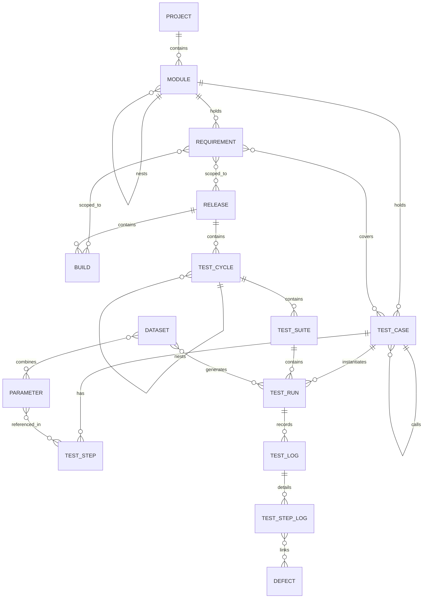

# Tricentis qTest — Competitive TMS Research

Research date: 2026-11-14. Prefer primary Tricentis docs, product pages, and verified review sites. Third-party price claims are labelled as such.

---

## 1. Overview

**Vendor:** Tricentis (formerly QASymphony for the qTest line). Product family marketed as **Tricentis qTest** / unified test management.

**Product modules (as relevant):**

| Module | Role |
| --- | --- |
| **qTest Manager** | Core TMS: projects, requirements, test design, execution, defects, integrations |
| **qTest Parameters** | Shared parameters and datasets for data-driven runs |
| **qTest Insights** | Cross-project analytics, dashboards, Report Gallery |
| **qTest Launch** | Central automation host/agent scheduling and kickoff |
| **qTest Pulse** | Event/webhook rules engine (Jenkins, Jira, Slack, Cucumber/JUnit formatters, etc.) |
| **qTest Explorer** (+ **Sessions**) | Exploratory/session capture, screenshots, defect repro steps, optional Selenium/Protractor script generation |
| **qTest Scenario** | BDD/Gherkin Jira app; feature files in GitHub/GitLab/Bitbucket |

**Deployment:** SaaS (`https://<site>.qtestnet.com`) and **OnPremises** (native Linux/Windows and Kubernetes/Helm charts for Manager plus satellite apps). Not a Jira-only app for Manager itself; Scenario is an Atlassian Marketplace Jira app. Browser support: latest Chrome, Chromium Edge, Firefox, Safari.

**Target users:** Enterprise Agile/DevOps QA organizations that need Jira (or Rally/VersionOne) alignment, portfolio reporting, CI result ingest at scale, and optional Tosca/automation orchestration. Strong HP ALM / Quality Center migration positioning.

**License model.** **Closed source** (proprietary commercial product by Tricentis). Cloud (OnDemand) and on-premises editions are licensed commercially; pricing is quote-only. No public product source repository found. Not open source or open core. Source: [Tricentis qTest](https://www.tricentis.com/products/unified-test-management-qtest/), [pricing request](https://www.tricentis.com/products/unified-test-management-qtest/pricing).

**Pricing:** **Quote-only.** The official [pricing page](https://www.tricentis.com/products/unified-test-management-qtest/pricing) asks buyers to request pricing; no public plan table or calculator. Docs direct buyers to contact Tricentis. Third-party aggregators (Capterra / PractiTest comparisons) have circulated unverified figures such as ~USD 1,000 per named user/year (Pro) and ~USD 2,900 per concurrent user (Enterprise)—treat as **non-official** until confirmed in a written quote. Licensing is commonly discussed as named vs concurrent; module access (Insights, Pulse, Launch) is gated by application permissions/groups.

**Trial / free plan:** Documented **14-day free trial** of qTest Manager that *can* include Manager, Sessions, Explorer, Pulse, Launch, and Insights. No perpetual free plan found in docs. OnPremises uses license files after install (Server ID → Tricentis Support).

Sources: [qTest product](https://www.tricentis.com/products/unified-test-management-qtest), [pricing](https://www.tricentis.com/products/unified-test-management-qtest/pricing), [trial docs](https://docs.tricentis.com/qtest-saas/content/overview/introduction/activate_your_qtest_manager_free_trial.htm), [OnPremises](https://docs.tricentis.com/all/manuals/qtest_op.htm).

---

## 2. Data model and entities

Manager organizes work in five primary tabs: **Test Plan**, **Requirements**, **Test Design**, **Test Execution**, **Defects** (Defects tab hidden when an external defect tracker is configured).

| Entity | What it is | Key fields / notes |
| --- | --- | --- |
| **Project** | Top-level workspace | `id`, `name`, `description`, `status_id`, `start_date`, `end_date`, `uuid`, defect tracking systems, admins |
| **Module** | Nested folder shared structurally between Requirements and Test Design | `id`, `name`, `description`, `web_url`; modules created in one tree appear in the other (contents remain separate) |
| **Requirement** | User story / testing objective (often synced from Jira) | `id`, `name`, `type`, `priority`, `target` (release/build), `description`; linkable to cases and plan scope |
| **Test Case** | Reusable design artifact | `id`, `pid` (display ID), description, precondition, status, type, priority, version, steps, attachments, assignee; types include manual, automation, Tosca-linked |
| **Test Step** | Action + expected result inside a case | description, expected, order, attachments; may **call** another approved test case (`called_test_case`) |
| **Called test case** | Reuse pattern (login etc.); not a separate “shared steps” object | Only approved cases; updates propagate; same project only |
| **Parameter / Dataset** | Data-driven variables (`@identifier` in steps) and row combinations | Parameters associated to projects; datasets up to 25 columns; generate runs from dataset rows |
| **Release** | Milestone / container mirrored between Test Plan and Test Execution | name, dates, notes, requirement scope; importable from ALM |
| **Build** | Nested under Release | build notes, requirement scope, build date |
| **Test Cycle** | Execution grouping under a Release (nestable) | used for browser vs mobile, etc.; summarises suites/runs/defects |
| **Test Suite** | Granular container for Test Runs under a Cycle | name, description, environment inheritance |
| **Test Run** | Executable instance of an approved (or permitted) case version | links to `test_case_version_id`, order, environment/config properties |
| **Test Log** | One execution result of a run | status, start/end, user, note, step logs, attachments, automation class name |
| **Test Step Log** | Per-step actual result / status; can link defects | `actual_result`, status, called-case group metadata |
| **Defect** | Internal tracker or link to external ID | `external_defect_id`, connection metadata when integrated |
| **Configuration / Environment** | Site-level config variables × values → config sets; Environment system field inherited suite → run | e.g. OS × browser combinations for multi-run creation |
| **Custom / Site fields** | Project custom fields + site templates for cross-project consistency | types: string, long text, datetime, number, boolean, URL, arrays; portfolio site fields tag releases/suites for Insights |
| **Attachments** | On requirements, cases, steps, runs, logs | SaaS API/UI limit **50 MB**; OnPrem configurable |
| **Tags / labels** | Not a first-class “tag” entity in the object model docs; portfolio/site field values act as tags for reporting; free-text search covers many fields | — |
| **Versions / baselines** | Case versioning (minor +0.1 on edit; approve → next whole number) | History tab; execution can target previously approved versions; approval updates callers |

API data-object documentation also describes Field/Property structures used for custom attributes.

Sources: [Introduction to qTest Objects](https://docs.tricentis.com/qtest-2026.2/content/manager/introduction/introduction_to_qtest_objects.htm), [Manager 101](https://docs.tricentis.com/qtest-latest/content/manager/introduction/qtest_manager_101.htm), [API specification / DOM](https://docs.tricentis.com/qtest-saas/content/apis/overview/qtest_api_specification.htm), [Parameters](https://docs.tricentis.com/qtest-latest/content/parameters/parameters_quick_start_guide.htm), [Configurations](https://documentation.tricentis.com/qtest/10100/en/content/qtest_manager/administration/test_configuration_field_settings.htm).

---

## 3. Relationships and flows

### Entity relationships (conceptual)

### Typical end-to-end workflow

1. Create/import **Release** (and optional **Builds**) in Test Plan; attach requirements to scope.
2. Sync or author **Requirements** in mirrored modules; link to cases.
3. Design **Test Cases** (manual steps, called cases, `@parameters`, or automation content / Tosca).
4. Approve cases (version → whole number) so they can be called and (by policy) executed.
5. Build **Test Cycles / Suites / Runs** under the Release (optionally from datasets or configuration sets).
6. Execute manually, via Explorer sessions, Launch agents, CI plugins, or API automation logs.
7. File defects (internal or Jira/ADO/etc.) from step/log context; report in Manager grids and Insights.

### Case versioning / review / approval

- Save edits → version **+0.1**.
- **Approve** → next whole version (e.g. 4.2 → 5.0).
- Only **approved** cases may be **called**; approving an edited case refreshes callers.
- Test Execution can select previously approved versions; users with Approve permission may also run the latest version at runtime.
- Data Query supports **batch approve**.

### Statuses and customisation

- Case fields (Status, Type, Priority, etc.) are system-populated but editable; project **Field Settings** and **Site Fields** customise labels, requiredness, allowed values.
- Execution statuses map to automation/CI statuses in Automation / CI Tool Integration settings (e.g. Jenkins PASSED/FAILED/SKIPPED/FIXED/REGRESSION → qTest values).
- Exact enumerations of default case/run statuses beyond those mappings: not exhaustively listed in the pages reviewed; treat as project-configurable via field settings.

Sources: [Objects](https://docs.tricentis.com/qtest-2026.2/content/manager/introduction/introduction_to_qtest_objects.htm), [versioning](https://documentation.tricentis.com/qtest/1001/en/content/qtest_manager/requirements_and_test_design/create__edit___and_delete_test_cases.htm), [reusing/calling](https://documentation.tricentis.com/qtest/9910/en/content/qtest_manager/requirements_and_test_design/reusing_test_cases.htm), [CI status mapping](https://docs.tricentis.com/qtest-saas/content/integrations/jenkins_and_bamboo_integration.htm).

---

## 4. Full feature list

**Test authoring:** Manual cases with rich step editor; preconditions; attachments; up to five custom step columns; **called test cases**; **Parameters** (`@id`) and **Datasets**; convert manual ↔ automation; Tosca conversion when integrated; **AI Generate with AI** from a requirement (site + project flags; generate ~10 cases, regenerate/elaborate/summarize steps, human select/save); marketing also positions AI Chat / MCP-compatible assistants and image-informed generation—confirm entitlement with sales.

**Organisation:** Nested modules; copy/move/share cases across projects (sharing creates runs in another project’s execution); recycle bin restore.

**Execution:** Test Execution tree; assignment; Quick Run; batch operations via Data Query; timers/elapsed: captured as exe start/end on logs (dedicated stopwatch UI: not found in docs reviewed); Explorer for session-based exploratory capture; Sessions module for planned/running/reviewed/completed sessions.

**Traceability / coverage:** Requirement ↔ case links; requirement → release/build scope; RTM via UI and `GET .../requirements/trace-matrix-report`; Jira bi-directional requirement/defect sync (marketing: real-time).

**Reporting / dashboards (Insights):**

- Analysis dashboards: **Quality**, **Coverage**, **Velocity**
- Custom dashboards (charts, panels, tabs); marketing cites **60+ widgets**
- Report Gallery: **Portfolio Overview**, **Portfolio Progress**, **Defect Analysis**
- Explore Data: raw datasets, filters, formulas, saved/scheduled reports, embeddable URLs
- Manager: tree export reports, Test Run grid export, **CI Tool Integration Report** (build-by-build / test-by-test)

**Search / filters:** Free-text search across object fields; **Data Query** (criteria, batch edit/approve, shareable custom reports, spreadsheet export); API `POST .../search` mirrors Data Query.

**Import / export:** Excel import/update of test cases (template + field mapping; update by Test Case ID); Excel/ZIP exports of selected fields; CI JUnit XML ingest (not a general “export as JUnit” product feature in official pages reviewed). Requirements import from ALM/Excel similarly supported in product docs.

**Audit logs:** Site Administration → Security → Audit Log export (CSV); user/admin security events; retained **up to one year**; includes timestamp, app, username, IP, login source (Web/API).

**Permissions / roles / SSO / SCIM:** Project **User Profiles** (Project Admin, QA, Developer, BA, Sessions roles, etc.) with fine-grained object permissions; site **User Groups** and application access (Insights Viewer/Editor, Pulse, Launch); SAML SSO guides for ADFS, Azure AD, Okta, Ping Federate; **SCIM 2.0** for user/group provisioning (Entra ID, Okta); LDAP mentioned under Authentication.

**AI:** Requirement → AI test case generation; product marketing for agentic creation, AI Chat, MCP; human-in-the-loop approval emphasised.

**Localisation:** not found in docs as a first-class multi-language product UI claim in pages reviewed.

**Mobile / offline:** Web/Desktop **Explorer** for capture; Sessions planning in browser. Dedicated PWA offline Manager: **not found in docs**. Exploratory tooling can run on desktop clients; full Manager offline sync: not found.

Sources: [manage test cases](https://docs.tricentis.com/qtest-saas/content/manager/manage_test_cases.htm), [import](https://docs.tricentis.com/qtest-saas/content/manager/import_test_cases.htm), [Insights](https://docs.tricentis.com/qtest-saas/content/insights/insights.htm), [Report Gallery](https://docs.tricentis.com/qtest-latest/content/insights/report_gallery/report_gallery.htm), [SSO](https://docs.tricentis.com/qtest-saas/content/user_and_administration/administration/authentication/sso_integration_landing_page.htm), [SCIM](https://docs.tricentis.com/qtest-latest/content/user_and_administration/administration/authentication/scim_configure.htm), [Security/audit](https://documentation.tricentis.com/qtest/10400/en/content/qtest_manager/administration/security.htm), [product page](https://www.tricentis.com/products/unified-test-management-qtest).

---

## 5. Automation and CI

### Supported result formats

- **JUnit / xUnit XML** is the primary CI plugin contract (Jenkins/Bamboo). Non-JUnit frameworks can use Jenkins **xUnit Plugin** to normalise first.
- Build tools called out: **Maven, Ant, Gradle**.
- **Pulse** sample rules format **Cucumber Java JSON**, **JUnit XML**, Postman JSON, etc., into Manager.
- Launch agents historically document **TestNG, jUnit, Cucumber, JBehave** agents; Universal Agent marketed as framework-agnostic.
- Tosca CI executable path supported from Jenkins plugin.
- **Allure / NUnit / Robot** as first-class native parsers: not found as named plugin options on the Jenkins integration page (may work if they emit JUnit XML or via custom Pulse/API).

### CLI / reporters / SDKs

- Official path is **REST API** (Swagger interactive docs), Jenkins/Bamboo plugins, Launch agents, Pulse scripts. Community OpenAPI clients exist on GitHub; treat as unofficial.

### CI integrations

- **Jenkins** (Freestyle post-build + Pipeline `submitJUnitTestResultsToqTest`)
- **Bamboo** (task; Bamboo Specs not supported per docs)
- Marketing/integrations pages also reference broader CI/CD and GitLab-style DevOps stacks; Pulse webhooks for Jenkins/GitHub/Slack/Jira.
- Azure DevOps, CircleCI, GitHub Actions as dedicated first-party plugins: **not found** as peer docs to Jenkins/Bamboo (API/Pulse still usable).

### How results map to cases — and auto-create

**Yes — qTest can auto-create test cases when automation/CI submits results for tests that do not yet exist.** Matching and creation work as follows.

#### A. Jenkins / Bamboo CI plugin (JUnit XML)

1. Enable **CI Tool Integration** + map CI statuses → qTest execution statuses (activates Automation Integration).
2. Plugin parses JUnit XML (or reuses results already published in Jenkins).
3. **Granularity (matching / creation unit):**
   - **Each JUnit Test Suite (class) = a qTest Test Case** (default), or
   - **Each JUnit Test Case (method) = a qTest Test Case**.
4. New cases land under a **Module** named `[Jenkins Project Name]` or `[Bamboo Plan Key]` (optional parent module).
5. Runs land in suites named by project/plan and optionally date, under a selected Release or existing container (release/cycle/suite); optional “new suite per day”.
6. **Overwrite existing test steps** (default on) replaces step text from the submission; clear to preserve Manager steps.
7. Optional Environment property applied to **newly created** runs only.

#### B. Automation Content identifier (design-time linking)

- Automation test cases store an **Automation Content** string (class, method, script path, etc.).
- Incoming automated runs **match on this unique identifier**; duplicate identifiers can attach results to the wrong case.
- Manual cases can be converted to automation and given content for linking without recreating.

#### C. Bulk / single automation test-log APIs

- `POST /api/v3/projects/{projectId}/test-runs/{testRunId}/auto-test-logs`  
  - `testRunId > 0`: update that run.  
  - `testRunId = 0`: **create** automation test run **and associated test case** with the submitted name/result.
- `POST /api/v3.1/projects/{projectId}/test-runs/0/auto-test-logs?type=automation` (batch):  
  - Required per log: `status`, `exe_start_date`, `exe_end_date`, `name`, **`automation_content`** (XML identifying class/group/package).  
  - If no associated case exists, **creates a new automation Test Case** under a module named **Automation** (or under `parent_module` if supplied).  
  - Optional `test_suite`, step logs, attachments, notes.
- Dolby case study (official): after bulk submit, **“Any test cases not previously in qTest are automatically created”**; results available in ~1–3 minutes at thousands of runs/minute throughput.

#### D. Launch / agents

- Agents can **scan scripting directories** and **automatically create** cases (TestNG/jUnit by class or method; Cucumber/JBehave by feature or scenario), then schedule execution and post step results (step description must match method/scenario name).

### Automation linking, flaky detection, run merging

- **Linking:** Automation Content + CI class/method mapping + Tosca-linked cases; Pulse can link Scenario results into Manager.
- **Flaky detection:** Official Insights Report Gallery documents Portfolio/Defect reports, not a dedicated “flaky tests” report. A third-party blog claims Insights flaky detection; **not confirmed in official Tricentis docs reviewed**. Pulse marketing example: auto-create a Jira bug when a test fails **7 times in a row** (workflow, not a flaky analytics product).
- **Run merging:** CI can append to an existing container/suite (including same-day suite reuse) vs create new suites; overwrite-steps controls whether case definitions merge with XML content. Extended batch API explicitly **does not update names/locations of existing cases/runs** when creating hierarchical structures. Dedicated “merge duplicate runs” feature: not found beyond suite reuse options.

Sources: [Jenkins/Bamboo](https://docs.tricentis.com/qtest-saas/content/integrations/jenkins_and_bamboo_integration.htm), [manage test cases / Automation Content](https://docs.tricentis.com/qtest-saas/content/manager/manage_test_cases.htm), [Test Run APIs](https://documentation.tricentis.com/qtest/1001/en/content/qtest_apis/apis_sdks/test_run_apis.htm), [Dolby case study](https://documentation.tricentis.com/qtest/10300/en/content/qtest_apis/customer_case_studies/dolby_scaling_test_automation_with_qtest_apis.htm), [Pulse](https://www.tricentis.com/products/unified-test-management-qtest/agile-devops-workflows-pulse), [Launch](https://docs.tricentis.com/qtest-latest/content/launch/overview/qtest_launch_quick_start_guide.htm).

---

## 6. API

| Aspect | Detail |
| --- | --- |
| **Type** | REST (JSON over HTTPS); interactive Swagger |
| **Base URL** | SaaS: `https://<site>.qtestnet.com/...`; OnPrem: instance URL. Paths under `/api/v3/...` and `/api/v3.1/...` |
| **Auth** | Bearer token from Login / Download qTest Resources; non-expiring until revoke or Site Admin session terminate. API sessions do not count toward the 3 web sessions / concurrent seat rules |
| **Rate limits** | HTTP **429**; headers `x-ratelimit-remaining-minute/month`, `x-ratelimit-limit-*`, `retry-after`; example docs show ~10/min and ~1,000,000/month (actual quotas vary) |
| **Pagination** | `page` + `size` / `pageSize` (defaults often 20–100; maxima commonly 100 or 1000 depending on endpoint) |
| **Webhooks** | CRUD `/api/v3/webhooks`; events via `/webhooks/events`; `x-qTest-signature` secret or OAuth2 connection |
| **Attachments** | 50 MB SaaS via API |

**Main endpoint groups (representative):**

| Group | Operations (examples) |
| --- | --- |
| Auth / users | Login, revoke token, user profiles, SCIM `/scim/v2` |
| Projects | List/get projects, defect tracker connections |
| Modules | CRUD, search, expand descendants |
| Requirements | List/get/create/update, trace-matrix-report |
| Test cases / steps | CRUD, versions, attachments, comments |
| Releases / builds / cycles / suites / runs | Hierarchy CRUD, expand testcase/steps |
| Test logs | List logs; submit automation / batch automation logs; queue-processing status |
| Search | `POST .../projects/{id}/search` (Data Query) |
| Defects | Internal defects + external links |
| Webhooks | Register/list/update/delete, OAuth2 connection |

Interactive API docs: from **Download qTest Resources** in-product; overview at [qTest API Specifications](https://docs.tricentis.com/qtest-saas/content/apis/overview/qtest_api_specification.htm). Webhooks: [docs](https://docs.tricentis.com/qtest-saas/content/apis/webhooks.htm).

---

## 7. Integrations

| Category | Integrations |
| --- | --- |
| **Issue / ALM** | **Jira** (requirements + defects, real-time marketing claim); Rally; VersionOne / Digital.ai; Azure DevOps / ADO (reviews and Explorer share flows); Blueprint, Caliber mentioned in older reviews |
| **CI/CD** | Jenkins, Bamboo; Pulse → Jenkins/GitHub webhooks; API for others |
| **Automation** | JUnit/xUnit family, Tosca, Selenium/Protractor (Explorer scripting), Cucumber/JBehave/TestNG via agents/Pulse; Universal Agent claim |
| **BDD** | qTest Scenario ↔ GitHub/GitLab/Bitbucket + Jira; Pulse BDD workflows |
| **Chat** | Slack (Pulse examples); Teams: not found as first-party named integration in pages reviewed |
| **SSO** | ADFS, Azure AD / Entra, Okta, Ping Federate; SCIM 2.0 |
| **Marketplace** | Scenario on Atlassian Marketplace; Jenkins plugin via Plugin Manager; AWS Marketplace listing for Manager |

Sources: product/integration pages, [SSO landing](https://docs.tricentis.com/qtest-saas/content/user_and_administration/administration/authentication/sso_integration_landing_page.htm), [Explorer](https://www.tricentis.com/products/unified-test-management-qtest/enterprise-exploratory-testing-explorer), [Scenario](https://www.tricentis.com/products/unified-test-management-qtest/enterprise-bdd-for-jira-scenario).

---

## 8. Marketing positioning

Headline themes (2026 product site):

- **“Unified quality, test coverage, and actionable insights at scale”** — agentic / AI-speed quality vs siloed tools.
- Domain-specialised AI for test creation (~**60% less test creation friction** claim), human-in-the-loop, MCP/AI Chat.
- Enterprise scale: reusable steps, portfolio orchestration, compliance/audit trails.
- Open integrations with any CI/CD/APM/DevOps stack; migration from **Quality Center / HP ALM**.
- Central automation via Launch Universal Agent; Pulse event-driven DevOps workflows.
- Insights: release readiness with **60+ widgets**, Quality/Coverage/Velocity, heat maps.

Differentiators vs lighter TMS tools: suite breadth (Manager + Insights + Launch + Pulse + Explorer + Scenario), deep Jira, Tosca ecosystem, bulk automation APIs proven at large CI volumes (Dolby).

Sources: [qTest product](https://www.tricentis.com/products/unified-test-management-qtest), [Insights](https://www.tricentis.com/products/unified-test-management-qtest/visual-reporting-analytics-insights), [Launch](https://www.tricentis.com/products/unified-test-management-qtest/centralize-automation-launch).

---

## 9. What users love

Themes from Capterra / G2-sourced reviews (2022–2024 samples):

1. **Jira integration and SDLC linkage** — “Its easy integration with different tools such as JIRA and the way it allows to manage test cases, requirements, bugs and everything related to SDLC” (Capterra, Oct 2024).
2. **Central test case / execution management** — ease of creating, batching, and executing cases; colour coding and status visibility.
3. **Traceability / RTM** — mapping scenarios to stories; requirement search after Jira import.
4. **CI / automation result ingest** — “Very easy to integrate with Jenkins when doing Automation” (G2 via AWS Marketplace, 2024).
5. **Migration from ALM** — “We moved from HP ALM over to qTest… night to day” (Capterra).
6. **Parameters / multi-environment runs** — useful for large batches across environments.
7. **Support / online help** — repeatedly mentioned as available.

Sources: [Capterra qTest reviews](https://www.capterra.com/p/173762/qTest/reviews/), [AWS Marketplace / G2 excerpts](https://aws.amazon.com/marketplace/reviews/reviews-list/B07VGB25M8).

---

## 10. What users dislike

1. **Insights / query performance** — “It becomes slow to run Insights queries when you have many projects selected” (Capterra, 2024, multiple reviewers).
2. **Price** — “License is very costly”; “slightly overpriced”; barrier for smaller teams (G2/Capterra).
3. **UI / UX friction** — counterintuitive flows (e.g. adding cases via oddly named tabs), session timeouts losing unsaved work, slow refresh.
4. **Requirement management / traceability gaps** — “not good for requirement management and hence creating test traceability”; manual tagging every item to a story.
5. **Integration hiccups** — occasional Jira sync mismatches; “third party automation tools are generally not supported… Tosca” sentiment in older reviews.
6. **Complexity / add-on learning curve** — Insights “not intuitive as normal data analysis tools”; many features underutilised.
7. **Automation reporting expectations** — G2 critical note that open-source framework integration can need “more code than expected”.

Sources: same Capterra/G2/AWS Marketplace review pages; [G2 vs Xray themes](https://www.g2.com/compare/tricentis-qtest-vs-xray-test-management).

---

## 11. Ideas for Vulyk

Vulyk context: open-source self-hosted TMS (folders/cases/plans/runs, CI ingest, campaigns/iterations, requirements, Jira/OpenProject, reports/flaky, RBAC/SSO, LLM, MCP, importers, PWA offline).

1. **First-class CI auto-create with clear matching knobs** — Copy qTest’s explicit options (match by suite vs method; stable automation ID; parent folder; overwrite-steps vs preserve; suite-per-day). Make “auto-create on / off” and “match key uniqueness” operator-visible so libraries do not silently fork.
2. **Bulk automation ingest API** — Dolby’s lesson: one-by-one run updates die at CI scale. Ship a batched results endpoint with async queue status and documented throughput expectations.
3. **Automation Content / external ID on every case** — Persist a unique automation key separate from display name; reject or warn on duplicates (qTest warns that duplicates mis-route results).
4. **Called cases + versioned approval** — Reusable login/setup cases with approve-to-publish semantics are highly valued; keep call graphs project-scoped and history-auditable.
5. **Parameters/datasets → run matrix** — Data-driven generation of runs from datasets (and optional environment/config cartesian products) is a clear enterprise differentiator for Vulyk plans/campaigns.
6. **Portfolio-style Insights without the pain** — Users love cross-project Quality/Coverage/Velocity views but hate slow multi-project Insights. Prefer incremental aggregates, stricter default filters, and flaky analytics as a **first-class** built-in (qTest’s official flaky story is weak/undocumented).
7. **Pulse-like lightweight webhooks** — Event rules (“fail N times → OpenProject/Jira issue”, “notify Slack”) without forcing a full proprietary rules product; open-source sample rules (as Pulse’s GitHub samples) fit Vulyk’s ethos.
8. **Avoid quote-wall pricing / SaaS lock-in pain** — Vulyk’s AGPL self-host + SSO/SCIM parity addresses the #1 cost complaint; document upgrade-safe env sync (already a Vulyk rule) as a competitive contrast to opaque enterprise quotes.
9. **LLM/MCP with human-in-the-loop** — Match qTest’s requirement→cases AI and MCP messaging, but keep generation reviewable and never silent-overwrite approved cases (align with approval/versioning).
10. **Offline PWA as a wedge** — qTest Manager offline is weak/not found; Explorer covers exploratory capture only. Vulyk’s PWA offline execution can win field/air-gapped and travel workflows they underserve.
11. **Importers** — Excel round-trip and HP ALM-style migration narratives win deals; keep OpenProject/Jira importers and seed fragments collision-safe.

---

## 12. Sources

- https://www.tricentis.com/products/unified-test-management-qtest
- https://www.tricentis.com/products/unified-test-management-qtest/pricing
- https://www.tricentis.com/software-testing-tool-trial-demo/qtest-trial
- https://www.tricentis.com/products/unified-test-management-qtest/enterprise-exploratory-testing-explorer
- https://www.tricentis.com/products/unified-test-management-qtest/centralize-automation-launch
- https://www.tricentis.com/products/unified-test-management-qtest/agile-devops-workflows-pulse
- https://www.tricentis.com/products/unified-test-management-qtest/visual-reporting-analytics-insights
- https://www.tricentis.com/products/unified-test-management-qtest/enterprise-bdd-for-jira-scenario
- https://docs.tricentis.com/qtest-saas/content/overview/introduction/activate_your_qtest_manager_free_trial.htm
- https://docs.tricentis.com/qtest-saas/content/apis/overview/qtest_api_specification.htm
- https://docs.tricentis.com/qtest-saas/content/apis/webhooks.htm
- https://docs.tricentis.com/qtest-saas/content/integrations/jenkins_and_bamboo_integration.htm
- https://docs.tricentis.com/qtest-saas/content/manager/manage_test_cases.htm
- https://docs.tricentis.com/qtest-saas/content/manager/import_test_cases.htm
- https://docs.tricentis.com/qtest-saas/content/manager/manager_navigation.htm
- https://docs.tricentis.com/qtest-saas/content/insights/insights.htm
- https://docs.tricentis.com/qtest-latest/content/insights/report_gallery/report_gallery.htm
- https://docs.tricentis.com/qtest-2026.2/content/manager/introduction/introduction_to_qtest_objects.htm
- https://docs.tricentis.com/qtest-latest/content/manager/introduction/qtest_manager_101.htm
- https://docs.tricentis.com/qtest-latest/content/manager/test_plan/test_plan_for_releases_and_builds.htm
- https://docs.tricentis.com/qtest-latest/content/parameters/parameters_quick_start_guide.htm
- https://docs.tricentis.com/qtest-latest/content/parameters/user_guides/use_parameters_and_datasets.htm
- https://docs.tricentis.com/qtest-latest/content/launch/overview/qtest_launch_quick_start_guide.htm
- https://docs.tricentis.com/qtest-saas/content/user_and_administration/administration/authentication/sso_integration_landing_page.htm
- https://docs.tricentis.com/qtest-latest/content/user_and_administration/administration/authentication/scim_configure.htm
- https://docs.tricentis.com/qtest-2026.2/content/user_and_administration/administration/groups/user_groups.htm
- https://docs.tricentis.com/qtest-saas/content/user_and_administration/administration/user_profiles/user_profiles.htm
- https://documentation.tricentis.com/qtest/10400/en/content/qtest_manager/administration/security.htm
- https://documentation.tricentis.com/qtest/1001/en/content/qtest_apis/apis_sdks/test_run_apis.htm
- https://documentation.tricentis.com/qtest/10300/en/content/qtest_apis/customer_case_studies/dolby_scaling_test_automation_with_qtest_apis.htm
- https://documentation.tricentis.com/qtest/9910/en/content/qtest_manager/requirements_and_test_design/reusing_test_cases.htm
- https://documentation.tricentis.com/qtest/1001/en/content/qtest_manager/requirements_and_test_design/create__edit___and_delete_test_cases.htm
- https://documentation.tricentis.com/qtest/10100/en/content/qtest_manager/administration/test_configuration_field_settings.htm
- https://docs.tricentis.com/qtest-2025.8/content/apis/apis/test_run_apis.htm
- https://docs.tricentis.com/qtest-2025.8/content/apis/apis/common_apis.htm
- https://docs.tricentis.com/qtest-2026.2/content/apis/apis/requirement_apis.htm
- https://docs.tricentis.com/qtest-saas/content/apis/apis/module_apis.htm
- https://docs.tricentis.com/all/manuals/qtest_op.htm
- https://docs.tricentis.com/qtest-latest/content/onpremise/installation/installation_guides/kubernetes/manager_kubernetes_installation_guide.htm
- https://www.capterra.com/p/173762/qTest/reviews/
- https://aws.amazon.com/marketplace/reviews/reviews-list/B07VGB25M8
- https://www.g2.com/compare/tricentis-qtest-vs-xray-test-management
- https://www.practitest.com/resource-center/blog/tricentis-qtest-review/ (secondary overview)
