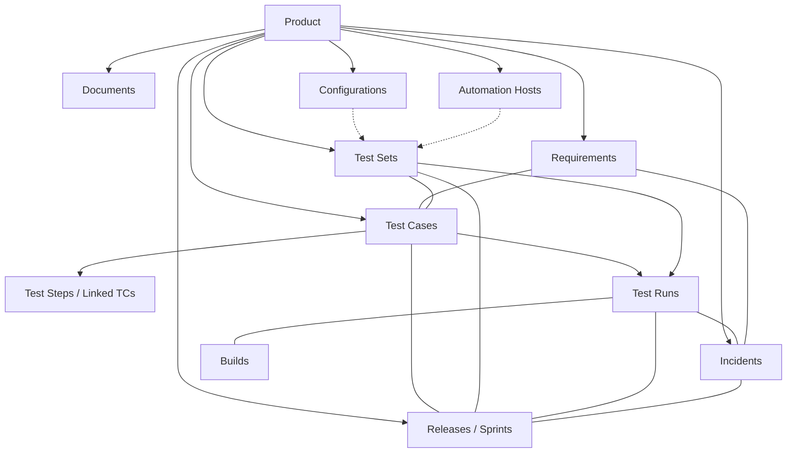

# SpiraTest (Inflectra) — Competitive TMS Research

Research date: 2026-11-14. Focus: **SpiraTest** (requirements + test + defect management). SpiraTeam/SpiraPlan are noted only where edition boundaries matter.

---

## 1. Overview

**Vendor:** Inflectra Corporation (Silver Spring, MD, USA). SpiraTest is the entry edition of the Spira family; SpiraTeam adds ALM delivery (tasks, risks, source code, baselines); SpiraPlan adds portfolio/program/enterprise planning. All three share one codebase and database; upgrading an edition unlocks features without data migration ([edition comparison](https://spiradoc.inflectra.com/About/edition-comparison/), [KB609](https://www.inflectra.com/Support/KnowledgeBase/KB609.aspx)).

**Deployment:** Cloud (Inflectra-hosted AWS, `*.spiraservice.net`) and on-premise / air-gapped download (Windows Server + IIS + SQL Server). Cloud and on-prem feature parity for the same edition ([forum](https://www.inflectra.com/Support/Forum/spiratest/issues-questions/3028.aspx)). Not a Jira app as the primary product; there is a Jira Marketplace add-on plus a separate data-sync plugin.

**Target users:** QA / test managers, manual and automation testers, regulated / compliance teams needing requirements↔test↔defect traceability and electronic signatures. Mid-market and enterprise (software, IT, finance, medical devices appear in reviews).

**Licensing model:** Concurrent users (not named seats). Every plan includes unlimited named users, projects, storage, tests, and API calls ([product page](https://www.inflectra.com/Products/SpiraTest/), [price list](https://inflectra.com/Purchase/Price-List.aspx)).

**Cloud pricing (USD, checked 2026-11-14 from Inflectra price list):**

| Concurrent users | Price/month | Price/year |
| --- | --- | --- |
| 1–3 | $134.26 | $1,450.01 |
| 4–5 | $215.24 | $2,324.59 |
| 6–10 | $389.49 | $4,206.49 |
| 11–20 | $751.31 | $8,114.15 |
| 21–30 | $1,072.14 | $11,579.11 |
| 31–50 | $1,500.59 | $16,206.37 |
| 51–100 | $1,875.74 | $20,257.99 |
| Higher tiers | up to $6,429.81/mo (500) | published on price list |

**On-premise (perpetual download + annual support renewal):** e.g. 1–3 users $1,372.67 purchase / $1,372.67/year renewal; 6–10 users $3,978.71; scales similarly ([price list](https://inflectra.com/Purchase/Price-List.aspx)).

**Inflectra.ai add-on (cloud only):** separate concurrent-user SKU from $1.99/mo (1 user) / $5.99 (3) / $9.99 (5); unlimited AI usage. Not available for on-prem (use “Spira AI Connect” instead) ([Inflectra.ai](https://www.inflectra.com/Products/Inflectra.ai/Spira.aspx)).

**License model.** **Closed source** (proprietary commercial product by Inflectra). Cloud and downloadable/on-prem editions sold under Inflectra price list; no open-source SpiraTest product repository found. Not open source or open core. Sources: [inflectra.com/Products/SpiraTest](https://inflectra.com/Products/SpiraTest/), [Price List](https://inflectra.com/Purchase/Price-List.aspx).

**Trial / free plan:** 30-day Spira Cloud trial, no credit card; Inflectra.ai included in trial. **No free forever plan** found in docs.

**Docs version:** SpiraDocs last updated for Spira **9.5.0.1** ([SpiraDocs](https://spiradoc.inflectra.com/)).

Sources: [SpiraTest product](https://www.inflectra.com/Products/SpiraTest/), [Price list](https://inflectra.com/Purchase/Price-List.aspx), [Edition comparison](https://spiradoc.inflectra.com/About/edition-comparison/).

---

## 2. Data model and entities

Spira organizes work in **workspaces**, then **artifacts** with two-letter tokens (e.g. `TC:42`) ([Functionality Overview](https://spiradoc.inflectra.com/Spira-User-Manual/Functionality-Overview/)).

### Workspaces (SpiraTest)

| Entity | Token | Role |
| --- | --- | --- |
| **Product** | PR | Primary project container (requirements, tests, defects, releases). |
| **Program** | PG | Groups products; available in SpiraTest (portfolio/enterprise workspaces are SpiraPlan-only). |

### Core QA artifacts (all in SpiraTest)

| Entity | Token | What it is / key fields |
| --- | --- | --- |
| **Requirement** | RQ | Features / stories; hierarchy via indent; importance, type, status, owner, author, release, components, tags, custom props, coverage counts. Optional use-case **Requirement Steps** (RS). |
| **Release / Sprint** | RL | Hierarchical releases and sprints; version number, dates, status/type, planned effort, execution status counts, owner. |
| **Build** | BL | CI build recorded against a release. |
| **Test Case** | TC | Manual or automated case; name, type, status, priority, folder, owner, estimated duration, automation engine/attachment, components, tags, custom props, last execution status/date. |
| **Test Step** | TS | Description, expected result, sample data; parameters (`${name}`); **linked steps** embed another TC (call-to-test). |
| **Test Set** | TX | Suite of cases for execution; status, owner, release, planned date, automation host, recurrence, dynamic query option, pass/fail counts. Folders supported. |
| **Test Run** | TR | **Immutable** execution record (manual or automated); status, duration, release/build/set linkage, step results, console output, attachments. |
| **Automation Host** | AH | Machine that runs scheduled automated tests from Spira. |
| **Configuration** | TG | Parameter / sample-data sets for data-driven / dynamic test sets. |
| **Incident** | IN | Bugs, enhancements, issues, etc.; type, status, priority, severity, opener/owner, detected/resolved release, workflow. |
| **Document** | — | Files/URLs with folders, types, meta-tags, versioning. |
| **Component** | CP | Cross-artifact product-area tags. |

### Not in SpiraTest (Team/Plan)

Tasks (TK), Risks (RK), Baselines, source code/commits/PRs, Planning boards, OData reporting API, portfolio/enterprise workspaces, program capabilities/milestones ([edition comparison](https://spiradoc.inflectra.com/About/edition-comparison/)).

### Custom fields, attachments, tags, versions

- **Custom properties:** template-level free-text, lists, multi-select, dates, users, releases, etc. (up to many `CUST_01…` style fields in reporting).
- **Attachments:** on artifacts and test runs; document repository is shared.
- **Tags:** supported on artifacts (visible in report tables).
- **Baselines:** SpiraTeam/Plan only — not SpiraTest.
- **History / audit:** change history on artifacts; electronic signatures for compliance workflows.

Sources: [Functionality Overview](https://spiradoc.inflectra.com/Spira-User-Manual/Functionality-Overview/), [Test Case Management](https://spiradoc.inflectra.com/Spira-User-Manual/Test-Case-Management/), [Custom Report Tables](https://spiradoc.inflectra.com/Reporting/Custom-Report-Tables/).

---

## 3. Relationships and flows

### Entity relationships

**Typical end-to-end workflow**

1. Capture/import **requirements**; organize hierarchy.
2. Author **test cases** (+ steps/parameters) and map them to requirements and releases (do **not** clone cases per release — reuse and map).
3. Group cases into **test sets**; assign owners; optionally bind release, automation host, configurations.
4. **Execute** (manual wizard, exploratory mode, or automation → test runs).
5. On failure, create/link **incidents**; sync to Jira/ADO if configured.
6. Track **builds** from CI; report coverage and progress on dashboards.

**Case versioning / review / approval**

- Test cases have **status** and **workflow** controls (configurable types/statuses).
- Execution creates an immutable **test run** (snapshot of results); cases themselves are living artifacts with history.
- **Electronic signatures** support regulated approval steps.
- Multi-approver workflows: reviewers report gaps (TrustRadius); not found as a first-class multi-approver feature in SpiraTest docs.

**Statuses (customizable)**

- Execution statuses include Passed, Failed, Blocked, Caution, Not Run, Not Applicable (seen across report tables and docs).
- Artifact statuses/types/priorities for requirements, test cases, incidents, releases are admin-configurable without code ([product capabilities](https://www.inflectra.com/Products/SpiraTest/)).

Sources: [Functionality Overview](https://spiradoc.inflectra.com/Spira-User-Manual/Functionality-Overview/), [Test Case Management](https://spiradoc.inflectra.com/Spira-User-Manual/Test-Case-Management/).

---

## 4. Full feature list

**Test authoring:** Rich text / wiki-like docs, diagrams, markdown; test steps with expected results and sample data; **parameters** (`${var}`) with defaults; **linked test cases** (call-to-test) with parameter pass-through; folders; type/status/priority/component; BDD/Gherkin highlighting and Feature file generation ([Highlights](https://inflectra.com/Products/SpiraTest/Highlights.aspx), [parameters blog](https://www.inflectra.com/Ideas/Entry/why-test-case-parameters-are-like-inception-1514.aspx)).

**Organisation:** Product → folders for cases/sets; hierarchical requirements and releases; components and tags; programs for multi-product views.

**Execution:** Manual execution wizard (step pass/fail, optional defect); **exploratory** mode (add/edit/reorder steps during run); assignment of sets to testers; estimated vs actual duration; automation hosts for remote scheduled runs; Excel **offline test runner** add-on; printable test scripts for paper offline ([Test Execution](https://spiradoc.inflectra.com/Spira-User-Manual/Test-Execution/), [Downloads](https://www.inflectra.com/Products/SpiraTest/Downloads.aspx)).

**Traceability / coverage:** Requirement↔test case mappings; release↔test case mappings; incident links from runs/steps; coverage dashboards and traceability matrix report.

**Reporting / dashboards (built-in printable reports):** Requirements Summary/Detailed/Plan/Traceability Matrix; Test Case Summary/Detailed; Test Set Summary/Detailed; Printable Test Scripts; Test Run Summary/Detailed; Test Case Traceability; Incident Summary/Detailed; Release Summary/Detailed/Plan. Default dashboard widgets: Incident Progress Rate, Test Run Progress Rate, Requirement Summary, Test Case Summary, Incident Aging (+ Task Burndown when Team/Plan). Graph families: summary, snapshot (e.g. Requirements Coverage), date-range. Export: HTML, Word, Excel, PDF, raw XML; graph data as CSV ([Reports Center](https://spiradoc.inflectra.com/Spira-User-Manual/Reports-Center/)). Custom reports via Entity SQL / report tables; OData API is **SpiraPlan-only**.

**Search / filters:** List filters on built-in and custom fields; cross-product search praised in reviews. No public “query language” product name like JQL found beyond Entity SQL for custom reports and API filter objects.

**Import / export:** Excel import/export (Office 365/Mac/Windows); Word requirements/cases; Google Sheets; migration tools for TestRail, qTest, PractiTest, ALM, ADO/TFS, Jira/Xray, Jama, QAComplete, Octane, etc. ([Downloads](https://www.inflectra.com/Products/SpiraTest/Downloads.aspx)).

**Audit / compliance:** History tracking; electronic signatures; password policy; LDAP; MFA.

**Permissions / SSO:** Product roles (RBAC per product); program roles; system admin. SSO via OAuth/OIDC: Entra ID, Okta, OneLogin, Google, GitHub, GitLab, ADFS, generic OpenID Connect ([Users admin](https://spiradoc.inflectra.com/Spira-Administration-Guide/System-Users/)). **SCIM:** not found in docs.

**AI:** Inflectra.ai (cloud add-on): generate test cases/steps, BDD scenarios, requirements/tasks/risks content; MCP-powered chat in UI; coverage/risk assistance ([Inflectra.ai docs](https://spiradoc.inflectra.com/Spira-User-Manual/Inflectra-Ai-In-Spira/), [Highlights](https://inflectra.com/Products/SpiraTest/Highlights.aspx)). Official **MCP server** for agent tools ([mcp-server-spira](https://github.com/Inflectra/mcp-server-spira)).

**Localisation:** G2 lists many UI languages (EN, DE, FR, ES, PT, ZH, etc.).

**Mobile:** Responsive web UI for phones — lists, assign, approve, run tests, attach camera screenshots ([Mobile Support](https://www.inflectra.com/Products/SpiraTest/Highlights/Mobile-Support.aspx)).

**Offline:** Excel Test Runner sync; printable scripts. Native PWA offline app: **not found in docs**.

---

## 5. Automation and CI

### Result formats and reporters

- **xUnit / JUnit XML** via official Python and Node readers (`spira.cfg` mapping) — also covers Playwright/JUnit/NUnit-style XML exporters ([xUnit Python](https://spiradoc.inflectra.com/Unit-Testing-Integration/Integrating-with-xUnit-Python/)).
- **pytest** plugin (`pytest-spiratest`) with markers, module/class/function mapping ([pytest](https://spiradoc.inflectra.com/Unit-Testing-Integration/Integrating-with-PyTest/)).
- Framework-specific reporters/samples: Cypress, WebdriverIO+Cucumber→JUnit then xUnit import, Rapise (first-party), Selenium via RemoteLaunch, UFT, TestComplete, Ranorex, etc. ([integrations](https://www.inflectra.com/Products/SpiraTest/Integrations.aspx?type=Automated-Testing-Tools)).
- Community **SpiraUniversalReporter**: Allure JSON, JUnit XML, ExtentReports HTML ([GitHub](https://github.com/inflectra-community/utility-spira-universal-reporter)).

### CI integrations

Build/server plugins and webhooks for **Jenkins, GitHub Actions, GitLab**, Azure DevOps (migration + sync ecosystem), plus OctoPerf webhooks. Builds associate with releases; test runs can attach to builds ([Highlights](https://inflectra.com/Products/SpiraTest/Highlights.aspx), [GitHub Actions](https://spiradoc.inflectra.com/Build-Server-Integration/GitHub-Actions/)).

### How results map to cases

| Path | Matching | Auto-create cases? |
| --- | --- | --- |
| Official xUnit reader | Required `classname.name` → Spira **TC ID** in `[test_cases]` of `spira.cfg`; optional suite name → test set ID | **No** — cases must already exist |
| Cypress SpiraReporter | Suite/context **name** → TC ID in `mapping` | **No** |
| pytest plugin | Markers / function / class / module → TC ID; optional `default` TC for unmapped | **No** auto-create of new TCs; unmapped can fall back to a default existing ID |
| Community Universal Reporter | Custom property automation ID (Allure hash / `classname.name` / name); fallback regex `[TC:123]`, `TC-123:`, etc. | **Yes, optional** — `SPIRA_AUTO_CREATE_TEST_CASES=true` creates TC and stores automation ID on custom property; if false, skips unmatched |

### Critical answer: auto-create from CI?

**Official SpiraTest automation path does not auto-create test cases from CI results.** Docs and KB flows (xUnit, Cypress, WDIO) assume you **create/maintain cases in Spira first**, then map automation identifiers to `TC:` IDs. Unmapped results are not described as spawning new cases.

**Auto-create exists only in the community Universal Reporter**, gated by `SPIRA_AUTO_CREATE_TEST_CASES`, matching via a dedicated custom property (`SPIRA_AUTOMATION_ID_FIELD`). Limits: test-set membership cannot be added via REST (must pre-add TCs to sets for set-linked runs); community tooling, not a documented first-party product feature ([tc-matching.md](https://raw.githubusercontent.com/inflectra-community/utility-spira-universal-reporter/main/docs/tc-matching.md)).

### Flaky detection / run merging

- Native SpiraTest **flaky-test detection / quarantine: not found in Spira docs**. Rapise’s Spira dashboard documents a manual “Flaky” flag on test cases ([RapiseDocs](https://rapisedoc.inflectra.com/Guide/spira_dashboard_2/)) — automation-tool side, not core TMS analytics.
- **Run merging:** not found as a first-class “merge duplicate CI runs” feature; each import creates new immutable test runs; optional **create_build** groups a batch under one build.

Sources: [xUnit Python](https://spiradoc.inflectra.com/Unit-Testing-Integration/Integrating-with-xUnit-Python/), [KB946 WDIO](https://www.inflectra.com/Support/KnowledgeBase/KB946.aspx), [Universal Reporter](https://github.com/inflectra-community/utility-spira-universal-reporter).

---

## 6. API

- **Type:** REST (v7 documented) and legacy SOAP. OpenAPI/Swagger UI on instance (`RestServiceOpenApiDocs.aspx` since Spira 8.15).
- **Base URL:** `https://{instance}/Services/v7_0/RestService.svc/` (cloud: `company.spiraservice.net`).
- **Auth:** username + api-key (RSS token, **including curly braces** `{…}`) via headers, query string, or HTTP Basic. JSON via `Accept` / `Content-Type: application/json`.
- **Rate limits:** **No formal rate limiting** ([KB992](https://www.inflectra.com/Support/KnowledgeBase/KB992.aspx)); recommend ≤3–5 concurrent API threads, backoff on deadlock/500s.
- **Pagination:** `start_row` (1-based) + `number_of_rows`; **max 500 rows** per GET.
- **Optimistic concurrency:** `ConcurrencyDate` required on PUT.
- **Webhooks:** **Inbound** build/test webhooks (e.g. GitHub Actions → `/Services/Webhooks/BuildService.svc/GitHub`, OctoPerf). **Outbound event webhooks** (Spira → arbitrary REST on artifact change): historically not available; forum notes consideration; still treat as **not a general outbound webhook product** ([forum](https://www.inflectra.com/support/Forum/integrations/bug-trackers/1227.aspx)).
- **Docs:** [API Overview](https://spiradoc.inflectra.com/Developers/API-Overview/); per-instance `…/RestService.aspx`.

| Endpoint group | Operations (typical) |
| --- | --- |
| Projects / products | List/get projects user can access |
| Requirements | CRUD, associations, coverage |
| Test cases / steps | CRUD, folders, parameters |
| Test sets | CRUD, membership |
| Test runs | POST automated/manual runs (immutable) |
| Releases / builds | CRUD releases; POST builds |
| Incidents | CRUD, workflow fields |
| Documents / attachments | Upload, link |
| Users / roles | Directory and permissions |
| Custom properties | Set via `CustomProperties` on artifacts |
| Data sync | Plugin status / events |
| Associations | Link artifacts by `ArtifactTypeId` (RQ=1, TC=2, IN=3, RL=4, TR=5, …) |

Filtering: POST search endpoints with filter objects (`IntValue`, `StringValue`, `MultiValue`, `DateRangeValue`).

---

## 7. Integrations

**Issue trackers:** Bidirectional **Jira** data sync (incidents, requirements/stories, releases) + Marketplace coverage add-on; Azure DevOps / TFS; Bugzilla; others via data-sync plugins ([Jira page](https://www.inflectra.com/Products/SpiraTest/Integrations/Jira-Test-Management.aspx)). Linear: **not found** in official SpiraTest integration list.

**CI/CD:** Jenkins, GitHub, GitLab, Azure DevOps (builds + importers).

**Automation:** Rapise (deep), Selenium, Playwright (via xUnit), Cypress, WDIO, UFT, TestComplete, Ranorex, Tosca, Postman/SoapUI, JMeter, OctoPerf, LambdaTest, etc. ([integrations catalog](https://www.inflectra.com/Products/SpiraTest/Integrations.aspx?type=Automated-Testing-Tools)).

**Chat:** Slack/Teams native: **not found** as first-party SpiraTest highlights (email notifications are documented).

**SSO:** OAuth/OIDC providers listed in §4; LDAP.

**Marketplace / extensibility:** SpiraApps plug-in framework; large download center of importers and RemoteLaunch hosts ([Downloads](https://www.inflectra.com/Products/SpiraTest/Downloads.aspx)).

**MCP:** Official `mcp-server-spira` (search/create/update artifacts, record test runs).

---

## 8. Marketing positioning

Headline themes from Inflectra:

- “Premier” / complete **QA hub**: requirements, test cases, defects, compliance, reporting in one place.
- **End-to-end traceability** and regulated-industry readiness (e-signatures, audit history).
- **Concurrent licensing** with unlimited named users, projects, storage, API calls — “fair, transparent, predictable.”
- Cloud **or** on-prem / air-gap.
- **Inflectra.ai** / agentic AI and MCP chat as modern differentiators.
- Methodology-agnostic (Agile + traditional).
- Positioned against TestRail, qTest, PractiTest in Inflectra content.

Sources: [SpiraTest](https://www.inflectra.com/Products/SpiraTest/), [Highlights](https://inflectra.com/Products/SpiraTest/Highlights.aspx), [AWS Marketplace listing](https://aws.amazon.com/marketplace/pp/prodview-4ve3kml7fi4sm).

---

## 9. What users love

Themes from G2 (~4.3/5, 62 reviews), Capterra (~4.0/5), TrustRadius (~8/10):

1. **Traceability / all-in-one QA** — requirements, tests, defects linked.  
   *“Easily link and associate artifacts”* — TrustRadius, May 2022.  
   *“Compliance management was the main reason we went with SpiraTest”* — G2 (Richard S., 2024).

2. **Support** — Capterra customer service ~4.5.  
   *“The Support team is very responsive”* — G2 (Dec 2022).

3. **Concurrent unlimited named users / organisation** — praised for distributing test sets and team work (G2/Capterra themes).

4. **Customization & workflows** — statuses, fields, roles without coding.

5. **Manual execution UX** — step results on one page.  
   *“A clean view of test case steps… record a result for each step quickly”* — TrustRadius (Dave Furlani).

Sources: [TrustRadius](https://www.trustradius.com/products/spiratest), [G2](https://www.g2.com/products/spiratest/reviews), [Capterra](https://www.capterra.com/p/70008/SpiraTest/reviews/).

---

## 10. What users dislike

1. **Reporting customization / steep learning curve**  
   *“Custom report generation needs to be easier. It has a steep learning curve.”* — TrustRadius, 2022.  
   G2/TrustRadius recurring: dashboards hard to read, verbose reports.

2. **Jira / IAM friction**  
   *“The Jira integration isn't great.”* … *“okta SSO process could be better… far far too manual for enterprise adoption.”* — G2, Dec 2022.  
   Older TrustRadius: Windows sync host needed for some Jira setups.

3. **Navigation / UI age / filters** — G2 summary themes; ease of use ~3.9 on Capterra.

4. **Pricing / concurrent model complexity**  
   *“The pricing model seems overly complex”* — G2; Capterra notes cost (e.g. “over $9k per year”).

5. **Missing polish** — multi-approver workflows, easier test-step copy/paste, sharing artifacts across products, SCIM/automated provisioning (user requests; SCIM not found in docs).

Sources: same review sites as §9.

---

## 11. Ideas for Vulyk

Vulyk context: open-source self-hosted TMS (folders/cases/plans/runs, CI ingest, campaigns/iterations, requirements, Jira/OpenProject, reports/flaky, RBAC/SSO, LLM, MCP, importers, PWA offline).

1. **Win on CI auto-create + matching** — Spira’s official path forces manual TC mapping; community tool adds auto-create via automation-ID custom property. Vulyk should make **ID / name / annotation matching + optional auto-create** a first-class, documented CI ingest feature (with clear limits).

2. **First-class flaky analytics** — Spira lacks native flaky detection. Ship history-based flaky scores, quarantine, and CI merge views as a differentiator.

3. **Keep concurrent-style generosity without proprietary lock-in** — Spira’s unlimited named users is loved; as AGPL self-host, emphasize unlimited users/projects by default.

4. **Outbound webhooks + OpenProject/Jira depth** — Spira’s sync can be heavy/Windows-oriented; prioritize clean REST webhooks and strong OpenProject (Vulyk-native) + Jira without separate Windows sync hosts.

5. **Traceability without ALM bloat** — SpiraTest’s RQ↔TC↔IN↔Release model is the right scope; avoid forcing Team/Plan-only constructs. Campaigns/iterations can map cleanly to releases/sprints.

6. **Offline PWA > Excel runner** — Spira’s offline story is Excel/paper; Vulyk’s PWA offline is a clearer modern edge for field/manual testers.

7. **LLM + MCP as core, not paid cloud-only** — Inflectra.ai is cloud add-on; Spira MCP exists. Vulyk can keep LLM/MCP in the open self-hosted product.

8. **Importers as migration on-ramp** — Spira’s TestRail/qTest/ALM importers are a moat; keep Vulyk importers current so teams can leave Spira/TestRail cheaply.

9. **Avoid Spira pain: reporting UX** — Invest in readable default dashboards and simple custom reports; don’t require Entity-SQL-level skill for common views.

10. **SSO that provisions** — Okta click-to-request + admin approval frustrates enterprises; aim for SCIM or JIT provisioning with Spira-comparable OIDC coverage.

---

## 12. Sources

- https://www.inflectra.com/Products/SpiraTest/
- https://inflectra.com/Purchase/Price-List.aspx
- https://www.inflectra.com/Products/SpiraComparison.aspx
- https://spiradoc.inflectra.com/
- https://spiradoc.inflectra.com/About/edition-comparison/
- https://spiradoc.inflectra.com/About/introduction-to-spira/
- https://spiradoc.inflectra.com/Spira-User-Manual/Functionality-Overview/
- https://spiradoc.inflectra.com/Spira-User-Manual/Test-Case-Management/
- https://spiradoc.inflectra.com/Spira-User-Manual/Test-Execution/
- https://spiradoc.inflectra.com/Spira-User-Manual/Reports-Center/
- https://spiradoc.inflectra.com/Spira-User-Manual/Inflectra-Ai-In-Spira/
- https://spiradoc.inflectra.com/Reporting/Custom-Report-Tables/
- https://spiradoc.inflectra.com/Developers/API-Overview/
- https://spiradoc.inflectra.com/Unit-Testing-Integration/Integrating-with-xUnit-Python/
- https://spiradoc.inflectra.com/Unit-Testing-Integration/Integrating-with-PyTest/
- https://spiradoc.inflectra.com/Build-Server-Integration/GitHub-Actions/
- https://spiradoc.inflectra.com/Spira-Administration-Guide/System-Users/
- https://inflectra.com/Products/SpiraTest/Highlights.aspx
- https://www.inflectra.com/Products/SpiraTest/Highlights/Mobile-Support.aspx
- https://www.inflectra.com/Products/SpiraTest/Downloads.aspx
- https://www.inflectra.com/Products/SpiraTest/Integrations/Jira-Test-Management.aspx
- https://www.inflectra.com/Products/SpiraTest/Integrations.aspx?type=Automated-Testing-Tools
- https://www.inflectra.com/Products/Inflectra.ai/Spira.aspx
- https://www.inflectra.com/Support/KnowledgeBase/KB609.aspx
- https://www.inflectra.com/Support/KnowledgeBase/KB946.aspx
- https://www.inflectra.com/Support/KnowledgeBase/KB992.aspx
- https://github.com/inflectra-community/utility-spira-universal-reporter
- https://raw.githubusercontent.com/inflectra-community/utility-spira-universal-reporter/main/docs/tc-matching.md
- https://github.com/Inflectra/mcp-server-spira
- https://github.com/Inflectra/spire-testing-cypress
- https://www.trustradius.com/products/spiratest
- https://www.g2.com/products/spiratest/reviews
- https://www.capterra.com/p/70008/SpiraTest/reviews/
- https://aws.amazon.com/marketplace/pp/prodview-4ve3kml7fi4sm
- https://rapisedoc.inflectra.com/Guide/spira_dashboard_2/
