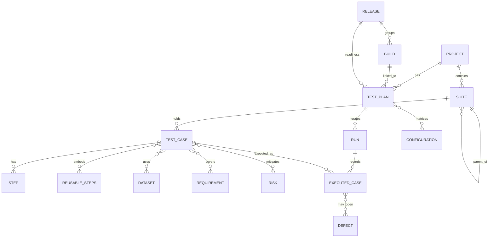

# TestCollab — Competitive TMS Research

Research date: 2026-11-14. Prefer primary sources (testcollab.com, developers.testcollab.com, help center). Prices and plan gates verified against the public pricing page and vendor comparison materials checked around October–November 2026.

---

## 1. Overview

**Vendor:** Test Collab Soft Inc. (product: TestCollab). Marketing site: [testcollab.com](https://testcollab.com). Developer docs: [developers.testcollab.com](https://developers.testcollab.com). Help center under `/help`.

**Deployment:** Primarily **cloud SaaS** (US default API `https://api.testcollab.io`; EU region `https://api-eu.testcollab.io`, Frankfurt). **Enterprise** adds private deployment: self-host in the customer’s **own AWS account**, or a managed single-tenant instance. There is also a **Jira Cloud app** (“TestCollab - Test management for Jira”) on the Atlassian Marketplace for bidirectional sync inside Jira. Full on-prem outside AWS (arbitrary datacenter) is **not** the published self-host model; AWS-only self-host is the Enterprise option.

**Target users:** QA engineers, SDETs, engineering managers, agile teams, and regulated/compliance teams who need structured cases, plans, traceability, and evidence. Positioned as an all-in-one TMS with optional AI (QA Copilot), built-in requirements/defects on higher tiers, and CI reporting via CLI.

**License model.** **Closed source** (proprietary commercial SaaS). Paid Premium/Elite plans; no public product source repository found. Not open source or open core. Source: [testcollab.com/pricing](https://testcollab.com/pricing).

**Pricing tiers** (checked 2026-11-14 from [pricing](https://testcollab.com/pricing) and help article on pricing structure):

| Plan | Published price | Notes |
| --- | --- | --- |
| **Premium** | **US$29**/user/month billed yearly; **US$35** billed monthly | Volume: ~US$21/user/month yearly at 50 seats |
| **Elite** | **US$39**/user/month billed yearly; **US$45** billed monthly | Volume: ~US$31/user/month yearly at 50 seats |
| **Enterprise** | Custom quote | SSO/SCIM, audit log, 2FA, password policies, US/EU residency, SQL export, self-host AWS |

Seat packages start at **2 users** (named licenses). Public read-only links for plans/dashboards do not consume seats; discounted read-only licenses available from 50+ seats. Taxes not included. Payment: major credit cards; bank transfer/invoice for larger annual deals.

**Free trial / free plan:** **14-day free trial**, no credit card required (marketing claims up to 10 users / full access in under 2 minutes). **No free plan** found on the pricing page.

Sources: [Pricing](https://testcollab.com/pricing), [Understanding pricing](https://testcollab.com/help/article/understanding-testcollab-s-pricing-structure-a-guide-to-choosing-the-right-plan), [llms-full.txt](https://testcollab.com/llms-full.txt), [TestRail alternative (prices dated Oct 11, 2026)](https://testcollab.com/testrail-alternative).

---

## 2. Data model and entities

Core glossary from [What is TestCollab?](https://testcollab.com/help/article/what-is-testcollab) and feature/help docs:

| Entity | What it is | Key fields / notes |
| --- | --- | --- |
| **User** | Named seat with profile, role, permissions | API token owner; assignee for plans/executions |
| **Project** | Top-level workspace | Members, cases, plans, settings (review, statuses, completion criteria) |
| **Suite** | Hierarchical folders for cases | Title (unique identifier), parent/child tree, drag/move, trash; reusable/shared suites across projects (plan-gated) |
| **Test case** | Authored scenario with steps | Business ID (e.g. `TC-42`), title, steps + expected results, suite, tags, custom fields, priority, attachments, version/revision history, review status |
| **Steps** | Ordered increments inside a case | Step text, optional expected result; step- or case-level execution status |
| **Reusable steps** | Shared step sets linked into cases | Title, steps/expected; edits propagate until unlinked; cannot delete while referenced |
| **Parameters / datasets** | Data-driven placeholders `{{name}}` | Dataset name, parameter columns, rows; one result per row at execution (Elite+) |
| **Tag** | Label for filtering / CI selection | e.g. curated CI tag, or auto-create’s `CI Imported` |
| **Test plan** | Group of cases for a goal/cycle | Folder, assignees, start/due dates, configurations, status (Not Started / In Progress / Done), completion criteria, public share link |
| **Test plan folder** | Organisation for plans | e.g. auto-create’s `CI` folder |
| **Run (regression / test plan run)** | Re-execution iteration of a plan | Multiple runs when cases must be retested; latest run gates starting a new one if completion criteria unmet |
| **Executed test case** | Result record in a run (+ config) | Status, assignee, comments, attachments/evidence, time taken, run mode (manual / CI / API) |
| **Configuration** | Matrix dimensions on a plan | e.g. Browser × OS → cartesian combinations without duplicate plans |
| **Build** | Version under test from CI | Version/ID, environment, commit, pipeline URL; Elite+ release grouping |
| **Release** | Grouping of builds + plans for readiness | Version pattern matching builds; GO/NO-GO thresholds (Elite+) |
| **Requirement** | Story/feature linked for coverage | From Jira/GitLab/Azure (Premium+) or built-in manager (Elite+); RTM coverage |
| **Defect / issue** | Failure report | Pushed to external trackers or built-in issue manager (Elite+); linked to failed case/step |
| **Risk** | Risk-register entry (Elite+) | `RK-` ID, likelihood × impact → exposure band, type, status, owner, links to cases/requirements/defects |
| **Custom fields** | Extensible properties | Types: text, textarea, editor, dropdown, multi-choice, date, number, URL, user; for cases/plans (all plans); issues/requirements (Elite+) |
| **Attachments / evidence** | Files on cases or executions | Screenshots, screen recordings (tab/window/fullscreen), CI attachments via JUnit markers |
| **Activity / audit** | Change and access logs | Activity logs on plans; full audit log on Enterprise |
| **Baselines** | Named frozen snapshot of a suite/library | **not found in docs** as a first-class “baseline” entity (versioning is per-case revision history) |

Sources: [What is TestCollab?](https://testcollab.com/help/article/what-is-testcollab), [Managing test suites](https://testcollab.com/help/article/managing-test-suites), [Reusable steps](https://testcollab.com/help/article/reusable-steps), [Parameters & datasets](https://testcollab.com/help/article/parameters-test-datasets-overiew), [Custom fields](https://testcollab.com/help/article/custom-fields), [Risk-based testing](https://testcollab.com/features/risk-based-testing), [llms-full.txt](https://testcollab.com/llms-full.txt).

---

## 3. Relationships and flows

**Typical links**

- Project → Suites (tree) → Test cases → Steps / reusable steps / datasets  
- Requirements ↔ Test cases (coverage); Risks ↔ cases / requirements / defects  
- Test plan ← selected cases (+ optional CI tag filter); plan → configurations → executed instances  
- Plan → Runs → Executed test cases → Defects / evidence  
- Build ← CI (`createBuild` / `--build`); Release ← builds matching version pattern + linked plans → GO/NO-GO  

**End-to-end workflow (manual):** Author cases in suites → (optional) review/approve → create plan, pick cases, set dates/configs, assign → execute (step- or case-wise), attach evidence/file defects → plan status moves by completion criteria → report/share/export → optional release dashboard.

**CI workflow (standard):** Tag cases → `tc createTestPlan` → runner writes JUnit/Mochawesome → `tc report --test-plan-id` (IDs in test names) → optional `tc gate` / `tc createBuild`.

**CI workflow (auto-create shortcut):** Runner → `tc report --auto-create` creates suites/cases/plan from file (see §5).

**Case versioning:** Change log with revisions; view diff vs previous; revert creates a new revision. ([Test case versioning](https://testcollab.com/help/article/test-case-versioning))

**Review/approval (Elite+):** Project toggle “Enable Review System”; optional “Approval is mandatory” with primary/secondary reviewers. Review statuses: **Approved**, **Review pending**, **Update requested**, **Rejected**. Unapproved cases cannot join plans, be bulk-copied, etc.; rejected new cases auto-delete after 7 days; reject of an edit reverts to last approved revision. ([Reviews](https://testcollab.com/help/article/enabling-reviews-approvals-for-a-project), [Review status](https://testcollab.com/help/article/review-status-and-their-impact-on-test-cases))

**Execution statuses:** Locked: Unexecuted, Passed, Failed; Skipped; custom statuses with color/priority (priority drives roll-up when steps differ). Plan completion statuses are configurable (e.g. only Passed counts as Done). ([Custom execution statuses](https://testcollab.com/help/article/create-manage-custom-execution-statuses), [Completion criteria](https://testcollab.com/help/article/configuring-test-plan-completion-criteria))

---

## 4. Full feature list

**Test authoring:** Rich editor with expected results, attachments, data tables; hierarchical suites; reusable steps (link/unlink); reusable/shared suites; parameters/datasets (`{{param}}`); templates/cloning/bulk edit; test case versioning (Premium+); review/approval (Elite+); BDD/Gherkin via one-way **Git sync** (`tc sync` — repo is source of truth; features→suites, scenarios→cases); AI generation from requirements/screenshots/page (Elite+, human review queue). Call-to-test as a separate named feature: **not found in docs** (reusable steps/suites cover reuse).

**Organisation:** Projects, suite tree, tags, custom fields, saved filters, plan folders, risk register (Elite+).

**Execution:** Manual runner (web; marketing also says “mobile test execution”); step- or case-wise status; timers/time tracking; assignment (one tester, auto-divide, or per case); configurations matrix; screen recording evidence; To-Do list; capacity/burndown/workload; UAT via email invite + public links; QA Copilot can be assigned like a tester (Elite+).

**Traceability / coverage:** Link requirements from Jira/GitLab/Azure; built-in requirements manager (Elite+); RTM with gap flagging; risk-to-test coverage; never-run cases on dashboard; release GO/NO-GO (Elite+).

**Reporting / dashboards (built-in themes from product pages):** Project dashboard (pass/fail/skip/block over time; **cases that fail most often**); custom reports (charts/tables by status, priority, custom field; pin to dashboard); test plan summary; run history; burndown/workload; requirement traceability matrix; release dashboard (Elite+); risk coverage by band; export CSV/PDF; public read-only links for plan/dashboard (release on Elite). Smart metrics listed as **Coming Soon** on pricing compare in places.

**Search / filters:** Advanced filters combining tags, fields, text; saved filter presets; custom fields markable “used as filter”. Dedicated query language (e.g. JQL-like): **not found in docs**.

**Import / export:** CSV/XLSX import with field mapping; TestRail CSV importer (sections→suites, References→requirements); marketing also mentions qTest/other tools; export PDF/Excel/CSV; Enterprise SQL dump. JUnit/XML as *library* import formats: result upload is CI-oriented (see §5), not a general case-library XML import.

**Audit / permissions / SSO:** Custom roles; activity logs (Premium shows limited retention in compare tables, e.g. 7 days vs unlimited on higher); Enterprise: audit log, SSO (Okta & Entra ID), SCIM 2.0, 2FA, password policies. SOC 2 Type II; HIPAA ready (vendor claim).

**AI:** QA Copilot — generate, automate plain English, run/heal, evidence (Elite+). MCP server (`@testcollab/mcp-server`, MIT) for AI assistants — cases/suites/plans (every plan per marketing).

**Localisation:** Specific UI language pack list: **not found in docs**.

**Mobile / offline:** “Web and mobile test execution” on features page (execution surface / testing mobile apps — not a documented native TMS mobile app). **Offline / PWA:** **not found in docs**.

Sources: [Features](https://testcollab.com/features), [Test management tool](https://testcollab.com/test-management-tool), [Pricing compare](https://testcollab.com/pricing), [BDD](https://testcollab.com/features/bdd-testing), [MCP](https://testcollab.com/integrations/mcp-server).

---

## 5. Automation and CI

**Critical answer — auto-create test cases from CI results?**

**Yes.** Optional CLI flag `tc report --auto-create` creates missing suites and test cases (and a plan) from a JUnit XML or Mochawesome JSON file. It is a **zero-setup shortcut**, not the recommended long-term path. Standard path: curated CI tag → `tc createTestPlan` → `tc report --test-plan-id` (no auto-create). `--auto-create` and `--test-plan-id` are **mutually exclusive**.

**Matching rules (auto-create):**

1. **ID-assisted:** Test title contains `[TC-42]`, `TC-42`, `id-42`, or `testcase-42` → look up that case ID; reuse and tag. If ID missing → fall back to title match then create.
2. **Title match (same leaf suite):** Exact match after lowercase, trim, collapse whitespace — **not fuzzy**. Title drift creates duplicates.
3. **Suite nesting:** Nested JUnit/Mochawesome paths humanized into suite titles (strip packages/extensions/`Tests`/`Spec`, split camelCase).
4. **Creations:** Tag `CI Imported` (once/project); missing suites; missing cases; plan folder `CI`; new plan `CI Run: DD-MM-YYYY HH:MM` every invocation; optional build from `--build`.
5. **Plan membership caveat:** Auto-created plans select **all** project cases with `CI Imported`, not only this file’s tests — older imports can appear as unexecuted; mitigate with `--skip-missing` or graduate to curated tags.
6. **Limits:** One result file per command (merge shards first); no plan reuse mode; **no configurations** on auto-created plans; no release creation; exact titles only; permissions must allow create/edit.

**Without auto-create:** Matching is by explicit case ID in the test name against executions already on the plan; unmatched results do not invent cases.

**Result formats:** **JUnit XML** and **Mochawesome JSON** only (documented). Frameworks via JUnit: Playwright, pytest, Jest, JUnit/TestNG, Robot, PHPUnit, Selenium, Cucumber (via JUnit), WebdriverIO, TestCafe, Newman, Behave, Go, Kaspresso, etc. Cypress via Mochawesome. Native Allure / NUnit / Cucumber JSON as first-class CLI formats: **not found in docs** (may work only if converted to JUnit).

**CLI / SDK:** `@testcollab/cli` (`tc`): `sync`, `createBuild`, `createTestPlan`, `getTestPlan`, `report`, `reportCase`, `gate`. JS SDK `@testcollab/sdk`. Evidence: JUnit `[[ATTACHMENT|path]]` markers (≤10 files/case, ≤10 MB/file).

**CI integrations:** Documented recipes for GitHub Actions, GitLab CI, Azure Pipelines, Bitbucket Pipelines, Jenkins, CircleCI — any Node.js 18+ runner. TestCollab does **not** host or trigger the test runner.

**Flaky detection:** Dashboard lists **cases that fail most often**; `tc gate` supports `--max-failed` / `--min-pass-rate` for tolerance. Dedicated flaky quarantine/marking feature: **not found in docs**.

**Run merging:** Multiple uploads can target a plan; shards must be merged before one `report` file, or handled carefully across uploads. Auto-create always creates a **new** plan.

Sources: [Zero-setup auto-create](https://testcollab.com/help/article/zero-setup-ci-reporting-with-tc-report-auto-create), [CI/CD pipeline guide](https://testcollab.com/help/article/automated-testing-in-a-ci-cd-pipeline-with-testcollab), [CLI overview](https://developers.testcollab.com/cli/overview/), [Test automation feature](https://testcollab.com/features/test-automation), [CLI auto-create.md](https://github.com/TCSoftInc/testcollab-cli/blob/develop/docs/auto-create.md).

---

## 6. API

**Type:** REST (documented HTTP + JavaScript SDK). GraphQL: **not found in docs**.

**Base URLs:** `https://api.testcollab.io` (default); `https://api-eu.testcollab.io` (EU).

**Auth:** User **API token** from My Profile → API Token. HTTP: `token` **query parameter** (redact URLs in logs). SDK/CLI use env `TESTCOLLAB_TOKEN`; MCP uses `TC_API_TOKEN`. Permissions = token owner’s project roles.

**Rate limits:** Explicit numeric quotas per plan: **not found in docs** beyond “respect rate limits”; HTTP **429** with optional `Retry-After`; Enterprise “higher quotas” (MCP FAQ).

**Pagination:** Query `_limit`, `_start`, plus `_sort`, `_filter` (stringified filter object) — e.g. `GET /testcases`.

**Webhooks:** Project webhooks (admin); up to 100 endpoints; HMAC-SHA256 signed envelope; events include `test_case.*`, `suite.*`, `test_plan.*` (incl. status/archive), `executed_test_case.status_changed` / `.assigned`, `test_plan_run.created`; at-least-once delivery with retries.

**Main endpoint groups** (from [API overview](https://developers.testcollab.com/api/overview/)):

| Area | Operations (illustrative) |
| --- | --- |
| Projects and people | Projects, members, activity, tasks |
| Cases and suites | Cases CRUD, suites, tags, datasets, reusable steps, revisions |
| Plans and runs | Plans, folders, configurations, assignment, plan cases, regressions/runs |
| Execution and evidence | Executed cases update, comments, uploads |
| Builds, releases, reports | Builds, readiness, defects, saved-report results |

Reference: [developers.testcollab.com/api/overview](https://developers.testcollab.com/api/overview/), [Authentication](https://developers.testcollab.com/get-started/authentication/), [Get test cases](https://developers.testcollab.com/api/operations/get-test-cases/), [Webhooks](https://testcollab.com/help/article/webhook-events-and-signature-verification).

---

## 7. Integrations

**Issue trackers:** Jira (Cloud bidirectional plugin / Marketplace app), GitHub Issues, GitLab (cloud & self-managed), Azure DevOps Boards, ServiceNow, Asana, Linear, ClickUp. Elite can link **multiple** issue managers per company; built-in issue + requirement managers on Elite+.

**CI/CD:** GitHub Actions, GitLab CI, Jenkins, Azure Pipelines, Bitbucket Pipelines, CircleCI (+ any Node shell).

**Automation frameworks:** Via CLI formats — Playwright, Cypress, Jest, pytest, TestNG/JUnit, Robot, Selenium, Katalon, Cucumber (JS/JVM via supported reporters), etc.

**Chat:** **Slack** notifications (plan/case events, comments). Microsoft Teams as a first-party integration: **not found in docs** (vendor comparison notes Teams more on TestRail).

**SSO:** Enterprise — Microsoft Entra ID and Okta; SCIM 2.0 provisioning (Entra); one active IdP per company; map groups/roles.

**Marketplace / AI:** Atlassian Marketplace Jira app; npm CLI/SDK/MCP; open-source MCP on GitHub.

Sources: [Integrations](https://testcollab.com/integrations), [SSO](https://testcollab.com/features/sso), [Jira Marketplace reviews](https://marketplace.atlassian.com/apps/1225036/testcollab-test-management-for-jira?tab=reviews).

---

## 8. Marketing positioning

Headline themes from home/features/`llms-full.txt`:

- “AI-powered test management” / ship faster with QA Copilot (generate, automate, heal).  
- All-in-one: manual + automation results + requirements + defects + release GO/NO-GO.  
- Versions and approvals **without** forcing Enterprise (vs TestRail packaging narrative).  
- Transparent per-user pricing from two seats; public stakeholder links without seats.  
- SOC 2 Type II, HIPAA ready; Enterprise SSO/SCIM/self-host AWS.  
- BDD with Git as source of truth; CLI + MCP for CI and AI agents.  
- Trusted-by logos (e.g. Moody’s, OutSystems, Grubhub in vendor materials).

Differentiators stressed vs TestRail: built-in requirements/defects, screen recording, release verdict dashboard, MCP GA, unlimited storage claim, versions at Premium.

Sources: [Home](https://testcollab.com/), [Features](https://testcollab.com/features), [TestRail alternative](https://testcollab.com/testrail-alternative), [llms-full.txt](https://testcollab.com/llms-full.txt).

---

## 9. What users love

Themes from **G2** (~4.4/5, ~37 reviews; ease of use ~8.9, setup ~9.3, support ~9.1 per secondary summaries) and **Atlassian Marketplace** (~4.5/5, 19 cloud reviews):

1. **Ease of use / clear structure** — Plans, dashboards, and case organisation feel approachable for non-QA stakeholders too.  
2. **Centralised cases replacing spreadsheets** — Single source of truth for runs and history.  
3. **Jira bidirectional sync** — Failed tests → tickets with less double entry.  
4. **Compliance / audit trail** — Timestamped executions and RBAC for regulated teams.  
5. **Support responsiveness** and steady product iteration (datasets, BDD, QA Copilot).  
6. **AI direction** (Marketplace) — useful for early planning; improving over time.

**Quoted snippets**

- G2 (Keith S., banking, Jan 2026, via G2 IT mirror): *“the lack of flexibility of TestCollab is its greatest advantage… an immutable, timestamped log of every test execution… Jira integration creates a bulletproof chain of custody from the failed test case to the linked Jira ticket.”* ([G2 reviews](https://www.g2.com/products/testcollab/reviews))  
- G2 (Nicola B.): *“Ease of use is fantastic… Creating tickets in Jira from failed tests… saved us a lot of time.”* (same source)  
- Atlassian Marketplace (Mark Thompson, Jan 2026): *“The Jira integration works well… The new AI-based test case generation feature is quite useful and saves time… generated test cases still need some refinement.”*  
- Marketplace (Aisha Rahman, Nov 2025): *“seamless integration with Jira… customer support team is incredibly responsive.”*

Sources: [G2](https://www.g2.com/products/testcollab/reviews), [Marketplace reviews](https://marketplace.atlassian.com/apps/1225036/testcollab-test-management-for-jira?tab=reviews), [Kualitee secondary summary of G2 themes](https://www.kualitee.com/review/testcollab-review/). Capterra: **0 reviews** at check time.

---

## 10. What users dislike

Recurring G2 themes (counts from secondary aggregation of G2): **inadequate/custom reporting**, limited customisation, learning curve, limited features/integrations depth.

**Quoted snippets**

- G2 (Keith S.): *“Reporting is good enough for compliance, but we have to manually configure the report format to get the ‘Release Readiness Certificate’ (PDF)… red team finds predefined Steps and Expected Results too limiting for improvised security scripts.”*  
- G2 (Marty M.): *“more custom configuration needed for integration with our CI/CD pipeline than I expected.”*  
- G2 (Amy G. / Jacqueline D. themes): *“reporting functions could be more advanced”* / *“manually gather data to create a client report showing test progress over time.”*  
- Marketplace (Soo-Min Park, Nov 2025): *“I do hope they introduce custom reports soon.”* (note: product now advertises custom report widgets — perception lag or unmet depth).  
- Packaging friction (secondary): AI, approvals, built-in requirements/defects, datasets, risk, release dashboard gated to **Elite+**; SSO/audit to **Enterprise**; trial only 14 days / no free tier.

Sources: same review URLs as §9; [Pricing](https://testcollab.com/pricing) for gate confirmation.

---

## 11. Ideas for Vulyk

Vulyk context: open-source self-hosted TMS (folders/cases/plans/runs, CI ingest, campaigns/iterations, requirements, Jira/OpenProject, reports/flaky, RBAC/SSO, LLM, MCP, importers, PWA offline).

1. **Ship first-class CI auto-create with documented matching** — TestCollab’s `[TC-id]` + suite-scoped exact title match + explicit `--auto-create` is a strong onboarding story. Vulyk should expose the same clarity: match order, normalisation rules, and duplicate risks, plus a “curated tag” path that does **not** pollute membership with a global import tag.  
2. **Avoid the `CI Imported` plan-scope pitfall** — Auto-plans that pull *all* historically tagged cases surprise users and break gates. Prefer plan membership = this upload’s set (or explicit filter), with optional “include prior imports.”  
3. **Two result formats is thin** — Prefer broader ingest (JUnit, Allure, Cucumber JSON, Robot, NUnit, etc.) as Vulyk differentiator vs TestCollab’s JUnit/Mochawesome-only CLI.  
4. **Quality gates in CLI** (`fail-on`, pass-rate, wait-for-manual) are copy-worthy for release automation alongside Vulyk’s campaigns/iterations.  
5. **Public read-only plan links without seats** — Strong commercial UX; for OSS, “share token / guest view” reduces friction for OpenProject/Jira stakeholders.  
6. **Case versioning + optional mandatory review** without burying them behind Enterprise-style tiers (Vulyk AGPL already differentiates on access).  
7. **Lean into PWA offline** — TestCollab has no documented offline; field/UAT offline execution is a clear Vulyk wedge.  
8. **Flaky as a first-class entity** — They only surface “fail most often”; Vulyk’s flaky reports should beat that with quarantine, history, and CI annotations.  
9. **MCP + LLM already on their roadmap** — Match/interop: keep Vulyk MCP and importers competitive; don’t cede “AI agents talk to TMS” to closed SaaS.  
10. **Self-host without AWS lock-in** — Their Enterprise self-host is AWS-centric; Vulyk’s generic Docker/Postgres install remains a selling point for regulated teams who disliked cloud-only or AWS-only options in reviews.  
11. **Reporting depth** — Reviews repeatedly ask for customisable stakeholder reports; invest in composable reports/exports early so Vulyk doesn’t inherit the #1 complaint.

---

## 12. Sources

- https://testcollab.com/  
- https://testcollab.com/pricing  
- https://testcollab.com/features  
- https://testcollab.com/llms-full.txt  
- https://testcollab.com/test-management-tool  
- https://testcollab.com/features/test-automation  
- https://testcollab.com/features/bdd-testing  
- https://testcollab.com/features/risk-based-testing  
- https://testcollab.com/features/sso  
- https://testcollab.com/features/requirements-traceability-matrix  
- https://testcollab.com/features/release-dashboard  
- https://testcollab.com/integrations  
- https://testcollab.com/integrations/mcp-server  
- https://testcollab.com/testrail-alternative  
- https://testcollab.com/help/article/what-is-testcollab  
- https://testcollab.com/help/article/understanding-testcollab-s-pricing-structure-a-guide-to-choosing-the-right-plan  
- https://testcollab.com/help/article/managing-test-suites  
- https://testcollab.com/help/article/reusable-steps  
- https://testcollab.com/help/article/parameters-test-datasets-overiew  
- https://testcollab.com/help/article/custom-fields  
- https://testcollab.com/help/article/test-case-versioning  
- https://testcollab.com/help/article/enabling-reviews-approvals-for-a-project  
- https://testcollab.com/help/article/review-status-and-their-impact-on-test-cases  
- https://testcollab.com/help/article/create-manage-custom-execution-statuses  
- https://testcollab.com/help/article/configuring-test-plan-completion-criteria  
- https://testcollab.com/help/article/automated-testing-in-a-ci-cd-pipeline-with-testcollab  
- https://testcollab.com/help/article/zero-setup-ci-reporting-with-tc-report-auto-create  
- https://testcollab.com/help/article/testcollab-cli-command-reference  
- https://testcollab.com/help/article/set-up-project-webhooks  
- https://testcollab.com/help/article/webhook-events-and-signature-verification  
- https://testcollab.com/help/article/importing-test-cases-from-testrail  
- https://testcollab.com/help/article/automation-of-test-cases-using-testcollab-api  
- https://developers.testcollab.com/api/overview/  
- https://developers.testcollab.com/get-started/authentication/  
- https://developers.testcollab.com/cli/overview/  
- https://developers.testcollab.com/api/operations/get-test-cases/  
- https://developers.testcollab.com/sdk/errors/  
- https://github.com/TCSoftInc/testcollab-cli/blob/develop/docs/auto-create.md  
- https://www.g2.com/products/testcollab/reviews  
- https://marketplace.atlassian.com/apps/1225036/testcollab-test-management-for-jira?tab=reviews  
- https://www.capterra.com/p/10021096/TestCollab/  
- https://www.kualitee.com/review/testcollab-review/  
