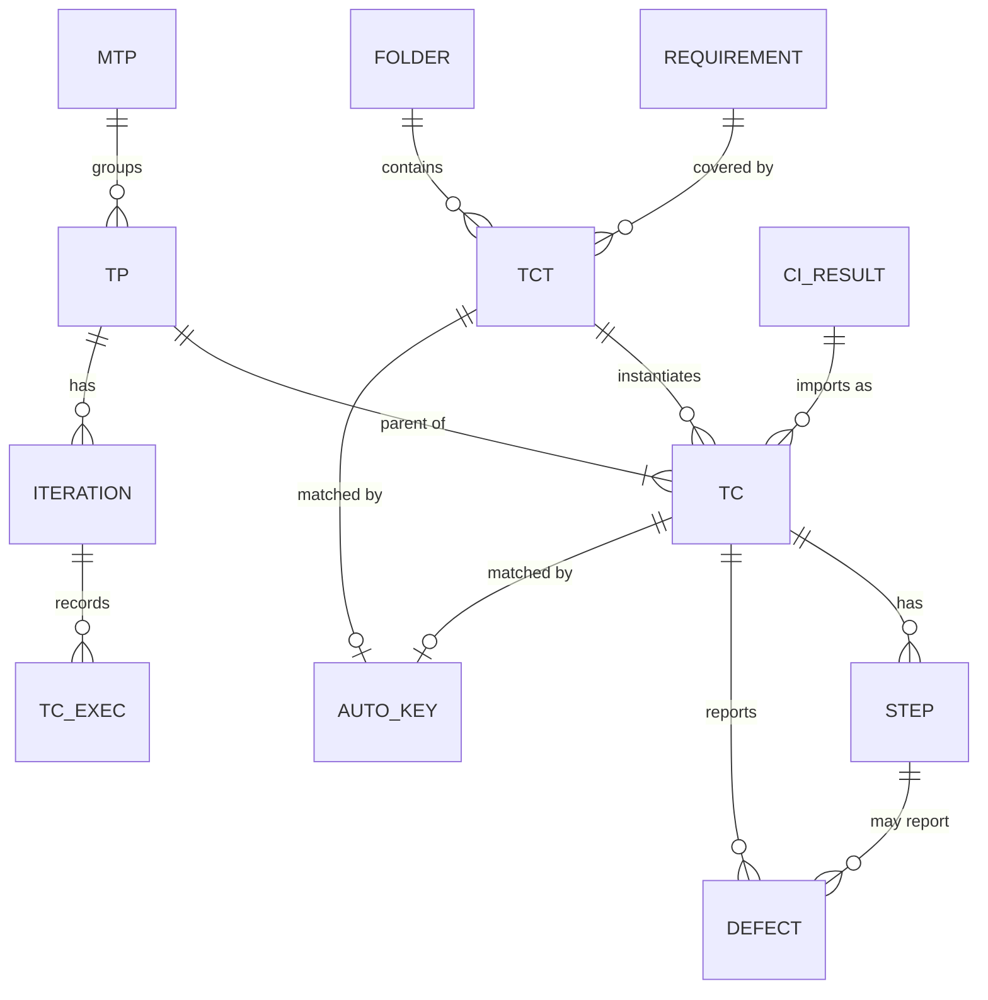

# TestFLO (Deviniti) — Competitive TMS Research

Research date: **2026-11-14**. Primary sources: Deviniti docs, Atlassian Marketplace, Jenkins plugin docs, SwaggerHub public API, Marketplace/community reviews. Cloud equivalent noted where relevant (RTM), but this report focuses on **TestFLO** (Server / Data Center).

---

## 1. Overview

**Vendor:** Deviniti (Wrocław, Poland; Atlassian partner). Product: **TestFLO – Test Management for Jira**.

**Deployment:** Jira **Server** and **Data Center** app (Marketplace app id `1211393`). Not a standalone SaaS TMS. As of late 2026 it lists compatibility with Jira Server 9.0.0–9.17.5 and Jira Data Center 11.0.0–11.3.x. There is **no TestFLO for Jira Cloud**; Deviniti’s Cloud product is **Requirements & Test Management (RTM)** for Jira, with a JCMA migration path from TestFLO → RTM.

**Target users:** QA / test teams already on self-managed Jira who want test management *inside* Jira issues (boards, JQL, workflows, permissions). Strong fit for regulated / compliance-oriented processes (custom workflows, optional Electronic Signature for Jira for 21 CFR Part 11–style sign-off). Also used by teams that want Jenkins/Bamboo-triggered automation results landed as Jira Test Cases.

**License model.** **Closed source** (proprietary commercial Atlassian Marketplace app by Deviniti). Paid via Atlassian for Jira Server/Data Center (and Cloud where offered). No public product source repository found. Not open source or open core. Source: [TestFLO Marketplace](https://marketplace.atlassian.com/apps/1211393/testflo-test-management-for-jira).

**Pricing (Data Center, annual, as published by Deviniti; checked 2026-11-14):**

| Users | Current list (pre–16 Jul 2026) | New list (effective **16 Jul 2026**) |
| --- | ---: | ---: |
| 11–50 | $1,541.80 | $2,312.70 |
| 51–100 | $3,597.10 | $5,035.94 |
| 101–250 | $7,194.20 | $9,352.46 |
| 251–500 | $12,334.40 | $12,334.40 |
| 501–750 | $16,445.00 | $17,267.25 |
| … | … | … (scales to 150k+ users; large tiers rise sharply under new prices) |

Pricing is **per Jira user tier** via Atlassian Marketplace (paid via Atlassian). Exact live Marketplace dollar amounts for every tier should be confirmed on the listing at purchase time; Deviniti’s updated-pricing page is the published source for the July 2026 change.

**Trial / free plan:** **30-day Data Center trial** (one trial per customer; vendor may extend). No perpetual free plan found. Product page: “Start your 30-day free trial.”

**Install footprint (third-party aggregator Ampin, ~2026):** on the order of **~200 installs**, **~47 reviews**, average rating ~**4.3/5** (Marketplace UI did not expose raw counts in fetch; treat Ampin as secondary).

Sources: [Deviniti product page](https://deviniti.com/products/atlassian-apps/testflo-test-management-for-jira/), [updated pricing](https://deviniti.com/testflo-test-management-for-jira-updated-pricing/), [Marketplace](https://marketplace.atlassian.com/apps/1211393/testflo-test-management-for-jira), [overview docs](https://deviniti.com/support/addon/server/testflo-92/latest/overview/).

---

## 2. Data model and entities

TestFLO models almost everything as **native Jira issue types** plus custom fields. That is the core design choice.

| Entity | What it is | Key fields / notes |
| --- | --- | --- |
| **Project** | Standard Jira project; TestFLO modules (repository, execution, requirements, automation) enabled per project | Project settings: General (Steps/Preconditions), Requirements, Test Execution, Test Automation, Permissions |
| **Test Repository / folders** | Tree of folders holding **Test Case Templates** | Uncategorized / All roots; folder path; drag-drop; counts; JQL folder search helpers |
| **Test Case Template (TCT)** | Non-executable reusable specification (Jira issue) | Summary, Steps, Preconditions, Requirement link, Test Repository folders, Automation Test Key (optional), workflow/status, labels/components/versions via Jira |
| **Test Case (TC)** | Executable instance; **sub-task of a Test Plan** | Parent TP, TC Template link, Steps (with statuses), Preconditions, Automation Test Key, assignee, defects links, Steps Progress |
| **Steps** | Custom field / panel on TCT & TC | Default columns: Action, Input, Expected result (configurable); groups; attachments; comments; step statuses (on TC); Wiki Markup |
| **Preconditions** | Custom field + optional **Preconditions repository** (shareable across projects) | Free text / reusable snippets from repository |
| **Shared steps / call-to-test** | **not found in docs** as first-class “call to test” / shared-step library | Closest: Preconditions repository; step groups; clone step within one issue |
| **Parameters / datasets** | **not found in docs** as data-driven datasets on cases | CI job custom parameters exist for automation runs; Jira custom fields can be used ad hoc |
| **Test Plan (TP)** | Aggregates TCs to execute (Jira issue) | TC panel, groups, order, Requirement links, TP Progress, iterations, Run automated tests |
| **Test Plan Iteration** | Re-execution cycle of (all or selected) TCs in a TP | Current vs new iteration; optional rename; Reset / Next iteration operations |
| **Master Test Plan (MTP)** | Optional parent grouping multiple TPs for one goal | Links to child Test Plans; progress overview |
| **Requirement** | Any configured Jira issue type (Story, Epic, custom, etc.) | Linked via Enhanced Issues Picker / Requirement field; coverage panels |
| **Defect** | Any configured Jira issue type | Creatable/linkable from TC or from a failed **step** |
| **Configurations / environments** | **not found in docs** as first-class entity | Use Jira custom fields / Environment field on issues if configured by admin |
| **Custom fields** | Full Jira custom fields + TestFLO fields (Steps, Preconditions, Automation Test Key, TP Progress, Steps Progress, TC Template, etc.) | Screens/workflows as in Jira |
| **Attachments** | Jira issue attachments + **per-step** attachments | Paste image into Steps cells attaches to issue |
| **Tags / labels** | Jira Labels, Components, Fix Version | Used for categorization at scale |
| **Versions / baselines** | Jira Fix Version / history; PO notes “snapshots” on workflow transition | Formal baseline product feature beyond Jira history: **not found in docs** as named baselines |

Sources: [Basic concepts](https://deviniti.com/support/addon/server/testflo-92/latest/basic-concepts/), [Glossary](https://deviniti.com/support/addon/server/testflo-812/latest/glossary/), [Test Repository](https://deviniti.com/support/addon/server/testflo-92/latest/test-repository/), [Steps design](https://deviniti.com/support/addon/server/testflo-92/latest/steps-design/).

---

## 3. Relationships and flows

### Entity relationships

### Typical end-to-end workflow

1. Define **requirements** (any Jira issue types configured as requirements).
2. Author **Test Case Templates** with Steps/Preconditions; organize in **Test Repository** folders.
3. Create a **Test Plan** (manually, from folder, or “Create Test Plan with grouped TCs” mirroring folder tree).
4. TCs are created from TCTs under the TP (sub-tasks); optionally grouped and ordered.
5. **Execute** TCs (manual status/step status) or **Run automated tests** (Jenkins/Bamboo).
6. Failed cases/steps → **defects**; monitor via reports and panels.
7. Optional **next iteration** for retest; optional **Master Test Plan** across teams.

### Case versioning / review / approval

- TCs not yet started can be **updated from TCT** (or from TP field changes) via Update Test Cases.
- Issue **History** holds change history; Deviniti PO has described **snapshots** on workflow transitions as a version-like freeze.
- Formal multi-stage review/approval is achieved via **custom Jira workflows** (and optionally **Electronic Signature for Jira** for CFR 21 Part 11–style sign-off)—not a separate TestFLO “approval product” UI.

### Statuses

- **Issue statuses:** fully customizable Jira workflows for TCT / TC / TP / MTP.
- **Step statuses:** configured per project (name, color, “is final”); progress metrics use configured “passed”/final statuses.
- **Cucumber mapping:** project automation settings map Cucumber Passed/Failed/Skipped → Steps statuses.

Sources: [Basic concepts](https://deviniti.com/support/addon/server/testflo-92/latest/basic-concepts/), [Reporting overview](https://deviniti.com/support/addon/server/testflo-813/latest/reporting-and-tracking/), [General tab](https://deviniti.com/support/addon/server/testflo-92/latest/general-tab/).

---

## 4. Full feature list

**Test authoring**

- Steps editor with configurable columns; Wiki Markup; groups; clone/reorder; per-step attachments; CSV/JSON import & CSV export of steps.
- Preconditions field + shareable Preconditions repository.
- No dedicated BDD/Gherkin scenario editor found; Cucumber is supported as **result import** (JSON), not as primary authoring UX.
- Shared steps / call-to-test: **not found in docs**.
- Parameterized/data-driven cases: **not found in docs** as first-class datasets.

**Organisation**

- Test Repository folder tree; create TP from folders; add folder contents to existing TP; Basic + Advanced (JQL) search in repository.
- Labels, Components, Fix Version, custom fields for large suites.

**Execution**

- Manual execution on TC issues: step statuses, comments, defects; Test information panel for progress.
- Assign TCs (including bulk assign on TP historically documented); reorder TCs/groups; Next / Reset iteration.
- Timers: **not found in docs** as a dedicated test-timer feature (Jira time tracking can be used because TCs are issues/sub-tasks).
- Bulk: Jira bulk change via Issue Navigator from groups; Update Test Cases operation.

**Traceability & coverage**

- Requirement ↔ TCT / TP / TC / Defect panels (Coverage, Test Progress, Tests Under Execution, Defects).
- Built-in reports (below).

**Reporting / dashboards**

Built-in Test Reports:

1. Requirement Test Coverage Report  
2. Requirement Traceability Report  
3. Requirement Test Execution Report  
4. Test Plan Execution Report  
5. Test Plan Iterations Report  
6. Test Execution Report  

Plus Jira dashboards/gadgets over native issues; TP Progress / Steps Progress fields.

**Search / filters**

- Standard JQL + TestFLO JQL functions, e.g. `requirementsFromTCInTP()`, `templateInPlan()`, `templatesFromPlan()`, `requirementsWithDefects()`, `testRepoTreeShallowSearch()`, `testRepoTreeDeepSearch()`, `steps ~ …`.

**Import / export**

- CSV TCT importer / exporter; CSV Steps importer (bulk into existing TCTs); TestLink XML TCT importer (optional preserve suite tree).
- Steps CSV/JSON import/export on issue.
- JUnit/TestNG/NUnit XML and Cucumber JSON via automation path (see §5).

**Audit**

- Relies on **Jira issue history**, workflows, and (optionally) Electronic Signature for Jira. Dedicated TestFLO-only audit log product: **not found in docs**.

**Permissions / roles / SSO / SCIM**

- TestFLO Global Permissions (Manage Test Repository, Next Iteration, Reorder TCs, Reset Iteration, Run automated tests, Steps execution, Update Test Cases, Test Management project config, TestFLO Menu, etc.) + project overrides; grant to users/groups/project roles/application access.
- SSO/SCIM: inherited from **Jira** (not a separate TestFLO IdP). SCIM specifically: **not found in docs** for TestFLO itself.

**AI**

- **not found in docs** (no LLM authoring, flaky AI, etc. in TestFLO materials reviewed).

**Localisation / mobile / offline**

- Follows Jira UI language/capabilities. Dedicated TestFLO mobile app / offline PWA: **not found in docs**.

Sources: [Marketplace listing](https://marketplace.atlassian.com/apps/1211393/testflo-test-management-for-jira), [Permissions](https://deviniti.com/support/addon/server/testflo-812/latest/testflo-permissions/), [JQL functions](https://deviniti.com/support/addon/server/testflo-813/latest/jql-functions/), [Import/Export TCT](https://deviniti.com/support/addon/server/testflo-813/latest/import-export-tct/).

---

## 5. Automation and CI

### Supported result formats

Documented: **JUnit (XML)**, **TestNG (XML)**, **Cucumber (JSON only)**, **NUnit (XML)**.

**Robot, Allure, and other formats:** **not found in docs** as native importers.

### CI integrations / plugins

- **Jenkins:** official plugin *TestFLO - Test Management for Jira* (`testflo-for-jira-test-management-automation`) — post-build / pipeline `TestResultSenderBuildStep`.
- **Bamboo:** TestFLO Integration for Bamboo — Final task publisher.
- **GitHub Actions / GitLab CI / Azure DevOps / CircleCI:** no first-party plugins found; possible only via custom REST/scripting into TestFLO/Jira APIs (**not documented as turnkey**).

### How automated results map to cases — and auto-create

**Yes — TestFLO can auto-create Test Cases from CI results.** This is a first-class, documented behaviour.

**Matching key:** custom field **Automation Test Key**, built as a fully qualified test identity, e.g.:

`[package].[class].[method]` → `com.deviniti.jira.plugins.steps.StepsServiceTest.shouldSetStepsComment`

That key links CI tests ↔ TC / TCT. Docs also describe results landing with “appropriate **test names** and statuses,” with the durable link stored in Automation Test Key.

**Creation strategy options** (Jenkins/Bamboo parameter `testCaseCreationStrategy`, mirrored in the “Run automated tests” UI):

| Option | Behaviour |
| --- | --- |
| **CREATE_AND_UPDATE** / “Update and create new Test Cases” | Update TCs that already match; **create new TCs** for automated tests not yet on the Test Plan |
| **UPDATE_EXISTING** / “Update existing Test Cases” | Only update matching existing TCs; do not create new ones |

**Iteration options** (`targetIteration`):

- `CURRENT_ITERATION` — import into current TP iteration  
- `NEW_ITERATION` — create/import into a new iteration (with caveats if the plan has no TCs yet)

**Optional TCT auto-create** (project Test Automation config):

- Don’t create (default)  
- Create in current project  
- Create in another project (requires Test Repository enabled)  

If a matching TCT already exists for that Automation Test Key, it is **not** recreated. Created TCs get the TCT key in the **TC Template** field.

**Flows:**

1. Trigger from **Test Plan → Run automated tests** (select Jenkins job / Bamboo plan; choose iteration + create strategy). Results pulled back as TCs.  
2. Trigger **from CI** (push-driven) with default job parameters `testPlanKey`, `targetIteration`, `testCaseCreationStrategy`.  
3. Selective re-run: **Select Test Cases to run** sends Automation Test Keys to CI (`testflo.automationTestKeys`); when that mode is on, create-new is disabled (update-only).

**Limits / notes:**

- Requires a **pre-existing Test Plan** key; missing key → fail or skip the publisher task.  
- While an automated run is in progress, other TP operations are blocked. Multiple runs can be queued.  
- Bamboo Automation Test Keys parameter length: chunks of 4000 chars with indexed params.  
- Maven Surefire ≥ 2.22.2 called out for selective re-run; Windows Bamboo + spaces in method names is a known pain.  
- Cucumber step statuses mappable in project config.

**Flaky test detection:** **not found in docs**.

**Run merging:** Import into **current** vs **new iteration** is the documented merge/retest model—not a separate “merge runs” feature. Update strategy merges statuses onto existing TCs matched by Automation Test Key.

Sources: [Test Automation overview](https://deviniti.com/support/addon/server/testflo-812/latest/test-automation-overview/), [Run automated tests from Test Plan](https://deviniti.com/support/addon/server/testflo-92/latest/run-automated-tests-from-test-plan/), [Run from CI Server](https://deviniti.com/support/addon/server/testflo-92/latest/run-automated-tests-directly-from-ci-server/), [Automation Test Key](https://deviniti.com/support/addon/server/testflo-92/latest/automation-test-key/), [Jenkins plugin](https://plugins.jenkins.io/testflo-for-jira-test-management-automation), [Test Automation project configuration](https://deviniti.com/support/addon/server/testflo-813/latest/test-automation-project-configuration/).

---

## 6. API

**Type:** REST (TestFLO public API + heavy use of **Jira REST API** for issue CRUD).

**Base URL pattern (since TestFLO 8.1):**  
`$jira_context/rest/tms/1.0/api/$api_endpoint`  
(Older pattern still compatible; new pattern recommended.)

**Auth:** Uses Jira authentication (basic/session/PAT as configured for the Jira instance). Dedicated OAuth-only TestFLO auth: **not found in docs**.

**Rate limits / pagination / webhooks:** **not found in docs** for TestFLO-specific limits; Jira platform limits apply. No TestFLO webhook catalog found in reviewed docs.

**Reference:** [SwaggerHub TestFLO public API 8.9](https://app.swaggerhub.com/apis-docs/DevinitiApps/testflo-public-api/8.9.0) (also referenced as 8.9); Deviniti REST examples: [REST API docs](https://deviniti.com/support/addon/server/testflo-92/latest/rest-api/).

| Group | Operations (examples) |
| --- | --- |
| **Steps** | `PUT …/steps/statuses`, `PUT …/steps/status`, `POST …/steps/attachment`, `PUT …/steps/comment`, `PUT …/steps/cell` |
| **Test Repository** | `GET/POST/PUT/DELETE …/test-repository/{project}/folder` (by path or id) |
| **Test Plan** | `POST …/testplan/add-test-case-templates`, `GET/POST …/testplan/{id}/group`, `PUT …/group/{groupId}`, `GET …/test-case-ids/{key}`, `GET …/test-case-template-ids/{key}`, `POST …/moveToNextIteration`, `POST …/testplan/copy` |
| **Jira issue API** | Create/update TCT/TC with Steps/Preconditions/Requirement custom fields via `/rest/api/2/issue` |

---

## 7. Integrations

| Area | Support |
| --- | --- |
| **Issue trackers** | Native **Jira** only (requirements & defects are Jira issues). Azure Boards / Linear / etc.: **not found in docs** |
| **CI/CD** | **Jenkins**, **Bamboo** plugins; REST for custom |
| **Automation frameworks** | JUnit, TestNG, Cucumber JSON, NUnit via result files |
| **Chat (Slack/Teams)** | **not found in docs** (Jira notifications may apply) |
| **SSO** | Via Jira |
| **Marketplace / admin** | Atlassian Marketplace listing; **Configuration Manager for Jira** called out; JCMA migration to **RTM** on Cloud |
| **Compliance add-on** | **Electronic Signature for Jira** (separate Deviniti app) for sign-off |

Sources: Marketplace “More details,” [Bamboo integration](https://deviniti.com/support/addon/server/testflo-92/latest/bamboo-integration/), [Jenkins integration](https://deviniti.com/support/addon/server/testflo-90/latest/jenkins-integration/).

---

## 8. Marketing positioning

Headline claims (Marketplace / product pages):

- “The most flexible testing tool that adapts to restrictive environments.”
- “Manage requirements, plan and execute tests, document them and create reports, **directly in Jira**.”
- Scaling, flexibility, compliance; “most customizable” via Jira projects, screens, permissions, advanced workflows.
- Large-scale testing + DevOps: repository, REST automation, CI/CD connection.
- Full traceability requirements → tests → bugs; internal policies and external legal standards.
- Master Test Plan for multi-team goals; Jenkins/Bamboo for regression automation.

Differentiators vs typical SaaS TMS: **deep Jira-native issue model**, workflow customizability, regulated-process friendliness—not a separate UI outside Jira.

Sources: [Marketplace](https://marketplace.atlassian.com/apps/1211393/testflo-test-management-for-jira), [Overview](https://deviniti.com/support/addon/server/testflo-92/latest/overview/), [Product page](https://deviniti.com/products/atlassian-apps/testflo-test-management-for-jira/).

---

## 9. What users love

Themes from Marketplace reviews and vendor-quoted feedback:

1. **Quick, customer-oriented support / training** — “The support from the Deviniti is always quick and customer oriented…” (Małgorzata Grabiec, Marketplace / product page). “The support team is very fast responsive and helpful!” (Vicky Tu, Mar 2022).
2. **Easy install / time-to-value** — “The product was easy to install, configure, and get up and running producing value.” (Alexandrea Renn, Jun 2020). “Great Jira testing app! Easy to use, powerful, and a real time-saver…” (Iulius MAREK, Jul 2026).
3. **Test Plans + execution + automation together** — Grabiec: Test Plans/Cases for process documentation, and “TestFLO automation… works very well together.”
4. **Advanced structure / configurability** — “One of the best tools for test management with advanced test structures” (Kristian Faerber, product page).
5. **Native Jira fit** — entities on boards, JQL, dashboards (emphasized in docs and comparative write-ups).

Sources: [Marketplace reviews](https://marketplace.atlassian.com/apps/1211393/testflo-test-management-for-jira?tab=reviews), [product page quotes](https://deviniti.com/products/atlassian-apps/testflo-test-management-for-jira/).

---

## 10. What users dislike

1. **Jira lock-in / dual cost** — TestFLO requires paid Jira + app license; hard to use without Jira (third-party comparisons).
2. **Configuration lock-in & change friction** — Community comparison: “Most configurable choice, however then you are locked into those choices… Change is challenging.” (Mark Bentsen, Atlassian Community).
3. **Selecting large template pools historically painful** — Marketplace comment cited in community thread: handpicking “50–70 templates out of… 3000 is just not realistic” (vendor later stated JQL/picker improvements; still a UX risk at scale).
4. **Limited first-party CI beyond Jenkins/Bamboo; REST expertise needed** — Testsigma comparison: integrations “limited… REST API which requires good technical expertise.”
5. **No AI / no in-app automation scripting** — same comparison notes lack of AI authoring and that scripting stays outside TestFLO.
6. **Cloud path is a different product (RTM)** — Data Center–only TestFLO; migration/parity concerns as Atlassian ends DC sales (EOL timeline discussed in industry write-ups).
7. **Reporting customization limits** — cited as weaker vs some competitors (secondary sources).

Sources: [Atlassian Community comparison](https://community.atlassian.com/forums/discussion/1226410/not-all-test-management-plugins-are-created-equal), [Testsigma TestFLO vs Xray](https://testsigma.com/blog/testflo-vs-xray/), [faun.dev TestFLO profile](https://faun.dev/toolbox/testflo/).

---

## 11. Ideas for Vulyk

Vulyk context: open-source self-hosted TMS (folders/cases/plans/runs, CI ingest, campaigns/iterations, requirements, Jira/OpenProject, reports/flaky, RBAC/SSO, LLM, MCP, importers, PWA offline).

1. **Ship CI auto-create with an explicit strategy flag** — Mirror TestFLO’s `CREATE_AND_UPDATE` vs `UPDATE_EXISTING`. Operators need both “bootstrap the plan from the suite” and “don’t invent cases.” Document defaults clearly.
2. **Stable automation identity field (not only display name)** — Automation Test Key–style `package.class.method` (and equivalents for pytest/node/etc.) beats name-only matching. Support optional annotation override; show the key in UI (TestFLO hides it by default—avoid that UX trap).
3. **Optional template/case auto-materialization from CI** — When creating runs from results, optionally upsert reusable **cases** (like optional TCT create). Deduplicate by automation key so re-runs don’t spawn clones.
4. **Iterations as first-class retest containers** — Current vs new iteration import is a clean model for campaigns; align Vulyk campaigns/iterations with “merge into current” vs “open new iteration.”
5. **Folder → plan generation** — “Create plan with groups from folder tree” is a high-leverage planning shortcut Vulyk folders can copy.
6. **Don’t require every entity to be a ticket** — TestFLO’s strength (Jira issues) is also its tax (issue spam, workflow ops). Keep Vulyk entities lean; integrate Jira/OpenProject as *links*, not as the only storage.
7. **Preconditions library + step groups without full shared-step complexity first** — Cheap reuse that users actually adopt; add call-to-test later if needed.
8. **Flaky detection & AI as differentiators** — TestFLO docs show neither. Vulyk’s flaky reports + LLM + MCP are clear competitive gaps to own.
9. **Importers: CSV + at least one legacy TMS XML** — TestLink import is a migration win; pair with CI ingest formats beyond JUnit (Robot/Allure) that TestFLO lacks.
10. **Avoid Jenkins/Bamboo-only trap** — First-party GitHub Actions / GitLab reporters + open result API; keep auto-create options identical across CI vendors.
11. **PWA offline & SSO/RBAC** — Areas TestFLO inherits from Jira or doesn’t offer; keep them crisp for self-hosted buyers escaping Atlassian DC EOL.

---

## 12. Sources

- https://deviniti.com/products/atlassian-apps/testflo-test-management-for-jira/
- https://deviniti.com/support/addon/server/testflo-92/latest/overview/
- https://deviniti.com/support/addon/server/testflo-92/latest/basic-concepts/
- https://deviniti.com/support/addon/server/testflo-812/latest/glossary/
- https://deviniti.com/support/addon/server/testflo-92/latest/test-repository/
- https://deviniti.com/support/addon/server/testflo-92/latest/steps-design/
- https://deviniti.com/support/addon/server/testflo-92/latest/general-tab/
- https://deviniti.com/support/addon/server/testflo-92/latest/import-export-steps/
- https://deviniti.com/support/addon/server/testflo-813/latest/reporting-and-tracking/
- https://deviniti.com/support/addon/server/testflo-92/latest/test-plan-iterations-report/
- https://deviniti.com/support/addon/server/testflo-812/latest/testflo-permissions/
- https://deviniti.com/support/addon/server/testflo-813/latest/jql-functions/
- https://deviniti.com/support/addon/server/testflo-813/latest/import-export-tct/
- https://deviniti.com/support/addon/server/testflo-813/latest/testlink-tct-importer/
- https://deviniti.com/support/addon/server/testflo-91/latest/csv-steps-importer/
- https://deviniti.com/support/addon/server/testflo-812/latest/test-automation-overview/
- https://deviniti.com/support/addon/server/testflo-92/latest/run-automated-tests-from-test-plan/
- https://deviniti.com/support/addon/server/testflo-92/latest/run-automated-tests-directly-from-ci-server/
- https://deviniti.com/support/addon/server/testflo-92/latest/automation-test-key/
- https://deviniti.com/support/addon/server/testflo-813/latest/test-automation-project-configuration/
- https://deviniti.com/support/addon/server/testflo-90/latest/jenkins-integration/
- https://deviniti.com/support/addon/server/testflo-92/latest/bamboo-integration/
- https://deviniti.com/support/addon/server/testflo-92/latest/rest-api/
- https://app.swaggerhub.com/apis-docs/DevinitiApps/testflo-public-api/8.9.0
- https://plugins.jenkins.io/testflo-for-jira-test-management-automation
- https://marketplace.atlassian.com/apps/1211393/testflo-test-management-for-jira
- https://marketplace.atlassian.com/apps/1211393/testflo-test-management-for-jira?tab=pricing
- https://marketplace.atlassian.com/apps/1211393/testflo-test-management-for-jira?tab=reviews
- https://deviniti.com/testflo-test-management-for-jira-updated-pricing/
- https://deviniti.com/blog/news/deviniti-apps-updated-pricing-effective-july-2026/
- https://deviniti.atlassian.net/wiki/spaces/KB/pages/6686310474/How+to+migrate+TestFLO+to+Jira+Cloud
- https://community.atlassian.com/forums/discussion/1226410/not-all-test-management-plugins-are-created-equal
- https://testsigma.com/blog/testflo-vs-xray/
- https://faun.dev/toolbox/testflo/
- https://ampin.app/apps/1211393/testflo-test-management-for-jira
