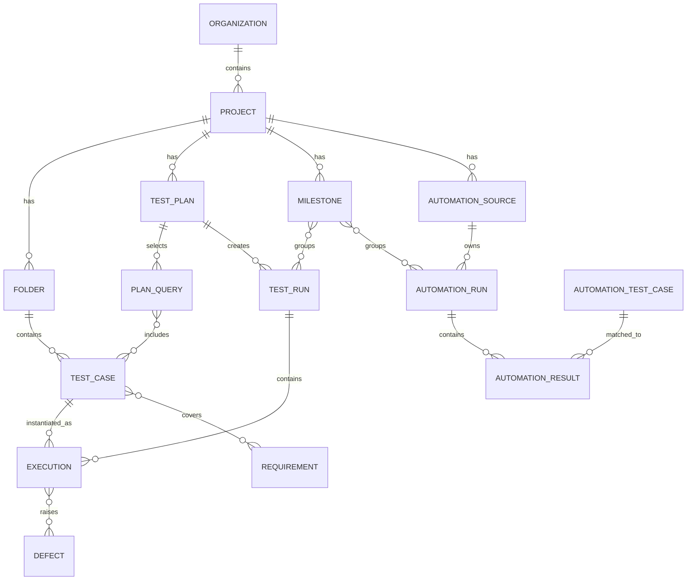

# Testiny — Competitive TMS Research

Research date: 14 November 2026. Prefer primary sources (testiny.io docs, pricing, API). Review quotes from G2, Capterra, and Software Testing Help.

---

## 1. Overview

**Vendor:** Testiny (Austria-based; GDPR / EU data posture). Product is a modern test management system (TMS) for manual and automated testing in one project.

**Deployment:**

- **Cloud:** EU-hosted (marketing cites Germany & Finland infrastructure).
- **Self-hosted:** Testiny Server (Docker, Kubernetes, or OpenShift) — Enterprise / Custom Enterprise; contact sales. Same product experience as cloud per marketing.
- **Not** a Jira-native app as the primary product; optional **Jira Marketplace / Forge app** for bi-directional visibility inside Jira. Also works with Jira Data Center.

**Target users:** Agile QA / engineering teams that want a fast UI for cases/plans/runs, CI result ingest without changing pipelines, and issue-tracker linking (Jira, GitHub, GitLab, Azure DevOps, Linear, etc.). Positioning skews SMB → mid-market, with Enterprise for RBAC/audit/self-host. G2 reviewer company mix is heavily small-business.

**License model.** **Closed source** (proprietary commercial product; Cloud and paid **Testiny Server** self-host). Testiny offers **free use for open-source projects** as a commercial courtesy ([testiny.io/open-source](https://www.testiny.io/open-source/)) but states the product is built *upon* open-source dependencies—it does **not** publish Testiny itself as open source. Not open-core. Sources: [open-source program](https://www.testiny.io/open-source/), [pricing](https://www.testiny.io/pricing/).

**Pricing (published on [testiny.io/pricing](https://www.testiny.io/pricing/), checked 14 Nov 2026; USD, net of tax; yearly billing shows “2 months free”; volume discounts apply):**

| Plan | Headline price (per user/month) | Notes |
| --- | --- | --- |
| **Free** | $0 | Up to 3 users; cases/plans/runs/executions limited to **1,000 total**; 5 GB / 1 MB upload |
| **Starter** | from ~$15.42 (yearly calc) / list **$18.50** (1–10 seats monthly table) | Up to 25 seats; custom fields, history, per-step results, CSV/Excel export, MCP, webhooks |
| **Business** | from ~$17.08 / list **$20.50** (1–10) | No user limit (from 5+); automation, milestones, custom result states, SSO |
| **Enterprise** | from ~$25.00 / list **$30.00** (1–10) | Packages of 5; custom roles, permission groups, audit log, project permissions, IP restriction |
| **Custom Enterprise** | Negotiated | Self-host (Testiny Server), SLA, invoice billing, custom storage/rate limits |
| **Testiny Server** | from **$300 per user/year** (5-user packages) | On-premises |

**Viewers** are cheaper seats (can view/comment, not create/edit) — e.g. Business viewers ~$3.42–$4.10/user/month depending on volume.

**Trial / free:** 21-day free trial, no credit card; trial defaults to 25 seats then downgrades to Free. Free for open-source projects (contact); discounts for education / non-profits (50% cited for some categories).

Sources: [Pricing](https://www.testiny.io/pricing/), [Pricing docs](https://www.testiny.io/docs/pricing-and-payment/), [Testiny Server](https://www.testiny.io/testiny-server/), [Features](https://www.testiny.io/features/).

---

## 2. Data model and entities

| Entity | What it is | Key fields / notes |
| --- | --- | --- |
| **Organization** | Tenant; company usually has one | Users, SSO, billing, custom fields, integrations |
| **Project** | Container for cases, plans, runs, milestones | Per-project roles, integration mapping, custom-field enablement |
| **Test case** | Reusable test definition | Title, owner, template (Steps / Text / BDD), precondition (Steps/Text), steps/expected or Scenarios (Gherkin), custom fields, attachments, tags via multi-select CF, sort index, history |
| **Folder** | Nested hierarchy for cases | Nested folders; “All” / “No folder” virtual groups; drag-drop order |
| **Steps** | Per-template content | Steps template: action + expected per step; Text: freeform; BDD: Gherkin in `Scenarios` |
| **Shared steps** | Reusable step library | **Not a first-class product feature** — forum: on roadmap; ADO import *expands* shared steps into cases |
| **Parameters / datasets** | Data-driven cases | **No built-in parameterization** (forum: high-priority roadmap). Capterra lists “Parameterized Testing”; treat as marketplace taxonomy, not confirmed product feature. ADO parameters import as multi-line text CF workaround |
| **Test plan** | Selection layer for future runs | Static queries (picked cases) and/or dynamic queries (by folder / by condition AND) |
| **Test run** | One execution round | Title, description, link to plan (optional), progress, team stats, close/reopen (sealed when closed) |
| **Test execution** | Case instance inside a run | Assignee, result status, comments, attachments, defects; optional per-step results (Starter+) |
| **Automation source** | Named suite grouping for CI imports | e.g. `e2e-tests`; scoped per project; deleting source deletes related runs |
| **Automation test case** | Auto-created ATC from imports | Separate from manual cases; identified by `testid`/`testkey` or title+folder path |
| **Automation test run** | Imported CI run | Source, run fields (pipeline/build IDs), environment fields, incomplete/complete, pin, retention |
| **Milestone** | Release/sprint grouping of runs | Start/due dates, progress, defects & requirements views across linked manual+auto runs (Business+) |
| **Requirements** | External issues linked as requirements | Not native RM; linked from Jira/ADO/GitHub/GitLab/Linear/Redmine/etc. to **test cases** |
| **Defects** | External issues linked as defects | Linked to **runs / executions** (manual and automated); create from failure |
| **Configurations / environments** | Native env matrix | **Not found as first-class entities** — roadmap (“environment support”); workaround: custom fields, run description, CLI `--field-values` / Run Fields |
| **Custom fields** | Org-defined case fields (max 30) | Types: text, multi-line, multi-select, URL, duration, date/time, date, int, float, boolean; dropdowns; per-project enable; predefined Priority, Type, Estimate, Status, Automation |
| **Custom result states** | Extra execution outcomes | Business+; categories map to Passed/Failed/Blocked/Skipped/Not Run behavior in charts |
| **Attachments** | Files/images on cases and results | Plan storage/upload limits; automation can import screenshots/videos/traces |
| **Tags / labels** | Via multi-select custom fields | No separate “tags” entity documented beyond multi-select CF |
| **Versions / baselines** | Formal case baselines | **Not found** as a baseline product. Case **history** / version history columns exist; closed runs freeze case state at close time |
| **Comments** | On cases and results | Own-comment permissions; notifications on run comments |

Sources: [Core concepts](https://www.testiny.io/docs/getting-started/core-concepts/), [Test cases](https://www.testiny.io/docs/test-management/test-cases/basics/), [Custom fields](https://www.testiny.io/docs/settings/custom-fields/), [Milestones](https://www.testiny.io/docs/test-management/milestones/basics/), [Automation guide](https://www.testiny.io/docs/automation/importing-results/), [Forum: parameterization](https://www.testiny.io/forum/t/environments-and-parameterization-in-test-cases/820), [Forum: shared steps](https://www.testiny.io/forum/t/reusable-test-steps-in-test-case/362).

---

## 3. Relationships and flows

**Primary links**

- Case ⊂ Folder ⊂ Project ⊂ Organization  
- Plan queries → Cases; creating a run from a plan **snapshots** the current case set (later plan changes do not mutate existing runs).  
- Run → many Executions (case + assignee + result); optional Plan link; optional Milestone membership.  
- Requirement (external) ↔ Case; Defect (external) ↔ Run/Execution.  
- Automation Source → Automation Runs → Automation Test Cases/Results; Run Fields merge shards into one run; Milestone can include automation runs (`--milestone-id`).  
- Manual ATCs and automation ATCs are **separate**; auto-link ATC↔manual **not available yet** (docs: future release).

**Typical end-to-end workflow**

1. Create project → folders → cases (Steps/Text/BDD) + custom fields.  
2. Optionally link requirements from issue tracker.  
3. Build plan with static and/or dynamic queries.  
4. Create run from plan (or from folder/selection); assign testers; execute in runner; set results/comments; file defects.  
5. Close run (seal). Generate PDF / CSV / Excel.  
6. Group related manual + automation runs under a Milestone for release readiness / coverage.  
7. CI: CLI uploads reports → auto-creates ATCs → flaky/history views over time.

**Case versioning / review / approval**

- Full edit **history** with diff view (paid history).  
- Predefined **Status** custom field intended for design workflow (e.g. only approved cases in a plan) — condition-based plans can enforce this pattern.  
- Formal multi-step approval workflow / baselines: **not found in docs**.  
- Closed runs are immutable snapshots of case content at close (except deleted custom fields). Soft-delete + API undelete; UI recycle bin “planned”.

**Statuses**

- Case Status: customizable predefined CF (Draft/Ready/Obsolete style values used in migrations).  
- Execution results: Passed, Failed, Blocked, Skipped, Not Run + custom result states (Business+), usable at case and/or step level.

Sources: [Core concepts](https://www.testiny.io/docs/getting-started/core-concepts/), [Test plans](https://www.testiny.io/docs/test-management/test-plans/basics/), [Custom result states](https://www.testiny.io/docs/settings/custom-result-states/).

---

## 4. Full feature list

**Authoring:** Rich text (tables, images, links, “copyable” text); Steps / Text / BDD templates; Gherkin live validation, **20 dialects**, `.feature` export; quick create; bulk edit; duplicate/copy/move across projects; drag-drop reorder; history/diff. **Shared steps / call-to-test:** not found (roadmap). **Parameters:** not found as native.

**Organisation:** Hierarchical folders; dynamic + static test plans; milestones; multi-project; real-time multi-user sync (WebSocket).

**Execution:** Manual runner side panel; assignment (incl. by owner); jump-to-next; comments/attachments; custom result states; per-step results (Starter+); close/reopen; rerun failed (marketing). Timers/stopwatch: Estimate CF exists; stopwatch described as **future**.

**Traceability:** Requirements on cases; defects on results; milestone requirements/defects views; PDF coverage tables.

**Reporting / dashboards (built-in):** Live project dashboard; pass/fail history per case; run progress / pie / team stats; test-plan **“Most frequently failed test cases”**; milestone overview; shareable run links; **PDF** (filterable content: not-passed summary, requirements/defects summaries, case details, history); **Excel/CSV** exports. Advanced custom analytics: reviewers call dashboards “basic”.

**Search / filters:** Table filters and plan conditions on fields; API `DataReadParams` filter/order/map. Dedicated advanced query language (JQL-like): **not found**.

**Import / export:** CSV/Excel import wizard; TestRail API/XML; Zephyr/Xray API migrations; ADO Test Plans importer; PDF/CSV/Excel out; REST for everything UI can do.

**Audit:** Enterprise audit log (areas: data, users, reports, exports, API keys, billing, SSO, auth, …); 90-day / 1M entry default retention; JSON export.

**Permissions / SSO / SCIM:** Built-in roles (Administrator, Editor, Run Executor, Viewer, No access, …); Enterprise custom roles + permission groups; per-project roles; User vs Viewer seats; 2FA/MFA + password policy. **SSO** via OIDC (Google, Microsoft Entra, Okta, Auth0, Cognito, OneLogin, JumpCloud, Salesforce, …) on Business+. **SCIM:** not found in docs.

**AI:** **MCP Server** (Starter+): create/edit cases & folders, create runs, set results, generate automation code; Claude Desktop / VS Code Copilot / MCP 2025-06-18; BDD cases read-only over MCP. No closed vendor LLM lock-in.

**Localisation:** UI auto-translated languages include Chinese (Simplified/Traditional), Czech, Danish, Dutch, Finnish, French, Italian, Japanese, Korean, Norwegian, Polish, Portuguese, Russian, Spanish, Swedish, Turkish, Ukrainian (plus English/German marketing). Gherkin 20 dialects.

**Mobile / offline / PWA:** Responsive web SPA; dedicated offline/PWA mode: **not found in docs**.

Sources: [Features](https://www.testiny.io/features/), [Home](https://www.testiny.io/), [Reporting](https://www.testiny.io/docs/test-management/test-runs/reporting/), [Roles](https://www.testiny.io/docs/settings/role-management/), [Integrations](https://www.testiny.io/integrations/), [Release notes](https://www.testiny.io/docs/release-notes/).

---

## 5. Automation and CI

**Supported result formats (CLI):** JUnit, xUnit, NUnit, TestNG, Playwright JSON, Cypress/Mochawesome/CodeceptJS, Vitest, VSTest (trx), Ranorex (`rxlog`), plus framework ecosystems that emit JUnit XML (Jest, Mocha, pytest, Robot, PHPUnit, Selenium, Appium, WebdriverIO, Postman, etc. via JUnit). Dedicated **Playwright reporter** also offered.

**CLI / reporters / SDKs:** `@testiny/cli` / `testiny-importer-*` binaries; env `TESTINY_API_KEY`; optional `--app` for Server. Language SDK wrappers: reviewers note absence (CLI + REST instead).

**CI integrations:** Auto-detect environments: GitHub, GitLab, Azure, CircleCI, Jenkins, TeamCity, Bamboo, Drone, Buddy, Bitbucket, GoCD, AppVeyor, AWS CodeBuild, Buildkite, Codeship, Codefresh, Cloud Build, Semaphore, Travis, etc. Pipeline unchanged — post-process report upload.

### Auto-create test cases from CI results? Matching?

**Yes — automation test cases are auto-created on first import.** Official Automation Guide:

> “When uploading results for the first time, the automation test cases are automatically created in Testiny. When uploading results from subsequent test runs (from the same test suite and to the same source), Testiny matches the test cases to re-use them.”

**Matching rules (automation):**

1. Prefer optional property **`testid` or `testkey`** (interchangeable; first property wins).  
2. Else match by **title + folder path**.  
3. If title changes and no stable id → **new** ATC is created.  
4. Cases are scoped in practice by **project + source** continuity (same suite/source reuse).  
5. JUnit options affect title/folder derivation (`--junit-ignore-classname`, `--junit-classname-as-folder`, strip prefix).

**Limits / design choices:**

- Automated cases are a **separate entity** from manual cases; results track flakiness/history but do **not** maintain automation source code in the TMS.  
- **Cannot currently auto-link** automation ATCs to manual TCs (future).  
- CLI `automation` command documents create-if-missing as the default behavior. The older/deprecated `testrun` importer exposes explicit `--testcases ignore|fail|create` (default `create`) — useful reference for policy knobs, but automation path is create-oriented.  
- No documented “never create / only match existing manual cases” switch on the primary `automation` command in the CLI reference (as of docs checked).  
- Flaky detection is by **reusing matched ATCs over time** + “frequently failing” / history UIs — not a separate ML flaky classifier documented.

**Run merging / sharding:** `--run-fields` + `--incomplete` / `--complete-runs` merge parallel jobs into one automation run; CI defaults often use pipeline ID. Retention auto-deletes old automation runs; **pin** to keep. Inactivity timeout can auto-complete incomplete runs.

Sources: [Automation guide](https://www.testiny.io/docs/automation/importing-results/), [CLI reference](https://www.testiny.io/docs/automation/reference/), [JUnit](https://www.testiny.io/docs/integrations/automation/junit/), [Forum: consistent IDs](https://www.testiny.io/forum/t/reporting-test-automation-with-consistent-ids/642), [CI overview](https://www.testiny.io/docs/integrations/ci-cd/overview/).

---

## 6. API

| Topic | Detail |
| --- | --- |
| **Type** | REST (OpenAPI / swagger.json). GraphQL: not found |
| **Base URL** | `https://app.testiny.io/api/v1` (Server: your host + `/api/v1`) |
| **Auth** | `X-Api-Key: <key>` (keys scoped to user permissions; optional project, expiry, limited role e.g. Automation Importer). MCP may use Bearer |
| **Rate limits** | Read 1100/min; Write 270/6 min; Bulk write 960/12 min; Blob up/down and export limits; Enterprise can raise. HTTP **429** |
| **Pagination** | `pagination.offset` / `limit` (default 1000, max 2000); `includeTotalCount`; enforced even if omitted |
| **Webhooks** | Via notification **custom HTTPS channel** (JSON envelope); events: case assigned, run closed, run comment. Retries/backoff; disable after consecutive failures. Not a full entity-change event bus |
| **Reference** | [API quickstart](https://www.testiny.io/docs/api-quickstart/), [swagger](https://app.testiny.io/api/v1/swagger.json), [API marketing](https://www.testiny.io/api/), [Rate limits](https://www.testiny.io/docs/api-rate-limiting/) |

**Main endpoint groups** (from OpenAPI tags / paths, API v1.43.1):

| Group | Operations (typical) |
| --- | --- |
| Project | list/find/get/create/update/delete; my projects |
| TestCase / TestCaseFolder | CRUD, bulk, undelete, mappings |
| TestPlan / TestCaseQuery | CRUD, bulk, mappings (plan↔queries↔cases) |
| TestRun | CRUD, bulk, mappings to cases (executions), blob attach to results |
| Milestone | CRUD, bulk, mappings to runs |
| Automation / AutomationSource / AutomationTestCase / AutomationTestRun (`atm-*`) | Import-related automation entities |
| Comment, Blob, Exporter, Data History | Attachments, exports, history queries |
| Permissions, UserProfile, Authentication | Access & identity |
| AppNotification* | Notification channels/settings |
| Data Batches | Batch ops |
| MCP | `POST/GET …/mcp-server` (HTTP MCP) |

Mappings use `/api/v1/<entity>/mapping/bulk/<others>?op=add|delete|update|add_or_update`. Soft-delete + undelete supported on many entities.

---

## 7. Integrations

**Issue trackers (deep):** Jira Cloud & Data Center (OAuth 2.0 3LO; Marketplace Forge app; shared and/or personal create accounts), GitHub, GitLab, Azure DevOps, Linear, Redmine. **Additional URL/API-style:** Asana, Confluence, Trello, Todoist, Zendesk, Wrike, Trac, monday.com, Zoho, Basecamp, YouTrack, ClickUp, Bugzilla, Shortcut, Pivotal Tracker, Custom REST/URL templates. Multiple integrations of same type supported.

**CI/CD:** Any CI that can run the CLI after tests (list in §5). Testiny does **not** execute tests.

**Automation frameworks:** Playwright (reporter + CLI), Cypress, JUnit family, Vitest, TestNG, NUnit, xUnit, Ranorex, VSTest, CodeceptJS, etc.

**Chat / notifications:** Slack, Microsoft Teams, Discord, Google Chat, custom webhook; email/browser/in-app.

**SSO:** Any OIDC provider (named list in §4). SCIM: not found.

**Marketplace:** Atlassian Marketplace Jira app (Forge). No broad “plugin marketplace” beyond that found.

**OpenProject:** not found (relevant gap vs Vulyk).

Sources: [Integrations](https://www.testiny.io/integrations/), [Notifications](https://www.testiny.io/notifications-and-webhooks/).

---

## 8. Marketing positioning

Headline: **“Manual and automated testing, side by side.”** / **“AI-ready test management”** with **no AI lock-in, no framework lock-in, no infrastructure lock-in**.

Differentiators they emphasize:

1. MCP so teams bring their own AI assistant.  
2. Framework-neutral CI ingest (don’t change the pipeline).  
3. Issue-tracker choice without making Jira the system of record.  
4. Fast real-time SPA UX.  
5. EU cloud **or** full self-host (same product).  
6. Afternoon migrations from TestRail / Zephyr / Xray / CSV.  
7. Affordable per-seat pricing with Free tier and Viewer seats.

Sources: [Home](https://www.testiny.io/), [Features](https://www.testiny.io/features/).

---

## 9. What users love

Themes (G2 ~4.8/18 reviews; Capterra 5.0/5):

- **Speed & UX:** “creating & executing test cases is quick & easy and it’s fast as if it was running locally” (Capterra / G2).  
- **Clean hierarchy:** “Convenient and clear storage of test cases in a hierarchical folder structure” (G2).  
- **Onboarding / simplicity:** “not overloaded with unnecessary features” (Capterra).  
- **Support & velocity:** “support is responsive and the dev team really reacts to issue reports & feature requests” (Capterra).  
- **Import & migrations:** “I'm excited by how smoothly and fast the import works… thousands of test cases” (G2, Ruslan T.).  
- **Price:** repeatedly called affordable; Viewer seats praised in hands-on reviews.  
- **Jira linking:** Software Testing Help: “fantastic integration with issue trackers (tested with JIRA)”.

Sources: [G2 reviews](https://www.g2.com/products/testiny/reviews), [Capterra](https://www.capterra.com/p/10004572/Testiny/), [STH review](https://www.softwaretestinghelp.com/testiny-test-management-tool-review/).

---

## 10. What users dislike

- **Reporting depth:** “dashboards and analytics can feel a bit basic” (G2).  
- **API learning curve:** “powerful and flexible… but hard to get started with” (Capterra).  
- **Missing maturity features (historical/ongoing):** shared/reusable steps; native parameterization & environments (forum + older STH notes); some wanted more integrations.  
- **Automation↔manual gap:** docs admit no automatic linking yet; early reviewers wanted automation results (since added on Business).  
- **UI polish:** “On monitors with small screens… some information is cut off” (G2).  
- **Docs perception:** older Capterra: “almost no documentation” (product docs have grown substantially since).  
- **Large imports:** rate-limit messages when importing thousands of cases (G2).  
- **SDK wrappers:** no language client libraries (G2).

Sources: same review URLs; [Forum shared steps](https://www.testiny.io/forum/t/reusable-test-steps-in-test-case/362); [Forum parameterization](https://www.testiny.io/forum/t/environments-and-parameterization-in-test-cases/820).

---

## 11. Ideas for Vulyk

Vulyk context: open-source self-hosted TMS (folders/cases/plans/runs, CI ingest, campaigns/iterations, requirements, Jira/OpenProject, reports/flaky, RBAC/SSO, LLM, MCP, importers, PWA offline).

1. **Copy: auto-create ATCs with stable ID matching** — Default create-on-ingest with `testid`/`testkey` first, then title+path; document rename breakage clearly. Offer Vulyk knobs (`create` / `match-only` / `fail`) that Testiny’s primary automation CLI under-documents.  
2. **Copy: source + run-fields merge model** — Explicit suite `source` and CI run-field merging for shards (`incomplete`/`complete`) is excellent UX for GitHub Actions / GitLab; align Vulyk CI ingest campaigns/iterations with the same mental model.  
3. **Copy: dynamic plan queries** — Folder- and condition-based plans that auto-include new critical cases are a major differentiator vs static suites; Vulyk plans should stay query-capable.  
4. **Copy: sealed runs + soft-delete history** — Closing a run freezes case content for audit; soft-delete/undelete via API. Strong for regulated self-host users.  
5. **Copy: MCP as first-class, not bolted AI** — Testiny’s “bring your own assistant” avoids LLM lock-in; Vulyk already targets MCP — keep permissions scoped like their Automation Importer API keys.  
6. **Avoid / beat: automation↔manual split** — Testiny still cannot link ATCs to manual cases. Vulyk should design unified or explicitly linked identities from day one.  
7. **Avoid / beat: missing shared steps & datasets** — Still roadmap for Testiny; ship shared steps and parameter datasets early for authoring parity with TestRail-class tools.  
8. **Avoid / beat: environments as an afterthought** — Users ask for config matrices; Vulyk configurations/environments should be entities on runs, not only custom fields.  
9. **Differentiate: OpenProject + true offline PWA** — Testiny has no OpenProject and no documented offline PWA; these are concrete Vulyk wedges for self-hosted EU teams.  
10. **Differentiate: open-source AGPL + transparent upgrade path** — Testiny Server is paid Enterprise; Vulyk’s self-host forever + OSS importers/LLM can undercut Custom Enterprise while matching folders/cases/plans/runs/CI/RBAC/SSO feature shape.  
11. **UX lesson:** Real-time sync and “fast as local” SPA feel dominate reviews — invest in perceived latency and runner ergonomics over dashboard chrome.  
12. **Flaky:** “Frequently failed” from plan history is enough for many teams; pair Vulyk flaky detection with stable ATC matching so renames don’t reset flaky history.

---

## 12. Sources

- https://www.testiny.io/  
- https://www.testiny.io/features/  
- https://www.testiny.io/pricing/  
- https://www.testiny.io/docs/pricing-and-payment/  
- https://www.testiny.io/testiny-server/  
- https://www.testiny.io/integrations/  
- https://www.testiny.io/api/  
- https://www.testiny.io/notifications-and-webhooks/  
- https://www.testiny.io/bdd-testing/  
- https://www.testiny.io/roadmap/  
- https://www.testiny.io/docs/  
- https://www.testiny.io/docs/getting-started/core-concepts/  
- https://www.testiny.io/docs/test-management/test-cases/basics/  
- https://www.testiny.io/docs/test-management/test-cases/details/  
- https://www.testiny.io/docs/test-management/test-plans/basics/  
- https://www.testiny.io/docs/test-management/test-plans/concept/  
- https://www.testiny.io/docs/test-management/test-runs/basics/  
- https://www.testiny.io/docs/test-management/test-runs/reporting/  
- https://www.testiny.io/docs/test-management/milestones/basics/  
- https://www.testiny.io/docs/settings/custom-fields/  
- https://www.testiny.io/docs/settings/custom-result-states/  
- https://www.testiny.io/docs/settings/role-management/  
- https://www.testiny.io/docs/settings/audit-log/  
- https://www.testiny.io/docs/settings/api-keys/  
- https://www.testiny.io/docs/automation/importing-results/  
- https://www.testiny.io/docs/automation/reference/  
- https://www.testiny.io/docs/automation/getting-started/  
- https://www.testiny.io/docs/integrations/automation/junit/  
- https://www.testiny.io/docs/integrations/ci-cd/overview/  
- https://www.testiny.io/docs/api-quickstart/  
- https://www.testiny.io/docs/api-rate-limiting/  
- https://app.testiny.io/api/v1/swagger.json  
- https://www.testiny.io/docs/release-notes/  
- https://www.testiny.io/forum/t/reusable-test-steps-in-test-case/362  
- https://www.testiny.io/forum/t/environments-and-parameterization-in-test-cases/820  
- https://www.testiny.io/forum/t/reporting-test-automation-with-consistent-ids/642  
- https://www.g2.com/products/testiny/reviews  
- https://www.capterra.com/p/10004572/Testiny/  
- https://www.softwaretestinghelp.com/testiny-test-management-tool-review/  
