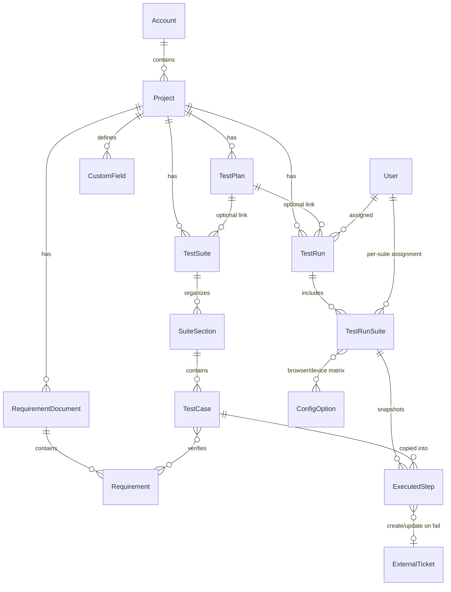

# TestLodge — Competitive TMS Research

Research date: **2026-11-14**. Prefer primary sources (testlodge.com, help.testlodge.com, G2/Capterra reviews). Unconfirmed items are marked **not found in docs**.

---

## 1. Overview

**Vendor:** TestLodge (cloud SaaS test case management). Marketing positions it as “the efficient test case management tool” for plans, requirements, cases, and runs ([homepage](https://www.testlodge.com/), [product](https://www.testlodge.com/product)).

**Deployment:** Cloud-only. Main servers and databases on **AWS in the United States**; no on-premise / Data Center / self-hosted edition described ([security](https://www.testlodge.com/security)). Not a Jira app; Jira is an external issue-tracker integration ([integrations](https://www.testlodge.com/integrations)).

**Target users:** QA / software testing teams—startups, SMBs, and enterprises—especially teams that want a simple, uncluttered manual TMS with unlimited users and issue-tracker defect automation ([homepage](https://www.testlodge.com/), [pricing](https://www.testlodge.com/pricing)). G2 reviewers often describe it as good for beginners, teaching, and small/UAT teams ([G2 reviews](https://www.g2.com/products/testlodge/reviews)).

**License model.** **Closed source** (proprietary commercial SaaS). Flat-rate paid plans; no open-source edition or public product repository found. Not open source or open core. Source: [testlodge.com/pricing](https://www.testlodge.com/pricing).

**Pricing (checked 2026-11-14)** — flat monthly account price, **unlimited users**, no per-seat charges ([pricing](https://www.testlodge.com/pricing)):

| Plan | Price | Test plans | Requirements | Test cases | Test runs | File storage |
| --- | --- | --- | --- | --- | --- | --- |
| Personal | $34/month | 50 | Unlimited | 200 | 100 | 1 GB |
| Basic | $69/month | 150 | Unlimited | 600 | 300 | 2 GB |
| Plus | $139/month | 500 | Unlimited | 3,000 | 1,000 | 3 GB |
| Premium | $279/month | 1,500 | Unlimited | 10,000 | 3,000 | 4 GB |

- Annual billing: **save 10%**; month-to-month available; no long-term contract required.
- Larger **Gold / Elite / custom** plans exist for higher limits.
- Prices exclude VAT (UK VAT added; EU VAT if no VAT number).
- Feature matrix (integrations, API, custom fields/roles, reports, Auth0, MFA, Google SSO) is the same across listed plans; differentiation is **content/storage caps**.

**Trial / free plan:** **30-day free trial**, no credit card required. **No free plan** after trial ([pricing](https://www.testlodge.com/pricing)).

**Security highlights:** SOC 2 Type II (no audit exceptions claimed), GDPR, AES-256 at rest, TLS in transit, Auth0 authentication, Google SSO, MFA on all plans ([security](https://www.testlodge.com/security), [pricing](https://www.testlodge.com/pricing)).

---

## 2. Data model and entities

Hierarchy is project-centric. Official help and API use these entities:

| Entity | What it is | Key fields / notes |
| --- | --- | --- |
| **Account** | Billing/tenant boundary; API scoped by `account_id` | Account Holders, Admins, users ([API Basics](https://help.testlodge.com/hc/en-us/articles/226734768-API-Basics)) |
| **Project** | Container for all test artifacts (product/client) | `name`, `description`, issue-tracker credential/project ids ([API Projects](https://help.testlodge.com/hc/en-us/articles/226734888-API-Projects)); unlimited projects on all plans |
| **Test plan** | Living planning document (scope, objectives, approach)—template or blank | Customizable sections (drag-and-drop); custom fields; copy/reuse; linkable to suites and runs ([test plans product](https://www.testlodge.com/product/test_plans), [getting started](https://help.testlodge.com/hc/en-us/articles/236206547-Getting-Started-With-TestLodge)) |
| **Test plan content** | Sections/body of a plan | Exposed via API resource “Test plan content” ([API Resources](https://help.testlodge.com/hc/en-us/sections/205934128-API-Resources)) |
| **Requirement document** | Folder-like document holding requirements/user stories | Title; contains many requirements ([requirements help](https://help.testlodge.com/hc/en-us/articles/115007106087-What-is-a-Requirement)) |
| **Requirement** | Individual requirement/story | `title`, `description`, custom fields, uploads; linkable to cases ([API Requirements](https://help.testlodge.com/hc/en-us/articles/226734948-API-Requirements)) |
| **Test suite** | Collection of cases (“folders”) | `name`, optional `plan_id`; prerequisite before creating cases ([suites help](https://help.testlodge.com/hc/en-us/articles/115007101447-Using-Test-Suites-and-Test-Cases)) |
| **Suite section** | Grouping inside a suite (e.g. “Required Fields”) | Used in API path for listing cases ([API Test cases](https://help.testlodge.com/hc/en-us/articles/226734968-API-Test-cases)) |
| **Test case** (API: **step**) | Individual manual test | `step_number` (e.g. TC01), `title`, `description`, `test_steps` (single text field), `expected_result` (single field), custom fields, attachments, verifies-requirements ([suites help](https://help.testlodge.com/hc/en-us/articles/115007101447-Using-Test-Suites-and-Test-Cases), [API Test cases](https://help.testlodge.com/hc/en-us/articles/226734968-API-Test-cases)) |
| **Test run** | Execution instance: one or more suites (or selected cases) | `name`, optional `plan_id` / `user_id`, status (not started / in progress / complete), pass/fail/skip/incomplete counts ([runs help](https://help.testlodge.com/hc/en-us/articles/115007265388-Creating-and-Executing-Test-Runs), [API Test runs](https://help.testlodge.com/hc/en-us/articles/226734848-API-Test-runs)) |
| **Test run suite / executed step (run case)** | Snapshot of a case inside a run | `passed` 0/1/2, `actual_result`, issue ticket number, uploads, executed requirements ([API Test run cases](https://help.testlodge.com/hc/en-us/articles/226734908-API-Test-run-cases)) |
| **Run configurations / config groups** | Browser/device (or custom) matrix applied per suite in a run | Predefined browsers/devices or custom; combinations via API `config_option_combinations` ([pricing](https://www.testlodge.com/pricing), [API Run configuration groups](https://help.testlodge.com/hc/en-us/sections/205934128-API-Resources)) |
| **Custom fields** | Per-project extras on plans, requirements, cases, runs | Types: text, text area, select ([custom fields](https://help.testlodge.com/hc/en-us/articles/115003052087-Custom-Fields)) |
| **Attachments / uploads** | Files on cases, requirements, run results | Screenshots, logs; S3 URLs time-limited (~30s) in API |
| **Users / roles** | Account Holder, Administrator, Standard User + custom project roles | Per-project role assignment ([roles](https://help.testlodge.com/hc/en-us/articles/231992528-User-Roles-Permissions)) |
| **Defects** | Not first-class in TMS; created in external trackers on fail | Ticket number stored on executed step |
| **Activity feed** | Project activity stream | Listed on pricing/product ([pricing](https://www.testlodge.com/pricing)) |

**Not found in docs (as first-class entities):** shared steps / call-to-test, parameters/datasets, milestones/releases/sprints, case versions/baselines, tags/labels as a native taxonomy, built-in defect objects, SCIM directory sync, SAML IdP SSO beyond Google.

---

## 3. Relationships and flows

### Entity relationships

### Typical end-to-end workflow

1. Create a **project** (and optionally wire an issue tracker).
2. Write a **test plan** (template or blank); optionally attach custom fields.
3. Create **requirement documents** and **requirements**; later link from cases via “Verifies Requirements”.
4. Create **test suites** → **sections** → **test cases** (or import from spreadsheet / Google Sheets).
5. Create a **test run**: pick suites/cases, optional plan, assignees, **configurations** (browser/device matrix).
6. Execute: mark each case **pass / fail / skip**, add actual results and attachments; on fail optionally **auto-create/update** tracker tickets.
7. Re-run failed (or selected) cases; for enhanced integrations, sync ticket status and close on successful re-test.
8. Review **dashboards**, **test run reports**, **common case results**, **user workload**, and **requirements traceability matrix**.

Sources: [getting started](https://help.testlodge.com/hc/en-us/articles/236206547-Getting-Started-With-TestLodge), [runs](https://help.testlodge.com/hc/en-us/articles/115007265388-Creating-and-Executing-Test-Runs), [reporting](https://help.testlodge.com/hc/en-us/articles/115007106427-Reporting), [integrations](https://www.testlodge.com/integrations).

### Case versioning / review / approval

**Not found in docs.** Cases can be edited during/around runs; results of individual executed cases can be edited after the fact ([edit results](https://help.testlodge.com/hc/en-us/articles/115007266228-Editing-the-Results-of-an-Individual-Test)). No formal review/approval workflow or baseline versioning is documented.

### Statuses and customisation

| Level | Statuses | Customisable? |
| --- | --- | --- |
| Test run | `0` Not started, `1` In progress, `2` Complete ([API runs](https://help.testlodge.com/hc/en-us/articles/226734848-API-Test-runs)) | **Not found in docs** for custom run statuses |
| Run case result | Failed `0`, Passed `1`, Skipped `2` ([API run cases](https://help.testlodge.com/hc/en-us/articles/226734908-API-Test-run-cases)) | Fixed triad; customisation **not found in docs** |
| Incomplete | Count of not-yet-run cases on the run | Derived |

Custom **fields** (not statuses) extend plans/requirements/cases/runs ([custom fields](https://help.testlodge.com/hc/en-us/articles/115003052087-Custom-Fields)).

---

## 4. Full feature list

### Test authoring
- Form-based editor: title, description, **test steps as one text block**, **one expected result** field ([suites help](https://help.testlodge.com/hc/en-us/articles/115007101447-Using-Test-Suites-and-Test-Cases), [API cases](https://help.testlodge.com/hc/en-us/articles/226734968-API-Test-cases)).
- **BDD / Gherkin:** not found in docs.
- **Rich text:** basic structured fields; advanced editor details not found in docs.
- **Shared steps / call-to-test:** not found; copy/re-use and “add existing case by title search” into another suite are supported ([feature overview](https://www.testlodge.com/resources/academy/videos/testlodge_feature_overview), [pricing](https://www.testlodge.com/pricing)).
- **Parameters / datasets:** not found in official docs (Capterra taxonomy may list “Parameterized Testing”; treat as unverified against primary docs).

### Organisation
- Projects → suites → sections → cases; plans and requirement documents alongside.
- Copy content (plans, requirements, cases) across suites ([product](https://www.testlodge.com/product), feature overview video).
- Custom fields per project/content type.

### Execution
- Guided manual runner: pass/fail/skip, actual results, attachments ([runs](https://help.testlodge.com/hc/en-us/articles/115007265388-Creating-and-Executing-Test-Runs)).
- Assignment at run and per-suite level; configs for browsers/devices.
- Mid-run add/remove/update cases ([pricing](https://www.testlodge.com/pricing)).
- Re-run failed (or selected) tests.
- **Timers:** not found in docs.
- **Bulk result update:** API bulk update up to **250** cases/request ([API run cases](https://help.testlodge.com/hc/en-us/articles/226734908-API-Test-run-cases)).

### Traceability and coverage
- Case ↔ requirement links (“Verifies Requirements”).
- **Requirements traceability matrix** (CSV export for large matrices) ([reporting](https://help.testlodge.com/hc/en-us/articles/115007106427-Reporting)).

### Reporting / dashboards (built-in)
- Charts & dashboards / project activity feed ([pricing](https://www.testlodge.com/pricing), [product](https://www.testlodge.com/product)).
- **Test Run Results** (incomplete / passed / failed / skipped).
- **Common Case Results** (top 10 passed/failed/skipped; pass rate).
- **User Workload** (incomplete cases, runs, completion rate).
- **Requirements Traceability Matrix**.
- Downloadable / neat document-style reports mentioned by Capterra reviewers (PDF-style sequencing—confirm per export path).

### Search / filters / query language
- Basic list/filter usage implied; G2 reviewers complain about weak tagging/filtering for large suites. Dedicated query language (e.g. JQL-like): **not found in docs**.

### Import / export
- **Import:** Google Sheets / CSV / Excel via Google Drive authorization; map Title, Description, Test Steps, Expected Result, custom fields, optional section column ([import tutorial](https://blog.testlodge.com/importing-test-cases-into-testlodge/), March 2026 section-title import update). Requirements import also advertised ([pricing](https://www.testlodge.com/pricing)).
- **Export:** CSV and HTML for suites, runs, requirements, plans ([export](https://help.testlodge.com/hc/en-us/articles/115007106247-Exporting-Content)); CSV also on pricing matrix. JUnit/XML native import: **not found**.

### Audit / permissions / SSO
- Project activity feed; Capterra lists “Audit Trail” as a feature ([Capterra](https://www.capterra.com/p/110329/Test-Lodge/))—granular immutable audit log details **not fully specified in help articles reviewed**.
- RBAC: Account Holder / Administrator / Standard + **custom project roles** ([roles](https://help.testlodge.com/hc/en-us/articles/231992528-User-Roles-Permissions)).
- **Google SSO**, Auth0 login, **MFA** all plans ([security](https://www.testlodge.com/security)).
- **SCIM / SAML enterprise IdP:** not found in docs.

### AI / localisation / mobile / offline
- **AI test generation / assistant:** not listed on product or pricing (security site links “AI terms” legal page—product AI features **not found**).
- **Localisation:** G2 FAQ cites English only ([G2](https://www.g2.com/products/testlodge/reviews)).
- **Mobile / offline / PWA:** web app; offline support **not found in docs**. Cloud-only noted as a limitation by reviewers.

---

## 5. Automation and CI

### Official stance (critical)

> “TestLodge is geared mainly towards **manual testing**… We **don’t provide any pre-made integrations** with automated frameworks or continuous integration (CI) servers. However, we do have a REST API… Some of our customers have integrated their automated tests and CI servers themselves using this API.”  
> — [Do you integrate with any automated testing tools?](https://help.testlodge.com/hc/en-us/articles/236167368-Do-you-integrate-with-any-automated-testing-tools) (updated 2017; still the published FAQ)

### Result formats
- **No native ingest** for JUnit XML, TestNG, Cucumber JSON, Robot, NUnit, Allure, Playwright, etc. **not found in docs**.

### CLI / reporters / SDKs
- No official CLI, reporter plugins, or language SDKs **found in docs**. Integration path is raw REST (examples often in Ruby/`curl`).

### CI integrations
- No first-party GitHub Actions, GitLab CI, Jenkins, Azure Pipelines, or CircleCI apps **found**. Customers wire their own pipelines to the API.

### How automated results map to cases

There is **no built-in matching** by automation ID, annotation, or test name against CI payloads.

Practical DIY pattern (from API capabilities, not a documented “CI sync” product feature):

1. Pre-create cases in a suite (UI, import, or `POST .../steps.json`).
2. Create a run with `suite_ids` or `step_ids`.
3. List `executed_steps` for that run; map your automation tests to `executed_step.id` (or `step_id` / `step_number` / title) **in your own script**.
4. `PATCH` each result (`passed` 0/1/2, `actual_result`) or use **`bulk_update`** (max 250; async background processing) ([API run cases](https://help.testlodge.com/hc/en-us/articles/226734908-API-Test-run-cases)).

### Auto-create test cases from CI results?

**No.** TestLodge does **not** auto-create test cases when CI sends results for unknown tests.

- There is no CI result webhook/uploader that upserts cases by name or ID.
- Case creation is an explicit API/UI/import action (`POST .../suites/{suite_id}/steps.json` with `title`, optional description/steps/expected_result) ([API Test cases](https://help.testlodge.com/hc/en-us/articles/226734968-API-Test-cases)).
- Matching, deduplication, and “create if missing” logic—if any—must live entirely in **customer-written** scripts. Official options/limits for auto-create: **none (feature absent)**.

### Automation linking, flaky detection, run merging
- **Automation linking** (case ↔ automated test ID): not found.
- **Flaky test detection:** not found (Common Case Results shows historical pass rates—useful signal, not flaky classification).
- **Run merging:** not found; re-run within a run is supported for failed/selected cases.

---

## 6. API

| Aspect | Detail |
| --- | --- |
| Type | REST over **JSON** (HTTPS only) |
| Base URL | `https://api.testlodge.com/v1/account/{account_id}/` |
| Auth | **HTTP Basic**: user email + API key (`My profile` → API keys); permissions mirror the user’s app permissions |
| Rate limit | **300 requests / 5 minutes** → HTTP **429** |
| Pagination | `page` query; response `pagination` object (`total_entries`, `total_pages`, `current_page`, `next_page`, `previous_page`, `per_page` e.g. 15–20) |
| Timezones | Timestamps **UTC** |
| Webhooks | **Not found in docs** (no webhook resource in [API Resources](https://help.testlodge.com/hc/en-us/sections/205934128-API-Resources)) |
| Reference | [API category](https://help.testlodge.com/hc/en-us/categories/203830188-TestLodge-API), [Basics](https://help.testlodge.com/hc/en-us/articles/226734768-API-Basics) |

### Main endpoint groups

| Group | Typical operations |
| --- | --- |
| Users | List (Admin/Account Holder) |
| Projects | List / show / create / update / delete |
| Custom fields | CRUD for project field definitions |
| Test plans / plan content | Plan CRUD + content sections |
| Requirement documents / requirements | Document + requirement CRUD; include uploads/linked steps |
| Test suites / suite sections | Suite CRUD; sections for organisation |
| Test cases (`steps`) | List by section, show, create, update; uploads; linked requirements |
| Test runs | List/filter by user/status; show; create (suites/cases, configs, assignees) |
| Test run suites | Suite instances inside a run |
| Test run cases (`executed_steps`) | List/show/update; bulk_update; uploads; create issue ticket option |
| Run configuration groups | Config options for matrix runs |

---

## 7. Integrations

### Issue trackers ([integrations](https://www.testlodge.com/integrations))
Broad list (~28), many marked **Enhanced** (create, associate existing, status sync, comments, resolve on pass). Examples:

- **Enhanced:** Jira, GitHub, GitLab, Linear, Asana, ClickUp, Trello, monday.com, Shortcut, YouTrack, Mantis, FogBugz, Wrike, Teamwork, Smartsheet, Backlog, Basecamp, ActiveCollab, Assembla, DoneDone, Redbooth, …
- **Standard (create-focused):** Azure DevOps, Bugzilla, Redmine, Axosoft, Countersoft, Unfuddle, Zoho BugTracker, …

Not a Jira Marketplace app; connect credentials from TestLodge and map projects.

### CI/CD & automation frameworks
None first-party—API only ([automation FAQ](https://help.testlodge.com/hc/en-us/articles/236167368-Do-you-integrate-with-any-automated-testing-tools)).

### Chat
Slack / Microsoft Teams: **not found** as official integrations; G2 reviewers request Slack alerts ([G2](https://www.g2.com/products/testlodge/reviews)).

### SSO / identity
Google SSO; Auth0-powered login; MFA. Broader IdP marketplace (Okta SAML, Azure AD SCIM): **not found**.

### Import ecosystem
Google Drive / Sheets (CASA-assessed) for spreadsheet import ([security](https://www.testlodge.com/security), [import blog](https://blog.testlodge.com/importing-test-cases-into-testlodge/)).

### Marketplace
No separate app marketplace beyond the integrations catalog on testlodge.com.

---

## 8. Marketing positioning

Headline claims ([homepage](https://www.testlodge.com/), [product](https://www.testlodge.com/product), [pricing](https://www.testlodge.com/pricing)):

- “The efficient test case management tool” / “A better way to manage tests”.
- **Uncluttered by design:** “We consciously limit the tool's features to include only those that optimize and ease your testing process.”
- **Unlimited users**, one fixed price—positioned against per-seat TMS pricing.
- Strong **issue-tracker** automation (raise/update/re-test defects while running tests).
- Template-based **test plans**, requirements coverage, configs for browsers/devices.
- Trust: “37+ million tests run”, SOC 2, senior human support (no chatbots).

**Differentiators vs typical enterprise TMS:** simplicity, flat pricing, manual-test focus, wide defect-tool coverage—not automation/CI depth or AI.

---

## 9. What users love

Themes from [G2](https://www.g2.com/products/testlodge/reviews) (~4.7/5, 12 reviews) and [Capterra](https://www.capterra.com/p/110329/Test-Lodge/) (~4.0–4.2, small sample):

1. **Simplicity / low learning curve** — “simple and clear for beginners… don’t get confused by too many features” (G2, Prachi S.); “very low learning curve” (Capterra, David K.).
2. **Fast setup / spreadsheet import** — “total time from sign up to importing test cases was less than an hour” via Google Sheets (Capterra).
3. **Unlimited users / easy UAT invites** — “Very easy to invite and add new users… clients seem to like it too” (G2, Shavkat J.).
4. **Defect automation** — Trello/Jira ticket creation on fail called out as a standout (Capterra/G2).
5. **Support** — “superb customer support”; replies “within an hour” (Capterra); G2 mentions support solving issues quickly.
6. **Templates & reports** — test plan templates and clean downloadable reports praised (Capterra).

---

## 10. What users dislike

1. **Shallow case model** — “you can’t add expected results to every step”; desire for per-step expected results (G2, Prachi S., Shavkat J.). Steps live in one field (Capterra cons).
2. **Weak tagging/filtering at scale** — “not many options to tag or filter test cases”; limited for large projects (G2).
3. **No built-in bug tracker** — must use external tools (G2).
4. **Content caps / price** — wish for unlimited cases/runs; Personal “a little bit costly”; Capterra value-for-money ~3.7/5; Premium called expensive (Capterra).
5. **Cloud-only** — may not fit strict environments (G2).
6. **Missing Slack / richer dashboards** — Slack alerts requested; more graphical status desired (G2).
7. **Admin scaling** — “does not scale very well to many projects or users… cumbersome to manage” (G2, 2015 enterprise review—still a scaling theme).
8. **No ready-made automation/CI** — confirmed by vendor FAQ and alternatives roundups.

---

## 11. Ideas for Vulyk

Vulyk context: open-source self-hosted TMS (folders/cases/plans/runs, CI ingest, campaigns/iterations, requirements, Jira/OpenProject, reports/flaky, RBAC/SSO, LLM, MCP, importers, PWA offline).

1. **Keep first-run simplicity** — TestLodge’s win is an obvious plan → suite → run mental model. Vulyk should preserve a calm default path even as campaigns/iterations/LLM/MCP appear.
2. **Win on CI ingest + auto-create** — TestLodge explicitly does **not** auto-create from CI and has no JUnit/native matching. Ship first-class result upload (JUnit/etc.), match by ID/annotation/name, and optional **auto-create missing cases** with clear limits/dedup—this is a sharp competitive gap.
3. **Per-step expected results** — Reviewers repeatedly ask for step-level expected results; Vulyk should avoid TestLodge’s single `test_steps` + single `expected_result` ceiling.
4. **Flat-pricing lesson, not a limit** — Unlimited users is beloved; content caps are hated. Self-hosted Vulyk should avoid artificial case/run quotas and advertise that contrast.
5. **Self-host + offline PWA** — Cloud-only and US AWS residency are exclusions for regulated teams; lean into self-host, data residency, and offline—areas TestLodge cannot match.
6. **Traceability matrix + workload reports** — Copy these high-value, low-complexity reports; add **flaky** analytics TestLodge lacks.
7. **Broader SSO than Google-only** — Offer SAML/OIDC/SCIM alongside Google; TestLodge stops at Google SSO + Auth0 password/MFA.
8. **Chat + OpenProject/Jira depth** — Users want Slack on fail; Vulyk should notify chat and deepen OpenProject/Jira two-way sync beyond “create ticket on fail.”
9. **Import UX** — Spreadsheet/Google-style column mapping is a proven migration path; keep importers excellent while adding CI/XML paths TestLodge skips.
10. **Don’t confuse “simple” with “no automation”** — TestLodge’s deliberate feature minimalism leaves automation teams writing custom API glue. Vulyk can stay approachable for manual QA **and** first-class for CI/LLM/MCP without requiring customers to invent matching.

---

## 12. Sources

- https://www.testlodge.com/
- https://www.testlodge.com/product
- https://www.testlodge.com/product/test_plans
- https://www.testlodge.com/pricing
- https://www.testlodge.com/integrations
- https://www.testlodge.com/security
- https://www.testlodge.com/resources/whats_new/google_sso
- https://www.testlodge.com/resources/whats_new/product_updates_03_2026
- https://www.testlodge.com/resources/academy/videos/testlodge_feature_overview
- https://blog.testlodge.com/importing-test-cases-into-testlodge/
- https://help.testlodge.com/hc/en-us/articles/236206547-Getting-Started-With-TestLodge
- https://help.testlodge.com/hc/en-us/articles/115007101447-Using-Test-Suites-and-Test-Cases
- https://help.testlodge.com/hc/en-us/articles/115007106087-What-is-a-Requirement
- https://help.testlodge.com/hc/en-us/articles/115007265388-Creating-and-Executing-Test-Runs
- https://help.testlodge.com/hc/en-us/articles/115007266228-Editing-the-Results-of-an-Individual-Test
- https://help.testlodge.com/hc/en-us/articles/115007106427-Reporting
- https://help.testlodge.com/hc/en-us/articles/115007106247-Exporting-Content
- https://help.testlodge.com/hc/en-us/articles/115003052087-Custom-Fields
- https://help.testlodge.com/hc/en-us/articles/231992528-User-Roles-Permissions
- https://help.testlodge.com/hc/en-us/articles/236167368-Do-you-integrate-with-any-automated-testing-tools
- https://help.testlodge.com/hc/en-us/categories/203830188-TestLodge-API
- https://help.testlodge.com/hc/en-us/sections/205934128-API-Resources
- https://help.testlodge.com/hc/en-us/articles/226734768-API-Basics
- https://help.testlodge.com/hc/en-us/articles/226734888-API-Projects
- https://help.testlodge.com/hc/en-us/articles/226734968-API-Test-cases
- https://help.testlodge.com/hc/en-us/articles/226734848-API-Test-runs
- https://help.testlodge.com/hc/en-us/articles/226734908-API-Test-run-cases
- https://help.testlodge.com/hc/en-us/articles/226734948-API-Requirements
- https://www.g2.com/products/testlodge/reviews
- https://www.g2.com/products/testlodge/pricing
- https://www.capterra.com/p/110329/Test-Lodge/
