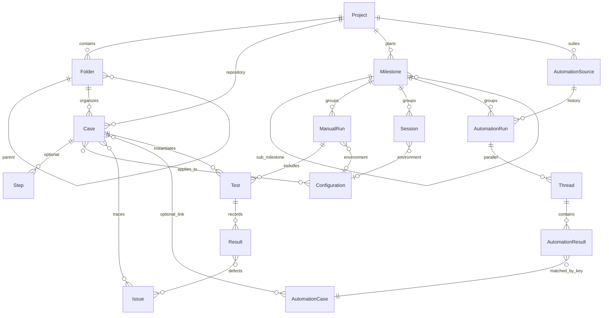

# Testmo — Competitive TMS Research

Research date: 14 November 2026. Prefer primary sources (testmo.com, support.testmo.com / docs). Prices and plan flags change; verify on the live pricing page before decisions.

---

## 1. Overview

**Vendor:** Testmo GmbH (product marketed as Testmo; seller also listed as Sembi on G2). Headquarters referenced as Leverkusen, Germany on third-party profiles; cloud app hosted primarily on Amazon AWS (US East) per vendor security/pricing FAQs.

**Deployment:** Cloud SaaS only (`https://<your-name>.testmo.net`). Official FAQ: *“We do not offer an on-premise server edition at this time.”* Not a Jira Data Center app; there is a free Jira Cloud add-on for linking.

**Target users:** Small and growing QA / engineering teams that want unified manual, exploratory, and automation management without “enterprise complexity.” Marketing also claims suitability for larger orgs that want to scale without heavy governance. Homepage claims “Trusted by 2,000+ QA teams worldwide.”

**License model.** **Closed source** (proprietary commercial SaaS by Testmo GmbH / related). Cloud product with published subscription plans; no self-hosted open-source edition found. The `@testmo/testmo-cli` npm package is a proprietary client tool (license text for the CLI package was **not found in docs** as an OSI license during this research). Product itself is not open source or open core. Sources: [testmo.com](https://www.testmo.com/), [testmo.com/pricing](https://www.testmo.com/pricing/).

**Pricing tiers (USD, net; checked 14 Nov 2026 from [testmo.com/pricing](https://www.testmo.com/pricing/)):**

| Plan | List price | Users included | Notable additions |
| --- | --- | --- | --- |
| **Team** | **$59/month** | 5 users | Unlimited projects/cases/plans/runs/milestones/results; unlimited automation results; Jira/GitHub/GitLab/Linear/CI integrations; Testmo AI |
| **Business** | **$249/month** | 15 users | Reporting Center; customizable RBAC; project admins; webhooks listed on comparison (see §6/§7) |
| **Enterprise** | **$599/month** | 25 users | SSO (Google, Microsoft, Okta, OneLogin, SAML); 2FA enforcement; complete user audit log; automation launching |

- Annual Business/Enterprise: **15% off** list; volume discount for **>500 users** (contact sales).
- Team at **10 users** is commonly cited as **$99/month** on contemporaneous comparisons of the same pricing page; full tier ladder is linked from pricing FAQ as a separate “full price list.”
- Business/Enterprise add users in larger tiers (marketing comparison shows “Per 25 users” billing language for Business/Enterprise).
- **No free plan.** Free trial via [manage.testmo.com/trial](https://manage.testmo.com/trial); ToS says duration is “specified on the Website”; third-party comparisons consistently report **21 days**. Trial is non-production; ends automatically; no obligation to subscribe.
- Activated users under Admin → Users count toward seats; Business/Enterprise allow **unlimited API-only users** that do not count toward the seat limit.

Sources: [Pricing](https://www.testmo.com/pricing/), [ToS PDF](https://www.testmo.com/assets/testmo-gmbh-terms-of-service-020122.pdf), [Homepage](https://www.testmo.com/).

---

## 2. Data model and entities

| Entity | What it is | Key fields / notes |
| --- | --- | --- |
| **Project** | Top-level workspace for all testing (manual, exploratory, automation) | Access-controlled; can be starred; completed vs active |
| **Folder** | Hierarchical organization inside the case repository | `parent_id`, name, display order, depth; recursive case queries |
| **Test case (repository)** | Manual / designed case in the project repository | Name, template, state (Draft / Under Review / Rejected / Active / Retired by default), estimate, configurations, issues, tags, attachments, custom fields, optional automation links |
| **Steps** | Structured steps on Case (steps) template | Up to **four** named subfields per step (e.g. Expected, Data); per-step result status at execution |
| **Shared steps / call-to-test** | Reusable step libraries or nested case calls | **Not found in docs** as GA; G2 reviewers mention shared steps on the roadmap |
| **Parameters / datasets (manual)** | Data-driven case variants as first-class objects | **Not found in docs** for repository cases; automation parameterized tests appear as distinct XML results (name suffixes) |
| **Templates** | Field sets for cases and sessions | Built-ins: Case (text), Case (steps), Case (BDD/Gherkin); custom templates via Admin → Fields |
| **Custom fields** | Project-assignable fields for cases, results, sessions | Types: checkbox, date, dropdown, float, integer, link, multi-select, steps, string, text; required/optional per project; restricted fields on higher plans |
| **Tags / labels** | Filterable labels on cases, runs, sessions | Creatable inline; used in filters and automation milestone linking |
| **Test run (manual)** | Time-bounded execution of selected repository cases | Name, configuration, milestone, case selection (all vs subset), state, issues, tags; each included case becomes a **test** instance |
| **Test / result** | Execution instance + logged outcomes | Statuses (pass/fail/skip/custom), assignee, comments, attachments, linked issues; closed runs snapshot original case content |
| **Session** | Exploratory / ad-hoc testing unit | Name, type/template, description, milestone, assignee, config, estimate, tags, session log (notes, screenshots, results) |
| **Milestone** | Container for release/sprint/cycle planning | Name, summary (≤80 chars), parent (hierarchy), type, planned start, due date, issues, automation tags, notes; groups runs + sessions + automation |
| **Test plan** | Marketing/pricing term | Docs treat **milestones** (with custom types) as the planning construct for “test plans, sprints, releases”; no separate first-class Plan entity found in API sections |
| **Configuration** | Environment combination (browser × OS × device, etc.) | Built from platform groups; linked to runs/sessions/cases; multi-config run creation (cap **250** runs per multi-create) |
| **Automation source** | Named suite identity across runs (e.g. `backend-api`) | Auto-created on first submit; groups history, flaky/slow/failure stats; can be retired |
| **Automation run / thread** | One CI submission (run) with one or more parallel threads | Name, source, config, milestone, tags, fields/artifacts/links, thread timing/console/exit code |
| **Automation case** | Stable identity for an automated test across runs | Identified by generated **key** from class/folder + name; separate from repository cases |
| **Requirement** | External or AI-workflow requirement text | External: issue IDs from trackers; AI: free-text requirements stored for regeneration, linked to generated cases |
| **Defect / issue** | External tracker issue linked into Testmo | Linked on cases, runs, results, sessions, milestones; coverage via Issue Coverage report |
| **Attachment** | Files/screenshots on cases, results, sessions | Paste screenshots into rich text; property attachments in JUnit XML |
| **Versions / baselines** | Case versioning / baseline snapshots | Closed runs retain historical case text; dedicated baseline/version entity **not found in docs** |
| **Automation target / job** | CI pipeline definition launched from Testmo (Enterprise) | Target (GitHub/GitLab workflow) + parameters/inputs; Jobs view launches and tracks status |

Sources: [Welcome to Testmo](https://support.testmo.com/hc/en-us/articles/37805644156813-Welcome-to-Testmo), [Adding Test Cases](https://support.testmo.com/hc/en-us/articles/47565282964237-Adding-Test-Cases), [Test Runs](https://support.testmo.com/hc/en-us/articles/47544002336653-Test-Runs), [Milestones](https://support.testmo.com/hc/en-us/articles/47548614635789-Milestones), [Configurations](https://support.testmo.com/hc/en-us/articles/47600836844429-Configurations), [Custom Fields](https://support.testmo.com/hc/en-us/articles/38042642061709-Custom-Fields), [Automation Concepts](https://support.testmo.com/hc/en-us/articles/37901269890189-Concepts).

---

## 3. Relationships and flows

### Entity relationship diagram

### Typical end-to-end workflow

1. Create a **project**; structure the **repository** with folders and cases (text / steps / BDD templates).
2. Optionally create a **milestone** (release/sprint/plan type) with dates and linked issues.
3. Start a **manual run** (all cases or filtered subset), optionally per **configuration**; assign tests; record results and defects.
4. Run **sessions** for exploratory work; paste screenshots into the session log.
5. CI submits JUnit XML via **Testmo CLI** → **automation run** under a **source**; optionally link to milestone/config.
6. Review milestone **Status** (burndown, automation by source) and Reporting Center reports; close runs/sessions/milestones to archive.

### Case review / approval

Default repository case states: **Draft → Under Review → Rejected | Active → Retired**. Workflow states are configurable per project (API exposes states for `repository_case`, `run`, and `session`). Closed runs keep the original case details even if the repository case later changes.

### Statuses

- Result statuses include built-in pass/fail/skip/blocked-style outcomes plus **custom statuses** (automation reporting references custom statuses).
- Run/session/case **workflow states** are separate from result statuses and are project-configurable.

Sources: [Welcome](https://support.testmo.com/hc/en-us/articles/37805644156813-Welcome-to-Testmo), [Test Runs](https://support.testmo.com/hc/en-us/articles/47544002336653-Test-Runs), [Projects API states](https://support.testmo.com/hc/en-us/articles/38158978447885-Projects).

---

## 4. Full feature list

**Authoring:** Rich-text editor (tables, code highlighting, paste screenshots); Case (text) / Case (steps) / Case (BDD); step subfields; templates; custom fields; tags; attachments; bulk edit; keyboard shortcuts; inline repository add. Shared steps / call-to-test: **not found as GA**. Manual parameterized datasets: **not found**.

**Organisation:** Projects, folders, milestones (up to 3-level hierarchy per milestones docs; welcome guide also mentions sub-milestones), configurations/platforms, sources, tags, My Work assignments.

**Execution:** Manual runner with assignments, filters, per-step results, timers/estimates/forecasts, multi-run create with configurations, exploratory sessions as first-class. Automation launching from Jobs UI (Enterprise).

**Traceability / coverage:** Link issue IDs (requirements/stories/bugs) on cases, runs, sessions, milestones; Issue Coverage & Traceability report; optional automation links + “Status (latest)” repository column spanning manual and automation.

**Reporting / dashboards:** Built-in metrics on runs/milestones/automation; PDF/print of pages; CSV/PDF exports; **Reporting Center** (Business+): Issue Coverage & Traceability, Milestone Summary & Metrics, Team Testing Workload, Test Automation Metrics.

**Search / filters:** Repository/run/session filters (folder, state, tags, status, milestone, config, dates, etc.). Users report search as a weakness (no advanced query language found in docs comparable to JQL).

**Import / export:** CSV/Excel import wizard with column mapping, multi-row steps, Markdown/HTML handling, auto-create folders; PDF/print exports; CSV exports from reporting areas. JUnit XML is the automation **import** format (not a repository case dump format).

**Audit / permissions / SSO:** Complete user audit log (Enterprise); custom RBAC and project admins (Business+); restricted fields; SSO/SAML and 2FA enforcement (Enterprise). **SCIM:** not found in docs.

**AI:** Testmo AI — generate cases from free-text requirements (BETA; 10–60 cases; AI tag + requirement link). Pricing shows “Update test cases with AI — Coming Soon.” Homepage mentions **Testmo MCP** (open beta) to expose cases/runs/results to MCP-capable agents.

**Localisation / mobile / offline:** User timezone (and localization settings) in profile; full multi-language UI catalogue **not found in docs**. Native mobile app / offline PWA: **not found** (browser web app).

Sources: [Features](https://www.testmo.com/features/), [AI Generated Test Cases](https://support.testmo.com/hc/en-us/articles/41325466687757-AI-Generated-Test-Cases), [Reporting Center Overview](https://support.testmo.com/hc/en-us/articles/38037574694797-Overview), [Importing CSV/Excel](https://support.testmo.com/hc/en-us/articles/37879320552461-Importing-CSV-Excel), [Homepage MCP FAQ](https://www.testmo.com/).

---

## 5. Automation and CI

### Result formats and tooling

- **Primary format:** JUnit-style XML (de facto standard). Docs/guides cover Jest, JUnit, Mocha, NUnit, PHPUnit, Pytest, Robot Framework, RSpec, TestNG, XCTest, Selenium, Cypress, Playwright, Ranorex, and more via XML conversion.
- **CLI:** `@testmo/testmo-cli` (`automation:run:submit`, `create` / `submit-thread` / `complete` for parallel). Auth via `TESTMO_TOKEN`.
- **Linking CLI:** `@testmo/testmo-link` (separate package) for Tier-2 repository linking.
- **CI:** Any pipeline that can install npm and upload XML — documented examples for GitHub Actions, GitLab CI, Jenkins, CircleCI, Bitbucket, Azure-oriented workflows, BrowserStack/Sauce Labs reporting guides.

### Critical: auto-create / matching behaviour

**Yes — Testmo auto-creates automation entities from CI results that do not yet exist. It does *not* auto-create repository (manual) test cases.**

Precisely:

1. **Tier 1 — automatic (always on submit)**  
   - Submit results with `testmo automation:run:submit` (or API equivalents).  
   - Testmo creates an **automation run**, identifies tests from XML `classname`/`name` (folder/class hierarchy), and **creates or updates automation cases**.  
   - Matching key: CLI **generates a unique `key` from the folder (class) and test name** so future results for the same test attach to the same automation case. Support articles also describe Tier 1 as matching on the test **`key` field**.  
   - **Sources** are auto-created from the `--source` string if new.  
   - Docs explicitly: *“There’s no need to manually create any tests, map tests or IDs”* for the Automation section workflow.

2. **Tier 2 — optional link to repository cases**  
   - Automation results are **not** automatically connected to repository cases.  
   - Enable Automation Linking (Admin → Automation); link manually in the UI by automation name/ID/key, **or** run `@testmo/testmo-link` after submit with:
     - **Annotations:** e.g. `@TestmoId: 1234` (multiple IDs allowed)  
     - **Config mappings:** YAML/JSON `test_name` → `case_id` (exact, case-sensitive names as in XML)  
     - **Pattern matching:** normalized case-insensitive name compare (spaces/underscores/hyphens collapsed); custom regex rules for parameterized suffixes  
   - Parameterized tests produce multiple XML names (`test_login[user1-pass1]`); annotations strip bracket suffixes; config mappings need per-variant entries or regex.

3. **Options / limits / guidance**  
   - Vendor **recommends against** linking large UI suites (>250) or unit/API/dev-owned suites to repository cases; prefer Automation-section-only tracking for those.  
   - Default: new manual runs can **exclude** repository cases that already have automation links.  
   - Flaky/slow/failure analytics live on **automation sources**, not only on repository cases.

### Flaky detection and run merging

- **Flaky:** On a source, Testmo increments a flaky counter when outcomes switch pass↔fail between runs; proprietary flaky **percentage**; top 25 flaky tests listed; full source history used.  
- **Parallel / merge:** `automation:run:create` → each parallel CI job `submit-thread` → `complete`. Threads retain separate timing, console, exit codes; UI merges into one run.

Sources: [Concepts](https://support.testmo.com/hc/en-us/articles/37901269890189-Concepts), [Automation Linking](https://support.testmo.com/hc/en-us/articles/37904613921549-Automation-Linking), [Automation Linking CLI](https://support.testmo.com/hc/en-us/articles/42977787361421-Testmo-Automation-Linking-CLI-Extension), [JUnit guide](https://support.testmo.com/hc/en-us/articles/37893689383309-JUnit), [Parallel Testing](https://support.testmo.com/hc/en-us/articles/37904635022349-Parallel-Testing), [Automation Reporting](https://support.testmo.com/hc/en-us/articles/47717919416333-Automation-Reporting), [CI/CD Integration](https://support.testmo.com/hc/en-us/articles/37901323466381-CI-CD-Integration).

---

## 6. API

| Aspect | Detail |
| --- | --- |
| **Type** | REST (`/api/v1/...`); OpenAPI schema published; JS client `@testmo/testmo-api` |
| **Base URL** | `https://<your-name>.testmo.net/api/v1/` |
| **Auth** | Bearer API key: `Authorization: Bearer $TESTMO_TOKEN` (keys from user profile; Business+ can create API-only users) |
| **Pagination** | `page`, `per_page` ∈ {15,25,50,100} (default 100); response includes `next_page`, `last_page`, `total` |
| **Expands** | Related resources embeddable via `expands=` |
| **Rate limits** | HTTP **429** + `Retry-After` (wait ≥60s if header absent); bulk result submit recommended; CLI batches |
| **Webhooks** | Documented outgoing webhooks (Business/Enterprise): HMAC-SHA256 `X-Testmo-Signature-256`, retries, Slack/Teams/Discord/Generic. Pricing comparison marks Webhooks as **Coming Soon** — treat GA status cautiously |
| **Reference** | [REST API category](https://support.testmo.com/hc/en-us/categories/37813841496333-REST-API), [API Reference section](https://support.testmo.com/hc/en-us/sections/37971074321293-API-Reference), [OpenAPI](https://support.testmo.com/hc/en-us/articles/38167278662925-OpenAPI) |

**Main endpoint groups (non-exhaustive):**

| Group | Operations |
| --- | --- |
| Projects | List/get; states; statuses |
| Folders | CRUD (incl. bulk patterns) |
| Cases | List/create/patch/delete; get; result-history; templates/tags/repos helpers |
| Runs | List/create/get/patch/delete; list tests in run; configs |
| Results | Record results against run tests (bulk-oriented) |
| Milestones | CRUD; types; bulk |
| Sessions | CRUD; bulk; session results CRUD |
| Automation runs | Create/list/get; append; complete; threads append/complete; list tests |
| Automation sources / cases / links | Management of automation identities and Tier-2 links |
| Attachments, Fields, Issues, Groups, Roles | Supporting admin/data endpoints |
| Webhooks | Manage subscriptions & delivery history (documented) |
| User | `GET /user` |

Sources: [Using the REST API](https://support.testmo.com/hc/en-us/articles/37816329967885-Using-the-REST-API), [API Authentication](https://support.testmo.com/hc/en-us/articles/37838838517517-API-Authentication), [Pagination](https://support.testmo.com/hc/en-us/articles/37839187088269-Pagination-Expands), [Error Handling](https://support.testmo.com/hc/en-us/articles/37970840943117-Error-Handling), [Automation Runs API](https://support.testmo.com/hc/en-us/articles/37971158770957-Automation-Runs), [Webhooks](https://support.testmo.com/hc/en-us/articles/46877947282189-Testmo-Webhooks).

---

## 7. Integrations

| Category | Integrations |
| --- | --- |
| **Issue trackers** | Deep: **Jira** (free Cloud add-on), **GitHub**, **GitLab**. Link-based / custom links: Linear, Asana, Azure DevOps, ClickUp, Monday.com, Redmine, Shortcut, Trac, Trello, YouTrack |
| **CI/CD** | CLI-centric: GitHub Actions, GitLab CI, Jenkins, CircleCI, Bitbucket; Enterprise **Automation Launching** for GitHub/GitLab targets from Jobs UI |
| **Automation frameworks** | Any producing JUnit XML (see §5); Selenium, Cypress, Playwright, Pytest, etc. |
| **Chat / notify** | Slack, Microsoft Teams, Discord via webhooks (documented); G2 mentions Slack |
| **SSO** | Azure AD, Google, Okta, OneLogin, custom SAML 2.0 (Enterprise) |
| **AI / agents** | Hosted **Testmo MCP** (open beta) |
| **Marketplace** | Atlassian Jira Cloud add-on; Linear integration listing; not a broad app store like Atlassian Marketplace for DC |

Sources: [Features](https://www.testmo.com/features/), [Custom Links](https://support.testmo.com/hc/en-us/articles/37817601888909-Custom-Links), [Authentication](https://support.testmo.com/hc/en-us/articles/38042870783117-Authentication), [Linear](https://linear.app/integrations/testmo), [Homepage](https://www.testmo.com/).

---

## 8. Marketing positioning

Headline claims (homepage / features):

- “**#1 Unified Test Management**” / “Test management for teams that move fast.”
- “**AI test management platform** purpose-built for small & growing teams.”
- Unifies **manual + exploratory + automation (+ AI agents)** in one place.
- “Any tool, any language, any platform” for automation — submit XML, no custom mapping required for the Automation workflow.
- Speed/productivity UI vs “clunky, expensive” traditional enterprise TMS.
- Differentiators emphasized: exploratory sessions as first-class; automation sources with flaky/slow analytics; milestones spanning all three testing modes; AI case generation + MCP; competitive seat-bundle pricing.

Sources: [Homepage](https://www.testmo.com/), [Features](https://www.testmo.com/features/), [Test case management](https://www.testmo.com/test-case-management/).

---

## 9. What users love

Themes from G2 (4.6/5, ~27 reviews) and Reddit:

1. **Clean UI / ease of use** — “clean and intuitive interface that makes managing test cases, runs, and results very simple” (Jaydeep D., G2, Oct 2025).
2. **Unified manual + exploratory + automation** — “consolidates all the testing cycle with automation runs, exploratory sessions, manual repository” (G2); Reddit: “Far superior over … TestRail … the UI is intuitive.”
3. **Integrations** — Jira/GitHub praised; G2 pros cluster on Integrations / Jira Integration.
4. **Value / price** — “great value for its low price” (Roman K., G2).
5. **Exploratory sessions** — “management of exploratory testing is unlike anything I've used before” (G2).
6. **Support** — “Customer support is on point, quick to respond” (Rowen S., G2).

Sources: [G2 Testmo reviews](https://www.g2.com/products/testmo/reviews), [r/QualityAssurance thread](https://www.reddit.com/r/QualityAssurance/comments/1947q9v/testmo/).

---

## 10. What users dislike

1. **Reporting depth / customization** — “reporting and analytics features feel somewhat limited” (Jaydeep D., G2); dashboards/workflows less flexible.
2. **Case editing & sharing limits** — “ability to edit test cases is quite limited”; “not possible to share repositories across teams” (Rowen S., G2).
3. **Navigation / URLs** — cases open in sidebar without dedicated deep-link pages (Roman K., G2).
4. **Search** — “lack of a proper search feature” (Roni M., G2); limited search/traceability for hardware/HIL contexts (G2).
5. **Performance at scale** — “a bit slow when handling large test suites” (G2).
6. **Missing shared steps** — reviewer notes shared steps / some automation enhancements still on roadmap (G2).
7. **Cloud-only** — no on-prem (blocker for some regulated/self-host buyers; confirmed by vendor FAQ).
8. **Export quirks** — Reddit: XLS export includes HTML tags; PDF layout not configurable.

Sources: [G2](https://www.g2.com/products/testmo/reviews), [Reddit](https://www.reddit.com/r/QualityAssurance/comments/1947q9v/testmo/), [Pricing FAQ on-prem](https://www.testmo.com/pricing/).

---

## 11. Ideas for Vulyk

Context: Vulyk is an **open-source, self-hosted** TMS (folders/cases/plans/runs, CI ingest, campaigns/iterations, requirements, Jira/OpenProject, reports/flaky, RBAC/SSO, LLM, MCP, importers, PWA offline).

1. **Copy the two-tier automation model.** Auto-create **automation identities** from CI by stable key (suite/class + name) without polluting the manual repository; make repository linking an explicit second step (annotations / mapping / name match). This is Testmo’s clearest differentiator vs tools that force every automated test to be a pre-created case.
2. **First-class exploratory sessions** (timed scope, log, screenshots, assignees) — repeatedly cited as better than TestRail-style bolted-on notes; Vulyk should keep sessions distinct from planned runs.
3. **Sources + flaky/slow/failure boards** per automation suite — full-history flaky %, slowest, most failures; Vulyk already plans flaky reporting — match this source-centric UX.
4. **Parallel CI threads under one run** (`create` → `submit-thread` → `complete`) — document and implement run merging so GitHub matrix jobs don’t become fragmented runs.
5. **Avoid Testmo’s cloud-only gap** — Vulyk’s self-host + offline PWA is a direct answer to buyers Testmo cannot serve; emphasize air-gapped/RBAC/SSO parity.
6. **Avoid weak search / sidebar-only case URLs** — ship dedicated case URLs, strong search/filter (and optional query language), and cross-project sharing of libraries if multi-team.
7. **Shared steps / call-to-test** — users say Testmo still lacks them; Vulyk can win maintenance-heavy manual suites here.
8. **Requirements as first-class (OpenProject/Jira)** vs Testmo’s mostly external-issue + AI free-text requirements — keep bidirectional coverage reports and campaign/iteration planning richer than milestone-only planning.
9. **MCP + LLM** — Testmo markets MCP + AI generation; Vulyk should ensure MCP exposes folders/cases/plans/runs/results similarly, with self-hosted model choice.
10. **Importers + JUnit ingest DX** — match CSV wizard quality and “any framework via JUnit XML + CLI” simplicity; document auto-create behaviour *precisely* so operators are never surprised about repository vs automation case creation.

---

## 12. Sources

- https://www.testmo.com/
- https://www.testmo.com/pricing/
- https://www.testmo.com/features/
- https://www.testmo.com/test-case-management/
- https://www.testmo.com/qa-project-milestones/
- https://www.testmo.com/topics/test-plan-software/
- https://www.testmo.com/blog/automation-linking-with-the-testmo-cli/
- https://www.testmo.com/blog/announcing-the-new-testmo-reporting-center-unlock-powerful-insights-from-your-testing/
- https://www.testmo.com/blog/print-pdf-reports/
- https://www.testmo.com/assets/testmo-gmbh-terms-of-service-020122.pdf
- https://manage.testmo.com/trial
- https://support.testmo.com/hc/en-us/articles/37805644156813-Welcome-to-Testmo
- https://support.testmo.com/hc/en-us/articles/47565282964237-Adding-Test-Cases
- https://support.testmo.com/hc/en-us/articles/37872130512525-Test-Case-Steps
- https://support.testmo.com/hc/en-us/articles/47544002336653-Test-Runs
- https://support.testmo.com/hc/en-us/articles/47548614635789-Milestones
- https://support.testmo.com/hc/en-us/articles/47600836844429-Configurations
- https://support.testmo.com/hc/en-us/articles/38042642061709-Custom-Fields
- https://support.testmo.com/hc/en-us/articles/38037860810125-Requirements-Coverage-Traceability
- https://support.testmo.com/hc/en-us/articles/37901269890189-Concepts
- https://support.testmo.com/hc/en-us/articles/37904613921549-Automation-Linking
- https://support.testmo.com/hc/en-us/articles/42977787361421-Testmo-Automation-Linking-CLI-Extension
- https://support.testmo.com/hc/en-us/articles/37893689383309-JUnit
- https://support.testmo.com/hc/en-us/articles/37901323466381-CI-CD-Integration
- https://support.testmo.com/hc/en-us/articles/37904635022349-Parallel-Testing
- https://support.testmo.com/hc/en-us/articles/37902053426445-Testmo-CLI-Reference
- https://support.testmo.com/hc/en-us/articles/47717919416333-Automation-Reporting
- https://support.testmo.com/hc/en-us/articles/38036427752333-XML-Format
- https://support.testmo.com/hc/en-us/articles/38036577109773-Contributing
- https://support.testmo.com/hc/en-us/articles/37879320552461-Importing-CSV-Excel
- https://support.testmo.com/hc/en-us/articles/41325466687757-AI-Generated-Test-Cases
- https://support.testmo.com/hc/en-us/articles/38037574694797-Overview
- https://support.testmo.com/hc/en-us/articles/37816329967885-Using-the-REST-API
- https://support.testmo.com/hc/en-us/articles/37838838517517-API-Authentication
- https://support.testmo.com/hc/en-us/articles/37839187088269-Pagination-Expands
- https://support.testmo.com/hc/en-us/articles/37970840943117-Error-Handling
- https://support.testmo.com/hc/en-us/articles/38167278662925-OpenAPI
- https://support.testmo.com/hc/en-us/articles/38158978447885-Projects
- https://support.testmo.com/hc/en-us/articles/40051160964749-Cases
- https://support.testmo.com/hc/en-us/articles/38159162797197-Runs
- https://support.testmo.com/hc/en-us/articles/38157425816717-Milestones
- https://support.testmo.com/hc/en-us/articles/40067196221837-Folders
- https://support.testmo.com/hc/en-us/articles/37971158770957-Automation-Runs
- https://support.testmo.com/hc/en-us/articles/38159977518989-Sessions
- https://support.testmo.com/hc/en-us/articles/46877947282189-Testmo-Webhooks
- https://support.testmo.com/hc/en-us/articles/38042870783117-Authentication
- https://support.testmo.com/hc/en-us/articles/37894142790029-Custom-SAML
- https://support.testmo.com/hc/en-us/articles/47602436736909-Audit-Logs
- https://support.testmo.com/hc/en-us/articles/37817601888909-Custom-Links
- https://support.testmo.com/hc/en-us/articles/38046836868621-Automation-Jobs
- https://support.testmo.com/hc/en-us/categories/37813841496333-REST-API
- https://support.testmo.com/hc/en-us/sections/37971074321293-API-Reference
- https://github.com/testmoapp/junitxml/
- https://docs.testmo.com/docs/automation/testmo-cli
- https://linear.app/integrations/testmo
- https://www.g2.com/products/testmo/reviews
- https://www.reddit.com/r/QualityAssurance/comments/1947q9v/testmo/
