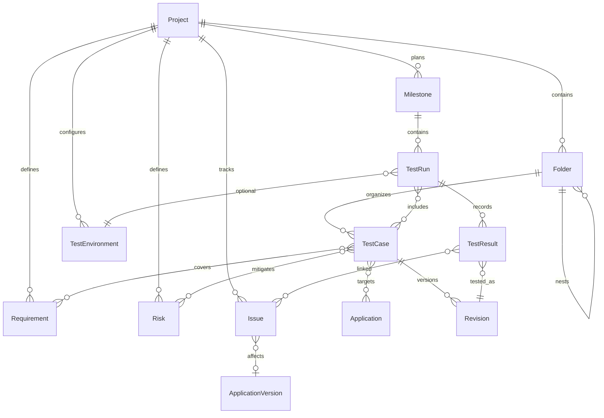

# TestMonitor — competitive TMS research

Research date: 2026-11-14. Prefer primary sources (testmonitor.com, help.testmonitor.com, docs.testmonitor.com). Review quotes from Capterra/G2 as published.

---

## 1. Overview

**Vendor:** TestMonitor (Cerios B.V., Netherlands). Part of Cerios, a QA consultancy/platform brand. Product marketed as an online, unified QA / test management platform oriented to UAT and agile delivery. ([About](https://www.testmonitor.com/about-us), [Home](https://www.testmonitor.com/))

**Deployment:** Cloud-hosted SaaS only (`https://{domain}.testmonitor.com`). Pricing and security pages emphasize cloud hosting, 24/7 monitoring, GDPR, ISO 27001. **Self-hosted / Data Center / Jira-app packaging: not found in docs.** Jira integration is Jira Cloud only (Atlassian Server discontinued). ([Pricing](https://www.testmonitor.com/pricing), [Security](https://www.testmonitor.com/features/security), [Jira help](https://help.testmonitor.com/jira))

**Target users:** Test managers, UAT coordinators, business/end-user testers with little IT experience, project managers, and QA teams that want requirements → cases → milestones/runs → issues in one product. Marketing stresses “professional-grade test runs” that non-experts can execute. ([Home](https://www.testmonitor.com/), [Test case management](https://www.testmonitor.com/test-case-management-with-testmonitor))

**License model.** **Closed source** (proprietary commercial SaaS). Published per-user plans; no public product source repository found. Not open source or open core. Source: [testmonitor.com/pricing](https://www.testmonitor.com/pricing).

**Pricing (checked 2026-11-14 from [pricing page](https://www.testmonitor.com/pricing)):**

| Plan | Published price | Notes |
|------|-----------------|-------|
| **Starter** | **$11 /user/month** (monthly billing shown); **3 users included** | Core TMS, built-in issue tracker, reports, API, integrations, automation ingest; **500 automated test results/day** |
| **Professional** | **$16 /user/month**; starts at **5 users** | + custom fields/lists, branding, OIDC SSO, two-way sync integrations; **2,500 results/day** |
| **Enterprise** | **Custom**; starts at **10 users** | + SAML SSO, SCIM, enforced 2FA, priority support, custom invoicing, CSM; **5,000 results/day** |

Annual billing advertised as “Save up to 50%.” Older help article still mentions Starter at $39/month for 3 users (pre–per-user framing); treat the live pricing page as authoritative. Non-profit / student / open-source discounts via sales. ([Pricing](https://www.testmonitor.com/pricing), [How pricing works](https://help.testmonitor.com/how-does-pricing-work))

**Trial / free plan:** **14-day free trial**, all features, **no credit card**. No perpetual free plan found. Trial data deleted after ~1 month if unused (AVG/GDPR framing). ([Pricing FAQ](https://www.testmonitor.com/pricing))

---

## 2. Data model and entities

Sources: [Using TestMonitor](https://help.testmonitor.com/using-testmonitor), entity help articles, OpenAPI 8.4.0.

| Entity | What it is | Key fields / notes |
|--------|------------|--------------------|
| **Account / environment** | Tenant (`{domain}.testmonitor.com`) | Name, language (EN/NL/DE), domain, version (auto-updated) |
| **Project** | Work container; features toggled per project | Requirements, risks, applications, issue tracking, messages optional |
| **Folders** | Replace classic “suites”; nest up to **5 levels**; Home = root | Name, description; clone with/without subfolders & cases; soft-delete/restore |
| **Test case** | Reusable instructions + expected outcome | Name, duration, instructions (ordered steps, rich text), preconditions, expected result, test data, tags, draft/active (or review states), attachments (≤50 MB), custom fields, links to requirements/risks/applications |
| **Steps** | Ordered instruction lines on a case | Per-step rich text; paste bullets → auto-split steps. **Shared steps / call-to-test: not found in docs** |
| **Parameters / datasets** | Data-driven case expansion | **Not found in docs** (free-text “Test data” field only) |
| **Test run** | Assignment of cases + testers in a time window; lives under a **milestone** | Name, environment, period, priority, draft, subscribers, tags, ordered cases, assigned users |
| **Milestone** | Sprint/release/UAT checkpoint; houses runs | Name, description, deadline date; optional milestone types |
| **Test plan** | Separate plan entity | **Not found** — planning = milestones + test runs |
| **Requirement** | Spec / objective for coverage | Type (Functional / Non-functional / User / Business — customizable), name, description, tags, custom fields |
| **Risk** | Risk-based testing object | Classification (Low/Medium/High — customizable), name, description, tags |
| **Application (+ versions)** | Product catalog (env-level); link cases; version issues | Name; versions for “affects” / fix targeting |
| **Issue (defect)** | Built-in tracker | Category, name, description, status, priority, assignee, affects version, resolution, tags, tasks, attachments, comments |
| **Test result** | Outcome of a case in a run (revision-pinned) | Status (Pass / Caution / Fail / Blocked — customizable + validation rules), description, attachments, comments, linked issues |
| **Test environment** | Config for a run (browser/OS/device/app) | Selected when creating/cloning runs |
| **Custom fields** | Pro+ | On requirements, risks, cases, runs, issues; types: text, rich text, number, dropdown, multi-select, checkbox, date, URL, user |
| **Tags / labels** | Cross-cutting labels | On cases, requirements, risks, issues, runs |
| **Attachments** | Files on cases, results, issues | Max **50 MB** |
| **Revisions (versions)** | Automatic case snapshots | Created on content/tag/custom-field/relation changes; compare, rollback; runs pin a revision |
| **Baselines** | Named suite baseline | **Not found in docs** (revisions + run pinning instead) |
| **Teams / users / roles** | Membership & RBAC | Default roles: Tester, Project Manager, Developer, Auditor + custom roles |
| **Webhooks** | Project outbound events | Up to **5** active webhooks per project |

---

## 3. Relationships and flows

**Typical hierarchy:** Project → (optional) Requirements / Risks / Applications → Test cases in Folders → Milestone → Test runs (cases + users + environment) → Test results → Issues (optional external sync).

**End-to-end workflow:** Enable project features → Define requirements/risks → Design cases in folders (draft → active or review) → Create milestone → Wizard: run details → select cases (filter by folder/req/risk/tag) → assign users → open run → testers execute (Pass/Caution/Fail/Blocked) → create/link issues → Track + Analyze reports → close run.

**Case versioning / review:** Revisions auto-created on material edits; runs use the **latest Active** revision when planned; upgrade button moves a run to a newer revision without rewriting past results. Optional review: Draft → In review → Active | Rejected; “Require review on changes” sends Active edits back to Draft. ([Revisions](https://help.testmonitor.com/test-case-revisioning), [Review](https://help.testmonitor.com/review-test-cases))

**Statuses:**

- **Case (no review):** Draft | Active. **With review:** + In review | Rejected.
- **Run lifecycle:** Draft → Upcoming → Open → In Progress → Completed | Expired → Closed (re-openable).
- **Result:** Pass, Caution, Fail, Blocked (customizable lists + required description/attachment rules).
- **Issue:** default Open / Resolved / Retest (+ custom lists for category, priority, resolution).
- **Requirement/risk “status”:** derived from latest linked case results.

**Customization:** Custom lists for requirement types, risk classifications, issue fields, result statuses; custom fields Pro+. ([Custom fields](https://help.testmonitor.com/using-custom-fields), [Customize lists](https://help.testmonitor.com/customize-lists))

---

## 4. Full feature list

**Authoring:** Step editor with rich text, preconditions, expected result, test data, tags, attachments, clone/move/batch update, comments with @mentions and `#case` refs. **BDD/Gherkin editor: not found.** **Shared steps / call-to-test: not found.** **Parameterized datasets: not found.** Optional review workflow and automatic revisions (8.4). Excel/CSV import of cases. ([Test cases](https://help.testmonitor.com/how-to-use-test-cases))

**Organisation:** Nested folders (5 levels), drag-reorder cases/requirements/risks, tags, applications, multi-select filters, project feature toggles.

**Execution:** Personal “Run” inbox; step-through runner; clipboard/screenshot paste; QR handoff to phone/tablet; create/link issues mid-run; progress sidebar; batch open/close/expire runs; assign multiple users to a run (each executes the case set — not “split cases across testers” as separate ownership of subsets in one run). Timers as wall-clock duration estimate field; **execution stopwatch: not found in docs.** ([Running tests](https://help.testmonitor.com/running-tests), [Mobile](https://help.testmonitor.com/run-tests-using-your-smartphone))

**Traceability / coverage:** Link cases ↔ requirements/risks/applications; coverage reports + traceability matrices; requirement/risk status from latest results. ([Coverage](https://help.testmonitor.com/coverage-traceability))

**Built-in reports (Analyze):** Summary — Project, Milestone, Issue; Coverage & Traceability — by requirement / risk / application / test case + matrices; Test Workload; Changelog; Task Report; Cumulative Flow. Share via in-app link; PDF/print. Power BI listed under reporting integrations. ([Using reports index](https://help.testmonitor.com/using-testmonitor), [Summary](https://help.testmonitor.com/summary-reports))

**Search / filters:** UI filters + API `filter[]`, fuzzy `query`, `order`, `with[]` relations. **Dedicated query language (JQL-like): not found.**

**Import / export:** Excel/CSV for requirements, risks, test cases, issues; CSV/Excel export of all test results; import revert if records unchanged. JUnit XML via CLI (automation). ([Imports & exports](https://help.testmonitor.com/imports-exports))

**Audit:** Environment-wide audit log + per-object activity; IP / user-agent. ([Audit log](https://help.testmonitor.com/audit-log))

**Permissions / SSO / SCIM:** Project RBAC; 4 defaults + custom stackable roles. OIDC (Google, Azure, Okta) on Professional+; SAML + SCIM on Enterprise; optional enforced 2FA (Enterprise). ([Roles](https://help.testmonitor.com/roles-and-permissions), [SSO](https://help.testmonitor.com/single-sign-on-sso))

**AI features:** **Not found in official docs/marketing** as of research date.

**Localisation:** Account + user language: **English, Dutch, German**. ([Account](https://help.testmonitor.com/manage-your-testmonitor-account))

**Mobile:** Responsive web + QR continue-on-phone; not a native store app emphasis. **Offline / PWA: not found in docs** (cloud-only product).

---

## 5. Automation and CI

**Primary path:** Activate **JUnit XML** integration per project → install `@testmonitor/testmonitor-cli` → `testmonitor-cli junit submit …`. Marketing claims **30+** automation tools via JUnit XML (explicitly: Cucumber, Jest, JUnit, PHPUnit, Robot Framework, xUnit.net, etc.). Help also lists Playwright, Selenium, TestNG, JOSF as automation entries. ([JUnit help](https://help.testmonitor.com/junit-xml), [Integrations apps](https://help.testmonitor.com/integrations-apps), [8.1 blog](https://www.testmonitor.com/blog/introducing-testmonitor-8.1))

**Formats:** **JUnit XML** is the documented ingest format. Native Cucumber JSON / Allure / NUnit-specific / Robot native: **not found** (use JUnit export from those tools).

**CLI options:** `-d` domain, `-t` JUnit token, `-f` file, `-a` automation-type, `-n` run name, `-m` / `-o` milestone id or find-or-create by name, `-e` environment id, `-p` preserve-names, `-s` skip-root-suite, `-v` verbose. ([CLI](https://help.testmonitor.com/testmonitor-cli))

**CI:** Docs say submit from **GitHub, GitLab, CircleCI, Jenkins** (and any CI that can run Node CLI). No first-party GitHub Action marketplace package documented beyond CLI invocation.

### Auto-create test cases from CI? Matching?

**Yes — auto-create is the default behavior of the JUnit XML integration.**

Official help states the integration supports:

1. **“Creating JUnit XML test cases, along with their associated results and execution run”**
2. **“Identification of previously uploaded JUnit XML test cases”** so later submits create new runs against the same cases
3. Configuration of **imported case placement** and **milestone** behavior

Marketing: “TestMonitor automatically extracts the test cases and their results from a JUnit XML.” ([JUnit help](https://help.testmonitor.com/junit-xml), [JUnit marketing](https://www.testmonitor.com/integrations/junit-xml))

**Matching details published:**

- Matching is framed as **identification of previously uploaded JUnit cases** across submits (stable identity for re-runs).
- **`--preserve-names`**: keep original names from XML; without it, naming may follow TestMonitor’s default convention (exact alternate naming algorithm **not fully documented**).
- **`--skip-root-suite`**: controls suite → folder nesting depth.
- Exact match key (classname+name vs suite path hash vs opaque internal id) is **not fully specified** in public help; OpenAPI has no dedicated “external automation id” field documented for cases. Practically: **name/suite structure from JUnit**, with persistence across uploads.

**Options / limits:**

| Limit | Value |
|-------|--------|
| Daily results | Starter **500** / Pro **2,500** / Enterprise **5,000** |
| Submit rate | Max **10 submissions / minute** |
| Milestone | Default in project settings, or `-m` / `-o` (find or **create**) |
| Placement | Suite nesting → folders; skip root suite; preserve names |
| Deactivate | Stops new submits; existing cases/runs/results kept |

**Linking automation to pre-authored manual cases by TMS ID / annotation:** **not found** as a first-class option — ingest **creates** cases rather than requiring prior case IDs in the XML.

**Flaky detection:** **not found in docs.**

**Run merging:** Each submit creates a **new test run**; re-identification reuses cases. Merging multiple XML files into one run: **not found** (submit one file per CLI invocation; multiple submits = multiple runs).

---

## 6. API

**Type:** REST + JSON. Spec: OpenAPI **8.4.0**. Docs: [https://docs.testmonitor.com/](https://docs.testmonitor.com/) (OpenAPI YAML also served from docs).

**Base URL:** `https://{domain}/api/v1` (e.g. `https://acme.testmonitor.com/api/v1`).

**Auth:** Personal Access Token as `Authorization: Bearer <token>` (My Account → API). HTTPS required. Separate **JUnit integration token** for CLI (not the same as PAT in help wording).

**Rate limits:** **1000 requests / 60 s** per access token (includes UI actions sharing the token). Headers: `X-RateLimit-Limit`, `X-RateLimit-Remaining`. Over limit → **HTTP 429**.

**Pagination:** `limit` (default 15, min 5, max 100) + `page` (from 1); `meta` + `links` Laravel-style.

**Other query features:** `filter[]`, fuzzy `query`, `order`, `with[]` / `with=` relations.

**Webhooks:** Project webhooks (POST JSON, HMAC-SHA256 `Signature` header, secret, HTTPS only); max **5** active; retry 1s/10s/100s then disable after 3 failures; logs 14 days; imports excluded from webhook fan-out. API: `/webhooks`, `/webhooks/{id}`. ([Webhooks](https://help.testmonitor.com/webhooks))

**Main endpoint groups (from OpenAPI):**

| Group | Operations (representative) |
|-------|-----------------------------|
| Projects / members | CRUD, archive/restore, members, list types |
| Applications / versions | CRUD, batch, versions |
| Requirements / tags | CRUD, batch, link test cases |
| Risks / tags | CRUD, batch, link test cases |
| Test case folders | CRUD, restore |
| Test cases | CRUD, move, batch, revisions, review states, attachments, comments, relations |
| Milestones | CRUD, batch |
| Test runs | CRUD, open/close/clone/move, batch, users, cases, upgrade revision |
| Test results | CRUD, attachments, comments, link issues, viewed flags |
| Issues | CRUD, batch, tasks, attachments, comments, link results |
| Test environments | CRUD |
| Custom fields | List/manage |
| Teams / users | CRUD, membership |
| Webhooks | CRUD |
| My-* | my-projects, my-test-runs, my-issues, my-tasks, my-account |

Official Java client and community MCP wrappers exist; prefer REST + CLI for CI. ([docs](https://docs.testmonitor.com/), [Java client](https://github.com/testmonitor/api-java-client))

---

## 7. Integrations

**Issue trackers / PM:** Jira Cloud (send/link/import issues & requirements; status sync; two-way sync Pro+), Azure DevOps (work items similarly), ClickUp, Asana, DoneDone, MantisBT, TOPdesk. **Linear: not found.** **OpenProject: not found.**

**Chat:** Slack, Microsoft Teams.

**Automation:** JUnit XML + CLI; Playwright / Selenium / TestNG / JOSF listed; Zapier for “thousands more.”

**SSO:** Google, Microsoft Azure, Okta — OIDC (Pro+) / SAML (Enterprise) + SCIM (Enterprise).

**Reporting:** Microsoft Power BI.

**Marketplace:** Product-owned integrations catalog + Zapier; not an Atlassian Marketplace TMS app. ([Integrations](https://www.testmonitor.com/integrations), [Help apps](https://help.testmonitor.com/integrations-apps), [Jira](https://help.testmonitor.com/jira))

---

## 8. Marketing positioning

Headline: **“All your test management needs. One easy-to-use platform.”** Differentiator claims: unified QA (requirements, risks, cases, milestones/runs, built-in issues, reports); UAT-friendly runner for non-technical testers; risk-based testing; ISO 27001 / enterprise SSO; “30+” automation tools via JUnit; “Trusted by 1000+ customers.” Positioned against spreadsheet chaos and complex TMS tooling — **simplicity and acceptance testing**, not deep automation IDE or AI-first authoring. ([Home](https://www.testmonitor.com/), [QA page](https://www.testmonitor.com/quality-assurance-test-management-software))

---

## 9. What users love

Themes from Capterra (~4.7/20) and G2 (~4.4–4.5, small sample) plus vendor-published quotes:

1. **Ease for UAT / business testers** — “Without testing experience they become user acceptance testers within the hour!” (G2 Test Manager, via [leave-a-review](https://www.testmonitor.com/leave-a-review)). “They can really start testing within minutes.” (Marcel F., Capterra).
2. **End-to-end flow** — requirements → runs → issues → reports in one place; “Everything from requirement to bug status at one place.” (Hafiz M., Capterra).
3. **Reporting for stakeholders** — Milestone Summary / Cumulative Flow called out; “good reporting on the different levels from testers to management.” (Everdina G., Capterra).
4. **Support & onboarding** — “customer service team are very approachable”; support “reply within minutes.” (Tina B. / Hans-Paul L., Capterra).
5. **Value / quick start** — web-based, no server; “more reasonable cost” vs alternatives; clone/move for regression suites. ([Capterra reviews](https://www.capterra.com/p/161759/TestMonitor/reviews/))

---

## 10. What users dislike

1. **Terminology / setup ramp for large plans** — “Took time to learn and adjust to what the terms are… Suite, case, requirements…” (Carol L., Capterra).
2. **Filter UX / workflow gaps** — “all the used filters have been rebooted… I miss also a sort of workflow management.” (ICT Consultant, Capterra).
3. **Role / workflow limits (historical)** — “The limited roles available within the tool” (IT Office Administrator, Capterra — note: custom roles exist now; complaint may be dated).
4. **Automation is ingest-only** — “It is manual testing and not automated testing… integrating with automated testtools, but it is not integrated.” (Testmanager, Capterra). Third-party summaries also note inability to **split one run’s cases across testers** as a documented complaint. ([Kualitee review](https://www.kualitee.com/review/testmonitor-review/))
5. **External incident linking friction** — “no easy way to connect with the support systems for incidents” (teammanager ICT, Capterra). Wishlist: editable case numbering, case priority field, GitLab issue integration.

---

## 11. Ideas for Vulyk

Vulyk already covers folders/cases/plans/runs, campaigns/iterations, CI ingest, requirements, Jira/OpenProject, reports/flaky, RBAC/SSO, LLM, MCP, importers, PWA offline, self-hosted AGPL.

1. **Copy: UAT-first runner UX** — clipboard screenshots, QR handoff to phone, mandatory fail evidence (description + attachment). Differentiates for business testers.
2. **Copy: revision pin on runs + explicit upgrade** — keeps evidence honest while authoring continues; Vulyk versioning should expose “which revision was executed” the same way.
3. **Copy: optional review gate** (“require review on changes”) for regulated teams — complements LLM-generated case edits.
4. **Copy carefully: CI auto-create** — TestMonitor’s strength is zero-config case creation from JUnit. Vulyk should offer **modes**: create-missing | match-by-key/annotation | match-by-name | fail-if-unknown — and document the match key (TestMonitor’s opacity here is a pain to avoid).
5. **Avoid: cloud-only + daily automation quotas** — Vulyk’s self-hosted unlimited ingest is a wedge; keep quotas out of OSS default.
6. **Avoid: JUnit-only / no flaky** — keep multi-format ingest + flaky analytics as differentiators vs TestMonitor’s gap.
7. **Copy: risk entity + coverage matrices** — optional risk-based layer beside requirements (Vulyk has requirements; risks are a competitive checkbox for UAT/enterprise).
8. **Copy: soft-delete + import revert** — safer migrations from TestRail/Xray/Zephyr.
9. **Avoid: seat tiers gating two-way sync / custom fields** — keep OpenProject/Jira sync and custom fields in core OSS.
10. **Positioning:** Market Vulyk as “TestMonitor-class UAT clarity + automation-native CI (matching modes, flaky, MCP/LLM) + self-hosted” — win teams who like TestMonitor’s simplicity but need offline PWA, OpenProject, and no result caps.

---

## 12. Sources

- https://www.testmonitor.com/
- https://www.testmonitor.com/pricing
- https://www.testmonitor.com/about-us
- https://www.testmonitor.com/quality-assurance-test-management-software
- https://www.testmonitor.com/test-case-management-with-testmonitor
- https://www.testmonitor.com/features/security
- https://www.testmonitor.com/integrations
- https://www.testmonitor.com/integrations/junit-xml
- https://www.testmonitor.com/integrations/azure-devops
- https://www.testmonitor.com/blog/introducing-testmonitor-8
- https://www.testmonitor.com/blog/introducing-testmonitor-8.1
- https://www.testmonitor.com/blog/introducing-testmonitor-8.4
- https://www.testmonitor.com/blog/pricing-updates-from-testmonitor
- https://www.testmonitor.com/leave-a-review
- https://help.testmonitor.com/using-testmonitor
- https://help.testmonitor.com/how-to-use-test-cases
- https://help.testmonitor.com/how-to-use-test-runs
- https://help.testmonitor.com/how-to-use-milestones
- https://help.testmonitor.com/how-to-use-requirements
- https://help.testmonitor.com/how-to-use-risks
- https://help.testmonitor.com/how-to-use-issue-management
- https://help.testmonitor.com/test-case-revisioning
- https://help.testmonitor.com/review-test-cases
- https://help.testmonitor.com/running-tests
- https://help.testmonitor.com/run-tests-using-your-smartphone
- https://help.testmonitor.com/junit-xml
- https://help.testmonitor.com/testmonitor-cli
- https://help.testmonitor.com/integrations-apps
- https://help.testmonitor.com/jira
- https://help.testmonitor.com/webhooks
- https://help.testmonitor.com/roles-and-permissions
- https://help.testmonitor.com/single-sign-on-sso
- https://help.testmonitor.com/audit-log
- https://help.testmonitor.com/using-custom-fields
- https://help.testmonitor.com/imports-exports
- https://help.testmonitor.com/export-test-results
- https://help.testmonitor.com/summary-reports
- https://help.testmonitor.com/coverage-traceability
- https://help.testmonitor.com/manage-your-testmonitor-account
- https://help.testmonitor.com/managing-project-features
- https://help.testmonitor.com/test-environments
- https://help.testmonitor.com/applications
- https://help.testmonitor.com/how-does-pricing-work
- https://docs.testmonitor.com/
- https://docs.testmonitor.com/openapi.yaml (OpenAPI 8.4.0)
- https://changelog.testmonitor.com/
- https://www.npmjs.com/package/@testmonitor/testmonitor-cli
- https://www.capterra.com/p/161759/TestMonitor/reviews/
- https://www.kualitee.com/review/testmonitor-review/
- https://aqua-cloud.io/testmonitor-alternatives/
