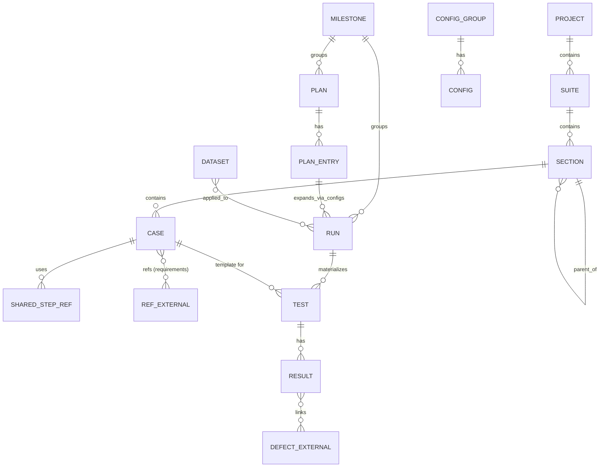

# TestRail — Competitive TMS Research

*Research date: 14 November 2026. Prefer official TestRail / Gurock / Sembi sources; review quotes from G2, Capterra, TrustRadius, and Reddit.*

---

## 1. Overview

**Vendor.** TestRail is a web-based test management system originally from **Gurock Software GmbH**, historically associated with **Idera**, and marketed today under the **Sembi** quality-software family (sister products include UI automation and app-shielding brands on testrail.com).

**Deployment.**

| Mode | Availability |
| --- | --- |
| **Cloud** (hosted by TestRail, e.g. `*.testrail.io`) | All plans |
| **On-premise / Server** (Windows, Linux, Docker) | Professional & Enterprise only; **minimum 10 seats** and **12-month** contract |
| **Data residency** | Listed on Essentials+ |
| **Private Cloud** | Marketing: “Coming soon” |
| **Jira app** | “TestRail Integration for Jira” (not a pure Jira-native TMS; TestRail remains a standalone product) |

**Target users.** QA leads, manual and automation engineers, and engineering managers who need a dedicated system of record for cases, runs, plans, milestones, and release evidence—especially mid-market and enterprise teams that also use Jira / Azure DevOps / CI.

**License model.** **Closed source** (proprietary commercial product). No public source for the TestRail application itself was found on vendor sites. The companion **TestRail CLI (`trcli`)** is published as open source under **MPL-2.0** at [github.com/gurock/trcli](https://github.com/gurock/trcli); TestRail Support also describes the CLI as open source ([Getting Started with the TestRail CLI](https://support.testrail.com/hc/en-us/articles/7146548750868-Getting-Started-with-the-TestRail-CLI)). The deprecated `trcli-action` GitHub Action is **MIT** ([gurock/trcli-action](https://github.com/gurock/trcli-action)). This is **not** open-core: the SaaS/Server product remains closed; only the CLI/integration helpers are OSS.

**Pricing (checked 14 Nov 2026 from [testrail.com/pricing](https://www.testrail.com/pricing/)).** Per-user, billed annually unless noted:

| Plan | Published annual price | Deployment | Notable limits |
| --- | --- | --- | --- |
| **Essentials** | **$22** / user / month | Cloud only | Max **5 users**; API **100 req/min**; storage **50 GB** |
| **Professional** | **$38** / user / month (FAQ on same page also says **$39**) | Cloud or on-prem | API **180 req/min**; storage **50 GB** |
| **Enterprise** | **$78** / user / month | Cloud or on-prem | API **300 req/min**; storage **500 GB**; SSO, audit, versioning, parameterization, cross-project reports |

Monthly billing is available for Essentials and Professional; Enterprise is annual-only. There is **no permanently free plan**. Every plan includes a **30-day free trial** with **no credit card required**. All plans advertise full AI capabilities (admins can disable AI for compliance).

Sources: [Pricing](https://www.testrail.com/pricing/), [Homepage](https://www.testrail.com/).

---

## 2. Data model and entities

Hierarchy (design vs execution):

**Project → Suite(s) → Section(s) → Case(s)** for design; **Milestone / Plan → Run → Test → Result** for execution.

| Entity | What it is | Key fields / notes |
| --- | --- | --- |
| **Project** | Top organizational unit | Project type: single repository vs multi-suite; optional approvals toggle |
| **Suite** | Extra repository partition in multi-suite projects | `id`, `name`, `project_id`; entities in different suites are isolated |
| **Section** | Nested folders for cases | `id`, `name`, `parent_id`, `suite_id`, `depth` |
| **Test case** | Spec / procedure template | `id`, `title`, `section_id`, `suite_id`, `template_id`, `type_id`, `priority_id`, `milestone_id`, `estimate`, `refs` (requirements), `custom_*`, version metadata (Enterprise) |
| **Steps** | Structured steps on Steps template | Arrays of step + expected result; step-level results on execution |
| **Shared steps** | Reusable consecutive step blocks (project-scoped) | Name, steps, usage list, history (compare/restore on Enterprise) |
| **Parameters / datasets** | Enterprise data-driven testing | Up to **500 variables**, up to **100 datasets** per project; names: letters/numbers/underscores, ≤50 chars |
| **Test** | Instantiation of a case inside a run | One case → many tests across runs; holds results |
| **Result** | Status + evidence for a test | `status_id`, `comment`, `elapsed`, `version`, `defects`, attachments, custom result fields |
| **Run** | Executable set of tests | Name, suite, milestone, assignee, include_all / case filter, dataset, close/freeze |
| **Plan** | Groups runs; expands configs into multiple runs | Entries + `config_ids` combinations |
| **Milestone** | Release/sprint goal container | Name, due date, completed flag; links runs/plans/cases |
| **Requirements / stories** | Not first-class objects | Linked via **`refs`** (comma-separated external IDs) + reference/defect plugins (Jira, ADO, etc.) |
| **Defects** | External tracker issues | Linked on results (`defects`); push via defect plugins |
| **Configurations** | Env matrix (browser/OS/device groups) | Groups + named configs; plan creates one run per valid combination |
| **Custom fields** | Case and result customization | String, Text, Integer, URL, Checkbox, Dropdown, Multiselect, User, Date, Milestone, Steps, BDD Scenarios, AI Automation (system) |
| **Attachments** | Files on cases/results/runs/plans/sections | Via UI and Attachments API |
| **Labels** | Tagging (pricing: unlimited on all plans) | Label API group exists |
| **Templates** | Case field layouts | Scripted / Steps / Exploratory / BDD / AI Evaluation, etc. |
| **Baselines / branches** | Marketing mentions baselines for branches/versions | Detailed baseline semantics: treat as product capability marketed on G2/feature pages; deep server docs not fully fetched in this pass |
| **Case versioning** | Enterprise change history | Compare versions side-by-side; restore (Enterprise) |

Sources: [API entities intro](https://support.testrail.com/hc/en-us/articles/15758177606676-API-uses-cases-intro), [Cases API](https://support.testrail.com/hc/en-us/articles/7077292642580-Cases), [Parameterization](https://support.testrail.com/hc/en-us/articles/7768851133716-Test-parameterization-variables-and-datasets), [Shared steps](https://support.testrail.com/hc/en-us/articles/7101778857236-Shared-steps), [Configurations](https://support.testrail.com/hc/en-us/articles/23043143013268-Configurations), [Platform](https://www.testrail.com/platform/).

---

## 3. Relationships and flows

### Entity relationships

### Typical end-to-end workflow

1. Create **project** (and suites if multi-suite).
2. Author **cases** in **sections** (optionally shared steps, BDD, custom fields, `refs` to Jira/ADO).
3. (Enterprise) Move cases through **Design → Review → Ready (Approved)**; optionally restrict runs to approved cases.
4. Define **milestone** for a release/sprint.
5. Create a **run** (or **plan** with **configurations** / datasets) selecting cases via include-all, IDs, or dynamic filters.
6. Assign testers; execute in UI (3-pane runner, timers, step results) and/or upload automation via **TRCLI** / API.
7. Link **defects** on failed results; close runs to freeze history.
8. Generate **reports** / dashboards; schedule email for stakeholders.

### Case versioning / review / approval

- **Enterprise:** test case **versioning** (view/compare/restore) and **review & approvals**.
- Default case statuses: **Design**, **Review**, **Ready (Approved)** — customizable under Admin → Customizations → Case Statuses; one default and one approved status required.
- Enabling approvals is **per project**. Editing a case resets it to the default (needs re-approval). Runs that include “all cases” default to **approved-only** unless filters/manual selection override.

### Result statuses

System defaults (`get_statuses`): **1 Passed**, **2 Blocked**, **3 Untested**, **4 Retest**, **5 Failed**. Custom statuses configurable; “final” statuses feed run/plan/milestone statistics. Untested cannot be submitted as a new result via API.

Sources: [API entities](https://support.testrail.com/hc/en-us/articles/15758177606676-API-uses-cases-intro), [Review & approvals](https://support.testrail.com/hc/en-us/articles/7766980011028-Test-case-review-approvals), [Statuses](https://support.testrail.com/hc/en-us/articles/7077935129364-Statuses), [Enterprise summary](https://support.testrail.com/hc/en-us/articles/40000509459604-Summary-of-Enterprise-Features).

---

## 4. Full feature list

**Test authoring.** Markdown text fields; **templates** (scripted, separated steps, exploratory, **BDD/Gherkin** with Feature/Scenario/Given-When-Then, import/export `.feature`); **shared steps**; **quick-add** cases; **custom fields**; **labels**; Enterprise **variables/datasets** in markdown/string/step fields (not titles); AI case / BDD / script generation (Cloud; human-in-the-loop). **Call-to-test** as a distinct Xray-style entity: **not found in docs** (shared steps cover reuse).

**Organisation.** Projects, suites, nested sections, copy/reuse cases across runs/projects, milestones, plans, configurations, to-do lists, estimates & forecasting.

**Execution.** Manual 3-pane runner; **Pass & Next**; elapsed **timer**; assignment; bulk result patterns via API; step-level and BDD scenario-level statuses; close/freeze runs; clone run/plan without results; push defects.

**Traceability.** `refs` + reference plugins; coverage/comparison/summary reports for references and defects; Jira two-way / Coverage Check; ADO Marketplace app.

**Built-in reports** ([Reports overview](https://support.testrail.com/hc/en-us/articles/9285210470420-Reports-overview)):

- Cross-project (Enterprise): Test Execution – Project Summary; User Workload  
- Cases: Activity Summary; Coverage for References; Property Distribution; Status Tops  
- Defects: Summary; Summary for Cases; Summary for References  
- Results: Comparison for Cases; Comparison for References; Property Distribution  
- Summary: Milestone; Plan; Project; Run  
- Users: Workload summary  

Live dashboards; scheduled/shareable reports (Professional+ for scheduled/email depth per pricing matrix).

**Search / filters.** Advanced filters for case selection and dynamic filters on runs; dedicated query language (JQL-like): **not found in docs**.

**Import / export.** CSV and XML import/export (all plans per pricing). TRCLI `parse_openapi` bootstraps cases from OpenAPI. Migration from Zephyr/Xray/qTest marketed via CSV/XML + Concierge.

**Audit / permissions / SSO.** Enterprise: **audit logs**, project-level admin, SSO (**SAML / OAuth / OIDC**), MFA, IP allow-list. Professional: RBAC, custom roles/groups. Server: LDAP/AD. Native **SCIM** as a first-class TestRail feature: **not found in official TestRail docs**; third-party identity connectors (e.g. One Identity) document SCIM mappings. SSO can **auto-provision** users on login, but IdP deactivation is **not** auto-synced—admins must deactivate in TestRail.

**AI.** Case generation, BDD scenarios, script generation (Java/Python; Selenium/Playwright/Cucumber/Behave), prioritization (uses execution history, defects, **flaky-test signals**, semantics), AI Evaluation template, **MCP Server** (hosted; Cloud; beta). Admins enable via AI Hub; can disable for compliance. Data not retained / not used for training (vendor claims on pricing FAQ).

**Localisation.** UI languages **EN, DE, FR, ES** (pricing feature table).

**Mobile / offline.** Mobile native app / PWA offline mode: **not found in docs**. Mobile *test results* can be ingested via tools like Repeato. Web UI is the primary client.

Sources: [Platform](https://www.testrail.com/platform/), [Pricing](https://www.testrail.com/pricing/), [BDD](https://support.testrail.com/hc/en-us/articles/7827238336916-Behavior-Driven-Development-BDD), [SSO](https://support.testrail.com/hc/en-us/articles/7649434769812-Configure-SSO), [AI](https://www.testrail.com/ai-test-management/), [MCP](https://www.testrail.com/mcp/).

---

## 5. Automation and CI

### Result formats and CLI

Official **TRCLI** (`pip install trcli`, open-source [gurock/trcli](https://github.com/gurock/trcli)) parsers:

| Command | Format |
| --- | --- |
| `parse_junit` | **JUnit XML** (also used for TestNG, Pytest, Cypress, Playwright, NUnit when they emit JUnit-compatible XML) |
| `parse_cucumber` | **Cucumber JSON** (Cucumber, Behave, pytest-bdd, SpecFlow with JSON, etc.) |
| `parse_robot` | **Robot Framework** `output.xml` |
| `parse_openapi` | OpenAPI YAML/JSON → **create cases** (not result upload) |

**Allure** dedicated importer: **not found in docs** (teams typically convert Allure → JUnit or use API). Native framework “reporters” are marketed for JUnit, Cypress, Playwright, TestNG, NUnit, Selenium, Sauce Labs, etc., usually via JUnit XML + TRCLI or API.

### CI integrations

Documented/marketed: **Jenkins**, **GitHub Actions**, **GitLab CI**, **Azure DevOps**, **CircleCI**, **Bitbucket**. Pattern: generate report in pipeline → `trcli … parse_*` with API key. Webhooks and UI scripts can trigger automation or notify chat tools.

### Matching automated tests to cases (precise)

TRCLI supports two philosophies:

#### A. Code-first → **auto-create** unmatched cases

1. Create custom case field, system name **`automation_id`**, type **Text** (docs also say String in one place; TRCLI README: Text).  
2. Default automation ID from JUnit: **`classname.name`** (e.g. `tests.LoginTests.test_case_1`).  
3. Optional override via property: `testrail_case_field` = `custom_automation_id:…`.  
4. On upload, CLI matches report tests to cases by `automation_id`.  
5. **If no match:** prompts to create; in CI use **`-y` / `--yes`** to auto-create, or **`-n` / `--no`** to refuse.  
6. Auto-create also adds missing **sections**; for multi-suite projects pass **`--suite-id`** (else CLI finds/creates suite).  
7. Renaming/moving tests changes `automation_id` → **duplicate cases** unless TestRail field is updated.  
8. TRCLI can auto-create the `automation_id` field itself when using `--case-matcher auto` with `-y` (per README).  
9. Cucumber/BDD auto-creation has **separate template logic**; README notes auto-creation is **not** supported the same way for some BDD/AI Evaluation edge cases—follow current TRCLI docs for limits.

#### B. Specification-first → match existing **case IDs** (prefer `-n`)

| Matcher | Mechanism |
| --- | --- |
| `--case-matcher name` | Case ID embedded in test **name** (`C123_test_login`, `test_login [C123]`, …) |
| `--case-matcher property` | JUnit `<property name="test_id" value="C123"/>` (comma-separated list maps **one** automation test → **multiple** cases, each getting its own result) |
| `--case-matcher auto` | Automation-ID / code-first path |

Annotations in code (e.g. Java `@TestRail`) are framework helpers that ultimately emit name/property/ID into the report—matching is still via CLI matchers above, not a separate TestRail server-side annotation engine.

### Does TestRail auto-create cases when CI sends results for unknown tests?

**Yes — but only through TRCLI’s code-first path when auto-creation is accepted (`-y`), after matching fails on `automation_id`.** It is **not** an unconditional server-side behavior of every result POST. Raw API `add_result` / `add_results_for_cases` requires existing case/test IDs; unmatched IDs fail rather than inventing cases. Specification-first uploads should use **`-n`** to avoid accidental duplicates.

### Flaky detection and run merging

- **Flaky:** Marketing/AI prioritization uses “flaky-test signals”; a dedicated flaky quarantine product (like Buildkite Test Engine) is **not found** as a first-class TestRail feature in support docs.  
- **Merging:** TRCLI can **glob-merge** multiple JUnit/Robot/Cucumber files into **one** upload/run; **`--run-id`** updates an existing run (manual + automated in one run). Merging two independent TestRail runs into one entity: **not found in docs**.

Sources: [Code-first](https://support.testrail.com/hc/en-us/articles/12609674354068-Code-first-workflow), [Specification-first](https://support.testrail.com/hc/en-us/articles/12609869124116-Specification-first-workflow), [JUnit mapping](https://support.testrail.com/hc/en-us/articles/12989737200276-JUnit-to-TestRail-mapping), [CLI reference](https://support.testrail.com/hc/en-us/articles/12908518569364-CLI-commands-reference), [TRCLI README](https://github.com/gurock/trcli), [TRCLI in CI](https://support.testrail.com/hc/en-us/articles/39964828672660-TRCLI-in-CI-CD-pipelines), [Integrations](https://www.testrail.com/integrations/).

---

## 6. API

- **Type:** REST (HTTP GET read / POST write), JSON UTF-8. **GraphQL: not found.**  
- **Base URL pattern:** `https://<instance>/index.php?/api/v2/<method>`  
- **Auth:** HTTP Basic — username (email) + password **or** API key (My Settings → API Keys). API must be enabled under Admin → Site Settings → API.  
- **Rate limits (Cloud):** Essentials **100**/min (pricing page); Professional **180**/min; Enterprise **300**/min — per **instance**. HTTP **429** + `Retry-After`. **Server: no built-in rate limits.**  
- **Pagination:** Bulk GETs default **250** records; `limit`/`offset`; cursor pagination (`use_cursor`, `cursor`) from TestRail **10.10+**; max `limit` **250** historically / **500** with 10.10+ (per API intro).  
- **Webhooks:** Events for plan/run/case/result/report (and cross-project report on Enterprise); templated payloads with variables (`%id%`, `%stats%`, `%custom_x%`, …).  
- **Reference:** [API reference section](https://support.testrail.com/hc/en-us/sections/7077185274644-API-reference), [Accessing the API](https://support.testrail.com/hc/en-us/articles/7077039051284-Accessing-the-TestRail-API), [Introduction](https://support.testrail.com/hc/en-us/articles/7077083596436-Introduction-to-the-TestRail-API).

| Endpoint group | Typical operations |
| --- | --- |
| Projects / Suites / Sections | get/add/update/delete |
| Cases / Case Fields / Types / Templates | get_case(s), add/update/delete, history |
| Shared Steps / Labels / BDDs | CRUD-style gets/adds |
| Runs / Plans / Milestones / Configurations | create runs/plans, close, configs |
| Tests / Results / Statuses / Result Fields | get_tests, add_result(s), add_results_for_cases |
| Datasets / Variables | Enterprise test data CRUD |
| Attachments | upload/list for case/run/plan/section |
| Users / Groups / Roles | user administration |
| Reports | get_reports, run reports (incl. cross-project) |

---

## 7. Integrations

| Category | Examples |
| --- | --- |
| **Issue / requirements** | **Jira** (two-way, Coverage Check, Confluence), **Azure DevOps** Marketplace app, GitHub Issues, GitLab Issues, Redmine, Bugzilla, Mantis, YouTrack, Rally, ClickUp, monday.com, Asana, Trello, Pivotal, FogBugz, Assembla, Axosoft, Trac, Aha! |
| **CI/CD** | Jenkins, GitHub Actions, GitLab, Azure DevOps, CircleCI, Bitbucket |
| **Automation** | Selenium, Cypress, Playwright, JUnit/TestNG, NUnit, Pytest, Robot, Ranorex, Sauce Labs, Functionize, testRigor, Repeato, Curiosity, Kiuwan |
| **Chat (Slack / Teams)** | No first-class Slack/Teams product on integrations page; **UI scripts** documented to push updates to Slack; webhooks/API for custom bridges |
| **SSO** | SAML 2.0, OAuth 2.0, OIDC (Enterprise); LDAP/AD on Server |
| **Marketplace** | Atlassian/Jira app; Azure DevOps Marketplace; partner listings on testrail.com/integrations |
| **Linear / OpenProject** | **not found** on official integrations list |

Sources: [Integrations](https://www.testrail.com/integrations/), [Supported configurations & integrations](https://support.testrail.com/hc/en-us/articles/23689587270548-TestRail-Supported-Configurations-Integrations), [Platform](https://www.testrail.com/platform/).

---

## 8. Marketing positioning

Headline claims from testrail.com:

- “**The one place your product’s quality lives**—so you know what’s ready to release.”  
- AI-driven test management (Sembi IQ): generate cases from requirements (**“up to 90% faster”**), script scaffolding (~30s), risk-based prioritization.  
- Single system of record for manual + automated results; audit-ready evidence.  
- Dedicated TMS (not a Jira plugin), with Cloud or on-prem.  
- Forrester TEI (commissioned): **204% ROI**, **$3.34M** benefits, **14-month** payback.  
- “**10,000+** QA teams” (G2 product copy).  
- Differentiators: depth of reporting/traceability, Enterprise governance, TRCLI code-first + spec-first automation, hosted **MCP** for coding agents.

Sources: [Homepage](https://www.testrail.com/), [AI](https://www.testrail.com/ai-test-management/), [MCP](https://www.testrail.com/mcp/), [Roadmap](https://www.testrail.com/roadmap/).

---

## 9. What users love

Themes with short quotes:

1. **Structure & hierarchy** — “structured test suite management, reusable test cases, and detailed reporting” (Capterra, Sarav T., May 2026).  
2. **Central visibility vs spreadsheets** — “keeps all our test cases, execution results, and testing progress in one place instead of … Excel” (Capterra, Hemal P., Nov 2026).  
3. **Jira integration** — “seamless integration with Jira helps connect test results to defects” (Capterra, Reshma T., Nov 2026).  
4. **Runs / regression history** — “repeatable execution through test runs and results tracking—so regression cycles feel more controlled” (Capterra, Rakhi V., Mar 2026).  
5. **Ease for testers** — “simple, user-friendly interface for managing test cases and tracking execution” (Capterra, Yogeshwar N., Nov 2026).  
6. G2 aggregate (~**4.4**/5, **663** reviews): ease of use, organization, Jira integration praised (G2 AI summary, Nov 2026). TrustRadius score **8.6**/10 (product overview).

Sources: [Capterra reviews](https://www.capterra.com/p/128204/TestRail/reviews/), [G2](https://www.g2.com/products/testrail/reviews), [TrustRadius](https://www.trustradius.com/products/testrail).

---

## 10. What users dislike

1. **Dated / clunky UI & large-suite UX** — “UI felt a bit outdated, especially when handling large test suites” (Capterra, Sarav T.); “navigation can sometimes feel cumbersome” (Reshma T.).  
2. **Performance at scale** — “Performance occasionally slowed down when managing a high volume of test cases” (Capterra). G2 summary likewise notes lag on large suites.  
3. **Price for small teams** — “TestRail is expensive for small teams” (Capterra, Arthi R.).  
4. **Support quality** — “responses and updates were too slow or none” (Capterra, Pavitra J.); Reddit: offshore support / canned answers (r/QualityAssurance, 2024).  
5. **Bulk maintenance & reporting flexibility** — bulk updates/reorg “tedious”; reporting “not as flexible as you’d want” (Rakhi V.).  
6. **Markdown / Jira formatting friction** — Reddit: TestRail↔Jira markdown mismatch; no free read-only seats for Jira viewers; API users billed as full seats (r/QualityAssurance thread, 2024).  
7. **Cloud bugs / release quality** — strong Reddit criticism of post-acquisition quality and cloud regressions (anecdotal; weigh accordingly).

Sources: [Capterra](https://www.capterra.com/p/128204/TestRail/reviews/), [G2](https://www.g2.com/products/testrail/reviews), [Reddit Zephyr→TestRail](https://www.reddit.com/r/QualityAssurance/comments/1dpddby/moving_to_testrail_previously_used_zephyr_scale/), [Reddit opinions](https://www.reddit.com/r/QualityAssurance/comments/1ccyp6t/testrail_question/).

---

## 11. Ideas for Vulyk

Vulyk context: open-source self-hosted TMS (folders/cases/plans/runs, CI ingest, campaigns/iterations, requirements, Jira/OpenProject, reports/flaky, RBAC/SSO, LLM, MCP, importers, PWA offline).

1. **Ship both CI mapping modes** TestRail’s users rely on: **stable automation_id (code-first + opt-in auto-create)** and **explicit case-ID annotations (spec-first, no silent creates)**. Default CI to “no create” unless operators enable it—avoids TestRail’s duplicate-case trap.  
2. **Make auto-create limits explicit** (suite/folder target, dry-run, rename detection warnings). TestRail’s `-y` is powerful but dangerous; Vulyk can win on safety UX.  
3. **First-class requirements** (not only `refs` strings) with OpenProject/Jira parity—TestRail’s coverage reports are strong, but the model is external-ID-centric.  
4. **Configurations × plan expansion** is a proven matrix pattern—keep Vulyk campaigns/iterations able to fan out env combinations cleanly.  
5. **Shared steps + parameterization** are Enterprise upsells in TestRail; as AGPL, Vulyk can offer them without tier gating—strong differentiator for self-hosted teams.  
6. **Avoid the large-suite UX pain**: fast search, bulk edit, and PWA offline (TestRail has no documented offline)—aligns with Vulyk’s PWA story.  
7. **Flaky as a real feature** (quarantine, history, signals in reports)—TestRail mostly folds “flaky signals” into AI prioritization marketing; Vulyk can productize this.  
8. **MCP + LLM with clear write gates**—TestRail’s hosted MCP (read-first, human approval) is the competitive bar; keep Vulyk’s MCP self-hosted and permission-aware.  
9. **Transparent API quotas / no seat tax on automation users**—Reddit dislike of paid API-equivalent seats is an opening for open-source licensing.  
10. **Importers**: CSV/XML plus JUnit/Cucumber/Robot parity with TRCLI; document Allure conversion if no native parser—set expectations honestly (“not found” → provide recipe).

---

## 12. Sources

1. https://www.testrail.com/  
2. https://www.testrail.com/pricing/  
3. https://www.testrail.com/platform/  
4. https://www.testrail.com/integrations/  
5. https://www.testrail.com/ai-test-management/  
6. https://www.testrail.com/mcp/  
7. https://www.testrail.com/roadmap/  
8. https://www.testrail.com/blog/ai-test-management-tools-by-use-case/  
9. https://support.testrail.com/hc/en-us/articles/15758177606676-API-uses-cases-intro  
10. https://support.testrail.com/hc/en-us/articles/7077083596436-Introduction-to-the-TestRail-API  
11. https://support.testrail.com/hc/en-us/articles/7077039051284-Accessing-the-TestRail-API  
12. https://support.testrail.com/hc/en-us/sections/7077185274644-API-reference  
13. https://support.testrail.com/hc/en-us/articles/7077292642580-Cases  
14. https://support.testrail.com/hc/en-us/articles/7077874763156-Runs  
15. https://support.testrail.com/hc/en-us/articles/7077711537684-Plans  
16. https://support.testrail.com/hc/en-us/articles/7077935129364-Statuses  
17. https://support.testrail.com/hc/en-us/articles/7077819312404-Results  
18. https://support.testrail.com/hc/en-us/articles/7169038183572-Webhooks  
19. https://support.testrail.com/hc/en-us/articles/12609674354068-Code-first-workflow  
20. https://support.testrail.com/hc/en-us/articles/12609869124116-Specification-first-workflow  
21. https://support.testrail.com/hc/en-us/articles/12989737200276-JUnit-to-TestRail-mapping  
22. https://support.testrail.com/hc/en-us/articles/12908518569364-CLI-commands-reference  
23. https://support.testrail.com/hc/en-us/articles/39964828672660-TRCLI-in-CI-CD-pipelines  
24. https://support.testrail.com/hc/en-us/articles/7146583042068-Integrating-with-JUnit5  
25. https://support.testrail.com/hc/en-us/articles/19126235360020-Integrating-with-Robot-Framework-using-Robot-parser  
26. https://github.com/gurock/trcli (README)  
27. https://support.testrail.com/hc/en-us/articles/9285210470420-Reports-overview  
28. https://support.testrail.com/hc/en-us/articles/7768851133716-Test-parameterization-variables-and-datasets  
29. https://support.testrail.com/hc/en-us/articles/7101778857236-Shared-steps  
30. https://support.testrail.com/hc/en-us/articles/7827238336916-Behavior-Driven-Development-BDD  
31. https://support.testrail.com/hc/en-us/articles/7766980011028-Test-case-review-approvals  
32. https://support.testrail.com/hc/en-us/articles/40000509459604-Summary-of-Enterprise-Features  
33. https://support.testrail.com/hc/en-us/articles/23043143013268-Configurations  
34. https://support.testrail.com/hc/en-us/articles/7649434769812-Configure-SSO  
35. https://support.testrail.com/hc/en-us/articles/23689587270548-TestRail-Supported-Configurations-Integrations  
36. https://support.testrail.com/hc/en-us/articles/15813183376148-Submitting-test-results  
37. https://www.g2.com/products/testrail/reviews  
38. https://www.capterra.com/p/128204/TestRail/reviews/  
39. https://www.trustradius.com/products/testrail  
40. https://www.reddit.com/r/QualityAssurance/comments/1dpddby/moving_to_testrail_previously_used_zephyr_scale/  
41. https://www.reddit.com/r/QualityAssurance/comments/1ccyp6t/testrail_question/  
42. https://docs.oneidentity.com/bundle/one-identity-connect_administration-guide/page/guides/testrail.htm (third-party SCIM connector; not official TestRail SCIM docs)
