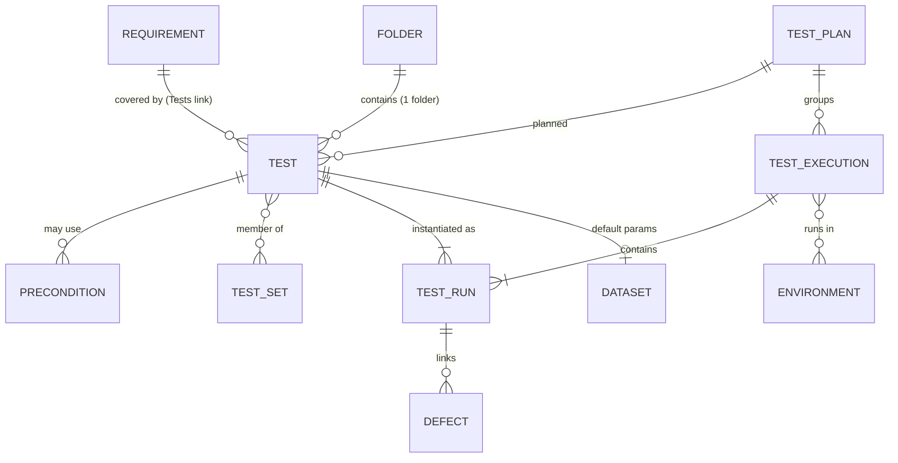

# Xray Test Management for Jira (Xblend / GetXray) — Competitive TMS Research

Research date: 2026-11-14. Prefer primary sources (docs.getxray.app, Atlassian Marketplace, getxray.app). Cloud and Data Center called out where they differ.

---

## 1. Overview

**Vendor:** Xblend (product brand GetXray / Xray). Sold as an Atlassian Marketplace app: *Xray - Test Management for Jira*.

**Deployment:**

| Form | Notes |
| --- | --- |
| **Jira Cloud** | Primary, most actively developed product. Separate Xray-side data store + regional endpoints (US / EU / AU). Cloud Fortified. |
| **Jira Data Center (DC)** | Distinct product/roadmap from Cloud. Still listed for existing DC customers; Atlassian is sunsetting Data Center (new DC purchases restricted; EOL path through ~2029 per third-party Marketplace summaries—confirm on Atlassian). |
| **Jira Server** | Legacy; Marketplace still lists Server version ranges alongside DC. |
| **Standalone TMS** | Not offered. Xray is a **Jira app** (native issue types), not a separate SaaS TMS. |

**Target users:** Agile/DevOps teams already on Jira who want requirements→tests→executions→defects in one place; manual + BDD (Cucumber) + automation; regulated teams needing traceability. Claimed scale: 10M+ users, 100M+ test cases, 10K+ companies (Marketplace / marketing).

**License model.** **Closed source** (proprietary commercial Atlassian Marketplace app by Xblend / GetXray). No public product source repository found. Paid Cloud / Data Center editions. Xray Exploratory App is a free desktop companion (still proprietary; not found as open source). Not open source or open core. Sources: [getxray.app](https://www.getxray.app/), [docs.getxray.app](https://docs.getxray.app/).

**Pricing (checked 2026-11-14):** Licensed by **Jira user tier** (must match Jira), not by “QA seats.” Free trial of Standard or Advanced on Marketplace. No free forever plan for the core app. Xray Exploratory App is free (desktop).

Cloud editions (Marketplace App Editions, introduced ~Sep 2025):

| Tier | List price (monthly, USD) | Notable deltas |
| --- | --- | --- |
| **Standard** | Up to 10 users: **$10**; 11–100: **$7.28/user**; 101–250: **$3.70/user**; 251–1,000: **$2.12/user**; higher tiers down to ~**$0.43/user** | Core TCM/execution, BDD, REST/GraphQL, AI Test Case Generation & Prioritization, Rovo Test Plan Summarizer; ~100 GB storage; API ~60 RPM / 300 per 5 min |
| **Advanced** | Up to 10: **$12**; 11–100: **$8.74/user**; etc. (~20% above Standard on published tiers) | AI Test Script Generation, 250 GB storage, higher API, Usage Monitor, expanded Manual Step Library |
| **Enterprise** | Separate Marketplace app / license (historically atop Xray; as of Cloud 6.9.0 Enterprise can be standalone) | Test Case Versioning, Dynamic Test Plans, Remote Jobs Trigger, Test Case Designer / AI Model Generator, highest storage/API, approvals-oriented governance |

Data Center (list prices cited Oct 2026 by secondary Marketplace scrapers): e.g. **~$3,306/year** for 50 users, **~$7,274** for 100—always verify the Marketplace Price tab. Older 2024 articles quoted ~$1,740/year for 50 users (stale).

Sources: [Marketplace listing](https://marketplace.atlassian.com/apps/1211769/xray-test-management-for-jira), [getxray pricing/editions](https://www.getxray.app/test-management/), [Marketplace History pricing](https://marketplacehistory.com/marketplace/apps/1211769/xray-test-management-for-jira?tab=pricing), [licensing KB](https://docs.getxray.app/pages/viewpage.action?pageId=119223502), [editions blog](https://www.getxray.app/blog/xray-introduces-app-editions/).

---

## 2. Data model and entities

Xray models testing as **Jira work item types** plus non-issue structures (repository folders, Test Runs). Terminology (Cloud docs):

| Entity | What it is | Key fields / notes |
| --- | --- | --- |
| **Project / Space** | Jira project with Xray enabled | Coverable issue types, Test Types, environments configured per space/global |
| **Test** | Test case (Manual / Cucumber-Gherkin / Generic unstructured, or custom types of those kinds) | Summary, Test Type, steps or Scenario or Generic Definition, labels, attachments, links to requirements |
| **Precondition** | Shared setup conditions before a Test | Linked to many Tests; Manual or Gherkin kinds |
| **Test Repository** | Hierarchical folders of Tests & Preconditions (not an issue) | One folder membership per Test; “Orphans” if unfiled |
| **Test Set** | Ordered flat group of Tests (issue) | Reusable across plans/executions; a Test may be in many Sets |
| **Test Plan** | Plan of Tests for a version/sprint (issue) | Consolidates latest status from linked Test Executions; optional Test Plan Board |
| **Test Execution** | Assignable execution task / cycle (issue) | Version, revision, Test Environments, linked Plan(s), list of Test Runs |
| **Sub-Test Execution** | Same as Execution but **sub-task** of a requirement | Agile-board friendly |
| **Test Run** | Internal instance of a Test inside an Execution | Snapshot of specification + status, evidence, defects, dataset iterations; not a Jira issue |
| **Coverable work / Requirement** | Story, Requirement, Bug, etc. configured as coverable | Coverage status OK / NOK / NOT RUN / UNKNOWN / UNCOVERED |
| **Defect** | Usually Jira Bug linked from failed runs/steps | Traceability reports include defects |
| **Test Environment** | Execution context (Cloud: managed globally/project; DC: often label-based) | Affects aggregated coverage when mixed |
| **Dataset / parameters** | Tabular parameters for parameterized Tests | Scopes: Test default → Test Plan–Test → Test Execution–Test; max **1000** iterations, **20** parameters; no duplicate rows |
| **Modular / Call Test** | Step that includes another Manual Test | Depth ≤5; ≤200 called Tests per run |
| **Custom fields** | Jira CFs + Xray Test Step / Test Run custom fields | Cloud: some Xray fields only after issue create |
| **Attachments / evidence** | On issues and on Test Runs / steps | Screenshots, videos (esp. Exploratory App) |
| **Tags / labels** | Jira labels | Also used for Cucumber feature path / `id:` tags on import |
| **Versions / baselines** | Jira Fix Version on Executions for scope; **Test Case Versioning** = Enterprise only | Run stores snapshot of chosen Test version |
| **Milestones / sprints** | Via Jira versions/sprints + Test Plans | Not a separate Xray entity |

Sources: [Terminology](https://docs.getxray.app/space/XRAYCLOUD/44566802/Terminology+and+Interface), [Test Sets vs Plans](https://docs.getxray.app/space/XRAYCLOUD/44565079/Test%20Sets%20vs%20Test%20Plans), [Parameterized Tests](https://docs.getxray.app/space/XRAYCLOUD/44566351/Parameterized+Tests), [Modular Tests](https://docs.getxray.app/space/XRAYCLOUD/44578265/Modular%20Tests).

---

## 3. Relationships and flows

**Typical E2E workflow**

1. Specify coverable requirements (Stories) in Jira.  
2. Design Tests (manual steps / Gherkin / Generic) + optional Preconditions; organize in Repository and/or Test Sets.  
3. Create Test Plan(s) for a Fix Version / sprint; add Tests.  
4. Create Test Execution(s) (ad hoc or from Plan/Set/folder); assign testers.  
5. Execute manually (Testing Board) or import automation results → Test Runs update; link defects.  
6. Coverage & Reporting Center / gadgets show requirement status and plan progress.

**Case versioning / review**

- Standard: Jira history + Test Run **snapshot**; optional merge/reset of run definition from current Test.  
- **Enterprise Test Case Versioning:** named versions (spec, type, dataset, preconditions); default version used when adding to Executions; archive/unarchive; multiple active variants (e.g. manual + automated). Formal approval workflow beyond Jira workflows is not a distinct documented “review gate” product feature—teams use Jira workflows / `jira.issue.editable` and Enterprise governance features.

**Statuses**

- Default Test Run statuses include TODO, EXECUTING, PASS, FAIL, ABORTED (and customizable statuses in Global/Space settings: Test Statuses, Test Step Statuses).  
- Coverage aggregates by Latest / Version / Test Plan, optional Test Environment, final-status precedence.

Sources: [Execute Tests](https://docs.getxray.app/space/XRAYCLOUD/44565122/Execute%20Tests), [Coverage calculation](https://docs.getxray.app/space/XRAYCLOUD/44565101/Understanding+the+calculation+of+coverage+status+and+the+status+of+Tests), [Test versioning (Enterprise)](https://docs.getxray.app/space/XRAY/301504609).

---

## 4. Full feature list

**Authoring:** Manual steps (action/data/expected), rich Jira text, Cucumber/Gherkin in-issue, Generic definition field, Preconditions, **Call Test** modular composition, parameterized datasets, BDD Step Library / Automated Step Library, AI Test Case Generation (all Cloud editions), AI Script Generation (Advanced+), AI Prioritization, Rovo summarizer. Enterprise: Test Case Designer / model generator, multi-version Tests.

**Organisation:** Test Repository folders; Test Sets; JQL + Xray JQL functions (Cloud: beta caveat); labels; cross-project reporting on Advanced/Enterprise Cloud (not Standard).

**Execution:** Manual runner / Testing Board (Cloud), assignment, bulk add Tests, timers/duration from imports, Test Environments, Sub-Test Executions, Exploratory App sessions attached to runs, Remote Jobs Trigger (Enterprise).

**Traceability / coverage:** Native links Requirements ↔ Tests ↔ Executions ↔ Defects; Overall / Historical coverage reports; scope by version/plan/environment.

**Reporting / dashboards (built-in):** Reporting Center — Traceability, Overall (Requirement/Test) Coverage, Historical Requirement Coverage (DC/Enterprise paths), Test Plans Report/Metrics, Test Executions Report, Test Runs Report/List, Test List, Test Sets List, Test Plans/Executions lists; Document Generator. Gadgets: Overall Coverage, Tests/Sets/Executions/Plans lists, Overall Test Results, Tests by Type, Requirements List, Test Runs List/Summary, Test Evolution. Cross-project reports: Advanced/Enterprise Cloud & Enterprise DC—not Standard Cloud.

**Search:** Jira JQL + Xray functions; repository filters.

**Import/export:** Test Case Importer (CSV/JSON; Tests, Preconditions, Sets; ≤1000 issues/import); Cucumber `.feature` import/export; execution result formats (see §5); Document Generator / Xporter ecosystem for docs.

**Audit:** Jira history; Cloud History tab is narrower than DC (type/definition/links/folder/attachments/executions). Separate product “Xray Export and Import” documents job webhooks—not core entity change webhooks.

**Permissions / SSO / SCIM:** Relies on **Jira** project permissions (Browse/Create/Edit/Delete/Link/Bulk) and workflows; Xray settings can disallow executions by workflow status. SSO/SCIM = whatever the Jira site uses—no separate Xray IdP documented.

**AI:** Case generation, prioritization, script generation (edition-gated), Rovo Test Plan Summarizer, AI Hub in settings.

**Localisation:** Follows Jira/Atlassian locale patterns; not independently catalogued here as a first-class Xray i18n matrix—“not found in docs” as a dedicated multi-locale product page beyond Jira.

**Mobile / offline:** No first-class mobile TMS app. **Xray Exploratory App** (Win/Mac): records sessions against web/desktop/mobile *targets*; **standalone/offline** mode without Jira; sync/attach when connected. Core Cloud UI itself is online (Cloud architecture loads Jira then Xray APIs).

Sources: Marketplace feature bullets, [Reporting gadgets](https://docs.getxray.app/space/XRAYCLOUD/44566250/Reporting%20using%20Gadgets), [Reporting Center](https://docs.getxray.app/space/XRAYCLOUD/338526916/Reporting%20Center), [Cloud vs DC](https://docs.getxray.app/space/XRAYCLOUD/44564726/Xray%20Server%2FData%20Center%20and%20Xray%20Cloud), [Permissions](https://getxraydocs.atlassian.net/wiki/spaces/XRAYCLOUD/pages/1203503118/Xray+and+Permissions), [Test Case Importer](https://docs.getxray.app/space/XRAYCLOUD/44565062/Importing%20Tests%20using%20Test%20Case%20Importer), [XEA](https://docs.getxray.app/space/XEA/43483200/Exploratory%20Testing%20in%20a%20Nutshell).

---

## 5. Automation and CI

### Supported result formats

Cucumber JSON, Behave JSON, JUnit XML, TestNG XML, NUnit XML, xUnit XML, Robot Framework XML, Xray JSON (+ multipart variants). **Allure:** not found as a native import format (teams typically convert to JUnit/Xray JSON).

### CLI / CI

REST/GraphQL clients, Jenkins/Bamboo/TeamCity plugins (esp. DC heritage), GitHub Actions, GitLab, Bitbucket Pipelines, Azure DevOps, Travis, CircleCI, Maven/Gradle examples in docs. Authenticate → optionally export Cucumber features → run → POST report to import endpoint.

### How results map to cases (matching)

| Format | Match / identity | Auto-create Test? |
| --- | --- | --- |
| **JUnit** | Optional `test_key` / `test_id` properties; else Generic Definition = `classname` + `name` | **Yes** → Generic Test if no match |
| **TestNG / NUnit / xUnit** | Same Generic pattern; richer formats can set labels/requirements from source | **Yes** → Generic |
| **Robot** | Tag with issue key forces existing Test; else Generic Definition = concatenated suite names + test name; summary = test name | **Yes** → Generic (unless key tag) |
| **Cucumber JSON results** | Existing Cucumber Tests (keys / prior feature import) | **No** on result import |
| **Cucumber `.feature` import** | Key → labels (`path` + `id:n`) → summary rules | **Yes** creates/updates Scenarios as Cucumber Tests |
| **Xray JSON** | `testKey` first; else Manual/BDD by **summary**, Generic by **definition** (same project); optional `testInfo` | **Yes if `testInfo` present** |

Extended JUnit properties: `requirement`/`requirements`, `test_summary`, `test_description`, `tags`, evidence, run comments/CFs, started-at/finished-at.

### Unmapped Tests / Auto Create — precise answer

**Xray does not document a product setting named “Unmapped Tests” or a toggle labeled “Auto Create.”** Behavior is built into each importer:

1. **Default for JUnit / TestNG / NUnit / xUnit / Robot:** if the report row does not resolve to an existing Test (by key/id or Generic Definition), Xray **automatically provisions a Generic Test**, fills Generic Definition as the stable ID, creates/updates a Test Execution + Test Runs, and **reuses** that Test on later imports with the same definition. Documented as “automatic provisioning” / “create Tests whenever importing results.”  
2. **Cucumber execution JSON:** **does not** create Tests. Create Tests via feature import (or author in Jira), then import results.  
3. **Xray JSON:** create only when `testInfo` is supplied; subsequent imports rematch by key/summary/definition. Enterprise may auto-add a **new Test version** when `testInfo` type differs.  
4. **Configurability:** Xray staff (community/SO) state auto-provisioning **is not a configurable option**. Practical controls: always send `test_key`; or use an API user **without Create Issues** permission so create fails; ensure Generic Test Type exists in the space.  
5. **Cucumber tags:** used as **labels** and matching aids on **feature import** (`id:xxx`, feature path)—not as the primary matcher for result-only Cucumber imports.

### Flaky detection / run merging

No dedicated “flaky test detector” product feature found in docs. History, Test Evolution / Test Runs gadgets, and AI prioritization *use* history; blogs discuss flakiness conceptually. Multiple suite results for the same JUnit case can appear as multiple contexts under one Test Run with joint PASS/FAIL/TODO rules. Re-import into an existing Execution vs creating a new one is controlled by API parameters (`testExecutionKey` / multipart fields)—not a separate “merge runs” product name beyond updating a specified Execution.

Sources: [CI tools](https://docs.getxray.app/space/XRAYCLOUD/44565135/Continuous%20Integration%20Tools), [JUnit mapping](https://docs.getxray.app/space/XRAYCLOUD/44564745/Taking+advantage+of+JUnit+XML+reports), [Generic automation](https://docs.getxray.app/space/XRAYCLOUD/44565229/Using%20Generic%20Tests%20for%20Automation), [Framework matrix](https://docs.getxray.app/space/XRAY/301404283/Integrating%20with%20Testing%20Frameworks), [Xray JSON](https://docs.getxray.app/space/XRAYCLOUD/44565311/Using%20Xray%20JSON%20format%20to%20import%20execution%20results), [Robot](https://docs.getxray.app/space/XRAYCLOUD/44564940/Taking+advantage+of+Robot+XML+reports), [Import REST v2](https://docs.getxray.app/space/XRAYCLOUD/44577176/Import%20Execution%20Results%20-%20REST%20v2), [SO: not configurable](https://stackoverflow.com/questions/63798747/how-to-import-jira-x-ray-data-without-creating-new-tests).

---

## 6. API

| Aspect | Cloud | Data Center |
| --- | --- | --- |
| **Types** | REST (esp. result import) + **GraphQL** (CRUD on entities) | REST extending Jira (`/rest/raven/1.0/...`); GraphQL not available historically |
| **Base URL** | `https://xray.cloud.getxray.app/` (+ `us.` / `eu.` / `au.` residency) | Same origin as Jira |
| **Auth** | API Key → Client ID/Secret → `POST /api/v2/authenticate` → Bearer token (**24h**); keys themselves don’t expire | Jira auth (basic, OAuth, etc.) |
| **Rate limits** | Documented: Standard **300 / 5 min** (~60/min); Enterprise **1000 / 5 min** (~200/min) per Jira instance; GraphQL node limit 1–100 per connection, ≤10k items, ≤25 resolvers/call. Marketing “Advanced” RPM figures (e.g. 100) appear on product pages—treat Marketplace/docs as source of truth for contracts. | Subject to Jira/DC capacity; different model |
| **Pagination** | GraphQL connections require `limit` | REST pagination per endpoint docs |
| **Webhooks** | Core Xray Cloud: **Xray Events notifications marked unavailable** vs DC in comparison table. Separate Export/Import app can webhook job completion. | Xray Notification / Events documented for Server/DC |

**Main endpoint groups (Cloud REST v2 import):**

| Group | Operations |
| --- | --- |
| Auth | `POST /api/v2/authenticate` |
| Import execution | `/api/v2/import/execution` (+ `/multipart`) |
| Format-specific import | `/cucumber`, `/junit`, `/nunit`, `/xunit`, `/testng`, `/robot`, `/behave` (+ `/multipart`) |
| GraphQL | `POST .../api/v2/graphql` — create/update/query Tests, Plans, Executions, coverage, etc. |
| Feature import | Cucumber feature endpoints (versioned paths in docs) |

API references: [REST API](https://docs.getxray.app/space/XRAYCLOUD/44565892/REST%20API), [GraphQL](https://docs.getxray.app/space/XRAYCLOUD/44565894/GraphQL%20API), [schema docs](https://xray.cloud.getxray.app/doc/graphql/), [Import Execution Results REST v2](https://docs.getxray.app/space/XRAYCLOUD/44577176/Import%20Execution%20Results%20-%20REST%20v2), DC raven import list under [Import Execution Results - REST](https://docs.getxray.app/space/XRAY/301667997/Import%20Execution%20Results%20-%20REST).

---

## 7. Integrations

- **Issue tracking:** Native **Jira** only as host; defects/requirements are Jira issues. No first-class Linear/Azure Boards TMS host—Azure DevOps appears as **CI** integration.  
- **CI/CD:** Jenkins, Bamboo, TeamCity, GitHub, GitLab, Bitbucket Pipelines, Azure DevOps, Travis, CircleCI, Maven, Gradle.  
- **Automation frameworks:** Selenium/JUnit/TestNG/NUnit/xUnit/Robot/Cucumber/Behave + Xray JSON; Ranorex via JUnit, etc.  
- **Chat:** not found as first-party Slack/Teams connectors in core docs (use Jira/Automation).  
- **SSO:** via Atlassian/Jira.  
- **Marketplace ecosystem:** Xporter, eazyBI, Structure, Confluence, ScriptRunner; Document Generator; Exploratory App; Xray Enterprise; third-party export/import apps.

Source: [Cloud vs DC comparison integrations row](https://docs.getxray.app/space/XRAYCLOUD/44564726/Xray%20Server%2FData%20Center%20and%20Xray%20Cloud), Marketplace.

---

## 8. Marketing positioning

Headline: **“Jira-native quality hub”** / “Jira-native Test Management. Plan, track, and release with confidence across DevOps workflows, powered by AI.”

Differentiators claimed: truly native issue types (not synced shadow data); unified manual + BDD + automation; end-to-end requirement/defect traceability; CI import; AI generation/prioritization with human review; Fortune Global 500 adoption; Exploratory App for unscripted testing.

Sources: [getxray.app](https://www.getxray.app/test-management/), [Marketplace](https://marketplace.atlassian.com/apps/1211769/xray-test-management-for-jira).

---

## 9. What users love

Themes from Atlassian Marketplace (~4.3/5, 500+ reviews), G2 (~4.2/5), Capterra (~4.0/5):

- **Deep Jira integration** — one place for planning, execution, reporting. G2: “What I like most… is how seamlessly it integrates with Jira. Having everything in one place makes planning, execution, and reporting much simpler.”  
- **Organisation at scale** — folders, sets, plans, JQL. G2: “The many options to organize, execute, and report… are absolutely the best part.”  
- **Traceability & coverage** — requirements to defects.  
- **Automation / CI** — Capterra: “Seamless Integration with JIRA and other Add-ons… Jenkins, GIT… shift left.”  
- **Support / migration help** called out positively in aggregated reviews.

Sources: [G2 reviews](https://www.g2.com/products/xray-test-management/reviews) (IT locale mirror), [Capterra](https://www.capterra.com.au/software/1049437/xray), [Marketplace](https://marketplace.atlassian.com/apps/1211769/xray-test-management-for-jira).

---

## 10. What users dislike

- **Steep learning curve / entity overload** (Test, Precondition, Set, Plan, Execution, Run…). G2: many concepts confuse new users; “starting daily use… took considerable time.”  
- **UI complexity / many screens** — Capterra: hard to find the right screen to link Executions to Plans.  
- **Performance / slowness** at large suite or Cloud dual-API latency.  
- **Pricing tied to all Jira users**, punishing small QA teams on large sites.  
- **Jira lock-in** and migration pain.  
- **Reporting setup** needs JQL/config expertise.  
- Capterra: cannot associate a requirement with an **individual test step** (failing any step fails linked requirements at case level).

Sources: same review aggregators; [aqua-cloud review synthesis](https://aqua-cloud.io/xray-review-2026-features-pricing/).

---

## 11. Ideas for Vulyk

Vulyk context: open-source self-hosted TMS (folders/cases/plans/runs, CI ingest, campaigns/iterations, requirements, Jira/OpenProject, reports/flaky, RBAC/SSO, LLM, MCP, importers, PWA offline).

1. **Configurable CI auto-create** — Xray always auto-provisions Generics (no “Unmapped Tests” switch). Vulyk should expose explicit modes: match-only / auto-create / quarantine-unmapped, with clear matching keys.  
2. **Stable external ID field** (like Generic Definition) separate from human summary—avoid summary-based rematch creating duplicates when titles change.  
3. **Format matrix clarity** — document per-importer create-vs-match (Xray’s Cucumber split is a common footgun).  
4. **Keep entity count teachable** — users hate Xray’s seven concepts; prefer folders + cases + plans + runs (+ campaigns) without issue-type explosion.  
5. **Snapshot-on-run** — copy case revision into the run (Xray Test Run snapshot) so edits don’t rewrite history.  
6. **Call-to-test / modular steps** with depth limits—high reuse value.  
7. **Datasets with scoped override** (case → plan → run) — copy the override model, not the “one unnamed dataset” confusion.  
8. **Flaky as a first-class report** — Xray blogs about flakes but lacks a dedicated detector; Vulyk’s flaky feature is a differentiator.  
9. **Price/seat independence** — Xray’s Jira-wide licensing is a major complaint; Vulyk’s self-hosted AGPL model wins small QA on large orgs.  
10. **Offline PWA + Exploratory-like evidence** — XEA offline is loved; lean into Vulyk PWA offline for field/manual runs.  
11. **Importers + MCP/LLM** — match Xray’s CSV/feature import and go further with LLM-assisted authoring without locking to Jira-only AI.  
12. **Avoid Cloud dual-store latency UX** — single DB (Postgres) is an architectural advantage over Xray Cloud’s Jira-then-Xray load pattern.

---

## 12. Sources

- https://www.getxray.app/test-management/  
- https://www.getxray.app/blog/xray-introduces-app-editions/  
- https://marketplace.atlassian.com/apps/1211769/xray-test-management-for-jira  
- https://marketplacehistory.com/marketplace/apps/1211769/xray-test-management-for-jira?tab=pricing  
- https://docs.getxray.app/pages/viewpage.action?pageId=119223502  
- https://docs.getxray.app/space/XRAYCLOUD/44566802/Terminology+and+Interface  
- https://docs.getxray.app/space/XRAYCLOUD/44565079/Test%20Sets%20vs%20Test%20Plans  
- https://docs.getxray.app/space/XRAYCLOUD/44565166/Test%20Repository  
- https://docs.getxray.app/space/XRAYCLOUD/44566351/Parameterized+Tests  
- https://docs.getxray.app/space/XRAYCLOUD/44578265/Modular%20Tests  
- https://docs.getxray.app/space/XRAYCLOUD/44565122/Execute%20Tests  
- https://docs.getxray.app/space/XRAYCLOUD/44565101/Understanding+the+calculation+of+coverage+status+and+the+status+of+Tests  
- https://docs.getxray.app/space/XRAYCLOUD/44564726/Xray%20Server%2FData%20Center%20and%20Xray%20Cloud  
- https://docs.getxray.app/space/XRAYCLOUD/44565229/Using%20Generic%20Tests%20for%20Automation  
- https://docs.getxray.app/space/XRAYCLOUD/44564745/Taking+advantage+of+JUnit+XML+reports  
- https://docs.getxray.app/space/XRAYCLOUD/44564940/Taking+advantage+of+Robot+XML+reports  
- https://docs.getxray.app/space/XRAYCLOUD/44565311/Using%20Xray%20JSON%20format%20to%20import%20execution%20results  
- https://docs.getxray.app/space/XRAYCLOUD/44565135/Continuous%20Integration%20Tools  
- https://docs.getxray.app/space/XRAYCLOUD/44577176/Import%20Execution%20Results%20-%20REST%20v2  
- https://docs.getxray.app/space/XRAYCLOUD/44565892/REST%20API  
- https://docs.getxray.app/space/XRAYCLOUD/44565894/GraphQL%20API  
- https://docs.getxray.app/space/XRAYCLOUD/44566250/Reporting%20using%20Gadgets  
- https://docs.getxray.app/space/XRAYCLOUD/338526916/Reporting%20Center  
- https://docs.getxray.app/space/XRAYCLOUD/44565062/Importing%20Tests%20using%20Test%20Case%20Importer  
- https://docs.getxray.app/space/XRAY/301404283/Integrating%20with%20Testing%20Frameworks  
- https://docs.getxray.app/space/XRAY/301667997/Import%20Execution%20Results%20-%20REST  
- https://docs.getxray.app/space/XRAY/301698724/Importing%20Cucumber%20Tests%20-%20REST  
- https://docs.getxray.app/space/XRAY/301504609  
- https://docs.getxray.app/space/XEA/43483200/Exploratory%20Testing%20in%20a%20Nutshell  
- https://getxraydocs.atlassian.net/wiki/spaces/XRAYCLOUD/pages/1203503118/Xray+and+Permissions  
- https://stackoverflow.com/questions/63798747/how-to-import-jira-x-ray-data-without-creating-new-tests  
- https://www.g2.com/products/xray-test-management/reviews  
- https://www.capterra.com.au/software/1049437/xray  
- https://aqua-cloud.io/xray-review-2026-features-pricing/  
- https://qasphere.com/blog/xray-pricing/  
- https://xray.cloud.getxray.app/doc/graphql/  
