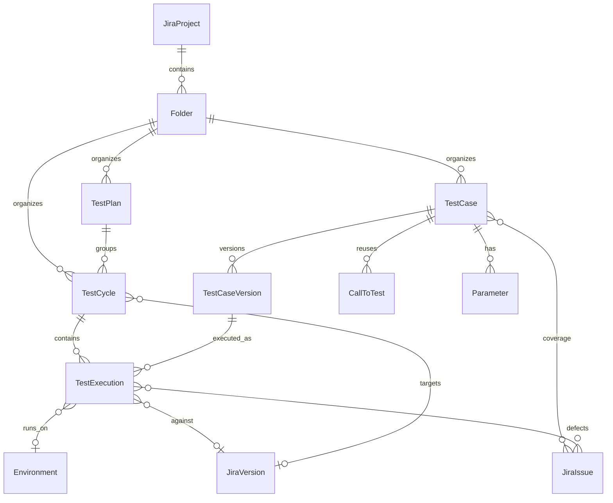

# Zephyr Scale (now Zephyr Standard) — competitive TMS research

Research date: 14 November 2026. Prefer primary SmartBear / Atlassian Marketplace / API sources. Where a claim could not be confirmed, this document says **not found in docs**.

---

## 1. Overview

**Vendor.** SmartBear. The product formerly marketed as **Zephyr Scale** (historically also TM4J / Adaptavist) is SmartBear’s structured test-management app for Atlassian Jira. On **2 April 2025** SmartBear consolidated naming: Zephyr Scale became **Zephyr** sold in **Standard** and **Advanced** editions; Zephyr Squad became **Zephyr Essential** (separate Marketplace app). API hosts, OpenAPI titles, and many docs still say “Zephyr Scale” (e.g. `api.zephyrscale.smartbear.com`). Reddit / SmartBear staff also refer to Scale as “Zephyr Standard.” Zephyr Enterprise remains a separate standalone TMS (custom pricing).

**Deployment.**

| Hosting | Notes |
| --- | --- |
| **Jira Cloud** | Primary path; Marketplace app “Zephyr - Test Management and Automation for Jira” (Forge). |
| **Jira Data Center / Server** | Still listed (e.g. DC builds through late 2026); Atlassian stopped **new** DC Marketplace purchases for new customers (30 Mar 2026); DC EOL 28 Mar 2029. |
| **Standalone self-host (Scale itself)** | No — Scale/Standard is a Jira app. Self-host / multi-tracker use-cases are pointed at **QMetry** or **Zephyr Enterprise**. |

**Target users.** QA and engineering teams already in Jira who want a **separate test library** (not every test as a Jira work item), folders, versioning, reusable steps, cycles/plans, CI result ingest, and (on Standard+) no-code / AI automation inside Jira.

**License model.** **Closed source** (proprietary commercial Atlassian Marketplace app by SmartBear). No public source repository for Zephyr Scale / Zephyr Standard product code was found. Sold as a paid Jira app (Cloud / Data Center). Not open source or open core. Sources: [SmartBear Zephyr docs](https://support.smartbear.com/zephyr/docs/en/zephyr-editions-feature-comparison.html), [Atlassian Marketplace listings](https://marketplace.atlassian.com/).

**Pricing (Cloud, USD, checked via Marketplace + secondary tables dated Oct 2026).** Licences match the **entire Jira site user tier**, not “QA seats only.” Free trial of Standard or Advanced via Marketplace. **No free forever plan** on current listing (lowest Cloud band is a flat fee for ≤10 users).

Approximate **Zephyr Standard** (ex-Scale) Cloud monthly bands (progressive after 10 users; exclude tax):

| Jira users | Approx. Standard price |
| --- | --- |
| 1–10 | **$10/month flat** |
| 11–100 | **$6.81 / user / month** |
| 101–250 | **$4.33 / user** (band) |
| 251–1,000 | **$2.10 / user** (band) |
| … | Lower rates at larger bands |

**Advanced** starts ~**$15/month flat** (≤10) then higher per-user rates (~$8.73 in the 11–100 band). Annual DC examples (Standard): e.g. **$4,760/yr (50)**, **$7,934 (100)**, **$31,146 (1,000)** — renewal-oriented for existing DC customers. Always re-check the [Marketplace pricing tab](https://marketplace.atlassian.com/apps/1213259/zephyr-test-management-and-automation-for-jira?tab=pricing).

**Sources:** [SmartBear Zephyr product](https://smartbear.com/product/zephyr/), [editions blog Nov 2026](https://smartbear.com/blog/which-zephyr-test-management-tool-is-right-for-me/), [Zephyr docs welcome](https://support.smartbear.com/zephyr/docs/en/welcome), [QA Sphere pricing digest 21 Oct 2026](https://qasphere.com/blog/zephyr-pricing/), [Marketplace listing](https://marketplace.atlassian.com/apps/1213259/zephyr-test-management-and-automation-for-jira).

---

## 2. Data model and entities

Zephyr keeps test assets in its **own library** keyed to a Jira project/space, not as native Jira issue types (contrast Essential/Squad history).

| Entity | What it is | Key fields / notes |
| --- | --- | --- |
| **Project / space** | Jira project where Zephyr is enabled | Jira `projectKey`; API project resources |
| **Folders** | Hierarchical tree for cases, cycles, and plans | Name, parent, reorder; create/move via UI |
| **Test case** | Core reusable test asset (`PROJ-T123`) | Name, objective, precondition, folder, status, priority, owner, labels, component, estimated time, custom fields, attachments, links to Jira issues (coverage) |
| **Test script / steps** | Step-by-step, plain text, or Gherkin BDD | Step description, test data, expected result; step-level attachments/custom fields |
| **Call to test** | Reuse another case’s steps (successor to “shared steps”) | Nested calls; parameters from caller; live link to source steps |
| **Parameters** | Modular parameterization on step-by-step scripts | Name, default value; referenced as `{param}` in data/expected |
| **Datasets** | Project-level reusable data for data-driven design | Configured under project settings |
| **Test cycle** | Execution batch for a release/sprint (`PROJ-R…`) | Name, folder, status, owner, planned start/end, Jira project version, environment, custom fields, issue/web links |
| **Test execution** | One case run inside a cycle (`PROJ-E…`) | Status, environment, version, assignee, executed-by, estimated/actual time, comment, automated flag, step results, defect links |
| **Test plan** | Groups multiple cycles for release-level oversight (`PROJ-P…`) | Name, folder, status, owner, links to cycles / issues / URLs |
| **Milestones / releases / sprints** | Via **Jira versions** and Zephyr **iterations** | Cycle/execution can reference `jiraProjectVersion`; iterations used in reporting |
| **Requirements / stories** | Jira work items linked as **coverage** | Not separate Zephyr entities |
| **Defects** | Jira issues linked from failed executions | Created/linked in Jira |
| **Environments** | Named run contexts | Project-scoped list; API GET environments |
| **Labels** | Tags on cases (and related artifacts) | Filterable; import can auto-create |
| **Custom fields** | On cases, cycles, plans, steps, executions | Types include text, numbers, dates, users, multi-select (per API samples) |
| **Attachments** | Case- and step-level files | Unlimited storage claimed on Marketplace |
| **Versions / baselines** | **Test case versioning** (not full library baseline product) | Explicit new versions; compare in History; executions pin the version run |
| **Priorities & statuses** | Configurable catalogues | Separate for case readiness vs execution result; colours/defaults (API) |
| **API keys** | Per-user JWT access tokens | Generated in Jira profile (“Zephyr API keys”) |

**Sources:** [Folders](https://support.smartbear.com/zephyr/docs/en/working-with-folders.html), [Parameters / Call to test](https://support.smartbear.com/zephyr/docs/en/test-cases/parameters.html), [Test plans](https://support.smartbear.com/zephyr/docs/en/test-plans/creating-a-test-plan.html), [Version control](https://support.smartbear.com/zephyr/docs/en/test-cases/version-control.html), [Cloud API](https://support.smartbear.com/zephyr-scale-cloud/api-docs/), [DC vs Cloud feature matrix](https://support.smartbear.com/zephyr-scale-server/docs/en/zephyr-features---server-data-center-vs-cloud.html).

---

## 3. Relationships and flows

**Typical links.** Cases live in folders → selected into **cycles** (optionally pinned case version) → executions record results, environments, and defect links → cycles roll up into **plans** → coverage links connect cases/cycles/plans to Jira requirements → reports/gadgets aggregate by plan, cycle, environment, iteration, project, component, label, tester, priority.

**End-to-end workflow (manual).** Enable Zephyr on a space → author cases (steps / BDD / call-to-test) → link coverage to stories → create cycle (optionally from filters) → assign executions → run in Test Player → log defects → track plan/cycle progress → export reports / gadgets.

**Automation workflow.** CI produces JUnit XML / Cucumber JSON / custom ZIP → `POST /automations/executions/...` with `projectKey` → Zephyr creates a **new test cycle** (optional `testCycle` JSON metadata) and executions mapped to cases.

**Case versioning / review.** Versioning is on by default: create a new version explicitly, edit, compare in History. Older executions keep the version that was run; outdated scripts in a cycle warn and can be refreshed. Formal multi-stage **approval workflow** beyond configurable case **statuses** (e.g. Draft / Approved) is **not found in docs** as a dedicated workflow engine.

**Statuses.** Configurable priorities and statuses for cases, cycles, plans, and executions (project settings). Cucumber statuses map to Zephyr statuses or show as Blocked if no matching custom status exists.

**Sources:** docs TOC for cycles/plans/traceability; [Cucumber status mapping](https://support.smartbear.com/zephyr/docs/en/test-automation/cucumber-integration.html); [Version control](https://support.smartbear.com/zephyr/docs/en/test-cases/version-control.html).

---

## 4. Full feature list

**Authoring.** Step-by-step and plain-text scripts; **Gherkin BDD**; rich text fields (objective/precondition/steps); **Call to test**; **parameters** and **datasets**; attachments on steps; clone/edit/delete; manage cases from a Jira issue view.

**Organisation.** Hierarchical folders for cases/cycles/plans; cross-project reuse of cases (call-to-test across spaces); labels, components, filters, grid views; archive/delete controls.

**Execution.** Manual Test Player; single-case execution; assignment (owner vs assignee vs executed-by); estimated vs actual effort; rerun / history; bulk cycle operations (clone/edit/delete/filter); environments.

**Traceability & coverage.** Issue links from cases, cycles, plans, executions; coverage/traceability reports and tree/matrix; gadgets on Jira dashboards; Power BI path documented.

**Reporting (built-in).** Docs list **31** OOTB reports: **27** execution + **4** traceability (Coverage, Traceability, Matrix, Tree). Execution reports include summary/list/detailed results, burn-up/burn-down, completion/effort over time, results by coverage/plan/cycle/environment/label/type/project/component/iteration/priority/tester, scorecards by cycle/tester/iteration. Marketing also claims **70+** reports/gadgets — treat “31 named reports” as the documented catalogue and “70+” as broader gadgets/variants. Filters yes; arbitrary column/colour customisation of reports is **limited** (docs: “currently reports cannot be customized”). Custom report **templates** are documented separately.

**Search / filters.** Library filters and saved views; **not found in docs**: a public Zephyr-specific query language for Cloud Scale comparable to Squad-era ZQL (ZQL appears in Enterprise/other product reviews).

**Import / export.** Import wizard: **CSV**, Excel via CSV, Zephyr **XML** between instances. Export cases to **Excel/XLS**, **XML**, BDD feature files; reports to Excel (and related). Cloud CSV import is documented on current Cloud import page; older DC-vs-Cloud matrices differ by host — verify per deployment.

**Audit.** Change history on cases (and related entities); version compare. Dedicated compliance “audit log” product feature beyond history: **not found in docs** as a separate module.

**Permissions / roles / SSO / SCIM.** Optional Zephyr permission system on top of Jira (users/roles/groups for create/edit/delete cases, cycles, executions, etc.; default off = all project users). **SSO / SCIM** inherit from **Atlassian / Jira** identity (Guard, IdP) — not a separate Zephyr Scale SSO. Zephyr Enterprise has its own Azure AD SSO docs; that is a different product.

**AI.** Standard+: AI step suggestions; **Zephyr Skills for Rovo** (generate cases, coverage, execution summary, release risk); **SmartBear MCP** for Copilot/VS Code/Claude etc.; no-code automation with HaloAI (record/play, self-healing locators — Standard limited, Advanced expanded). Rovo usage also depends on Jira plan credits.

**Localisation.** Marketplace: **En, De, Es, Por, It** for the app. Broader UI language also follows Jira/Atlassian prefs.

**Mobile / offline.** Browser/Jira mobile web possible; dedicated offline / PWA execution mode for Scale: **not found in docs** (community: no offline Jira/Zephyr SaaS mode).

**Sources:** [Reports overview](https://support.smartbear.com/zephyr/docs/en/reports-and-analysis/overview.html), [Import](https://support.smartbear.com/zephyr/docs/en/test-cases/import-test-cases.html), [Permissions](https://support.smartbear.com/zephyr/docs/en/configuration/setting-permissions.html), [Marketplace](https://marketplace.atlassian.com/apps/1213259/zephyr-test-management-and-automation-for-jira), [Product page](https://smartbear.com/product/zephyr/).

---

## 5. Automation and CI

**Result formats (official integrations).**

| Format / framework | Mechanism |
| --- | --- |
| **JUnit XML** (JUnit 4/5 and “similar”) | `POST /automations/executions/junit` (XML or ZIP, max **10MB**) |
| **Pytest / TestNG / NUnit / Robot** | Documented via JUnit XML (or framework-specific pages that upload compatible results) |
| **Cucumber JSON** | `POST /automations/executions/cucumber` (ZIP, max **2MB**); also GET export of feature files |
| **Custom format** | `POST /automations/executions/custom` (ZIP, max **10MB**) |
| **Allure** | **not found in docs** as a first-class ingest format (teams typically convert to JUnit/Cucumber/custom) |

**CLI / reporters / SDKs.** Official curl + REST; SmartBear sample repos (e.g. junit/cucumber examples); community Java helpers. Jenkins and Bamboo integrations documented; other CI tools use the same REST upload.

**CI systems.** Documented: **Jenkins**, **Bamboo**. **GitHub Actions / GitLab / Azure DevOps / CircleCI**: no dedicated first-party plugins found in Zephyr Cloud docs — use HTTP upload of results (generic).

### Matching and auto-create (critical)

**Yes — Zephyr can auto-create missing test cases when CI uploads results, but only when explicitly enabled.**

Official JUnit rules ([JUnit integration](https://support.smartbear.com/zephyr/docs/en/test-automation/junit-integration--and-similar-.html)):

1. Parse a **test case key** from the method name (e.g. `JQA_T1_sumTwoNumbers` → `JQA-T1`).
2. Else match by **fully qualified name** (package.class.method / equivalent for pytest naming).
3. If still unmatched:
   - `autoCreateTestCases=true` → **create the test case** and a new execution.
   - `false` or **omitted (default false)** → **error**; upload fails for unmatched tests.

Cucumber: map with `@TestCaseKey=ABC-T123`; docs also note if the case does not exist yet, annotation may be unnecessary when relying on create behaviour; API query param **`autoCreateTestCases`** (default **false**) exists on **JUnit, Cucumber, and custom** automation endpoints. Optional multipart `testCycle` JSON customises the **new** cycle (name, description, version, folderId, custom fields). Upload creates a **new cycle** keyed in the response.

**Limits / caveats.** File size caps (2–10MB); default off (easy CI foot-gun); naming discipline required for stable keys; community reports of always-new cycles unless metadata is crafted carefully. **Flaky-test detection / scoring:** **not found in official Zephyr Scale/Standard docs** (third-party comparisons claim only partial / “non-flaky execution” for no-code runs — not AI flaky analytics). **Run merging:** re-runs and execution history exist for manual cycles; automatic merge of parallel CI shards into one cycle is **not found in docs** as a first-class feature (usual pattern: one upload → one new cycle, or post via individual execution APIs).

**Sources:** [JUnit docs](https://support.smartbear.com/zephyr/docs/en/test-automation/junit-integration--and-similar-.html), [Pytest](https://support.smartbear.com/zephyr/docs/en/test-automation/pytest-integration.html), [Cucumber](https://support.smartbear.com/zephyr/docs/en/test-automation/cucumber-integration.html), [API Automations](https://support.smartbear.com/zephyr-scale-cloud/api-docs/).

---

## 6. API

| Aspect | Detail |
| --- | --- |
| **Type** | REST (OpenAPI 3); not GraphQL |
| **Base URL** | `https://api.zephyrscale.smartbear.com/v2` ; EU: `https://eu.api.zephyrscale.smartbear.com/v2` |
| **Auth** | JWT access token from Jira → `Authorization: Bearer {token}` |
| **Pagination** | `maxResults` (default 10; server may lower; often up to 1000) + `startAt`; list responses include `next`, `isLast`, `total`. Executions “nextgen” uses cursor-style `startAtId` / `nextStartId` |
| **Rate limits** | No published fixed RPM in OpenAPI. HTTP **429** with `Retry-After` observed in community (60s / “try again after 5 minutes”). Document as **undocumented soft limits** |
| **Webhooks** | **not found in docs** / OpenAPI tags reviewed |

**Main endpoint groups**

| Group | Operations (representative) |
| --- | --- |
| Test cases | list/get/create/update; steps; scripts; versions; links |
| Test cycles | list/get/create/update; links |
| Test plans | list/get/create; link cycles/issues/web |
| Test executions | list/get/create/update; step results; links; nextgen list |
| Folders | list/get/create |
| Statuses / priorities / environments / projects | CRUD or read as applicable |
| Issue links | resolve cases/cycles/plans/executions by Jira issue |
| Automations | JUnit, Cucumber, custom uploads; GET Cucumber features ZIP |
| Healthcheck | GET health |
| Links | delete link |

**Reference:** [https://support.smartbear.com/zephyr-scale-cloud/api-docs/](https://support.smartbear.com/zephyr-scale-cloud/api-docs/) · [REST overview](https://support.smartbear.com/zephyr/docs/en/rest-api/rest-api--overview-.html)

---

## 7. Integrations

| Category | Status |
| --- | --- |
| **Issue trackers** | **Jira** native (core). Azure Boards / Linear / etc.: **not found** as native Scale integrations (SmartBear points multi-tracker to **QMetry**) |
| **CI/CD** | Jenkins, Bamboo; generic REST for others |
| **Automation frameworks** | JUnit, TestNG, Cucumber, NUnit, Pytest, Robot; TestComplete community patterns via JUnit upload |
| **Chat** | Slack/Teams: **not found** as first-party Zephyr Scale bots (notifications typically via Jira) |
| **SSO** | Via Atlassian identity / Guard |
| **AI / MCP** | SmartBear MCP; Atlassian Rovo skills |
| **Analytics** | Jira gadgets; Power BI |
| **Marketplace** | Atlassian Marketplace (~**14.7k+** installs; Cloud Fortified / Enterprise Certified messaging) |

**Sources:** product + docs automation/CI sections; [Marketplace](https://marketplace.atlassian.com/apps/1213259/zephyr-test-management-and-automation-for-jira).

---

## 8. Marketing positioning

Headline claims (SmartBear):

- “**Seamless Test Management and AI-Powered Automation Inside Jira**”
- “Bestselling Jira-native test management and automation platform”
- Unify testing and development; shorten release cycles; governed **system of record** for tests
- Differentiators: native Jira UX; separate scalable library with folders/versioning/parameters; **360° traceability**; cross-project reports; BDD + CI; Standard/Advanced **no-code + HaloAI + Rovo + MCP**

Positioning vs siblings: Essential = governed manual TMS; Standard = TMS + limited no-code/AI; Advanced = parallel/cross-browser/email/SMS automation; Enterprise/QMetry for outside-Jira or heavier enterprise needs.

**Sources:** [smartbear.com/product/zephyr](https://smartbear.com/product/zephyr/), [editions blog](https://smartbear.com/blog/which-zephyr-test-management-tool-is-right-for-me/).

---

## 9. What users love

Themes from Marketplace / Capterra / TrustRadius:

1. **Jira-native workflow** — “seamless integration with Jira… link test cases with user stories” (Marketplace, Nader Elbana, Jun 2026).
2. **Organisation & ease** — “keep all the test case organized and easily to filter” (Marketplace, Oct 2026); “Very intuitive… call to test… customizable fields” (Marketplace, Jun 2026).
3. **Cycles & reporting** — Capterra: easy cycles, friendly UI, spreadsheet import/export, automation evidence via API.
4. **Traceability / gadgets** — TrustRadius: “Scalable and compatible with Jira & Confluence”; “Easy to retrospectively trace testing with change history.”
5. **Structure at scale** — folders, versioning, parameters praised vs lighter Jira-issue-as-test models.

Ratings snapshot: Marketplace overall ~**4.1/5** (~494 reviews; Cloud ~**3.9/5** on 381); TrustRadius Zephyr Scale ~**9.6/10** (small sample, 6 reviews). G2 has strong SmartBear / Zephyr **Enterprise** presence; dedicated Scale G2 page less prominent than Marketplace.

**Sources:** [Marketplace reviews](https://marketplace.atlassian.com/apps/1213259/zephyr-test-management-and-automation-for-jira?tab=reviews), [Capterra](https://www.capterra.com/p/240810/Zephyr-Scale/), [TrustRadius](https://www.trustradius.com/products/smartbear-zephyr-scale).

---

## 10. What users dislike

1. **Pricing model (all Jira users)** — “licensing cost is based on all Jira users rather than just the QA team… not cost-effective” (Marketplace, Vu Nguyen, Jun 2026); Capterra Michael B.: “can't do individual licenses… Zephyr will cost around $15k a year… TestRail would have been $500.”
2. **Automation depth** — “good for test case management but not a good fit overall for automation” (Marketplace, Oct 2026).
3. **Performance / stability** — Capterra: crashes and lost work; aqua-cloud synthesis cites load-time complaints (mix of Squad/Scale anecdotes — treat carefully).
4. **Jira lock-in** — TrustRadius: “Not as valuable if not already using Jira.”
5. **Learning / polish** — “Needs better first time tutorials”; some find cycles “wonky” when driven from Jira issue context (Capterra).
6. **API rate limits** — community 429 threads on `/testexecutions` and `/testscript` (2026).

**Sources:** Marketplace + Capterra + TrustRadius + SmartBear community rate-limit threads.

---

## 11. Ideas for Vulyk

Vulyk context: open-source self-hosted TMS (folders/cases/plans/runs, CI ingest, campaigns/iterations, requirements, Jira/OpenProject, reports/flaky, RBAC/SSO, LLM, MCP, importers, PWA offline).

1. **Ship `autoCreateTestCases` with a safe default of false** — match Zephyr’s explicit opt-in; document matching order (ID annotation → FQN/name) so CI does not silently pollute libraries *or* fail mysteriously.
2. **Support key-in-name and annotation matching** — e.g. `PROJ_T12` / `@TestCaseKey=` style plus stable external IDs; first-class annotations beat fragile name matching.
3. **Call-to-test + parameters** — modular reuse is a clear Scale strength; keep live-update semantics and nested calls.
4. **Case versioning pinned on execution** — preserve “what ran” while allowing script evolution; version compare for audit.
5. **Plans → cycles → executions hierarchy** — align naming with Vulyk campaigns/iterations but keep the same mental model for Jira migrants.
6. **Avoid Atlassian-style seat tax** — Vulyk’s self-hosted / tester-centric licensing (or free AGPL) is a direct competitive wedge against Marketplace tiering.
7. **Flaky analytics as a differentiator** — Scale docs do not offer strong flaky scoring; Vulyk’s flaky reports can win automation-heavy teams.
8. **Offline PWA execution** — Scale has no offline mode; disconnected-lab testing is a real gap Vulyk can own.
9. **Multi-tracker (Jira + OpenProject)** — Scale is Jira-only; dual integration is a migration story for teams leaving Atlassian lock-in.
10. **MCP + LLM without Rovo tax** — Scale MCP/Rovo are compelling; Vulyk can mirror MCP while keeping AI local/self-hosted and not tied to Jira credit pools.
11. **Importer parity** — CSV/Excel/XML wizards with field mapping and auto-create labels/folders reduce switching cost from Scale.
12. **Document rate limits and webhooks early** — Scale’s undocumented 429s and missing webhooks frustrate CI; publish limits and outbound webhooks for run completion.

---

## 12. Sources

1. https://support.smartbear.com/zephyr/docs/en/welcome  
2. https://support.smartbear.com/zephyr/docs/en/test-automation/junit-integration--and-similar-.html  
3. https://support.smartbear.com/zephyr/docs/en/test-automation/cucumber-integration.html  
4. https://support.smartbear.com/zephyr/docs/en/test-automation/pytest-integration.html  
5. https://support.smartbear.com/zephyr-scale-cloud/api-docs/  
6. https://support.smartbear.com/zephyr/docs/en/rest-api/rest-api--overview-.html  
7. https://support.smartbear.com/zephyr/docs/en/reports-and-analysis/overview.html  
8. https://support.smartbear.com/zephyr/docs/en/working-with-folders.html  
9. https://support.smartbear.com/zephyr/docs/en/test-cases/parameters.html  
10. https://support.smartbear.com/zephyr/docs/en/test-cases/version-control.html  
11. https://support.smartbear.com/zephyr/docs/en/test-cases/import-test-cases.html  
12. https://support.smartbear.com/zephyr/docs/en/test-plans/creating-a-test-plan.html  
13. https://support.smartbear.com/zephyr/docs/en/configuration/setting-permissions.html  
14. https://support.smartbear.com/zephyr-scale-server/docs/en/zephyr-features---server-data-center-vs-cloud.html  
15. https://smartbear.com/product/zephyr/  
16. https://smartbear.com/blog/which-zephyr-test-management-tool-is-right-for-me/  
17. https://marketplace.atlassian.com/apps/1213259/zephyr-test-management-and-automation-for-jira  
18. https://marketplace.atlassian.com/apps/1213259/zephyr-test-management-and-automation-for-jira?tab=pricing  
19. https://marketplace.atlassian.com/apps/1213259/zephyr-test-management-and-automation-for-jira?tab=reviews  
20. https://qasphere.com/blog/zephyr-pricing/  
21. https://www.capterra.com/p/240810/Zephyr-Scale/  
22. https://www.trustradius.com/products/smartbear-zephyr-scale  
23. https://www.reddit.com/r/jira/comments/1iyqc8h/zephyrscale_pricing/  
24. https://community.smartbear.com/t/zephyr-scale-too-many-requests-error-after-adhering-to-retry-after-60/487  
25. https://www.qable.io/knowledge-hub/tools/zephyr  
