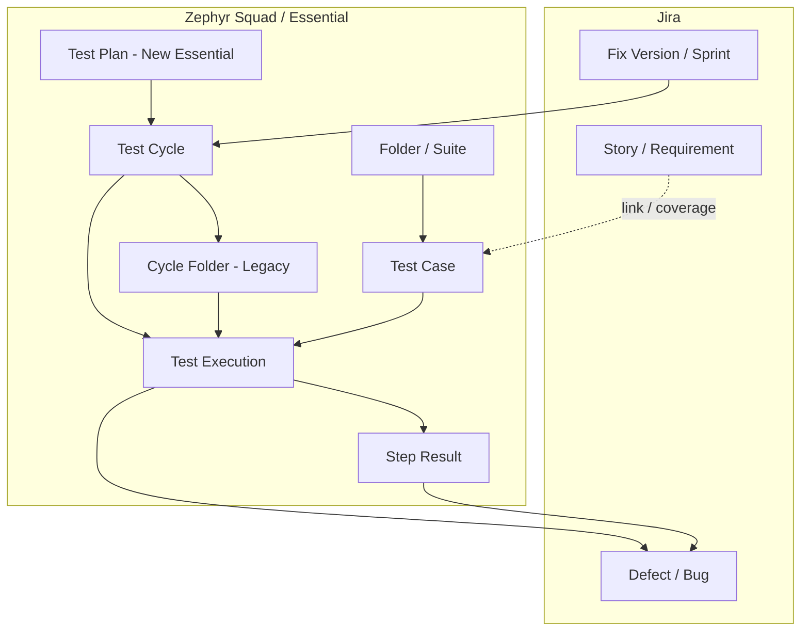

# Zephyr Squad / Zephyr Essential — Competitive TMS Research

> **Scope note.** This document covers **Zephyr Squad**, renamed **Zephyr Essential** in April 2025 (SmartBear / Atlassian Marketplace). It is **not** Zephyr Scale (now sold as **Zephyr** with Standard/Advanced editions), and not Zephyr Enterprise. Where Essential’s Cloud product now shares the Scale platform architecture, that is called out explicitly as **New Zephyr Essential Cloud** vs **Legacy Zephyr Squad Cloud**.

*Research date: 14 November 2026.*

---

## 1. Overview

**Vendor:** SmartBear Software.  
**Product (current name):** Zephyr Essential — Test Management for Jira ([Atlassian Marketplace](https://marketplace.atlassian.com/apps/1014681/zephyr-essential-test-management-for-jira)). Marketplace note: “Zephyr Essential was previously known as Zephyr Squad.” SmartBear’s April 2025 Data Center release notes state the same rename while keeping capabilities ([release notes](https://support.smartbear.com/zephyr-essential-dc/docs/en/zephyr-squad-release-notes/version-9.html)).

**Deployment:** Atlassian Jira app for **Jira Cloud**, **Jira Data Center**, and remaining **Jira Server** ranges listed on Marketplace (Cloud version 12.0.0 as of 13 Oct 2026). Not a standalone SaaS TMS; not self-hosted outside Jira.

**Two Cloud experiences (important):**
- **Legacy Zephyr Squad Cloud** — customers who started before November 2023, or who migrated DC→Cloud via Atlassian JCMA. Tests are Jira issue type **Test**.
- **New Zephyr Essential Cloud** — default for new Cloud installs since Nov 2023; built on the Zephyr Scale platform; renamed Essential in April 2025. Test cases are **internal SmartBear objects**, not Jira issues ([upgrade guide](https://support.smartbear.com/zephyr-squad-cloud-v1/docs/en/squad-to-zephyr-essential-upgrade-guide.html)).

**Target users:** Agile QA / engineering teams that want governed test management **inside Jira** without built-in no-code automation or Rovo/MCP AI (those start at Zephyr Standard). SmartBear positions Essential for teams formalizing spreadsheets and ad-hoc Jira work into one system of record ([editions blog, Nov 2026](https://smartbear.com/blog/which-zephyr-test-management-tool-is-right-for-me/)).

**License model.** **Closed source** (proprietary commercial Atlassian Marketplace app by SmartBear; Marketplace listing **Zephyr Essential**, formerly Zephyr Squad). No public product source repo found. Paid via Atlassian. Not open source or open core. Source: [Zephyr Essential Marketplace](https://marketplace.atlassian.com/apps/1014681/zephyr-essential-test-management-for-jira).

**Pricing (Cloud, USD, excl. tax; progressive per Jira-user tier — you pay for every Jira site user, not only testers).** Figures below were published from Marketplace snapshots on **21 October 2026** ([QA Sphere pricing roundup](https://qasphere.com/blog/zephyr-pricing/)); Capterra lists starting price **$10/month** and **free trial available**, **no free version** ([Capterra](https://www.capterra.com/p/240713/Zephyr-Squad/)). Always re-check Marketplace before purchase.

| Jira users on site | Zephyr Essential (monthly) |
| --- | --- |
| 1–10 | $10/month flat |
| 11–100 | $5.99 per user |
| 101–250 | $3.14 per user |
| 251–1,000 | $1.58 per user |
| 1,001–5,000 | $0.51 per user |
| 5,001–10,000 | $0.25 per user |

Annual example bands (same source): 1–10 → $100/yr; 51–100 → $5,990/yr. Data Center annual examples: 50 users ≈ $4,457; 500 ≈ $19,153 (existing DC customers only; Atlassian DC new sales closed Mar 2026, EOL Mar 2029).

**Distinguish from Zephyr Scale / Standard:** Essential is a **separate Marketplace app**. Zephyr (ex-Scale) Standard/Advanced live under “Zephyr - Test Management and Automation for Jira” and add data residency, limited no-code automation, Rovo skills, and SmartBear MCP — **not included in Essential** ([editions comparison](https://smartbear.com/blog/which-zephyr-test-management-tool-is-right-for-me/); [MCP docs: Essential not supported](https://developer.smartbear.com/smartbear-mcp/docs/zephyr-integration)).

---

## 2. Data model and entities

Because Legacy Squad and New Essential differ architecturally, entities are listed with both models where they diverge ([feature comparison](https://support.smartbear.com/zephyr/docs/en/zephyr-squad-to-zephyr-upgrade-guide/feature-comparison-squad-scale.html); [terms](https://zephyr-squad-cloud-v1.sb-docs.com/en/get-started/terms-and-concepts)).

| Entity | What it is / key fields |
| --- | --- |
| **Project / space** | Host Jira project; Zephyr enabled per project. |
| **Test / Test case** | **Legacy:** Jira issue type `Test` (summary, description, steps, components, labels, priority, Fix Version, workflow). **New Essential:** Zephyr-managed object with key (e.g. `PROJ-T1`), name, status (Draft/Approved…), folder, components, labels, priority, owner, custom fields — **not** a Jira issue. |
| **Test steps** | Ordered step / test data / expected result; wiki formatting; step custom fields (Legacy max 5); step attachments. |
| **Folders / suites** | **Legacy:** folders **inside cycles** (organize executions); tests organized mainly via Jira fields. **New:** multi-level folders for cases, cycles, and plans in a test repository. |
| **Shared steps / Call to Test** | **Legacy:** copy steps between tests; true modular “Call to Test” **not found** as first-class in Legacy docs. **New Essential:** Call to Test + parameters (`{param}`) with defaults ([parameters](https://support.smartbear.com/zephyr/docs/en/test-cases/parameters.html)). |
| **Parameters / datasets** | **Legacy:** not found as native datasets. **New:** case parameters + space-level datasets ([datasets](https://support.smartbear.com/zephyr/docs/en/configuration/advanced-customization-options/datasets.html)). |
| **Test cycle** | Group of executions for a release/goal; name, version/fixVersion, dates, folders, assignee; New also: cycle custom fields, attachments, environment/iteration on executions. |
| **Test plan** | **Legacy:** not a first-class entity (planning ≈ versions + cycles/folders). **New Essential:** plans grouping cycles; custom fields/attachments. |
| **Execution** | Result of running a case in a cycle (or ad-hoc); status, comment, attachments, defects, custom fields, time tracking, step results. |
| **Version / release / sprint** | Jira Fix Version; Legacy cycles hang under versions; Legacy can link cycles to sprints (New: sprint link **not** equivalent per feature matrix). |
| **Requirements / stories** | Jira issues linked to tests (traceability panel); coverage via issue↔case↔execution↔defect. |
| **Defects** | Jira bugs linked from execution or step. |
| **Environments** | Legacy: Jira environment field. New: configurable Environments assigned via cycles/executions. |
| **Iterations / labels** | New: configurable iterations & labels; Legacy labels via Jira. |
| **Custom fields** | Legacy Cloud: up to 20 execution + 5 step global CFs. New: CFs on cases, cycles, plans, steps, executions. |
| **Attachments / tags** | Attachments on cases, steps, executions; labels/tags as above. |
| **Versions / baselines** | **New Essential:** built-in test-case version control (create/compare versions) ([version control](https://support.smartbear.com/zephyr/docs/en/test-cases/version-control.html)). Legacy: history via Jira + step history. |

---

## 3. Relationships and flows

**Legacy Squad flow:** Jira Version → Test Cycle (+ optional folders) → Executions of Test issues → Defects; Requirements linked as Jira issue links; Ad-hoc cycle if no cycle chosen.

**New Essential flow:** Folder repository of Test Cases → Test Plans → Test Cycles → Executions (with Environment / Iteration) → Defects; Traceability on Jira issues still available.



**Typical E2E workflow:** author tests → organize (cycle folders or repository folders) → add to cycle for a version → assign testers → execute (manual player or automation import) → link defects → review metrics/traceability → release decision.

**Case versioning / review:** New Essential: draft→approved-style case statuses + explicit version snapshots and History compare. Legacy: Jira issue workflow on Test + execution statuses; formal case baseline versioning limited compared to New.

**Statuses (customisable):** Default execution statuses **UNEXECUTED, PASS, FAIL, WIP, BLOCKED**; admins can rename/recolor and add custom statuses (predefined cannot be deleted). Automation still maps by default meaning of PASS/FAIL even if renamed ([customize statuses](https://support.smartbear.com/zephyr-squad-cloud-v1/docs/en/configure-zephyr-squad-cloud/customize-test-and-step-execution-statuses.html)). Overall case status is **not** auto-derived from step statuses (must set manually).

---

## 4. Full feature list

**Authoring:** Step editor with wiki markup; BDD/Gherkin (stronger on Legacy Cloud / feature files; New has partial Gherkin — Feature/Scenario/Background creation limitations per feature matrix); copy steps; New: Call to Test, parameters, datasets, case versioning; attachments; custom fields.

**Organisation:** Cycles under versions (Legacy); multi-level folders + plans + repository (New); cross-project reuse marketed on Essential listing.

**Execution:** Manual Test Player; quick execute; time tracking; assignment; bulk ops (Legacy: status/move/copy/assign/defects/CFs/delete; New bulk more limited — assign/environment/iteration); ad-hoc executions; re-run / new execution (New archives prior).

**Traceability / coverage:** Forward and backward matrices (requirements → test → execution → defects); issue-view panels; export HTML/Excel (Legacy).

**Reporting / dashboards:**
- **Legacy gadgets (~9):** Test Distribution, Test Execution, Assignment, Burndown, Details, Distribution, Time Tracking, Progression, Top Defects.
- **Legacy Test Metrics (~5):** Daily progress, by cycle, by tester, executions by date, etc.
- **New Essential:** ~21 gadgets / ~29 reports (results by environment, label, priority, plan, project, cycle, coverage, scorecards, burn-up/down, effort, etc.) ([feature comparison](https://support.smartbear.com/zephyr/docs/en/zephyr-squad-to-zephyr-upgrade-guide/feature-comparison-squad-scale.html)).

**Search:** Legacy **ZQL** for executions (fields: project, executionStatus, cycleName, folderName, issue, priority, fixVersion, assignee/executedBy account ids, dates, workflowStatus, custom execution fields) ([ZQL](https://support.smartbear.com/zephyr-squad-cloud-v1/docs/en/execute-tests/zql-reference.html)). New: library search by key/name; ZQL-style execution search **not** carried over per matrix.

**Import/export:** XLS/CSV/XML; BDD export; cycle/execution HTML/CSV/XML (Legacy); reports Excel/PDF (New). Internal + external importers.

**Audit:** Execution history (Legacy); case/step history; New execution change history weaker (cycle-level edits tracked; status change history gaps noted in migration matrix).

**Permissions / SSO / SCIM:** Relies on **Jira** users/roles/permissions; Server/DC also had Zephyr-specific permissions; Cloud Legacy: Jira permissions primarily. SSO/SCIM are **Jira/Atlassian Identity** concerns — dedicated Essential SCIM **not found in docs**. Marketplace: Cloud Fortified (New Essential).

**AI:** **Not included** in Essential (Rovo skills, AI step suggestions, MCP → Standard+) ([editions blog](https://smartbear.com/blog/which-zephyr-test-management-tool-is-right-for-me/)).

**Localisation:** Marketplace lists En, De, Es, Por, It; feature matrix also notes broader Legacy i18n historically.

**Mobile / offline:** Capterra lists Android among platforms; dedicated offline PWA **not found in docs**. FAQ mentions Zephyr Mobile Android historically — treat as limited / not a full offline TMS.

---

## 5. Automation and CI

### Supported result formats

**Legacy Squad Cloud automation tasks:** Cucumber, Eggplant, JUnit, PyTest (JUnit), Robot (JUnit), Selenium, SoapUI, TestNG, Tosca, UFT ([Test Automation](https://support.smartbear.com/zephyr-squad-cloud-v1/docs/en/test-automation.html)). Upload file or **ZBot** agent from remote path.

**New Essential / Scale-platform API:** JUnit XML (and compatible), Cucumber JSON, custom format, plus NUnit / Pytest / Robot / TestNG integrations documented under Zephyr Cloud automation ([JUnit integration](https://support.smartbear.com/zephyr/docs/en/test-automation/junit-integration--and-similar-.html); Scale API automations). Max sizes documented on Scale API (e.g. custom zip 10MB, Cucumber zip 2MB).

**CI integrations:** Jenkins and Bamboo first-party plugins/scripts; generic shell scripts against API for other CI (GitHub Actions, GitLab, Azure DevOps, CircleCI, TeamCity — wire via script/API; Capterra lists Bitbucket, GitLab, Jenkins, CircleCI among integrations). Marketplace Essential listing: Jenkins, Bamboo, REST for Selenium/JUnit/NUnit/Robot/Pytest.

### Matching and **auto-create test cases** (critical)

#### A) Legacy Zephyr Squad Cloud (automation tasks / ZBot)

**Yes — auto-creates by default when no match.** Matching uses JQL:

```text
project=KEY AND summary~"test name from the file" AND labels=ZFJ_Automation
```

| Match outcome | Behavior |
| --- | --- |
| 0 tests | **Create** a new Jira Test, label it for automation, set execution status from file |
| Exactly 1 | Add/update execution on that test |
| 2+ | **Skip** import (ambiguous) |
| Invalid JQL (special chars in name) | Skip |

Name rules: non-empty; unique; cannot contain `+ - & | ! ( ) { } [ ] ^ ~ * ? \ :`. Reuse same cycle/folder to update executions instead of duplicating. Existing tickets **without** `ZFJ_Automation` are ignored by the matcher ([docs](https://support.smartbear.com/zephyr-squad-cloud-v1/docs/en/test-automation.html); [Stack Overflow confirmation](https://stackoverflow.com/questions/78108427/zephyr-squad-server-import-test-results-without-creating-new-jira-tickets)).

Jenkins Squad plugin similarly “creates test cases and publishes results” for Surefire/JUnit/TestNG ([Jenkins plugin](https://support.smartbear.com/zephyr-essential-dc/docs/en/continuous-integration/zephyr-squad-test-management-plugin-for-jenkins.html)).

#### B) New Zephyr Essential Cloud (Scale-platform REST)

**Optional auto-create via `autoCreateTestCases` (default `false`).** Matching order:

1. Parse a test-case key from the method name (e.g. `JQA_T1_sum…` → `JQA-T1`).
2. Else match by fully qualified name `package.Class.method`.
3. If still unmatched: `autoCreateTestCases=true` → create case + execution; if `false`/omitted → **error**, no cases created.

```bash
curl -H "Authorization: Bearer ${TOKEN}" \
  -F "file=@results.xml;type=application/xml" \
  "https://api.zephyrscale.smartbear.com/v2/automations/executions/junit?projectKey=JQA&autoCreateTestCases=true"
```

New Essential API base is also documented as `https://prod-api.zephyr4jiracloud.com/v2` with Bearer token ([Essential API auth](https://developer.smartbear.com/zephyr-squad/default/authentication)). Same `autoCreateTestCases` pattern applies across JUnit/Cucumber/custom automation endpoints on the Scale-family API ([API docs](https://support.smartbear.com/zephyr-scale-cloud/api-docs/)).

**Annotations (Scale/Essential family):** `@TestCase(key=…)` or `@TestCase(name=…)` / Cucumber tags like `@TestCaseKey=ABC-T123` for explicit linking; name-based can participate in auto-create when enabled ([annotations](https://support.smartbear.com/zephyr-dc/docs/en/test-automation/integrations/annotations-with-other-ci-tools-running-locally.html)).

### Flaky detection / run merging

Dedicated **flaky-test detection** product feature: **not found in docs** for Squad/Essential. Run merging: Legacy guidance is reuse cycle/folder so results update and history shows deltas; New supports multiple executions / “Start a New Test Execution” archiving prior results. No documented automatic flake scoring.

---

## 6. API

| Variant | Type | Base URL | Auth |
| --- | --- | --- | --- |
| **Legacy Squad Cloud** | REST | `https://prod-api.zephyr4jiracloud.com/connect` | Per-request JWT + `zapiAccessKey` header (JWT bound to method/path/query — regenerate per call) ([REST API](https://support.smartbear.com/zephyr-squad-cloud-v1/docs/en/zephyr-squad-cloud-rest-api.html)) |
| **New Essential Cloud** | REST | `https://prod-api.zephyr4jiracloud.com/v2` (Scale twin: `https://api.zephyrscale.smartbear.com/v2`) | `Authorization: Bearer {token}` from Zephyr Essential API keys |
| **Server/DC** | REST (historically ZAPI) | `{jira}/rest/zapi/latest/...` | Basic / Jira session |

Interactive Legacy reference: [SwaggerHub Zephyr Squad Cloud](https://smartbear.portal.swaggerhub.com/zephyrsquadcloud/docs/introduction). Scale/Essential v2: [zephyr-scale-cloud API docs](https://support.smartbear.com/zephyr-scale-cloud/api-docs/).

**Rate limits:** Per-user, per-minute; HTTP **429** + `Retry-After` ([rate limiting](https://support.smartbear.com/zephyr-squad-cloud-v1/docs/en/zephyr-squad-cloud-rest-api/api-rate-limiting-guide.html)). Exact numeric quota: **not found in docs** (contact support). Pagination limits exist; exact page sizes: not found in overview docs.

**Webhooks:** First-party Squad/Essential Cloud webhooks: **not found in docs** (Enterprise FAQ mentions webhooks; not Essential).

**Main endpoint groups (Legacy):** tests/cycles/executions CRUD; attachments; ZQL search; BDD content API; separate Test Automation API for jobs. **New/v2:** testcases, folders, testcycles, testplans, testexecutions, automations/executions/{junit\|cucumber\|custom}, statuses, priorities, environments, links — same surface as Scale.

---

## 7. Integrations

| Category | Details |
| --- | --- |
| **Issue trackers** | Native **Jira** only for Essential. Azure Boards / Linear: **not found** as native. Outside Jira → SmartBear points to QMetry. |
| **CI/CD** | Jenkins, Bamboo; scripted API for others. |
| **Automation frameworks** | JUnit, TestNG, Selenium, Cucumber, Robot, Pytest, NUnit, SoapUI, UFT, Tosca, Eggplant (Legacy list). |
| **Chat** | Slack/Teams native Essential integration: **not found in docs**. |
| **SSO** | Via Atlassian/Jira IdP. |
| **Marketplace / ecosystem** | Atlassian Marketplace app; Cloud Fortified; Bug Bounty. SmartBear tool deep links stronger on Legacy (TestComplete, ReadyAPI, etc.) than New per matrix. |
| **OpenProject** | **not found**. |

---

## 8. Marketing positioning

- Headline: manage, track, and report on tests **inside Jira at any scale** without slowing Jira ([Marketplace](https://marketplace.atlassian.com/apps/1014681/zephyr-essential-test-management-for-jira)).
- Differentiator vs spreadsheets: “trusted system of record,” audit trails, requirements→defect traceability, cross-project reporting.
- Differentiator vs Zephyr Standard/Advanced: Essential = **governed TMS only**; Standard adds no-code AI automation + Rovo + MCP; Advanced adds parallel/cross-browser/email/SMS ([editions blog](https://smartbear.com/blog/which-zephyr-test-management-tool-is-right-for-me/)).
- Historical claim (Capterra): “top selling test management solution on the Atlassian Marketplace,” “7 million users.”
- New Essential pitch: Scale-platform performance — test data on SmartBear servers so Jira is not slowed by storing all test artifacts in Jira issue storage ([feature comparison data storage](https://support.smartbear.com/zephyr/docs/en/zephyr-squad-to-zephyr-upgrade-guide/feature-comparison-squad-scale.html)).

---

## 9. What users love

Themes from Capterra (overall **4.4/5**, n=5) and positive Marketplace/history reviews:

1. **Jira-native familiarity** — “seamless integration with Atlassian tool stack” (Smrati T., Capterra, Nov 2023).
2. **Excel import** — “ease of importing test cases from MS Excel… simpler than TestRail” (QA Engineer, Capterra, Apr 2022).
3. **Cycles + attachments + issue linking** — easy defect/story linking inside the workflow they already use.
4. **BDD section** (Legacy) valued for Agile/Cucumber teams (same Capterra review).
5. **Long-term training use** — Institute of IT Training Canada: 10 years teaching cases/cycles/executions/dashboards/filters (Marketplace review, Mar 2024).
6. **Spanish-speaking praise** for managing casos de prueba (Marketplace history, 2024).

Sources: [Capterra Zephyr Squad](https://www.capterra.com/p/240713/Zephyr-Squad/); [Marketplace review history](https://marketplacehistory.com/marketplace/apps/1014681/zephyr-essential-test-management-for-jira?tab=reviews).

---

## 10. What users dislike

1. **License tied to all Jira users** — “should not be tied with number of Jira users… hundred of Jira sw users but only less than 10 users need Zephyr” (Hien Thanh Ho, Marketplace, Jun 2024). Same theme dominates competitor pricing analyses.
2. **Cloud reliability / performance** — “Very Slow, test cases randomly disappear”; “terribly slow… still loading… 15 minutes” (Steph Mason May 2025; Karol Walendzik Apr 2025). Multi-week outages creating cycles/executions (Pushpkant Garg, Jul 2025).
3. **Support / upgrade communication** — silent upgrades breaking dashboards/widgets (Colin McDermott, Apr 2025); support delays during critical failures.
4. **UX vs dedicated TMS** — “dry” vs TestRail; weaker suite/run organization and result-history browsing (Capterra 2022).
5. **Search / filters** — users ask for better search; New UI lost some list counts / query modes (Manisha Pardeshi, May 2025).
6. **Naming / dual-product confusion** and migration beta pain (docs still say Squad/Scale; APIs differ; BDD & execution audit not migrating until ~Q1 2027).
7. **Playwright / modern CI gaps** — “How can we automate… playwright… no executionurl in Essentials” (savitha doddangadi, Feb 2026).

Sources: Marketplace history reviews; Capterra; [QA Sphere pricing](https://qasphere.com/blog/zephyr-pricing/).

---

## 11. Ideas for Vulyk

Vulyk context: open-source self-hosted TMS (folders/cases/plans/runs, CI ingest, campaigns/iterations, requirements, Jira/OpenProject, reports/flaky, RBAC/SSO, LLM, MCP, importers, PWA offline).

1. **Keep tester-based (or seat-optional) licensing messaging** — Zephyr’s #1 hate is paying for every Jira user; Vulyk’s AGPL self-host is a direct counter-position.
2. **Ship clear CI matching + opt-in auto-create** — Copy New Essential’s three-step matcher (key → stable FQN/name → optional create) **and** Legacy’s uniqueness rules; default `autoCreate=false` with explicit flag; never silent-create duplicates when names collide (return ambiguity errors like Squad’s multi-match skip).
3. **Label/tag for automation inventory** — Squad’s `ZFJ_Automation` filter is crude but useful; Vulyk should have an explicit “automation-managed” flag so CI cannot overwrite carefully authored manual cases by accident.
4. **Folders + plans + cycles/runs as first-class** — New Essential’s repository/plans fix Legacy’s Jira-issue sprawl; align with Vulyk folders/plans/runs rather than issue-type pollution.
5. **Call-to-test + parameters** — High reuse value; implement modular steps without forcing cases to be Jira issues.
6. **Avoid Jira-only lock-in** — Essential cannot serve OpenProject/Linear shops; double down on multi-tracker (Jira **and** OpenProject) as a differentiator.
7. **Flaky analytics as a wedge** — Zephyr docs lack flaky detection; Vulyk’s flaky reports are a concrete “better than Essential” claim for CI-heavy teams.
8. **Offline PWA** — Zephyr mobile/offline is weak; field/manual testers are underserved — keep offline execution a showcase feature.
9. **LLM + MCP without upsell wall** — Essential excludes Rovo/MCP (Standard+ only); Vulyk can expose MCP/LLM on the same open core.
10. **Pain to avoid:** silent breaking upgrades, opaque JWT-per-request APIs, dual-product naming chaos, and weak status-change audit on executions — document migrations, stable Bearer APIs, and full execution audit from day one.

---

## 12. Sources

1. https://marketplace.atlassian.com/apps/1014681/zephyr-essential-test-management-for-jira  
2. https://support.smartbear.com/zephyr-squad-cloud-v1/docs/en/squad-to-zephyr-essential-upgrade-guide.html  
3. https://support.smartbear.com/zephyr-essential-dc/docs/en/zephyr-squad-release-notes/version-9.html  
4. https://smartbear.com/blog/which-zephyr-test-management-tool-is-right-for-me/  
5. https://support.smartbear.com/zephyr/docs/en/zephyr-squad-to-zephyr-upgrade-guide/feature-comparison-squad-scale.html  
6. https://support.smartbear.com/zephyr-squad-cloud-v1/docs/en/test-automation.html  
7. https://support.smartbear.com/zephyr/docs/en/test-automation/junit-integration--and-similar-.html  
8. https://support.smartbear.com/zephyr-scale-cloud/api-docs/  
9. https://developer.smartbear.com/zephyr-squad/default/authentication  
10. https://support.smartbear.com/zephyr-squad-cloud-v1/docs/en/zephyr-squad-cloud-rest-api.html  
11. https://support.smartbear.com/zephyr-squad-cloud-v1/docs/en/zephyr-squad-cloud-rest-api/api-rate-limiting-guide.html  
12. https://smartbear.portal.swaggerhub.com/zephyrsquadcloud/docs/introduction  
13. https://support.smartbear.com/zephyr-squad-cloud-v1/docs/en/execute-tests/zql-reference.html  
14. https://support.smartbear.com/zephyr-squad-cloud-v1/docs/en/configure-zephyr-squad-cloud/customize-test-and-step-execution-statuses.html  
15. https://zephyr-squad-cloud-v1.sb-docs.com/en/get-started/terms-and-concepts  
16. https://support.smartbear.com/zephyr-essential-dc/docs/en/zephyr-squad-features---server-data-center-vs-cloud.html  
17. https://support.smartbear.com/zephyr/docs/en/test-cases/parameters.html  
18. https://support.smartbear.com/zephyr/docs/en/test-cases/version-control.html  
19. https://support.smartbear.com/zephyr/docs/en/test-cases/modular-test-design-with-call-to-test.html  
20. https://developer.smartbear.com/smartbear-mcp/docs/zephyr-integration  
21. https://support.smartbear.com/zephyr-essential-dc/docs/en/continuous-integration/zephyr-squad-test-management-plugin-for-jenkins.html  
22. https://qasphere.com/blog/zephyr-pricing/  
23. https://www.capterra.com/p/240713/Zephyr-Squad/  
24. https://marketplacehistory.com/marketplace/apps/1014681/zephyr-essential-test-management-for-jira?tab=reviews  
25. https://stackoverflow.com/questions/78108427/zephyr-squad-server-import-test-results-without-creating-new-jira-tickets  
26. https://support.smartbear.com/testcomplete/docs/other-tools/zephyr.html  
27. https://www.qable.io/knowledge-hub/tools/zephyr  
